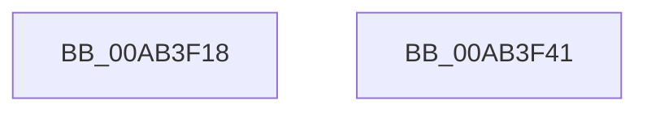

# PsPicoSystemCallDispatch

- RVA: `0x00AB3F18`–`0x00AB3F42` (길이 `42` bytes)
- VA: `0x0000000140AB3F18`
- 실행 섹션: `PAGE`
- PDB 이름 있음: `예`; PDB Function 태그: `아니요`
- unwind 정보 RVA: `0x0005CF00`
- 디코드: `12`개 명령, `42/42` bytes 표시
- 미해석 바이트: `0` (있으면 어셈블리에 `.byte`로 보존)

> 이 문서는 커널 이미지의 기계어와 PDB 기호를 분석해 생성했습니다. 4번과 5번은 함수 원형과 자료형을 바이너리 사용 방식에서 추정한 C 해석이며 원본 소스 복구 결과는 아닙니다.

## 1. Dependencies

- 직접 호출 지점: **1**; 고유 호출 대상: **1**
- 직접 호출자로 확인된 함수: **2**
- RIP 상대 이미지 참조: **1**

### Outgoing calls
- `0x00AB3F32` → [guard_dispatch_icall](../../text/6B/guard_dispatch_icall_function_006BAAD0.md) (function, `0x006BAAD0`)

### Direct callers
- [PsPicoAltSystemCallDispatch](../../text/5E/PsPicoAltSystemCallDispatch_function_005E4080.md) at `0x005E4084`
- [PsSyscallProviderDispatch](PsSyscallProviderDispatch_function_00AB3D80.md) at `0x00AB3DA8`

### Static image references
- `0x00AB3F1E` → RVA `0x00F06528` (`.data`; read)

## 2. Other-region calls and transfers

- 다른 실행 섹션으로 향하는 call: **1**
  - `0x00AB3F32` → [guard_dispatch_icall](../../text/6B/guard_dispatch_icall_function_006BAAD0.md) (`PAGE` → `.text`)
- 별도 외부 분기/꼬리 이동을 확인하지 못했습니다.

## 3. Assembly (complete function range)

```asm
00AB3F18  40 53                           push rbx
00AB3F1A  48 83 EC 20                     sub rsp, 0x20
00AB3F1E  48 8B 05 03 26 45 00            mov rax, qword ptr [rip + 0x452603]
00AB3F25  48 8B D9                        mov rbx, rcx
00AB3F28  48 89 4C 24 30                  mov qword ptr [rsp + 0x30], rcx
00AB3F2D  48 8D 4C 24 30                  lea rcx, [rsp + 0x30]
00AB3F32  E8 99 6B C0 FF                  call 0x1406baad0
00AB3F37  48 8B 43 30                     mov rax, qword ptr [rbx + 0x30]
00AB3F3B  48 83 C4 20                     add rsp, 0x20
00AB3F3F  5B                              pop rbx
00AB3F40  C3                              ret
00AB3F41  CC                              int3
```

## 4. C-style interpretation (structured pseudocode)

```c
__int64 __fastcall PsPicoSystemCallDispatch(__int64 a1)
{
    __int64 result;
    __int64 v_rsp;
    unsigned __int64 v_stack_p8;

    v_rsp = (v_rsp) - (32);
    v_stack_p8 = a1;
    result = guard_dispatch_icall(v_stack_p8, a2, a3, a4);
    v_rsp = (v_rsp) + (32);
    return *(unsigned __int64 *)(a1 + 48);
}
```

## 5. (Beta) C Style

```c
int64_t PsPicoSystemCallDispatch(void *Arg1)
{
    uint8_t *arg1 = (uint8_t *)Arg1;

    int64_t result;
    int64_t local_rsp;
    uint64_t v_stack_p8;

    local_rsp = (local_rsp) - (32);
    v_stack_p8 = Arg1;
    result = guard_dispatch_icall(v_stack_p8, a2, a3, a4);
    local_rsp = (local_rsp) + (32);
    return *(uint64_t *)(arg1 + 0x30);
}
```

### 관측된 메모리 오프셋

구조체 형식이 확인되지 않은 접근은 인자 기준의 오프셋으로만 기록했습니다.

| 기준 인자 | 오프셋 표현 | 폭 (bit) | 접근 |
|---|---:|---:|---|
| `Arg1` | `+ 0x30` | `64` | `R` |

## 6. Execution-region graph

[열기: 2D/3D 그래프와 함수 탐색 컨트롤 패널](../../../control-panel.html?section=page&rva=0x00AB3F18&view=graph)

- 2D 그래프는 위에서 아래로 흐르고, 3D 그래프는 빈 공간을 드래그해 회전합니다. Shift+드래그는 이동, 휠은 확대·축소, 함수 노드 선택은 대상 보고서 이동입니다.

### Static fallback


