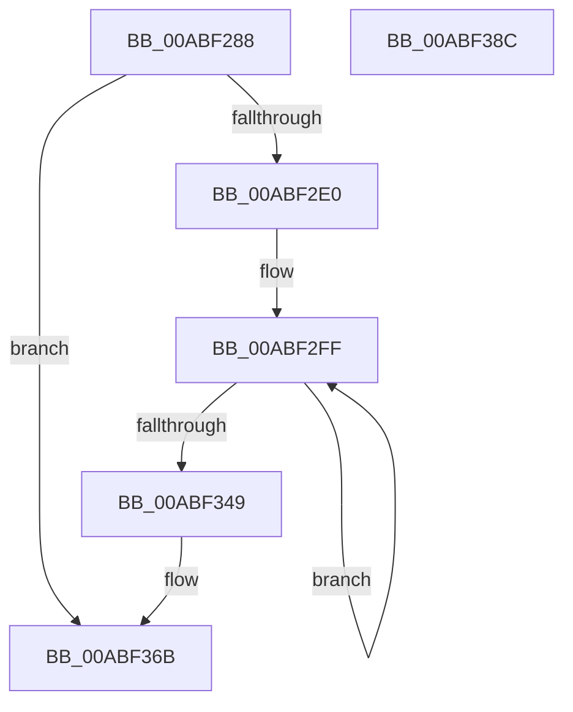

# PsPicoWalkUserStack

- RVA: `0x00ABF288`–`0x00ABF38D` (길이 `261` bytes)
- VA: `0x0000000140ABF288`
- 실행 섹션: `PAGE`
- PDB 이름 있음: `예`; PDB Function 태그: `아니요`
- unwind 정보 RVA: `0x000BD72C`
- 디코드: `61`개 명령, `261/261` bytes 표시
- 미해석 바이트: `0` (있으면 어셈블리에 `.byte`로 보존)

> 이 문서는 커널 이미지의 기계어와 PDB 기호를 분석해 생성했습니다. 4번과 5번은 함수 원형과 자료형을 바이너리 사용 방식에서 추정한 C 해석이며 원본 소스 복구 결과는 아닙니다.

## 1. Dependencies

- 직접 호출 지점: **5**; 고유 호출 대상: **5**
- 직접 호출자로 확인된 함수: **1**
- RIP 상대 이미지 참조: **2**

### Outgoing calls
- `0x00ABF2B9` → [memset](../../text/6C/memset_function_006C6C40.md) (function, `0x006C6C40`)
- `0x00ABF2C9` → [PsGetBaseTrapFrame](../../text/44/PsGetBaseTrapFrame_function_004484B0.md) (function, `0x004484B0`)
- `0x00ABF34F` → [KeLeaveGuardedRegion](../../text/2E/KeLeaveGuardedRegion_function_002E2C40.md) (function, `0x002E2C40`)
- `0x00ABF366` → [guard_dispatch_icall](../../text/6B/guard_dispatch_icall_function_006BAAD0.md) (function, `0x006BAAD0`)
- `0x00ABF376` → [_security_check_cookie](../../text/6A/_security_check_cookie_function_006AC640.md) (function, `0x006AC640`)

### Direct callers
- [sub_002F92A3](../../text/2F/Unknown_function_002F92A3.md) at `0x002F92B4`

### Static image references
- `0x00ABF295` → RVA `0x00E0A740` (`.data`; read)
- `0x00ABF2D3` → RVA `0x00F06550` (`.data`; read)

## 2. Other-region calls and transfers

- 다른 실행 섹션으로 향하는 call: **5**
  - `0x00ABF2B9` → [memset](../../text/6C/memset_function_006C6C40.md) (`PAGE` → `.text`)
  - `0x00ABF2C9` → [PsGetBaseTrapFrame](../../text/44/PsGetBaseTrapFrame_function_004484B0.md) (`PAGE` → `.text`)
  - `0x00ABF34F` → [KeLeaveGuardedRegion](../../text/2E/KeLeaveGuardedRegion_function_002E2C40.md) (`PAGE` → `.text`)
  - `0x00ABF366` → [guard_dispatch_icall](../../text/6B/guard_dispatch_icall_function_006BAAD0.md) (`PAGE` → `.text`)
  - `0x00ABF376` → [_security_check_cookie](../../text/6A/_security_check_cookie_function_006AC640.md) (`PAGE` → `.text`)
- 별도 외부 분기/꼬리 이동을 확인하지 못했습니다.

## 3. Assembly (complete function range)

```asm
00ABF288  48 89 5C 24 18                  mov qword ptr [rsp + 0x18], rbx
00ABF28D  57                              push rdi
00ABF28E  48 81 EC C0 01 00 00            sub rsp, 0x1c0
00ABF295  48 8B 05 A4 B4 34 00            mov rax, qword ptr [rip + 0x34b4a4]
00ABF29C  48 33 C4                        xor rax, rsp
00ABF29F  48 89 84 24 B0 01 00 00         mov qword ptr [rsp + 0x1b0], rax
00ABF2A7  8B FA                           mov edi, edx
00ABF2A9  48 8B D9                        mov rbx, rcx
00ABF2AC  33 D2                           xor edx, edx
00ABF2AE  48 8D 4C 24 20                  lea rcx, [rsp + 0x20]
00ABF2B3  41 B8 90 01 00 00               mov r8d, 0x190
00ABF2B9  E8 82 79 C0 FF                  call 0x1406c6c40
00ABF2BE  65 48 8B 0C 25 88 01 00 00      mov rcx, qword ptr gs:[0x188]
00ABF2C7  33 D2                           xor edx, edx
00ABF2C9  E8 E2 91 98 FF                  call 0x1404484b0
00ABF2CE  48 8B C8                        mov rcx, rax
00ABF2D1  33 C0                           xor eax, eax
00ABF2D3  48 39 05 76 72 44 00            cmp qword ptr [rip + 0x447276], rax
00ABF2DA  0F 84 8B 00 00 00               je 0x140abf36b
00ABF2E0  65 48 8B 04 25 88 01 00 00      mov rax, qword ptr gs:[0x188]
00ABF2E9  BA 80 00 00 00                  mov edx, 0x80
00ABF2EE  66 FF 88 E6 01 00 00            dec word ptr [rax + 0x1e6]
00ABF2F5  44 8D 4A 83                     lea r9d, [rdx - 0x7d]
00ABF2F9  90                              nop
00ABF2FA  48 8D 44 24 20                  lea rax, [rsp + 0x20]
00ABF2FF  0F 10 01                        movups xmm0, xmmword ptr [rcx]
00ABF302  0F 11 00                        movups xmmword ptr [rax], xmm0
00ABF305  0F 10 49 10                     movups xmm1, xmmword ptr [rcx + 0x10]
00ABF309  0F 11 48 10                     movups xmmword ptr [rax + 0x10], xmm1
00ABF30D  0F 10 41 20                     movups xmm0, xmmword ptr [rcx + 0x20]
00ABF311  0F 11 40 20                     movups xmmword ptr [rax + 0x20], xmm0
00ABF315  0F 10 49 30                     movups xmm1, xmmword ptr [rcx + 0x30]
00ABF319  0F 11 48 30                     movups xmmword ptr [rax + 0x30], xmm1
00ABF31D  0F 10 41 40                     movups xmm0, xmmword ptr [rcx + 0x40]
00ABF321  0F 11 40 40                     movups xmmword ptr [rax + 0x40], xmm0
00ABF325  0F 10 49 50                     movups xmm1, xmmword ptr [rcx + 0x50]
00ABF329  0F 11 48 50                     movups xmmword ptr [rax + 0x50], xmm1
00ABF32D  0F 10 41 60                     movups xmm0, xmmword ptr [rcx + 0x60]
00ABF331  0F 11 40 60                     movups xmmword ptr [rax + 0x60], xmm0
00ABF335  48 03 C2                        add rax, rdx
00ABF338  0F 10 49 70                     movups xmm1, xmmword ptr [rcx + 0x70]
00ABF33C  48 03 CA                        add rcx, rdx
00ABF33F  0F 11 48 F0                     movups xmmword ptr [rax - 0x10], xmm1
00ABF343  49 83 E9 01                     sub r9, 1
00ABF347  75 B6                           jne 0x140abf2ff
00ABF349  0F 10 01                        movups xmm0, xmmword ptr [rcx]
00ABF34C  0F 11 00                        movups xmmword ptr [rax], xmm0
00ABF34F  E8 EC 38 82 FF                  call 0x1402e2c40
00ABF354  48 8B 05 F5 71 44 00            mov rax, qword ptr [rip + 0x4471f5]
00ABF35B  48 8D 4C 24 20                  lea rcx, [rsp + 0x20]
00ABF360  44 8B C7                        mov r8d, edi
00ABF363  48 8B D3                        mov rdx, rbx
00ABF366  E8 65 B7 BF FF                  call 0x1406baad0
00ABF36B  48 8B 8C 24 B0 01 00 00         mov rcx, qword ptr [rsp + 0x1b0]
00ABF373  48 33 CC                        xor rcx, rsp
00ABF376  E8 C5 D2 BE FF                  call 0x1406ac640
00ABF37B  48 8B 9C 24 E0 01 00 00         mov rbx, qword ptr [rsp + 0x1e0]
00ABF383  48 81 C4 C0 01 00 00            add rsp, 0x1c0
00ABF38A  5F                              pop rdi
00ABF38B  C3                              ret
00ABF38C  CC                              int3
```

## 4. C-style interpretation (structured pseudocode)

```c
__int64 __fastcall PsPicoWalkUserStack(__int64 a1, int a2)
{
    __int64 result;
    __int64 v_rsp;
    unsigned __int64 v_stack_m18;
    unsigned __int64 v_stack_m1A8;
    unsigned __int64 v_stack_p18;

    v_stack_p18 = v_rbx;
    v_rsp = (v_rsp) - (448);
    result = (*(unsigned __int64 *)(v_rip + 3454116)) ^ (v_rsp);
    v_stack_m18 = result;
    a2 = 0;
    result = memset(v_stack_m1A8, a2, 400, a4);
    a2 = 0;
    result = PsGetBaseTrapFrame(*(unsigned __int64 *)(gs_base + (0 + 392)), a2, 400, a4);
    result = 0;
    if ((*(unsigned __int64 *)(v_rip + 4485750)) == 0) goto loc_00ABF36B;
loc_00ABF2FF:
    *(unsigned __int64 *)(v_stack_m1A8) = v_xmm0;
    *(unsigned __int64 *)(v_stack_m1A8 + 16) = v_xmm1;
    *(unsigned __int64 *)(v_stack_m1A8 + 32) = v_xmm0;
    *(unsigned __int64 *)(v_stack_m1A8 + 48) = v_xmm1;
    *(unsigned __int64 *)(v_stack_m1A8 + 64) = v_xmm0;
    *(unsigned __int64 *)(v_stack_m1A8 + 80) = v_xmm1;
    *(unsigned __int64 *)(v_stack_m1A8 + 96) = v_xmm0;
    result = (v_stack_m1A8) + (128);
    a1 = (result) + (128);
    *(unsigned __int64 *)(result - 16) = v_xmm1;
    a4 = (128 - 125) - (1);
    if (condition_is_not_equal) goto loc_00ABF2FF;
    *(unsigned __int64 *)(result) = v_xmm0;
    result = KeLeaveGuardedRegion(a1, 128, 400, a4);
    result = guard_dispatch_icall(v_stack_m1A8, a1, (unsigned int)((unsigned int)((unsigned int)(a2))), a4);
loc_00ABF36B:
    a1 = (v_stack_m18) ^ (v_rsp);
    result = _security_check_cookie(a1, a1, (unsigned int)((unsigned int)((unsigned int)(a2))), a4);
    v_rsp = (v_rsp) + (448);
    return result;
}
```

## 5. (Beta) C Style

```c
int64_t PsPicoWalkUserStack(int64_t Arg1, int32_t Arg2)
{
    int64_t result;
    int64_t local_rsp;
    uint64_t v_stack_m18;
    uint64_t v_stack_m1A8;
    uint64_t v_stack_p18;

    v_stack_p18 = local_rbx;
    local_rsp = (local_rsp) - (448);
    result = (*(uint64_t *)(v_rip + 0x34B4A4)) ^ (local_rsp);
    v_stack_m18 = result;
    Arg2 = 0;
    result = memset(v_stack_m1A8, Arg2, 400, a4);
    Arg2 = 0;
    result = PsGetBaseTrapFrame(*(uint64_t *)(gs_base + (0 + 0x188)), Arg2, 400, a4);
    result = 0;
    if ((*(uint64_t *)(v_rip + 0x447276)) == 0) goto loc_00ABF36B;
loc_00ABF2FF:
    *(uint64_t *)(v_stack_m1A8) = v_xmm0;
    *(uint64_t *)(v_stack_m1A8 + 0x10) = v_xmm1;
    *(uint64_t *)(v_stack_m1A8 + 0x20) = v_xmm0;
    *(uint64_t *)(v_stack_m1A8 + 0x30) = v_xmm1;
    *(uint64_t *)(v_stack_m1A8 + 0x40) = v_xmm0;
    *(uint64_t *)(v_stack_m1A8 + 0x50) = v_xmm1;
    *(uint64_t *)(v_stack_m1A8 + 0x60) = v_xmm0;
    result = (v_stack_m1A8) + (128);
    Arg1 = (result) + (128);
    *(uint64_t *)(result - 0x10) = v_xmm1;
    a4 = (128 - 125) - (1);
    if (condition_is_not_equal) goto loc_00ABF2FF;
    *(uint64_t *)(result) = v_xmm0;
    result = KeLeaveGuardedRegion(Arg1, 128, 400, a4);
    result = guard_dispatch_icall(v_stack_m1A8, Arg1, (uint32_t)((uint32_t)((uint32_t)(Arg2))), a4);
loc_00ABF36B:
    Arg1 = (v_stack_m18) ^ (local_rsp);
    result = _security_check_cookie(Arg1, Arg1, (uint32_t)((uint32_t)((uint32_t)(Arg2))), a4);
    local_rsp = (local_rsp) + (448);
    return result;
}
```

## 6. Execution-region graph

[열기: 2D/3D 그래프와 함수 탐색 컨트롤 패널](../../../control-panel.html?section=page&rva=0x00ABF288&view=graph)

- 2D 그래프는 위에서 아래로 흐르고, 3D 그래프는 빈 공간을 드래그해 회전합니다. Shift+드래그는 이동, 휠은 확대·축소, 함수 노드 선택은 대상 보고서 이동입니다.

### Static fallback


