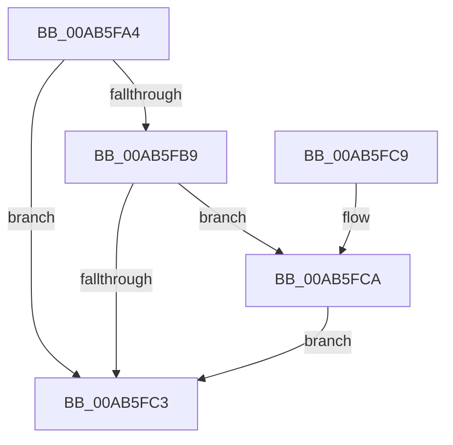

# PsRemoveDeepFreezeOptimizations

- RVA: `0x00AB5FA4`–`0x00AB5FFC` (길이 `88` bytes)
- VA: `0x0000000140AB5FA4`
- 실행 섹션: `PAGE`
- PDB 이름 있음: `예`; PDB Function 태그: `아니요`
- unwind 정보 RVA: `0x000BCDD8`
- 디코드: `25`개 명령, `88/88` bytes 표시
- 미해석 바이트: `0` (있으면 어셈블리에 `.byte`로 보존)

> 이 문서는 커널 이미지의 기계어와 PDB 기호를 분석해 생성했습니다. 4번과 5번은 함수 원형과 자료형을 바이너리 사용 방식에서 추정한 C 해석이며 원본 소스 복구 결과는 아닙니다.

## 1. Dependencies

- 직접 호출 지점: **2**; 고유 호출 대상: **2**
- 직접 호출자로 확인된 함수: **2**
- RIP 상대 이미지 참조: **0**

### Outgoing calls
- `0x00AB5FCA` → [PsGetProcessSessionIdEx](../../text/22/PsGetProcessSessionIdEx_function_0022F8F0.md) (function, `0x0022F8F0`)
- `0x00AB5FF5` → [PsInvokeWin32Callout](../91/PsInvokeWin32Callout_function_009133C0.md) (function, `0x009133C0`)

### Direct callers
- [PspChangeProcessExecutionStateLegacy](../../text/5E/PspChangeProcessExecutionStateLegacy_function_005E4098.md) at `0x005E4196`
- [PspChangeProcessExecutionState](../AE/PspChangeProcessExecutionState_function_00AEC594.md) at `0x00AEC69A`

### Static image references
- 디코드된 RIP-relative 메모리 참조가 없습니다.

## 2. Other-region calls and transfers

- 다른 실행 섹션으로 향하는 call: **1**
  - `0x00AB5FCA` → [PsGetProcessSessionIdEx](../../text/22/PsGetProcessSessionIdEx_function_0022F8F0.md) (`PAGE` → `.text`)
- 별도 외부 분기/꼬리 이동을 확인하지 못했습니다.

## 3. Assembly (complete function range)

```asm
00AB5FA4  40 53                           push rbx
00AB5FA6  48 83 EC 40                     sub rsp, 0x40
00AB5FAA  33 C0                           xor eax, eax
00AB5FAC  48 8B D9                        mov rbx, rcx
00AB5FAF  89 44 24 24                     mov dword ptr [rsp + 0x24], eax
00AB5FB3  8B 02                           mov eax, dword ptr [rdx]
00AB5FB5  A8 01                           test al, 1
00AB5FB7  74 0A                           je 0x140ab5fc3
00AB5FB9  48 83 B9 98 02 00 00 00         cmp qword ptr [rcx + 0x298], 0
00AB5FC1  75 07                           jne 0x140ab5fca
00AB5FC3  48 83 C4 40                     add rsp, 0x40
00AB5FC7  5B                              pop rbx
00AB5FC8  C3                              ret
00AB5FC9  CC                              int3
00AB5FCA  E8 21 99 77 FF                  call 0x14022f8f0
00AB5FCF  48 83 64 24 20 00               and qword ptr [rsp + 0x20], 0
00AB5FD5  4C 8D 4C 24 58                  lea r9, [rsp + 0x58]
00AB5FDA  48 83 64 24 28 00               and qword ptr [rsp + 0x28], 0
00AB5FE0  48 8D 54 24 20                  lea rdx, [rsp + 0x20]
00AB5FE5  45 33 C0                        xor r8d, r8d
00AB5FE8  89 44 24 58                     mov dword ptr [rsp + 0x58], eax
00AB5FEC  48 89 5C 24 30                  mov qword ptr [rsp + 0x30], rbx
00AB5FF1  41 8D 48 2C                     lea ecx, [r8 + 0x2c]
00AB5FF5  E8 C6 D3 E5 FF                  call 0x1409133c0
00AB5FFA  EB C7                           jmp 0x140ab5fc3
```

## 4. C-style interpretation (structured pseudocode)

```c
__int64 __fastcall PsRemoveDeepFreezeOptimizations(__int64 a1, __int64 a2, int a3)
{
    __int64 result;
    __int64 v_rsp;
    unsigned int v_stack_m24;
    unsigned __int64 v_stack_p20;
    unsigned __int64 v_stack_p28;
    unsigned __int64 v_stack_p30;
    unsigned __int64 v_stack_p58;

    v_rsp = (v_rsp) - (64);
    result = 0;
    v_stack_m24 = 0;
    if ((((unsigned __int8)((unsigned int)(*(unsigned int *)(a2)))) & (1)) == 0) goto loc_00AB5FC3;
    if ((*(unsigned __int64 *)(a1 + 664)) != 0) goto loc_00AB5FCA;
loc_00AB5FC3:
    v_rsp = (v_rsp) + (64);
    return (unsigned int)(*(unsigned int *)(a2));
loc_00AB5FCA:
    result = PsGetProcessSessionIdEx(a1, a2, a3, a4);
    a3 = 0;
    v_stack_p58 = (unsigned int)(result);
    v_stack_p30 = a1;
    result = PsInvokeWin32Callout(a3 + 44, v_stack_p20, a3, v_stack_p58);
    goto loc_00AB5FC3;
}
```

## 5. (Beta) C Style

```c
int64_t PsRemoveDeepFreezeOptimizations(void *Arg1, void *Arg2, int32_t Arg3)
{
    uint8_t *arg1 = (uint8_t *)Arg1;
    uint8_t *arg2 = (uint8_t *)Arg2;

    int64_t result;
    int64_t local_rsp;
    uint32_t v_stack_m24;
    uint64_t v_stack_p20;
    uint64_t v_stack_p28;
    uint64_t v_stack_p30;
    uint64_t v_stack_p58;

    local_rsp = (local_rsp) - (64);
    result = 0;
    v_stack_m24 = 0;
    if ((((uint8_t)((uint32_t)(*(uint32_t *)(arg2)))) & (1)) == 0) goto loc_00AB5FC3;
    if ((*(uint64_t *)(arg1 + 0x298)) != 0) goto loc_00AB5FCA;
loc_00AB5FC3:
    local_rsp = (local_rsp) + (64);
    return (uint32_t)(*(uint32_t *)(arg2));
loc_00AB5FCA:
    result = PsGetProcessSessionIdEx(Arg1, Arg2, Arg3, a4);
    Arg3 = 0;
    v_stack_p58 = (uint32_t)(result);
    v_stack_p30 = Arg1;
    result = PsInvokeWin32Callout(Arg3 + 44, v_stack_p20, Arg3, v_stack_p58);
    goto loc_00AB5FC3;
}
```

### 관측된 메모리 오프셋

구조체 형식이 확인되지 않은 접근은 인자 기준의 오프셋으로만 기록했습니다.

| 기준 인자 | 오프셋 표현 | 폭 (bit) | 접근 |
|---|---:|---:|---|
| `Arg1` | `+ 0x298` | `64` | `R` |
| `Arg2` | `+ 0x0` | `32` | `R` |

## 6. Execution-region graph

[열기: 2D/3D 그래프와 함수 탐색 컨트롤 패널](../../../control-panel.html?section=page&rva=0x00AB5FA4&view=graph)

- 2D 그래프는 위에서 아래로 흐르고, 3D 그래프는 빈 공간을 드래그해 회전합니다. Shift+드래그는 이동, 휠은 확대·축소, 함수 노드 선택은 대상 보고서 이동입니다.

### Static fallback


