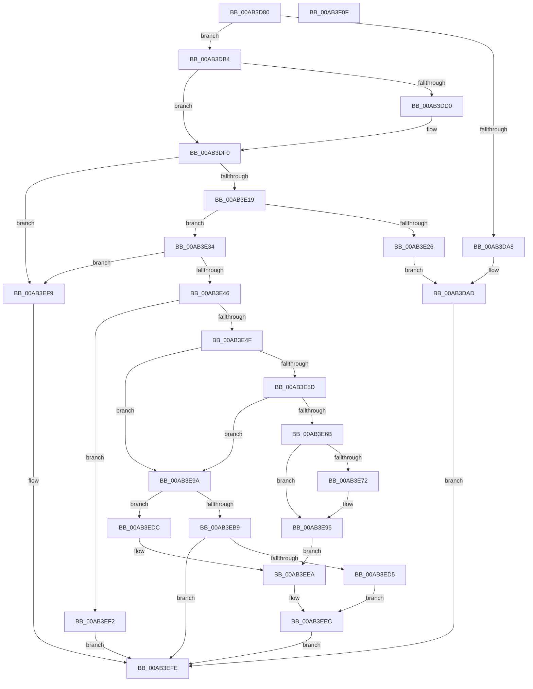

# PsSyscallProviderDispatch

- RVA: `0x00AB3D80`–`0x00AB3F10` (길이 `400` bytes)
- VA: `0x0000000140AB3D80`
- 실행 섹션: `PAGE`
- PDB 이름 있음: `예`; PDB Function 태그: `아니요`
- unwind 정보 RVA: `0x000BCB98`
- 디코드: `112`개 명령, `400/400` bytes 표시
- 미해석 바이트: `0` (있으면 어셈블리에 `.byte`로 보존)

> 이 문서는 커널 이미지의 기계어와 PDB 기호를 분석해 생성했습니다. 4번과 5번은 함수 원형과 자료형을 바이너리 사용 방식에서 추정한 C 해석이며 원본 소스 복구 결과는 아닙니다.

## 1. Dependencies

- 직접 호출 지점: **6**; 고유 호출 대상: **6**
- 직접 호출자로 확인된 함수: **1**
- RIP 상대 이미지 참조: **3**

### Outgoing calls
- `0x00AB3DA8` → [PsPicoSystemCallDispatch](PsPicoSystemCallDispatch_function_00AB3F18.md) (function, `0x00AB3F18`)
- `0x00AB3DB7` → [IoThreadToProcess](../../text/44/IoThreadToProcess_function_00448540.md) (function, `0x00448540`)
- `0x00AB3DEA` → [KeBugCheckEx](../../text/4F/KeBugCheckEx_function_004FD660.md) (function, `0x004FD660`)
- `0x00AB3E60` → [PspEnsureGuiThreadAndBatchFlush](../77/PspEnsureGuiThreadAndBatchFlush_function_0077E528.md) (function, `0x0077E528`)
- `0x00AB3ECC` → [PspSyscallProviderServiceDispatchGeneric](../77/PspSyscallProviderServiceDispatchGeneric_function_0077E914.md) (function, `0x0077E914`)
- `0x00AB3EE2` → [PspSyscallProviderServiceDispatch](../../text/6B/PspSyscallProviderServiceDispatch_function_006BA3F0.md) (function, `0x006BA3F0`)

### Direct callers
- [KiSystemCall64](../../text/6C/KiSystemCall64_function_006C4A40.md) at `0x006C4D66`

### Static image references
- `0x00AB3DF7` → RVA `0x01201D30` (`CFGRO`; read)
- `0x00AB3E72` → RVA `0x00FC72B0` (`ALMOSTRO`; read)
- `0x00AB3E81` → RVA `0x00FC72A0` (`ALMOSTRO`; read)

## 2. Other-region calls and transfers

- 다른 실행 섹션으로 향하는 call: **3**
  - `0x00AB3DB7` → [IoThreadToProcess](../../text/44/IoThreadToProcess_function_00448540.md) (`PAGE` → `.text`)
  - `0x00AB3DEA` → [KeBugCheckEx](../../text/4F/KeBugCheckEx_function_004FD660.md) (`PAGE` → `.text`)
  - `0x00AB3EE2` → [PspSyscallProviderServiceDispatch](../../text/6B/PspSyscallProviderServiceDispatch_function_006BA3F0.md) (`PAGE` → `.text`)
- 별도 외부 분기/꼬리 이동을 확인하지 못했습니다.

## 3. Assembly (complete function range)

```asm
00AB3D80  48 89 5C 24 08                  mov qword ptr [rsp + 8], rbx
00AB3D85  55                              push rbp
00AB3D86  56                              push rsi
00AB3D87  57                              push rdi
00AB3D88  41 56                           push r14
00AB3D8A  41 57                           push r15
00AB3D8C  48 83 EC 30                     sub rsp, 0x30
00AB3D90  48 83 64 24 70 00               and qword ptr [rsp + 0x70], 0
00AB3D96  48 8B F1                        mov rsi, rcx
00AB3D99  65 48 8B 2C 25 88 01 00 00      mov rbp, qword ptr gs:[0x188]
00AB3DA2  F6 45 03 04                     test byte ptr [rbp + 3], 4
00AB3DA6  74 0C                           je 0x140ab3db4
00AB3DA8  E8 6B 01 00 00                  call 0x140ab3f18
00AB3DAD  33 C0                           xor eax, eax
00AB3DAF  E9 4A 01 00 00                  jmp 0x140ab3efe
00AB3DB4  48 8B CD                        mov rcx, rbp
00AB3DB7  E8 84 47 99 FF                  call 0x140448540
00AB3DBC  8B 7E 30                        mov edi, dword ptr [rsi + 0x30]
00AB3DBF  81 E7 FF 9F FF FF               and edi, 0xffff9fff
00AB3DC5  8B 88 D4 07 00 00               mov ecx, dword ptr [rax + 0x7d4]
00AB3DCB  83 F9 20                        cmp ecx, 0x20
00AB3DCE  72 20                           jb 0x140ab3df0
00AB3DD0  48 83 64 24 20 00               and qword ptr [rsp + 0x20], 0
00AB3DD6  44 8B C1                        mov r8d, ecx
00AB3DD9  4C 8B 88 B8 07 00 00            mov r9, qword ptr [rax + 0x7b8]
00AB3DE0  B9 E0 01 00 00                  mov ecx, 0x1e0
00AB3DE5  BA 05 00 00 00                  mov edx, 5
00AB3DEA  E8 71 98 A4 FF                  call 0x1404fd660
00AB3DEF  CC                              int3
00AB3DF0  48 8D 04 49                     lea rax, [rcx + rcx*2]
00AB3DF4  44 8B F7                        mov r14d, edi
00AB3DF7  48 8D 0D 32 DF 74 00            lea rcx, [rip + 0x74df32]
00AB3DFE  4C 8D 3C C1                     lea r15, [rcx + rax*8]
00AB3E02  8B C7                           mov eax, edi
00AB3E04  48 C1 E8 0C                     shr rax, 0xc
00AB3E08  83 E0 07                        and eax, 7
00AB3E0B  49 8B 5C C7 08                  mov rbx, qword ptr [r15 + rax*8 + 8]
00AB3E10  48 85 DB                        test rbx, rbx
00AB3E13  0F 84 E0 00 00 00               je 0x140ab3ef9
00AB3E19  8B C7                           mov eax, edi
00AB3E1B  B9 FF 0F 00 00                  mov ecx, 0xfff
00AB3E20  23 C1                           and eax, ecx
00AB3E22  3B 03                           cmp eax, dword ptr [rbx]
00AB3E24  72 0E                           jb 0x140ab3e34
00AB3E26  B8 1C 00 00 C0                  mov eax, 0xc000001c
00AB3E2B  48 89 46 30                     mov qword ptr [rsi + 0x30], rax
00AB3E2F  E9 79 FF FF FF                  jmp 0x140ab3dad
00AB3E34  4C 23 F1                        and r14, rcx
00AB3E37  42 8B 5C B3 04                  mov ebx, dword ptr [rbx + r14*4 + 4]
00AB3E3C  8B C3                           mov eax, ebx
00AB3E3E  85 DB                           test ebx, ebx
00AB3E40  0F 84 B3 00 00 00               je 0x140ab3ef9
00AB3E46  83 F8 01                        cmp eax, 1
00AB3E49  0F 84 A3 00 00 00               je 0x140ab3ef2
00AB3E4F  8B C7                           mov eax, edi
00AB3E51  25 00 70 00 00                  and eax, 0x7000
00AB3E56  3D 00 10 00 00                  cmp eax, 0x1000
00AB3E5B  75 3D                           jne 0x140ab3e9a
00AB3E5D  48 8B CD                        mov rcx, rbp
00AB3E60  E8 C3 A6 CC FF                  call 0x14077e528
00AB3E65  8B C8                           mov ecx, eax
00AB3E67  85 C0                           test eax, eax
00AB3E69  79 2F                           jns 0x140ab3e9a
00AB3E6B  3D 01 00 00 C0                  cmp eax, 0xc0000001
00AB3E70  75 24                           jne 0x140ab3e96
00AB3E72  8B 05 38 34 51 00               mov eax, dword ptr [rip + 0x513438]
00AB3E78  BA 1C 00 00 C0                  mov edx, 0xc000001c
00AB3E7D  49 8D 0C 86                     lea rcx, [r14 + rax*4]
00AB3E81  48 8B 05 18 34 51 00            mov rax, qword ptr [rip + 0x513418]
00AB3E88  0F BE 0C 01                     movsx ecx, byte ptr [rcx + rax]
00AB3E8C  B8 01 00 00 00                  mov eax, 1
00AB3E91  3B C8                           cmp ecx, eax
00AB3E93  0F 44 CA                        cmove ecx, edx
00AB3E96  8B D1                           mov edx, ecx
00AB3E98  EB 50                           jmp 0x140ab3eea
00AB3E9A  48 8B D3                        mov rdx, rbx
00AB3E9D  48 B8 F0 FF FF FF FF FF FF 0F   movabs rax, 0xffffffffffffff0
00AB3EA7  48 C1 EA 04                     shr rdx, 4
00AB3EAB  48 8B CE                        mov rcx, rsi
00AB3EAE  48 23 D0                        and rdx, rax
00AB3EB1  49 03 17                        add rdx, qword ptr [r15]
00AB3EB4  F6 C3 10                        test bl, 0x10
00AB3EB7  74 23                           je 0x140ab3edc
00AB3EB9  48 8D 44 24 70                  lea rax, [rsp + 0x70]
00AB3EBE  80 E3 0F                        and bl, 0xf
00AB3EC1  44 8A C3                        mov r8b, bl
00AB3EC4  48 89 44 24 20                  mov qword ptr [rsp + 0x20], rax
00AB3EC9  44 8B CF                        mov r9d, edi
00AB3ECC  E8 43 AA CC FF                  call 0x14077e914
00AB3ED1  85 C0                           test eax, eax
00AB3ED3  75 29                           jne 0x140ab3efe
00AB3ED5  48 8B 54 24 70                  mov rdx, qword ptr [rsp + 0x70]
00AB3EDA  EB 10                           jmp 0x140ab3eec
00AB3EDC  80 E3 0F                        and bl, 0xf
00AB3EDF  44 8A C3                        mov r8b, bl
00AB3EE2  E8 09 65 C0 FF                  call 0x1406ba3f0
00AB3EE7  48 8B D0                        mov rdx, rax
00AB3EEA  33 C0                           xor eax, eax
00AB3EEC  48 89 56 30                     mov qword ptr [rsi + 0x30], rdx
00AB3EF0  EB 0C                           jmp 0x140ab3efe
00AB3EF2  B8 02 00 00 00                  mov eax, 2
00AB3EF7  EB 05                           jmp 0x140ab3efe
00AB3EF9  B8 01 00 00 00                  mov eax, 1
00AB3EFE  48 8B 5C 24 60                  mov rbx, qword ptr [rsp + 0x60]
00AB3F03  48 83 C4 30                     add rsp, 0x30
00AB3F07  41 5F                           pop r15
00AB3F09  41 5E                           pop r14
00AB3F0B  5F                              pop rdi
00AB3F0C  5E                              pop rsi
00AB3F0D  5D                              pop rbp
00AB3F0E  C3                              ret
00AB3F0F  CC                              int3
```

## 4. C-style interpretation (structured pseudocode)

```c
__int64 __fastcall PsSyscallProviderDispatch(__int64 a1)
{
    __int64 result;
    __int64 v_r14;
    __int64 v_rbx;
    __int64 v_rdi;
    __int64 v_rsp;
    unsigned __int64 v_stack_m38;
    unsigned __int64 v_stack_p18;
    unsigned __int64 v_stack_p8;

    v_stack_p8 = v_rbx;
    v_rsp = (v_rsp) - (48);
    if (((*(unsigned __int8 *)(*(unsigned __int64 *)(gs_base + (0 + 392)) + 3)) & (4)) == 0) goto loc_00AB3DB4;
    result = PsPicoSystemCallDispatch(a1, a2, a3, a4);
loc_00AB3DAD:
    result = 0;
    goto loc_00AB3EFE;
loc_00AB3DB4:
    result = IoThreadToProcess(*(unsigned __int64 *)(gs_base + (0 + 392)), a2, a3, a4);
    v_rdi = (unsigned int)(((unsigned int)(*(unsigned int *)(a1 + 48))) & (0xFFFF9FFFULL));
    if (((unsigned int)((unsigned int)(*(unsigned int *)(result + 2004)))) >= 32) {
        a3 = (unsigned int)((unsigned int)(*(unsigned int *)(result + 2004)));
        a4 = *(unsigned __int64 *)(result + 1976);
        a1 = 480;
        a2 = 5;
        result = KeBugCheckEx(a1, a2, a3, a4);
    }
    result = ((unsigned int)((unsigned int)(v_rdi))) >> (12);
    result = (unsigned int)((result) & (7));
    if (*(unsigned __int64 *)(v_rip + 7659314 + a1 + a1 * 2 * 8 + result * 8 + 8) == 0) goto loc_00AB3EF9;
    result = (unsigned int)(((unsigned int)((unsigned int)(v_rdi))) & ((unsigned int)((unsigned int)(0xFFFULL))));
    if (((unsigned int)(result)) < (*(unsigned int *)(*(unsigned __int64 *)(v_rip + 7659314 + a1 + a1 * 2 * 8 + result * 8 + 8)))) goto loc_00AB3E34;
    *(unsigned __int64 *)(a1 + 48) = (unsigned int)(0xC000001CULL);
    goto loc_00AB3DAD;
loc_00AB3E34:
    v_r14 = ((unsigned int)((unsigned int)(v_rdi))) & ((unsigned int)(0xFFFULL));
    if ((unsigned int)((unsigned int)(*(unsigned int *)(*(unsigned __int64 *)(v_rip + 7659314 + a1 + a1 * 2 * 8 + result * 8 + 8) + v_r14 * 4 + 4))) == 0) goto loc_00AB3EF9;
    if (((unsigned int)((unsigned int)((unsigned int)((unsigned int)(*(unsigned int *)(*(unsigned __int64 *)(v_rip + 7659314 + a1 + a1 * 2 * 8 + result * 8 + 8) + v_r14 * 4 + 4)))))) == 1) goto loc_00AB3EF2;
    result = (unsigned int)(((unsigned int)((unsigned int)(v_rdi))) & (0x7000ULL));
    if (((unsigned int)(result)) != 0x1000ULL) goto loc_00AB3E9A;
    result = PspEnsureGuiThreadAndBatchFlush(*(unsigned __int64 *)(gs_base + (0 + 392)), a2, a3, a4);
    if (!sign_flag) goto loc_00AB3E9A;
    if (((unsigned int)(result)) == 0xC0000001ULL) {
        result = *(unsigned int *)(v_rip + 5321784);
        a2 = 0xC000001CULL;
        a1 = v_r14 + result * 4;
        result = *(unsigned __int64 *)(v_rip + 5321752);
        a1 = (__int8)(*(unsigned __int8 *)(a1 + result * 1));
        result = 1;
        if (((unsigned int)(a1)) == ((unsigned int)(result))) { a1 = (unsigned int)(a2); }
    }
    goto loc_00AB3EEA;
loc_00AB3E9A:
    a2 = ((unsigned int)(*(unsigned int *)(*(unsigned __int64 *)(v_rip + 7659314 + a1 + a1 * 2 * 8 + result * 8 + 8) + v_r14 * 4 + 4))) >> (4);
    a2 = (a2) & (result);
    a2 = (a2) + (*(unsigned __int64 *)(v_rip + 7659314 + a1 + a1 * 2 * 8));
    if ((((unsigned __int8)((unsigned int)(*(unsigned int *)(*(unsigned __int64 *)(v_rip + 7659314 + a1 + a1 * 2 * 8 + result * 8 + 8) + v_r14 * 4 + 4)))) & (16)) == 0) goto loc_00AB3EDC;
    v_rbx = (unsigned __int8)(((unsigned int)(*(unsigned int *)(*(unsigned __int64 *)(v_rip + 7659314 + a1 + a1 * 2 * 8 + result * 8 + 8) + v_r14 * 4 + 4))) & (15));
    v_stack_m38 = v_stack_p18;
    result = PspSyscallProviderServiceDispatchGeneric(a1, a2, (unsigned __int8)(v_rbx), (unsigned int)((unsigned int)(v_rdi)));
    if ((unsigned int)(result) != 0) goto loc_00AB3EFE;
    goto loc_00AB3EEC;
loc_00AB3EDC:
    v_rbx = (unsigned __int8)((v_rbx) & (15));
    result = PspSyscallProviderServiceDispatch(a1, v_stack_p18, (unsigned __int8)(v_rbx), (unsigned int)((unsigned int)(v_rdi)));
loc_00AB3EEA:
    result = 0;
loc_00AB3EEC:
    *(unsigned __int64 *)(a1 + 48) = 0;
    goto loc_00AB3EFE;
loc_00AB3EF2:
    goto loc_00AB3EFE;
loc_00AB3EF9:
loc_00AB3EFE:
    v_rsp = (v_rsp) + (48);
    return 1;
}
```

## 5. (Beta) C Style

```c
int64_t PsSyscallProviderDispatch(void *Arg1)
{
    uint8_t *arg1 = (uint8_t *)Arg1;

    int64_t result;
    int64_t local_r14;
    int64_t local_rbx;
    int64_t local_rdi;
    int64_t local_rsp;
    uint64_t v_stack_m38;
    uint64_t v_stack_p18;
    uint64_t v_stack_p8;

    v_stack_p8 = local_rbx;
    local_rsp = (local_rsp) - (48);
    if (((*(uint8_t *)(*(uint64_t *)(gs_base + (0 + 0x188)) + 0x3)) & (4)) == 0) goto loc_00AB3DB4;
    result = PsPicoSystemCallDispatch(Arg1, a2, a3, a4);
loc_00AB3DAD:
    result = 0;
    goto loc_00AB3EFE;
loc_00AB3DB4:
    result = IoThreadToProcess(*(uint64_t *)(gs_base + (0 + 0x188)), a2, a3, a4);
    local_rdi = (uint32_t)(((uint32_t)(*(uint32_t *)(arg1 + 0x30))) & (0xFFFF9FFFULL));
    if (((uint32_t)((uint32_t)(*(uint32_t *)(result + 0x7D4)))) >= 32) {
        a3 = (uint32_t)((uint32_t)(*(uint32_t *)(result + 0x7D4)));
        a4 = *(uint64_t *)(result + 0x7B8);
        Arg1 = 480;
        a2 = 5;
        result = KeBugCheckEx(Arg1, a2, a3, a4);
    }
    result = ((uint32_t)((uint32_t)(local_rdi))) >> (12);
    result = (uint32_t)((result) & (7));
    if (*(uint64_t *)(v_rip + 0x74DF32 + arg1 + arg1 * 2 * 8 + result * 8 + 0x8) == 0) goto loc_00AB3EF9;
    result = (uint32_t)(((uint32_t)((uint32_t)(local_rdi))) & ((uint32_t)((uint32_t)(0xFFFULL))));
    if (((uint32_t)(result)) < (*(uint32_t *)(*(uint64_t *)(v_rip + 0x74DF32 + arg1 + arg1 * 2 * 8 + result * 8 + 0x8)))) goto loc_00AB3E34;
    *(uint64_t *)(arg1 + 0x30) = (uint32_t)(0xC000001CULL);
    goto loc_00AB3DAD;
loc_00AB3E34:
    local_r14 = ((uint32_t)((uint32_t)(local_rdi))) & ((uint32_t)(0xFFFULL));
    if ((uint32_t)((uint32_t)(*(uint32_t *)(*(uint64_t *)(v_rip + 0x74DF32 + arg1 + arg1 * 2 * 8 + result * 8 + 0x8) + local_r14 * 4 + 0x4))) == 0) goto loc_00AB3EF9;
    if (((uint32_t)((uint32_t)((uint32_t)((uint32_t)(*(uint32_t *)(*(uint64_t *)(v_rip + 0x74DF32 + arg1 + arg1 * 2 * 8 + result * 8 + 0x8) + local_r14 * 4 + 0x4)))))) == 1) goto loc_00AB3EF2;
    result = (uint32_t)(((uint32_t)((uint32_t)(local_rdi))) & (0x7000ULL));
    if (((uint32_t)(result)) != 0x1000ULL) goto loc_00AB3E9A;
    result = PspEnsureGuiThreadAndBatchFlush(*(uint64_t *)(gs_base + (0 + 0x188)), a2, a3, a4);
    if (!sign_flag) goto loc_00AB3E9A;
    if (((uint32_t)(result)) == 0xC0000001ULL) {
        result = *(uint32_t *)(v_rip + 0x513438);
        a2 = 0xC000001CULL;
        Arg1 = local_r14 + result * 4;
        result = *(uint64_t *)(v_rip + 0x513418);
        Arg1 = (int8_t)(*(uint8_t *)(arg1 + result * 1));
        result = 1;
        if (((uint32_t)(Arg1)) == ((uint32_t)(result))) { Arg1 = (uint32_t)(a2); }
    }
    goto loc_00AB3EEA;
loc_00AB3E9A:
    a2 = ((uint32_t)(*(uint32_t *)(*(uint64_t *)(v_rip + 0x74DF32 + arg1 + arg1 * 2 * 8 + result * 8 + 0x8) + local_r14 * 4 + 0x4))) >> (4);
    a2 = (a2) & (result);
    a2 = (a2) + (*(uint64_t *)(v_rip + 0x74DF32 + arg1 + arg1 * 2 * 8));
    if ((((uint8_t)((uint32_t)(*(uint32_t *)(*(uint64_t *)(v_rip + 0x74DF32 + arg1 + arg1 * 2 * 8 + result * 8 + 0x8) + local_r14 * 4 + 0x4)))) & (16)) == 0) goto loc_00AB3EDC;
    local_rbx = (uint8_t)(((uint32_t)(*(uint32_t *)(*(uint64_t *)(v_rip + 0x74DF32 + arg1 + arg1 * 2 * 8 + result * 8 + 0x8) + local_r14 * 4 + 0x4))) & (15));
    v_stack_m38 = v_stack_p18;
    result = PspSyscallProviderServiceDispatchGeneric(Arg1, a2, (uint8_t)(local_rbx), (uint32_t)((uint32_t)(local_rdi)));
    if ((uint32_t)(result) != 0) goto loc_00AB3EFE;
    goto loc_00AB3EEC;
loc_00AB3EDC:
    local_rbx = (uint8_t)((local_rbx) & (15));
    result = PspSyscallProviderServiceDispatch(Arg1, v_stack_p18, (uint8_t)(local_rbx), (uint32_t)((uint32_t)(local_rdi)));
loc_00AB3EEA:
    result = 0;
loc_00AB3EEC:
    *(uint64_t *)(arg1 + 0x30) = 0;
    goto loc_00AB3EFE;
loc_00AB3EF2:
    goto loc_00AB3EFE;
loc_00AB3EF9:
loc_00AB3EFE:
    local_rsp = (local_rsp) + (48);
    return 1;
}
```

### 관측된 메모리 오프셋

구조체 형식이 확인되지 않은 접근은 인자 기준의 오프셋으로만 기록했습니다.

| 기준 인자 | 오프셋 표현 | 폭 (bit) | 접근 |
|---|---:|---:|---|
| `Arg1` | `+ 0x30` | `32` | `R` |
| `Arg1` | `+ 0x30` | `64` | `W` |

## 6. Execution-region graph

[열기: 2D/3D 그래프와 함수 탐색 컨트롤 패널](../../../control-panel.html?section=page&rva=0x00AB3D80&view=graph)

- 2D 그래프는 위에서 아래로 흐르고, 3D 그래프는 빈 공간을 드래그해 회전합니다. Shift+드래그는 이동, 휠은 확대·축소, 함수 노드 선택은 대상 보고서 이동입니다.

### Static fallback


