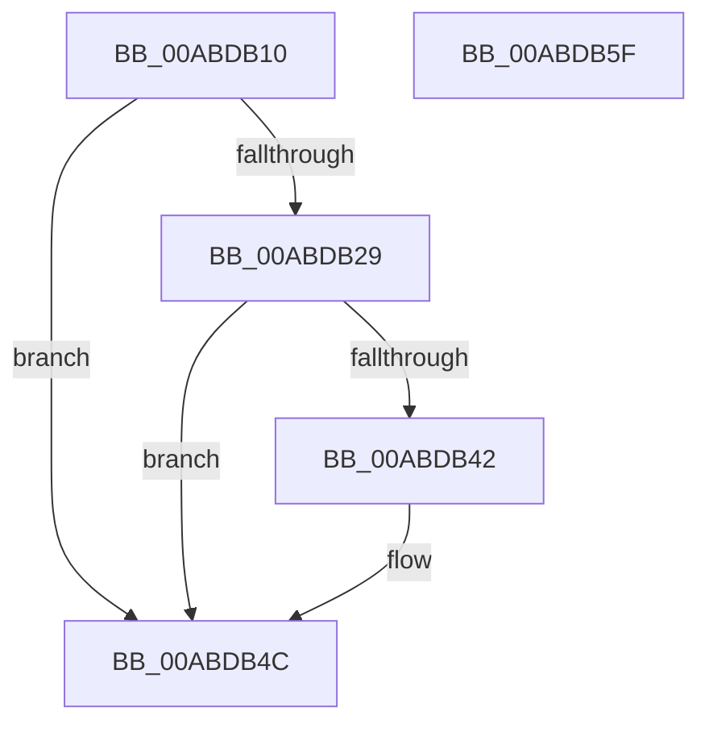

# PspCompleteHardDereferenceSiloDeferred

- RVA: `0x00ABDB10`–`0x00ABDB60` (길이 `80` bytes)
- VA: `0x0000000140ABDB10`
- 실행 섹션: `PAGE`
- PDB 이름 있음: `예`; PDB Function 태그: `아니요`
- unwind 정보 RVA: `0x0005CAAC`
- 디코드: `22`개 명령, `80/80` bytes 표시
- 미해석 바이트: `0` (있으면 어셈블리에 `.byte`로 보존)

> 이 문서는 커널 이미지의 기계어와 PDB 기호를 분석해 생성했습니다. 4번과 5번은 함수 원형과 자료형을 바이너리 사용 방식에서 추정한 C 해석이며 원본 소스 복구 결과는 아닙니다.

## 1. Dependencies

- 직접 호출 지점: **3**; 고유 호출 대상: **2**
- 직접 호출자로 확인된 함수: **0**
- RIP 상대 이미지 참조: **0**

### Outgoing calls
- `0x00ABDB31` → [PspStorageEmptyArrayNonReadonly](../../text/4A/PspStorageEmptyArrayNonReadonly_function_004A3F6C.md) (function, `0x004A3F6C`)
- `0x00ABDB47` → [PspStorageEmptyArrayNonReadonly](../../text/4A/PspStorageEmptyArrayNonReadonly_function_004A3F6C.md) (function, `0x004A3F6C`)
- `0x00ABDB4F` → [ObfDereferenceObject](../../text/2F/ObfDereferenceObject_function_002F9350.md) (function, `0x002F9350`)

### Direct callers
- 이 함수 시작 RVA로 연결되는 직접 call은 확인되지 않았습니다. 간접 호출은 완전히 역산할 수 없습니다.

### Static image references
- 디코드된 RIP-relative 메모리 참조가 없습니다.

## 2. Other-region calls and transfers

- 다른 실행 섹션으로 향하는 call: **3**
  - `0x00ABDB31` → [PspStorageEmptyArrayNonReadonly](../../text/4A/PspStorageEmptyArrayNonReadonly_function_004A3F6C.md) (`PAGE` → `.text`)
  - `0x00ABDB47` → [PspStorageEmptyArrayNonReadonly](../../text/4A/PspStorageEmptyArrayNonReadonly_function_004A3F6C.md) (`PAGE` → `.text`)
  - `0x00ABDB4F` → [ObfDereferenceObject](../../text/2F/ObfDereferenceObject_function_002F9350.md) (`PAGE` → `.text`)
- 별도 외부 분기/꼬리 이동을 확인하지 못했습니다.

## 3. Assembly (complete function range)

```asm
00ABDB10  48 89 5C 24 08                  mov qword ptr [rsp + 8], rbx
00ABDB15  57                              push rdi
00ABDB16  48 83 EC 20                     sub rsp, 0x20
00ABDB1A  48 8B 99 00 06 00 00            mov rbx, qword ptr [rcx + 0x600]
00ABDB21  48 8B F9                        mov rdi, rcx
00ABDB24  48 85 DB                        test rbx, rbx
00ABDB27  74 23                           je 0x140abdb4c
00ABDB29  BA 20 00 00 00                  mov edx, 0x20
00ABDB2E  48 8B CB                        mov rcx, rbx
00ABDB31  E8 36 64 9E FF                  call 0x1404a3f6c
00ABDB36  48 8B 8B 00 02 00 00            mov rcx, qword ptr [rbx + 0x200]
00ABDB3D  48 85 C9                        test rcx, rcx
00ABDB40  74 0A                           je 0x140abdb4c
00ABDB42  BA 00 01 00 00                  mov edx, 0x100
00ABDB47  E8 20 64 9E FF                  call 0x1404a3f6c
00ABDB4C  48 8B CF                        mov rcx, rdi
00ABDB4F  E8 FC B7 83 FF                  call 0x1402f9350
00ABDB54  48 8B 5C 24 30                  mov rbx, qword ptr [rsp + 0x30]
00ABDB59  48 83 C4 20                     add rsp, 0x20
00ABDB5D  5F                              pop rdi
00ABDB5E  C3                              ret
00ABDB5F  CC                              int3
```

## 4. C-style interpretation (structured pseudocode)

```c
__int64 __fastcall PspCompleteHardDereferenceSiloDeferred(__int64 a1)
{
    __int64 result;
    __int64 v_rsp;
    unsigned __int64 v_stack_p8;

    v_stack_p8 = v_rbx;
    v_rsp = (v_rsp) - (32);
    if (*(unsigned __int64 *)(a1 + 1536) == 0) goto loc_00ABDB4C;
    result = PspStorageEmptyArrayNonReadonly(*(unsigned __int64 *)(a1 + 1536), 32, a3, a4);
    if (*(unsigned __int64 *)(*(unsigned __int64 *)(a1 + 1536) + 512) != 0) {
        a2 = 256;
        result = PspStorageEmptyArrayNonReadonly(*(unsigned __int64 *)(*(unsigned __int64 *)(a1 + 1536) + 512), a2, a3, a4);
    }
    result = ObfDereferenceObject(a1, a2, a3, a4);
    v_rsp = (v_rsp) + (32);
    return result;
}
```

## 5. (Beta) C Style

```c
int64_t PspCompleteHardDereferenceSiloDeferred(void *Arg1)
{
    uint8_t *arg1 = (uint8_t *)Arg1;

    int64_t result;
    int64_t local_rsp;
    uint64_t v_stack_p8;

    v_stack_p8 = local_rbx;
    local_rsp = (local_rsp) - (32);
    if (*(uint64_t *)(arg1 + 0x600) == 0) goto loc_00ABDB4C;
    result = PspStorageEmptyArrayNonReadonly(*(uint64_t *)(arg1 + 0x600), 32, a3, a4);
    if (*(uint64_t *)(*(uint64_t *)(arg1 + 0x600) + 0x200) != 0) {
        a2 = 256;
        result = PspStorageEmptyArrayNonReadonly(*(uint64_t *)(*(uint64_t *)(arg1 + 0x600) + 0x200), a2, a3, a4);
    }
    result = ObfDereferenceObject(Arg1, a2, a3, a4);
    local_rsp = (local_rsp) + (32);
    return result;
}
```

### 관측된 메모리 오프셋

구조체 형식이 확인되지 않은 접근은 인자 기준의 오프셋으로만 기록했습니다.

| 기준 인자 | 오프셋 표현 | 폭 (bit) | 접근 |
|---|---:|---:|---|
| `Arg1` | `+ 0x600` | `64` | `R` |

## 6. Execution-region graph

[열기: 2D/3D 그래프와 함수 탐색 컨트롤 패널](../../../control-panel.html?section=page&rva=0x00ABDB10&view=graph)

- 2D 그래프는 위에서 아래로 흐르고, 3D 그래프는 빈 공간을 드래그해 회전합니다. Shift+드래그는 이동, 휠은 확대·축소, 함수 노드 선택은 대상 보고서 이동입니다.

### Static fallback


