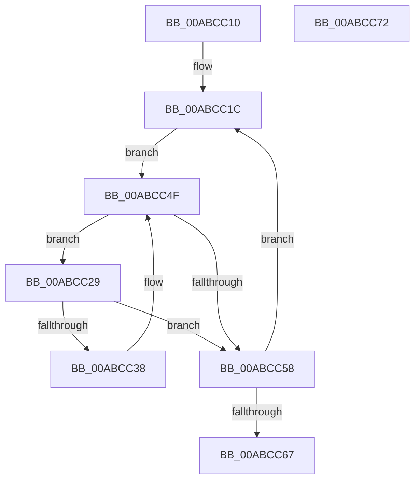

# PspProcessRundownWorkerSingle

- RVA: `0x00ABCC10`–`0x00ABCC73` (길이 `99` bytes)
- VA: `0x0000000140ABCC10`
- 실행 섹션: `PAGE`
- PDB 이름 있음: `예`; PDB Function 태그: `아니요`
- unwind 정보 RVA: `0x0005CAAC`
- 디코드: `27`개 명령, `99/99` bytes 표시
- 미해석 바이트: `0` (있으면 어셈블리에 `.byte`로 보존)

> 이 문서는 커널 이미지의 기계어와 PDB 기호를 분석해 생성했습니다. 4번과 5번은 함수 원형과 자료형을 바이너리 사용 방식에서 추정한 C 해석이며 원본 소스 복구 결과는 아닙니다.

## 1. Dependencies

- 직접 호출 지점: **2**; 고유 호출 대상: **2**
- 직접 호출자로 확인된 함수: **0**
- RIP 상대 이미지 참조: **4**

### Outgoing calls
- `0x00ABCC3D` → [PspRundownSingleProcess](../90/PspRundownSingleProcess_function_00906D50.md) (function, `0x00906D50`)
- `0x00ABCC4A` → [ObfDereferenceObjectWithTag](../../text/2F/ObfDereferenceObjectWithTag_function_002F78E0.md) (function, `0x002F78E0`)

### Direct callers
- 이 함수 시작 RVA로 연결되는 직접 call은 확인되지 않았습니다. 간접 호출은 완전히 역산할 수 없습니다.

### Static image references
- `0x00ABCC21` → RVA `0x00FD9C68` (`PAGEDATA`; read/write)
- `0x00ABCC2C` → RVA `0x00FD9D98` (`PAGEDATA`; read/write)
- `0x00ABCC4F` → RVA `0x00FD9D98` (`PAGEDATA`; read)
- `0x00ABCC5D` → RVA `0x00FD9C68` (`PAGEDATA`; read)

## 2. Other-region calls and transfers

- 다른 실행 섹션으로 향하는 call: **1**
  - `0x00ABCC4A` → [ObfDereferenceObjectWithTag](../../text/2F/ObfDereferenceObjectWithTag_function_002F78E0.md) (`PAGE` → `.text`)
- 별도 외부 분기/꼬리 이동을 확인하지 못했습니다.

## 3. Assembly (complete function range)

```asm
00ABCC10  48 89 5C 24 08                  mov qword ptr [rsp + 8], rbx
00ABCC15  57                              push rdi
00ABCC16  48 83 EC 20                     sub rsp, 0x20
00ABCC1A  33 FF                           xor edi, edi
00ABCC1C  B8 01 00 00 00                  mov eax, 1
00ABCC21  87 05 41 D0 51 00               xchg dword ptr [rip + 0x51d041], eax
00ABCC27  EB 26                           jmp 0x140abcc4f
00ABCC29  48 8B DF                        mov rbx, rdi
00ABCC2C  48 87 1D 65 D1 51 00            xchg qword ptr [rip + 0x51d165], rbx
00ABCC33  48 85 DB                        test rbx, rbx
00ABCC36  74 20                           je 0x140abcc58
00ABCC38  33 D2                           xor edx, edx
00ABCC3A  48 8B CB                        mov rcx, rbx
00ABCC3D  E8 0E A1 E4 FF                  call 0x140906d50
00ABCC42  BA 50 73 53 77                  mov edx, 0x77537350
00ABCC47  48 8B CB                        mov rcx, rbx
00ABCC4A  E8 91 AC 83 FF                  call 0x1402f78e0
00ABCC4F  48 39 3D 42 D1 51 00            cmp qword ptr [rip + 0x51d142], rdi
00ABCC56  75 D1                           jne 0x140abcc29
00ABCC58  B8 01 00 00 00                  mov eax, 1
00ABCC5D  F0 0F B1 3D 03 D0 51 00         lock cmpxchg dword ptr [rip + 0x51d003], edi
00ABCC65  75 B5                           jne 0x140abcc1c
00ABCC67  48 8B 5C 24 30                  mov rbx, qword ptr [rsp + 0x30]
00ABCC6C  48 83 C4 20                     add rsp, 0x20
00ABCC70  5F                              pop rdi
00ABCC71  C3                              ret
00ABCC72  CC                              int3
```

## 4. C-style interpretation (structured pseudocode)

```c
__int64 __fastcall PspProcessRundownWorkerSingle(__int64 a1, int a2)
{
    __int64 result;
    __int64 v_rdi;
    __int64 v_rsp;
    unsigned __int64 v_stack_p8;

    v_stack_p8 = v_rbx;
    v_rsp = (v_rsp) - (32);
    v_rdi = 0;
loc_00ABCC1C:
    goto loc_00ABCC4F;
loc_00ABCC29:
    if (0 == 0) goto loc_00ABCC58;
    a2 = 0;
    result = PspRundownSingleProcess(0, a2, a3, a4);
    result = ObfDereferenceObjectWithTag(0, (unsigned int)(0x77537350ULL), a3, a4);
loc_00ABCC4F:
    if ((*(unsigned __int64 *)(v_rip + 5361986)) != 0) goto loc_00ABCC29;
loc_00ABCC58:
    if ((*(unsigned __int64 *)(v_rip + 5361986)) != 0) goto loc_00ABCC1C;
    v_rsp = (v_rsp) + (32);
    return 1;
}
```

## 5. (Beta) C Style

```c
int64_t PspProcessRundownWorkerSingle(int64_t Arg1, int32_t Arg2)
{
    int64_t result;
    int64_t local_rdi;
    int64_t local_rsp;
    uint64_t v_stack_p8;

    v_stack_p8 = local_rbx;
    local_rsp = (local_rsp) - (32);
    local_rdi = 0;
loc_00ABCC1C:
    goto loc_00ABCC4F;
loc_00ABCC29:
    if (0 == 0) goto loc_00ABCC58;
    Arg2 = 0;
    result = PspRundownSingleProcess(0, Arg2, a3, a4);
    result = ObfDereferenceObjectWithTag(0, (uint32_t)(0x77537350ULL), a3, a4);
loc_00ABCC4F:
    if ((*(uint64_t *)(v_rip + 0x51D142)) != 0) goto loc_00ABCC29;
loc_00ABCC58:
    if ((*(uint64_t *)(v_rip + 0x51D142)) != 0) goto loc_00ABCC1C;
    local_rsp = (local_rsp) + (32);
    return 1;
}
```

## 6. Execution-region graph

[열기: 2D/3D 그래프와 함수 탐색 컨트롤 패널](../../../control-panel.html?section=page&rva=0x00ABCC10&view=graph)

- 2D 그래프는 위에서 아래로 흐르고, 3D 그래프는 빈 공간을 드래그해 회전합니다. Shift+드래그는 이동, 휠은 확대·축소, 함수 노드 선택은 대상 보고서 이동입니다.

### Static fallback


