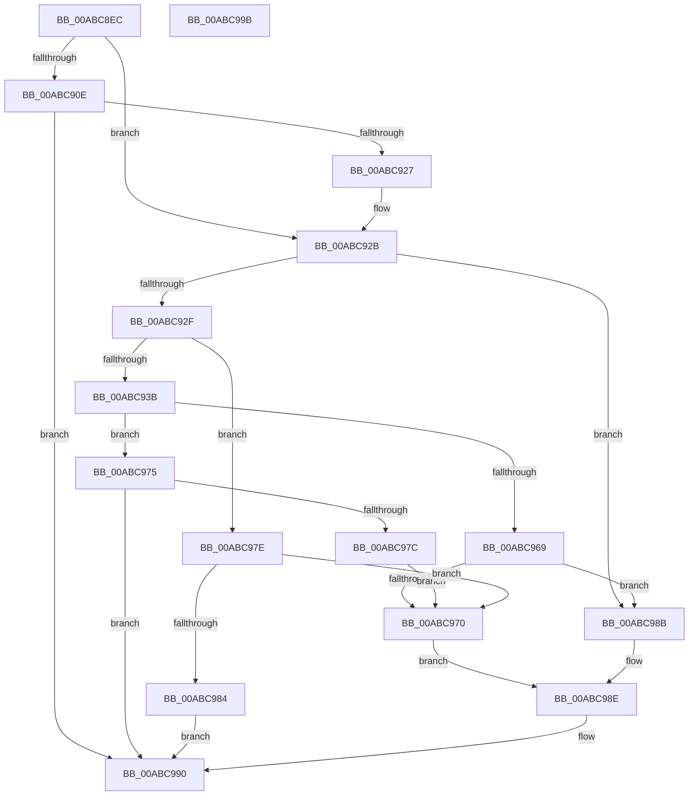

# PspQueryComPlusRunUnderWoW

- RVA: `0x00ABC8EC`–`0x00ABC99C` (길이 `176` bytes)
- VA: `0x0000000140ABC8EC`
- 실행 섹션: `PAGE`
- PDB 이름 있음: `예`; PDB Function 태그: `아니요`
- unwind 정보 RVA: `0x0006E5F8`
- 디코드: `49`개 명령, `176/176` bytes 표시
- 미해석 바이트: `0` (있으면 어셈블리에 `.byte`로 보존)

> 이 문서는 커널 이미지의 기계어와 PDB 기호를 분석해 생성했습니다. 4번과 5번은 함수 원형과 자료형을 바이너리 사용 방식에서 추정한 C 해석이며 원본 소스 복구 결과는 아닙니다.

## 1. Dependencies

- 직접 호출 지점: **2**; 고유 호출 대상: **2**
- 직접 호출자로 확인된 함수: **1**
- RIP 상대 이미지 참조: **1**

### Outgoing calls
- `0x00ABC91E` → [ZwQuerySystemInformation](../../text/6A/ZwQuerySystemInformation_function_006AD790.md) (function, `0x006AD790`)
- `0x00ABC960` → [RtlQueryImageFileKeyOption](../A2/RtlQueryImageFileKeyOption_function_00A2D110.md) (function, `0x00A2D110`)

### Direct callers
- [sub_00B37422](../B3/Unknown_function_00B37422.md) at `0x00B37448`

### Static image references
- `0x00ABC94B` → RVA `0x00B04EA0` (` ?? ::NNGAKEGL::`string'`; read)

## 2. Other-region calls and transfers

- 다른 실행 섹션으로 향하는 call: **1**
  - `0x00ABC91E` → [ZwQuerySystemInformation](../../text/6A/ZwQuerySystemInformation_function_006AD790.md) (`PAGE` → `.text`)
- 별도 외부 분기/꼬리 이동을 확인하지 못했습니다.

## 3. Assembly (complete function range)

```asm
00ABC8EC  48 89 5C 24 08                  mov qword ptr [rsp + 8], rbx
00ABC8F1  57                              push rdi
00ABC8F2  48 83 EC 30                     sub rsp, 0x30
00ABC8F6  A1 E0 02 00 00 80 F7 FF FF      movabs eax, dword ptr [0xfffff780000002e0]
00ABC8FF  48 8B DA                        mov rbx, rdx
00ABC902  89 44 24 50                     mov dword ptr [rsp + 0x50], eax
00ABC906  48 8B F9                        mov rdi, rcx
00ABC909  83 F8 FF                        cmp eax, -1
00ABC90C  75 1D                           jne 0x140abc92b
00ABC90E  45 33 C9                        xor r9d, r9d
00ABC911  48 8D 54 24 50                  lea rdx, [rsp + 0x50]
00ABC916  45 8D 41 04                     lea r8d, [r9 + 4]
00ABC91A  41 8D 49 3B                     lea ecx, [r9 + 0x3b]
00ABC91E  E8 6D 0E BF FF                  call 0x1406ad790
00ABC923  85 C0                           test eax, eax
00ABC925  78 69                           js 0x140abc990
00ABC927  8B 44 24 50                     mov eax, dword ptr [rsp + 0x50]
00ABC92B  A8 01                           test al, 1
00ABC92D  74 5C                           je 0x140abc98b
00ABC92F  48 8B 8F C8 00 00 00            mov rcx, qword ptr [rdi + 0xc8]
00ABC936  48 85 C9                        test rcx, rcx
00ABC939  74 43                           je 0x140abc97e
00ABC93B  48 83 64 24 28 00               and qword ptr [rsp + 0x28], 0
00ABC941  4C 8D 4C 24 58                  lea r9, [rsp + 0x58]
00ABC946  83 64 24 58 00                  and dword ptr [rsp + 0x58], 0
00ABC94B  48 8D 15 4E 85 04 00            lea rdx, [rip + 0x4854e]
00ABC952  41 B8 04 00 00 00               mov r8d, 4
00ABC958  C7 44 24 20 04 00 00 00         mov dword ptr [rsp + 0x20], 4
00ABC960  E8 AB 07 F7 FF                  call 0x140a2d110
00ABC965  85 C0                           test eax, eax
00ABC967  78 0C                           js 0x140abc975
00ABC969  83 7C 24 58 00                  cmp dword ptr [rsp + 0x58], 0
00ABC96E  75 1B                           jne 0x140abc98b
00ABC970  C6 03 00                        mov byte ptr [rbx], 0
00ABC973  EB 19                           jmp 0x140abc98e
00ABC975  3D 34 00 00 C0                  cmp eax, 0xc0000034
00ABC97A  75 14                           jne 0x140abc990
00ABC97C  EB F2                           jmp 0x140abc970
00ABC97E  F6 47 10 40                     test byte ptr [rdi + 0x10], 0x40
00ABC982  75 EC                           jne 0x140abc970
00ABC984  B8 01 00 00 C0                  mov eax, 0xc0000001
00ABC989  EB 05                           jmp 0x140abc990
00ABC98B  C6 03 01                        mov byte ptr [rbx], 1
00ABC98E  33 C0                           xor eax, eax
00ABC990  48 8B 5C 24 40                  mov rbx, qword ptr [rsp + 0x40]
00ABC995  48 83 C4 30                     add rsp, 0x30
00ABC999  5F                              pop rdi
00ABC99A  C3                              ret
00ABC99B  CC                              int3
```

## 4. C-style interpretation (structured pseudocode)

```c
__int64 __fastcall PspQueryComPlusRunUnderWoW(__int64 a1, __int64 a2, __int64 a3, int a4)
{
    __int64 result;
    __int64 v_rsp;
    unsigned __int64 v_stack_m10;
    unsigned int v_stack_m18;
    unsigned int v_stack_p18;
    unsigned __int64 v_stack_p20;
    unsigned __int64 v_stack_p8;

    v_stack_p8 = v_rbx;
    v_rsp = (v_rsp) - (48);
    v_stack_p18 = (unsigned int)(result);
    if (((unsigned int)(result)) != -1) goto loc_00ABC92B;
    a4 = 0;
    result = ZwQuerySystemInformation(a4 + 59, v_stack_p18, a4 + 4, a4);
    if (sign_flag) goto loc_00ABC990;
loc_00ABC92B:
    if ((((unsigned __int8)((unsigned int)(v_stack_p18))) & (1)) == 0) goto loc_00ABC98B;
    if (*(unsigned __int64 *)(a1 + 200) == 0) goto loc_00ABC97E;
    v_stack_m18 = 4;
    result = RtlQueryImageFileKeyOption(*(unsigned __int64 *)(a1 + 200), v_rip + 296270, 4, v_stack_p20);
    if (sign_flag) goto loc_00ABC975;
    if (v_stack_p20 != 0) goto loc_00ABC98B;
loc_00ABC970:
    *(unsigned __int8 *)(a2) = 0;
    goto loc_00ABC98E;
loc_00ABC975:
    if (((unsigned int)(result)) != 0xC0000034ULL) goto loc_00ABC990;
    goto loc_00ABC970;
loc_00ABC97E:
    if (((*(unsigned __int8 *)(a1 + 16)) & (64)) != 0) goto loc_00ABC970;
    goto loc_00ABC990;
loc_00ABC98B:
    *(unsigned __int8 *)(a2) = 1;
loc_00ABC98E:
    result = 0;
loc_00ABC990:
    v_rsp = (v_rsp) + (48);
    return result;
}
```

## 5. (Beta) C Style

```c
int64_t PspQueryComPlusRunUnderWoW(void *Arg1, void *Arg2, int64_t Arg3, int32_t Arg4)
{
    uint8_t *arg1 = (uint8_t *)Arg1;
    uint8_t *arg2 = (uint8_t *)Arg2;

    int64_t result;
    int64_t local_rsp;
    uint64_t v_stack_m10;
    uint32_t v_stack_m18;
    uint32_t v_stack_p18;
    uint64_t v_stack_p20;
    uint64_t v_stack_p8;

    v_stack_p8 = local_rbx;
    local_rsp = (local_rsp) - (48);
    v_stack_p18 = (uint32_t)(result);
    if (((uint32_t)(result)) != -1) goto loc_00ABC92B;
    Arg4 = 0;
    result = ZwQuerySystemInformation(Arg4 + 59, v_stack_p18, Arg4 + 4, Arg4);
    if (sign_flag) goto loc_00ABC990;
loc_00ABC92B:
    if ((((uint8_t)((uint32_t)(v_stack_p18))) & (1)) == 0) goto loc_00ABC98B;
    if (*(uint64_t *)(arg1 + 0xC8) == 0) goto loc_00ABC97E;
    v_stack_m18 = 4;
    result = RtlQueryImageFileKeyOption(*(uint64_t *)(arg1 + 0xC8), v_rip + 296270, 4, v_stack_p20);
    if (sign_flag) goto loc_00ABC975;
    if (v_stack_p20 != 0) goto loc_00ABC98B;
loc_00ABC970:
    *(uint8_t *)(arg2) = 0;
    goto loc_00ABC98E;
loc_00ABC975:
    if (((uint32_t)(result)) != 0xC0000034ULL) goto loc_00ABC990;
    goto loc_00ABC970;
loc_00ABC97E:
    if (((*(uint8_t *)(arg1 + 0x10)) & (64)) != 0) goto loc_00ABC970;
    goto loc_00ABC990;
loc_00ABC98B:
    *(uint8_t *)(arg2) = 1;
loc_00ABC98E:
    result = 0;
loc_00ABC990:
    local_rsp = (local_rsp) + (48);
    return result;
}
```

### 관측된 메모리 오프셋

구조체 형식이 확인되지 않은 접근은 인자 기준의 오프셋으로만 기록했습니다.

| 기준 인자 | 오프셋 표현 | 폭 (bit) | 접근 |
|---|---:|---:|---|
| `Arg1` | `+ 0x10` | `8` | `R` |
| `Arg1` | `+ 0xC8` | `64` | `R` |
| `Arg2` | `+ 0x0` | `8` | `W` |

## 6. Execution-region graph

[열기: 2D/3D 그래프와 함수 탐색 컨트롤 패널](../../../control-panel.html?section=page&rva=0x00ABC8EC&view=graph)

- 2D 그래프는 위에서 아래로 흐르고, 3D 그래프는 빈 공간을 드래그해 회전합니다. Shift+드래그는 이동, 휠은 확대·축소, 함수 노드 선택은 대상 보고서 이동입니다.

### Static fallback


