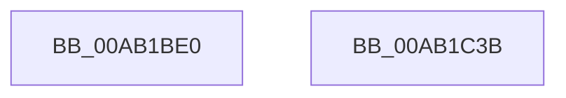

# PspSetNoChildProcessRestrictedPolicy

- RVA: `0x00AB1BE0`–`0x00AB1C3C` (길이 `92` bytes)
- VA: `0x0000000140AB1BE0`
- 실행 섹션: `PAGE`
- PDB 이름 있음: `예`; PDB Function 태그: `아니요`
- unwind 정보 RVA: `0x00060BC4`
- 디코드: `25`개 명령, `92/92` bytes 표시
- 미해석 바이트: `0` (있으면 어셈블리에 `.byte`로 보존)

> 이 문서는 커널 이미지의 기계어와 PDB 기호를 분석해 생성했습니다. 4번과 5번은 함수 원형과 자료형을 바이너리 사용 방식에서 추정한 C 해석이며 원본 소스 복구 결과는 아닙니다.

## 1. Dependencies

- 직접 호출 지점: **3**; 고유 호출 대상: **3**
- 직접 호출자로 확인된 함수: **3**
- RIP 상대 이미지 참조: **0**

### Outgoing calls
- `0x00AB1BF9` → [PsReferencePrimaryTokenWithTag](../../text/20/PsReferencePrimaryTokenWithTag_function_0020FF80.md) (function, `0x0020FF80`)
- `0x00AB1C11` → [SeTokenSetNoChildProcessRestricted](../../text/4C/SeTokenSetNoChildProcessRestricted_function_004C4504.md) (function, `0x004C4504`)
- `0x00AB1C26` → [ObFastDereferenceObject](../../text/3E/ObFastDereferenceObject_function_003ED5F0.md) (function, `0x003ED5F0`)

### Direct callers
- [PspApplyMitigationOptions](../A6/PspApplyMitigationOptions_function_00A699AC.md) at `0x00A6A136`
- [NtSetInformationProcess](../AE/NtSetInformationProcess_function_00AE5370.md) at `0x00AE8558`
- [NtSetInformationProcess](../AE/NtSetInformationProcess_function_00AE5370.md) at `0x00AE856F`
- [NtSetInformationProcess](../AE/NtSetInformationProcess_function_00AE5370.md) at `0x00AE858F`
- [sub_00B3F098](../B3/Unknown_function_00B3F098.md) at `0x00B3F121`

### Static image references
- 디코드된 RIP-relative 메모리 참조가 없습니다.

## 2. Other-region calls and transfers

- 다른 실행 섹션으로 향하는 call: **3**
  - `0x00AB1BF9` → [PsReferencePrimaryTokenWithTag](../../text/20/PsReferencePrimaryTokenWithTag_function_0020FF80.md) (`PAGE` → `.text`)
  - `0x00AB1C11` → [SeTokenSetNoChildProcessRestricted](../../text/4C/SeTokenSetNoChildProcessRestricted_function_004C4504.md) (`PAGE` → `.text`)
  - `0x00AB1C26` → [ObFastDereferenceObject](../../text/3E/ObFastDereferenceObject_function_003ED5F0.md) (`PAGE` → `.text`)
- 별도 외부 분기/꼬리 이동을 확인하지 못했습니다.

## 3. Assembly (complete function range)

```asm
00AB1BE0  48 89 5C 24 08                  mov qword ptr [rsp + 8], rbx
00AB1BE5  48 89 74 24 10                  mov qword ptr [rsp + 0x10], rsi
00AB1BEA  57                              push rdi
00AB1BEB  48 83 EC 20                     sub rsp, 0x20
00AB1BEF  8B FA                           mov edi, edx
00AB1BF1  48 8B F1                        mov rsi, rcx
00AB1BF4  BA 50 73 51 79                  mov edx, 0x79517350
00AB1BF9  E8 82 E3 75 FF                  call 0x14020ff80
00AB1BFE  83 FF 03                        cmp edi, 3
00AB1C01  48 8B C8                        mov rcx, rax
00AB1C04  48 8B D8                        mov rbx, rax
00AB1C07  41 0F 94 C0                     sete r8b
00AB1C0B  83 FF 02                        cmp edi, 2
00AB1C0E  0F 94 C2                        sete dl
00AB1C11  E8 EE 28 A1 FF                  call 0x1404c4504
00AB1C16  48 8D 8E 48 02 00 00            lea rcx, [rsi + 0x248]
00AB1C1D  41 B8 50 73 51 79               mov r8d, 0x79517350
00AB1C23  48 8B D3                        mov rdx, rbx
00AB1C26  E8 C5 B9 93 FF                  call 0x1403ed5f0
00AB1C2B  48 8B 5C 24 30                  mov rbx, qword ptr [rsp + 0x30]
00AB1C30  48 8B 74 24 38                  mov rsi, qword ptr [rsp + 0x38]
00AB1C35  48 83 C4 20                     add rsp, 0x20
00AB1C39  5F                              pop rdi
00AB1C3A  C3                              ret
00AB1C3B  CC                              int3
```

## 4. C-style interpretation (structured pseudocode)

```c
__int64 __fastcall PspSetNoChildProcessRestrictedPolicy(__int64 a1, int a2)
{
    __int64 result;
    __int64 v_rsp;
    unsigned __int64 v_stack_p10;
    unsigned __int64 v_stack_p8;

    v_stack_p8 = v_rbx;
    v_stack_p10 = v_rsi;
    v_rsp = (v_rsp) - (32);
    result = PsReferencePrimaryTokenWithTag(a1, (unsigned int)(0x79517350ULL), a3, a4);
    a3 = (((unsigned int)((unsigned int)(a2))) == 3) ? 1 : 0;
    a2 = (((unsigned int)((unsigned int)(a2))) == 2) ? 1 : 0;
    result = SeTokenSetNoChildProcessRestricted(result, a2, a3, a4);
    result = ObFastDereferenceObject(a1 + 584, result, (unsigned int)(0x79517350ULL), a4);
    v_rsp = (v_rsp) + (32);
    return result;
}
```

## 5. (Beta) C Style

```c
int64_t PspSetNoChildProcessRestrictedPolicy(void *Arg1, int32_t Arg2)
{
    uint8_t *arg1 = (uint8_t *)Arg1;

    int64_t result;
    int64_t local_rsp;
    uint64_t v_stack_p10;
    uint64_t v_stack_p8;

    v_stack_p8 = local_rbx;
    v_stack_p10 = local_rsi;
    local_rsp = (local_rsp) - (32);
    result = PsReferencePrimaryTokenWithTag(Arg1, (uint32_t)(0x79517350ULL), a3, a4);
    a3 = (((uint32_t)((uint32_t)(Arg2))) == 3) ? 1 : 0;
    Arg2 = (((uint32_t)((uint32_t)(Arg2))) == 2) ? 1 : 0;
    result = SeTokenSetNoChildProcessRestricted(result, Arg2, a3, a4);
    result = ObFastDereferenceObject(Arg1 + 584, result, (uint32_t)(0x79517350ULL), a4);
    local_rsp = (local_rsp) + (32);
    return result;
}
```

### 관측된 메모리 오프셋

구조체 형식이 확인되지 않은 접근은 인자 기준의 오프셋으로만 기록했습니다.

| 기준 인자 | 오프셋 표현 | 폭 (bit) | 접근 |
|---|---:|---:|---|
| `Arg1` | `+ 0x248` | `64` | `R` |

## 6. Execution-region graph

[열기: 2D/3D 그래프와 함수 탐색 컨트롤 패널](../../../control-panel.html?section=page&rva=0x00AB1BE0&view=graph)

- 2D 그래프는 위에서 아래로 흐르고, 3D 그래프는 빈 공간을 드래그해 회전합니다. Shift+드래그는 이동, 휠은 확대·축소, 함수 노드 선택은 대상 보고서 이동입니다.

### Static fallback


