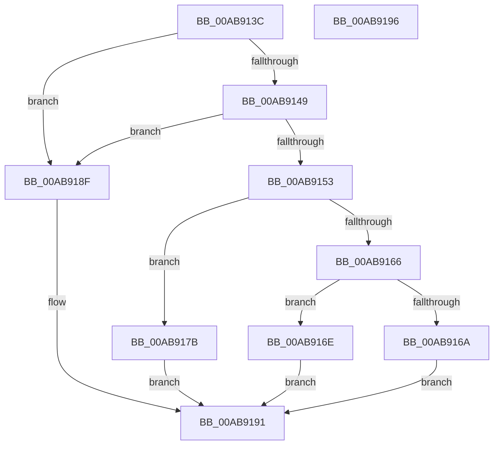

# PspValidateJobAssignmentUILimits

- RVA: `0x00AB913C`–`0x00AB9197` (길이 `91` bytes)
- VA: `0x0000000140AB913C`
- 실행 섹션: `PAGE`
- PDB 이름 있음: `예`; PDB Function 태그: `아니요`
- unwind 정보 RVA: `0x0005C788`
- 디코드: `31`개 명령, `91/91` bytes 표시
- 미해석 바이트: `0` (있으면 어셈블리에 `.byte`로 보존)

> 이 문서는 커널 이미지의 기계어와 PDB 기호를 분석해 생성했습니다. 4번과 5번은 함수 원형과 자료형을 바이너리 사용 방식에서 추정한 C 해석이며 원본 소스 복구 결과는 아닙니다.

## 1. Dependencies

- 직접 호출 지점: **1**; 고유 호출 대상: **1**
- 직접 호출자로 확인된 함수: **1**
- RIP 상대 이미지 참조: **0**

### Outgoing calls
- `0x00AB9188` → [PspDoesJobHierarchyPermitUILimits](../6F/PspDoesJobHierarchyPermitUILimits_function_006FD328.md) (function, `0x006FD328`)

### Direct callers
- [PspAssignProcessToJob](../A2/PspAssignProcessToJob_function_00A23370.md) at `0x00A23531`

### Static image references
- 디코드된 RIP-relative 메모리 참조가 없습니다.

## 2. Other-region calls and transfers

- 다른 실행 섹션으로 향하는 call: **0**
- 별도 외부 분기/꼬리 이동을 확인하지 못했습니다.

## 3. Assembly (complete function range)

```asm
00AB913C  48 83 EC 28                     sub rsp, 0x28
00AB9140  4C 8B CA                        mov r9, rdx
00AB9143  41 83 F8 04                     cmp r8d, 4
00AB9147  75 46                           jne 0x140ab918f
00AB9149  8B 81 10 06 00 00               mov eax, dword ptr [rcx + 0x610]
00AB914F  A8 10                           test al, 0x10
00AB9151  74 3C                           je 0x140ab918f
00AB9153  8B 89 14 06 00 00               mov ecx, dword ptr [rcx + 0x614]
00AB9159  8B 82 10 06 00 00               mov eax, dword ptr [rdx + 0x610]
00AB915F  83 E1 10                        and ecx, 0x10
00AB9162  A8 10                           test al, 0x10
00AB9164  74 15                           je 0x140ab917b
00AB9166  85 C9                           test ecx, ecx
00AB9168  74 04                           je 0x140ab916e
00AB916A  32 C0                           xor al, al
00AB916C  EB 23                           jmp 0x140ab9191
00AB916E  8B 82 14 06 00 00               mov eax, dword ptr [rdx + 0x614]
00AB9174  C1 E8 04                        shr eax, 4
00AB9177  24 01                           and al, 1
00AB9179  EB 16                           jmp 0x140ab9191
00AB917B  F7 D9                           neg ecx
00AB917D  49 8B C9                        mov rcx, r9
00AB9180  1B D2                           sbb edx, edx
00AB9182  83 E2 FE                        and edx, 0xfffffffe
00AB9185  83 C2 03                        add edx, 3
00AB9188  E8 9B 41 C4 FF                  call 0x1406fd328
00AB918D  EB 02                           jmp 0x140ab9191
00AB918F  B0 01                           mov al, 1
00AB9191  48 83 C4 28                     add rsp, 0x28
00AB9195  C3                              ret
00AB9196  CC                              int3
```

## 4. C-style interpretation (structured pseudocode)

```c
__int64 __fastcall PspValidateJobAssignmentUILimits(__int64 a1, __int64 a2, int a3)
{
    __int64 result;
    __int64 v_rsp;

    v_rsp = (v_rsp) - (40);
    if (a3 != 4) goto loc_00AB918F;
    if ((((unsigned __int8)((unsigned int)(*(unsigned int *)(a1 + 1552)))) & (16)) == 0) goto loc_00AB918F;
    a1 = (unsigned int)(((unsigned int)(*(unsigned int *)(a1 + 1556))) & (16));
    if ((((unsigned __int8)((unsigned int)(*(unsigned int *)(a2 + 1552)))) & (16)) == 0) goto loc_00AB917B;
    if ((unsigned int)(a1) == 0) goto loc_00AB916E;
    result = 0;
    goto loc_00AB9191;
loc_00AB916E:
    result = (unsigned int)(((unsigned int)(*(unsigned int *)(a2 + 1556))) >> (4));
    result = (unsigned __int8)((result) & (1));
    goto loc_00AB9191;
loc_00AB917B:
    a1 = (unsigned int)(-(a1));
    a2 = (unsigned int)((a2) & (0xFFFFFFFEULL));
    a2 = (unsigned int)((a2) + (3));
    result = PspDoesJobHierarchyPermitUILimits(a2, a2, a3, a2);
    goto loc_00AB9191;
loc_00AB918F:
loc_00AB9191:
    v_rsp = (v_rsp) + (40);
    return 1;
}
```

## 5. (Beta) C Style

```c
int64_t PspValidateJobAssignmentUILimits(void *Arg1, void *Arg2, int32_t Arg3)
{
    uint8_t *arg1 = (uint8_t *)Arg1;
    uint8_t *arg2 = (uint8_t *)Arg2;

    int64_t result;
    int64_t local_rsp;

    local_rsp = (local_rsp) - (40);
    if (Arg3 != 4) goto loc_00AB918F;
    if ((((uint8_t)((uint32_t)(*(uint32_t *)(arg1 + 0x610)))) & (16)) == 0) goto loc_00AB918F;
    Arg1 = (uint32_t)(((uint32_t)(*(uint32_t *)(arg1 + 0x614))) & (16));
    if ((((uint8_t)((uint32_t)(*(uint32_t *)(arg2 + 0x610)))) & (16)) == 0) goto loc_00AB917B;
    if ((uint32_t)(Arg1) == 0) goto loc_00AB916E;
    result = 0;
    goto loc_00AB9191;
loc_00AB916E:
    result = (uint32_t)(((uint32_t)(*(uint32_t *)(arg2 + 0x614))) >> (4));
    result = (uint8_t)((result) & (1));
    goto loc_00AB9191;
loc_00AB917B:
    Arg1 = (uint32_t)(-(Arg1));
    Arg2 = (uint32_t)((Arg2) & (0xFFFFFFFEULL));
    Arg2 = (uint32_t)((Arg2) + (3));
    result = PspDoesJobHierarchyPermitUILimits(Arg2, Arg2, Arg3, Arg2);
    goto loc_00AB9191;
loc_00AB918F:
loc_00AB9191:
    local_rsp = (local_rsp) + (40);
    return 1;
}
```

### 관측된 메모리 오프셋

구조체 형식이 확인되지 않은 접근은 인자 기준의 오프셋으로만 기록했습니다.

| 기준 인자 | 오프셋 표현 | 폭 (bit) | 접근 |
|---|---:|---:|---|
| `Arg1` | `+ 0x610` | `32` | `R` |
| `Arg1` | `+ 0x614` | `32` | `R` |
| `Arg2` | `+ 0x610` | `32` | `R` |
| `Arg2` | `+ 0x614` | `32` | `R` |

## 6. Execution-region graph

[열기: 2D/3D 그래프와 함수 탐색 컨트롤 패널](../../../control-panel.html?section=page&rva=0x00AB913C&view=graph)

- 2D 그래프는 위에서 아래로 흐르고, 3D 그래프는 빈 공간을 드래그해 회전합니다. Shift+드래그는 이동, 휠은 확대·축소, 함수 노드 선택은 대상 보고서 이동입니다.

### Static fallback


