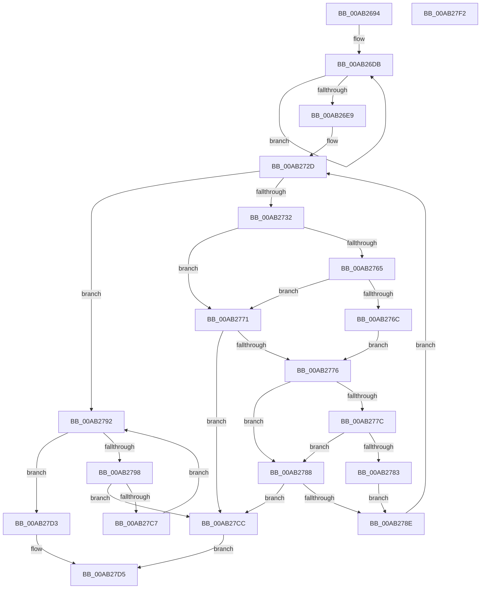

# PspValidateMitigationAuditOptions

- RVA: `0x00AB2694`–`0x00AB27F3` (길이 `351` bytes)
- VA: `0x0000000140AB2694`
- 실행 섹션: `PAGE`
- PDB 이름 있음: `예`; PDB Function 태그: `아니요`
- unwind 정보 RVA: `0x000BC96C`
- 디코드: `91`개 명령, `351/351` bytes 표시
- 미해석 바이트: `0` (있으면 어셈블리에 `.byte`로 보존)

> 이 문서는 커널 이미지의 기계어와 PDB 기호를 분석해 생성했습니다. 4번과 5번은 함수 원형과 자료형을 바이너리 사용 방식에서 추정한 C 해석이며 원본 소스 복구 결과는 아닙니다.

## 1. Dependencies

- 직접 호출 지점: **1**; 고유 호출 대상: **1**
- 직접 호출자로 확인된 함수: **3**
- RIP 상대 이미지 참조: **4**

### Outgoing calls
- `0x00AB27DC` → [_security_check_cookie](../../text/6A/_security_check_cookie_function_006AC640.md) (function, `0x006AC640`)

### Direct callers
- [PspBuildCreateProcessContext](../9E/PspBuildCreateProcessContext_function_009ED6E0.md) at `0x009EE91E`
- [PspReadIFEOMitigationAuditOptions](../A2/PspReadIFEOMitigationAuditOptions_function_00A2CF64.md) at `0x00A2CFD3`
- [PspInitPhase0](../../init/C7/PspInitPhase0_function_00C77E2C.md) at `0x00C78016`

### Static image references
- `0x00AB26A6` → RVA `0x00E0A740` (`.data`; read)
- `0x00AB26E9` → RVA `0x0001E200` (`.rdata`; read)
- `0x00AB26F3` → RVA `0x0001E210` (`.rdata`; read)
- `0x00AB2706` → RVA `0x0001E220` (`.rdata`; read)

## 2. Other-region calls and transfers

- 다른 실행 섹션으로 향하는 call: **1**
  - `0x00AB27DC` → [_security_check_cookie](../../text/6A/_security_check_cookie_function_006AC640.md) (`PAGE` → `.text`)
- 별도 외부 분기/꼬리 이동을 확인하지 못했습니다.

## 3. Assembly (complete function range)

```asm
00AB2694  48 89 5C 24 08                  mov qword ptr [rsp + 8], rbx
00AB2699  55                              push rbp
00AB269A  48 8D 6C 24 A9                  lea rbp, [rsp - 0x57]
00AB269F  48 81 EC A0 00 00 00            sub rsp, 0xa0
00AB26A6  48 8B 05 93 80 35 00            mov rax, qword ptr [rip + 0x358093]
00AB26AD  48 33 C4                        xor rax, rsp
00AB26B0  48 89 45 47                     mov qword ptr [rbp + 0x47], rax
00AB26B4  48 8B D9                        mov rbx, rcx
00AB26B7  C7 45 E7 01 00 00 00            mov dword ptr [rbp - 0x19], 1
00AB26BE  B9 0B 00 00 00                  mov ecx, 0xb
00AB26C3  C7 45 EB 07 00 00 00            mov dword ptr [rbp - 0x15], 7
00AB26CA  C7 45 EF 09 00 00 00            mov dword ptr [rbp - 0x11], 9
00AB26D1  48 8D 55 F3                     lea rdx, [rbp - 0xd]
00AB26D5  8B C1                           mov eax, ecx
00AB26D7  44 8D 41 F9                     lea r8d, [rcx - 7]
00AB26DB  89 02                           mov dword ptr [rdx], eax
00AB26DD  FF C0                           inc eax
00AB26DF  48 8D 52 04                     lea rdx, [rdx + 4]
00AB26E3  49 83 E8 01                     sub r8, 1
00AB26E7  75 F2                           jne 0x140ab26db
00AB26E9  66 0F 6F 05 0F BB 56 FF         movdqa xmm0, xmmword ptr [rip - 0xa944f1]
00AB26F1  33 D2                           xor edx, edx
00AB26F3  66 0F 6F 0D 15 BB 56 FF         movdqa xmm1, xmmword ptr [rip - 0xa944eb]
00AB26FB  45 33 D2                        xor r10d, r10d
00AB26FE  66 0F 7F 45 07                  movdqa xmmword ptr [rbp + 7], xmm0
00AB2703  45 33 C9                        xor r9d, r9d
00AB2706  66 0F 6F 05 12 BB 56 FF         movdqa xmm0, xmmword ptr [rip - 0xa944ee]
00AB270E  66 0F 7F 45 27                  movdqa xmmword ptr [rbp + 0x27], xmm0
00AB2713  44 8D 42 28                     lea r8d, [rdx + 0x28]
00AB2717  C7 45 03 11 00 00 00            mov dword ptr [rbp + 3], 0x11
00AB271E  66 0F 7F 4D 17                  movdqa xmmword ptr [rbp + 0x17], xmm1
00AB2723  C7 45 37 27 00 00 00            mov dword ptr [rbp + 0x37], 0x27
00AB272A  89 4D B7                        mov dword ptr [rbp - 0x49], ecx
00AB272D  41 3B D0                        cmp edx, r8d
00AB2730  73 60                           jae 0x140ab2792
00AB2732  0F 28 03                        movaps xmm0, xmmword ptr [rbx]
00AB2735  8D 0C 95 00 00 00 00            lea ecx, [rdx*4]
00AB273C  F2 0F 10 4B 10                  movsd xmm1, qword ptr [rbx + 0x10]
00AB2741  8B C1                           mov eax, ecx
00AB2743  83 E1 3F                        and ecx, 0x3f
00AB2746  48 C1 E8 06                     shr rax, 6
00AB274A  0F 29 45 C7                     movaps xmmword ptr [rbp - 0x39], xmm0
00AB274E  F2 0F 11 4D D7                  movsd qword ptr [rbp - 0x29], xmm1
00AB2753  4C 8B 5C C5 C7                  mov r11, qword ptr [rbp + rax*8 - 0x39]
00AB2758  49 D3 EB                        shr r11, cl
00AB275B  41 80 E3 03                     and r11b, 3
00AB275F  41 83 FA 15                     cmp r10d, 0x15
00AB2763  73 0C                           jae 0x140ab2771
00AB2765  42 39 54 95 E7                  cmp dword ptr [rbp + r10*4 - 0x19], edx
00AB276A  75 05                           jne 0x140ab2771
00AB276C  41 FF C2                        inc r10d
00AB276F  EB 05                           jmp 0x140ab2776
00AB2771  45 84 DB                        test r11b, r11b
00AB2774  75 56                           jne 0x140ab27cc
00AB2776  41 83 F9 01                     cmp r9d, 1
00AB277A  73 0C                           jae 0x140ab2788
00AB277C  42 39 54 8D B7                  cmp dword ptr [rbp + r9*4 - 0x49], edx
00AB2781  75 05                           jne 0x140ab2788
00AB2783  41 FF C1                        inc r9d
00AB2786  EB 06                           jmp 0x140ab278e
00AB2788  41 80 FB 03                     cmp r11b, 3
00AB278C  74 3E                           je 0x140ab27cc
00AB278E  FF C2                           inc edx
00AB2790  EB 9B                           jmp 0x140ab272d
00AB2792  41 83 F8 30                     cmp r8d, 0x30
00AB2796  73 3B                           jae 0x140ab27d3
00AB2798  0F 28 03                        movaps xmm0, xmmword ptr [rbx]
00AB279B  42 8D 0C 85 00 00 00 00         lea ecx, [r8*4]
00AB27A3  F2 0F 10 4B 10                  movsd xmm1, qword ptr [rbx + 0x10]
00AB27A8  8B C1                           mov eax, ecx
00AB27AA  83 E1 3F                        and ecx, 0x3f
00AB27AD  48 C1 E8 06                     shr rax, 6
00AB27B1  0F 29 45 C7                     movaps xmmword ptr [rbp - 0x39], xmm0
00AB27B5  F2 0F 11 4D D7                  movsd qword ptr [rbp - 0x29], xmm1
00AB27BA  48 8B 54 C5 C7                  mov rdx, qword ptr [rbp + rax*8 - 0x39]
00AB27BF  48 D3 EA                        shr rdx, cl
00AB27C2  F6 C2 03                        test dl, 3
00AB27C5  75 05                           jne 0x140ab27cc
00AB27C7  41 FF C0                        inc r8d
00AB27CA  EB C6                           jmp 0x140ab2792
00AB27CC  B8 0D 00 00 C0                  mov eax, 0xc000000d
00AB27D1  EB 02                           jmp 0x140ab27d5
00AB27D3  33 C0                           xor eax, eax
00AB27D5  48 8B 4D 47                     mov rcx, qword ptr [rbp + 0x47]
00AB27D9  48 33 CC                        xor rcx, rsp
00AB27DC  E8 5F 9E BF FF                  call 0x1406ac640
00AB27E1  48 8B 9C 24 B0 00 00 00         mov rbx, qword ptr [rsp + 0xb0]
00AB27E9  48 81 C4 A0 00 00 00            add rsp, 0xa0
00AB27F0  5D                              pop rbp
00AB27F1  C3                              ret
00AB27F2  CC                              int3
```

## 4. C-style interpretation (structured pseudocode)

```c
__int64 __fastcall PspValidateMitigationAuditOptions(__int64 a1, __int64 a2, __int64 a3, int a4)
{
    __int64 result;
    __int64 v_r10;
    __int64 v_r11;
    __int64 v_rsp;
    unsigned __int64 v_stack_m18;
    unsigned int v_stack_m28;
    unsigned __int64 v_stack_m38;
    unsigned __int64 v_stack_m48;
    unsigned __int64 v_stack_m58;
    unsigned int v_stack_m5C;
    unsigned __int64 v_stack_m5F;
    unsigned __int64 v_stack_m6C;
    unsigned int v_stack_m70;
    unsigned int v_stack_m74;
    unsigned int v_stack_m78;
    unsigned __int64 v_stack_m88;
    unsigned __int64 v_stack_m98;
    unsigned int v_stack_mA8;
    unsigned __int64 v_stack_p8;

    v_stack_p8 = v_rbx;
    v_rsp = (v_rsp) - (160);
    result = (*(unsigned __int64 *)(v_rip + 3506323)) ^ (v_rsp);
    v_stack_m18 = result;
    v_stack_m78 = 1;
    v_stack_m74 = 7;
    v_stack_m70 = 9;
loc_00AB26DB:
    *(unsigned int *)(v_stack_m6C) = 11;
    result = (unsigned int)((11) + 1);
    a3 = (11 - 7) - (1);
    if (condition_is_not_equal) goto loc_00AB26DB;
    a2 = 0;
    v_r10 = 0;
    v_stack_m58 = v_xmm0;
    a4 = 0;
    v_stack_m38 = v_xmm0;
    v_stack_m5C = 17;
    v_stack_m48 = v_xmm1;
    v_stack_m28 = 39;
    v_stack_mA8 = 11;
loc_00AB272D:
    if (0 >= ((unsigned int)(a2 + 40))) goto loc_00AB2792;
    a1 = (unsigned int)((a2 * 4) & (63));
    result = ((unsigned int)((unsigned int)(a2 * 4))) >> (6);
    v_stack_m98 = v_xmm0;
    v_stack_m88 = v_xmm1;
    v_r11 = (*(unsigned __int64 *)(v_stack_m5F + result * 8 - 57)) >> ((unsigned __int8)(a1));
    v_r11 = (unsigned __int8)((v_r11) & (3));
    if (0 >= 21) goto loc_00AB2771;
    if ((*(unsigned int *)(v_stack_m5F + v_r10 * 4 - 25)) != 0) goto loc_00AB2771;
    v_r10 = (unsigned int)((v_r10) + 1);
    goto loc_00AB2776;
loc_00AB2771:
    if ((unsigned __int8)(v_r11) != 0) goto loc_00AB27CC;
loc_00AB2776:
    if (0 >= 1) goto loc_00AB2788;
    if ((*(unsigned int *)(v_stack_m5F + a4 * 4 - 73)) != 0) goto loc_00AB2788;
    a4 = (unsigned int)((a4) + 1);
    goto loc_00AB278E;
loc_00AB2788:
    if (((unsigned __int8)(v_r11)) == 3) goto loc_00AB27CC;
loc_00AB278E:
    a2 = (unsigned int)((a2) + 1);
    goto loc_00AB272D;
loc_00AB2792:
    if (((unsigned int)(a2 + 40)) >= 48) goto loc_00AB27D3;
    a1 = (unsigned int)((a2 + 40 * 4) & (63));
    result = ((unsigned int)((unsigned int)(a2 + 40 * 4))) >> (6);
    v_stack_m98 = v_xmm0;
    v_stack_m88 = v_xmm1;
    a2 = (*(unsigned __int64 *)(v_stack_m5F + result * 8 - 57)) >> ((unsigned __int8)(a1));
    if ((((unsigned __int8)(a2)) & (3)) != 0) goto loc_00AB27CC;
    a3 = (unsigned int)((a2 + 40) + 1);
    goto loc_00AB2792;
loc_00AB27CC:
    goto loc_00AB27D5;
loc_00AB27D3:
    result = 0;
loc_00AB27D5:
    a1 = (v_stack_m18) ^ (v_rsp);
    result = _security_check_cookie(a1, a2, a3, a4);
    v_rsp = (v_rsp) + (160);
    return result;
}
```

## 5. (Beta) C Style

```c
int64_t PspValidateMitigationAuditOptions(void *Arg1, int64_t Arg2, int64_t Arg3, int32_t Arg4)
{
    uint8_t *arg1 = (uint8_t *)Arg1;

    int64_t result;
    int64_t local_r10;
    int64_t local_r11;
    int64_t local_rsp;
    uint64_t v_stack_m18;
    uint32_t v_stack_m28;
    uint64_t v_stack_m38;
    uint64_t v_stack_m48;
    uint64_t v_stack_m58;
    uint32_t v_stack_m5C;
    uint64_t v_stack_m5F;
    uint64_t v_stack_m6C;
    uint32_t v_stack_m70;
    uint32_t v_stack_m74;
    uint32_t v_stack_m78;
    uint64_t v_stack_m88;
    uint64_t v_stack_m98;
    uint32_t v_stack_mA8;
    uint64_t v_stack_p8;

    v_stack_p8 = local_rbx;
    local_rsp = (local_rsp) - (160);
    result = (*(uint64_t *)(v_rip + 0x358093)) ^ (local_rsp);
    v_stack_m18 = result;
    v_stack_m78 = 1;
    v_stack_m74 = 7;
    v_stack_m70 = 9;
loc_00AB26DB:
    *(uint32_t *)(v_stack_m6C) = 11;
    result = (uint32_t)((11) + 1);
    Arg3 = (11 - 7) - (1);
    if (condition_is_not_equal) goto loc_00AB26DB;
    Arg2 = 0;
    local_r10 = 0;
    v_stack_m58 = v_xmm0;
    Arg4 = 0;
    v_stack_m38 = v_xmm0;
    v_stack_m5C = 17;
    v_stack_m48 = v_xmm1;
    v_stack_m28 = 39;
    v_stack_mA8 = 11;
loc_00AB272D:
    if (0 >= ((uint32_t)(Arg2 + 40))) goto loc_00AB2792;
    Arg1 = (uint32_t)((Arg2 * 4) & (63));
    result = ((uint32_t)((uint32_t)(Arg2 * 4))) >> (6);
    v_stack_m98 = v_xmm0;
    v_stack_m88 = v_xmm1;
    local_r11 = (*(uint64_t *)(v_stack_m5F + result * 8 - 0x39)) >> ((uint8_t)(Arg1));
    local_r11 = (uint8_t)((local_r11) & (3));
    if (0 >= 21) goto loc_00AB2771;
    if ((*(uint32_t *)(v_stack_m5F + local_r10 * 4 - 0x19)) != 0) goto loc_00AB2771;
    local_r10 = (uint32_t)((local_r10) + 1);
    goto loc_00AB2776;
loc_00AB2771:
    if ((uint8_t)(local_r11) != 0) goto loc_00AB27CC;
loc_00AB2776:
    if (0 >= 1) goto loc_00AB2788;
    if ((*(uint32_t *)(v_stack_m5F + Arg4 * 4 - 0x49)) != 0) goto loc_00AB2788;
    Arg4 = (uint32_t)((Arg4) + 1);
    goto loc_00AB278E;
loc_00AB2788:
    if (((uint8_t)(local_r11)) == 3) goto loc_00AB27CC;
loc_00AB278E:
    Arg2 = (uint32_t)((Arg2) + 1);
    goto loc_00AB272D;
loc_00AB2792:
    if (((uint32_t)(Arg2 + 40)) >= 48) goto loc_00AB27D3;
    Arg1 = (uint32_t)((Arg2 + 40 * 4) & (63));
    result = ((uint32_t)((uint32_t)(Arg2 + 40 * 4))) >> (6);
    v_stack_m98 = v_xmm0;
    v_stack_m88 = v_xmm1;
    Arg2 = (*(uint64_t *)(v_stack_m5F + result * 8 - 0x39)) >> ((uint8_t)(Arg1));
    if ((((uint8_t)(Arg2)) & (3)) != 0) goto loc_00AB27CC;
    Arg3 = (uint32_t)((Arg2 + 40) + 1);
    goto loc_00AB2792;
loc_00AB27CC:
    goto loc_00AB27D5;
loc_00AB27D3:
    result = 0;
loc_00AB27D5:
    Arg1 = (v_stack_m18) ^ (local_rsp);
    result = _security_check_cookie(Arg1, Arg2, Arg3, Arg4);
    local_rsp = (local_rsp) + (160);
    return result;
}
```

### 관측된 메모리 오프셋

구조체 형식이 확인되지 않은 접근은 인자 기준의 오프셋으로만 기록했습니다.

| 기준 인자 | 오프셋 표현 | 폭 (bit) | 접근 |
|---|---:|---:|---|
| `Arg1` | `+ 0x0` | `128` | `R` |
| `Arg1` | `+ 0x10` | `64` | `R` |

## 6. Execution-region graph

[열기: 2D/3D 그래프와 함수 탐색 컨트롤 패널](../../../control-panel.html?section=page&rva=0x00AB2694&view=graph)

- 2D 그래프는 위에서 아래로 흐르고, 3D 그래프는 빈 공간을 드래그해 회전합니다. Shift+드래그는 이동, 휠은 확대·축소, 함수 노드 선택은 대상 보고서 이동입니다.

### Static fallback


