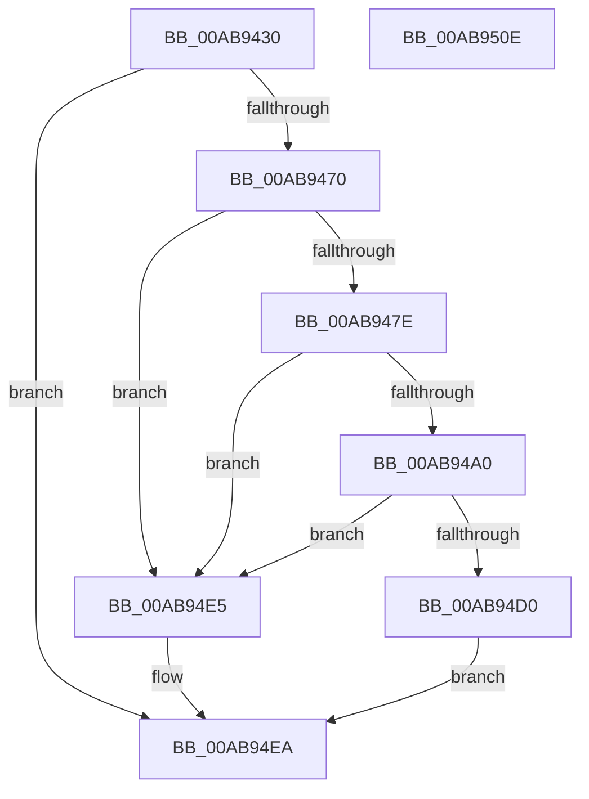

# RtlIncrementCorrelationVector

- RVA: `0x00AB9430`–`0x00AB950F` (길이 `223` bytes)
- VA: `0x0000000140AB9430`
- 실행 섹션: `PAGE`
- PDB 이름 있음: `예`; PDB Function 태그: `아니요`
- unwind 정보 RVA: `0x000BD2D0`
- 디코드: `62`개 명령, `223/223` bytes 표시
- 미해석 바이트: `0` (있으면 어셈블리에 `.byte`로 보존)

> 이 문서는 커널 이미지의 기계어와 PDB 기호를 분석해 생성했습니다. 4번과 5번은 함수 원형과 자료형을 바이너리 사용 방식에서 추정한 C 해석이며 원본 소스 복구 결과는 아닙니다.

## 1. Dependencies

- 직접 호출 지점: **7**; 고유 호출 대상: **7**
- 직접 호출자로 확인된 함수: **0**
- RIP 상대 이미지 참조: **2**

### Outgoing calls
- `0x00AB945B` → [RtlpGetCorrelationVectorBufferLength](RtlpGetCorrelationVectorBufferLength_function_00AB9518.md) (function, `0x00AB9518`)
- `0x00AB9465` → [RtlValidateCorrelationVector](../70/RtlValidateCorrelationVector_function_007052E0.md) (function, `0x007052E0`)
- `0x00AB9473` → [RtlpGetCorrelationVectorLastDotPosition](../../text/5E/RtlpGetCorrelationVectorLastDotPosition_function_005EC574.md) (function, `0x005EC574`)
- `0x00AB9496` → [sscanf_s](../../text/50/sscanf_s_function_00505EC0.md) (function, `0x00505EC0`)
- `0x00AB94C2` → [snprintf_s](../../text/50/snprintf_s_function_00505330.md) (function, `0x00505330`)
- `0x00AB94DE` → [strcpy_s](../../text/50/strcpy_s_function_00505FB0.md) (function, `0x00505FB0`)
- `0x00AB94F4` → [_security_check_cookie](../../text/6A/_security_check_cookie_function_006AC640.md) (function, `0x006AC640`)

### Direct callers
- 이 함수 시작 RVA로 연결되는 직접 call은 확인되지 않았습니다. 간접 호출은 완전히 역산할 수 없습니다.

### Static image references
- `0x00AB9444` → RVA `0x00E0A740` (`.data`; read)
- `0x00AB9488` → RVA `0x00B05A80` (` ?? ::NNGAKEGL::`string'`; read)

## 2. Other-region calls and transfers

- 다른 실행 섹션으로 향하는 call: **5**
  - `0x00AB9473` → [RtlpGetCorrelationVectorLastDotPosition](../../text/5E/RtlpGetCorrelationVectorLastDotPosition_function_005EC574.md) (`PAGE` → `.text`)
  - `0x00AB9496` → [sscanf_s](../../text/50/sscanf_s_function_00505EC0.md) (`PAGE` → `.text`)
  - `0x00AB94C2` → [snprintf_s](../../text/50/snprintf_s_function_00505330.md) (`PAGE` → `.text`)
  - `0x00AB94DE` → [strcpy_s](../../text/50/strcpy_s_function_00505FB0.md) (`PAGE` → `.text`)
  - `0x00AB94F4` → [_security_check_cookie](../../text/6A/_security_check_cookie_function_006AC640.md) (`PAGE` → `.text`)
- 별도 외부 분기/꼬리 이동을 확인하지 못했습니다.

## 3. Assembly (complete function range)

```asm
00AB9430  48 89 5C 24 10                  mov qword ptr [rsp + 0x10], rbx
00AB9435  48 89 6C 24 18                  mov qword ptr [rsp + 0x18], rbp
00AB943A  48 89 74 24 20                  mov qword ptr [rsp + 0x20], rsi
00AB943F  57                              push rdi
00AB9440  48 83 EC 50                     sub rsp, 0x50
00AB9444  48 8B 05 F5 12 35 00            mov rax, qword ptr [rip + 0x3512f5]
00AB944B  48 33 C4                        xor rax, rsp
00AB944E  48 89 44 24 48                  mov qword ptr [rsp + 0x48], rax
00AB9453  83 64 24 30 00                  and dword ptr [rsp + 0x30], 0
00AB9458  48 8B F9                        mov rdi, rcx
00AB945B  E8 B8 00 00 00                  call 0x140ab9518
00AB9460  48 8B CF                        mov rcx, rdi
00AB9463  8B E8                           mov ebp, eax
00AB9465  E8 76 BE C4 FF                  call 0x1407052e0
00AB946A  8B D8                           mov ebx, eax
00AB946C  85 C0                           test eax, eax
00AB946E  78 7A                           js 0x140ab94ea
00AB9470  48 8B CF                        mov rcx, rdi
00AB9473  E8 FC 30 B3 FF                  call 0x1405ec574
00AB9478  8B F0                           mov esi, eax
00AB947A  85 C0                           test eax, eax
00AB947C  78 67                           js 0x140ab94e5
00AB947E  FF C0                           inc eax
00AB9480  4C 8D 44 24 30                  lea r8, [rsp + 0x30]
00AB9485  48 63 C8                        movsxd rcx, eax
00AB9488  48 8D 15 F1 C5 04 00            lea rdx, [rip + 0x4c5f1]
00AB948F  48 03 F9                        add rdi, rcx
00AB9492  48 8D 4F 01                     lea rcx, [rdi + 1]
00AB9496  E8 25 CA A4 FF                  call 0x140505ec0
00AB949B  83 F8 01                        cmp eax, 1
00AB949E  75 45                           jne 0x140ab94e5
00AB94A0  8B 44 24 30                     mov eax, dword ptr [rsp + 0x30]
00AB94A4  4C 8D 0D D5 C5 04 00            lea r9, [rip + 0x4c5d5]
00AB94AB  FF C0                           inc eax
00AB94AD  48 8D 4C 24 38                  lea rcx, [rsp + 0x38]
00AB94B2  BA 0C 00 00 00                  mov edx, 0xc
00AB94B7  89 44 24 30                     mov dword ptr [rsp + 0x30], eax
00AB94BB  44 8B C2                        mov r8d, edx
00AB94BE  89 44 24 20                     mov dword ptr [rsp + 0x20], eax
00AB94C2  E8 69 BE A4 FF                  call 0x140505330
00AB94C7  2B EE                           sub ebp, esi
00AB94C9  83 ED 02                        sub ebp, 2
00AB94CC  3B C5                           cmp eax, ebp
00AB94CE  7D 15                           jge 0x140ab94e5
00AB94D0  FF C0                           inc eax
00AB94D2  4C 8D 44 24 38                  lea r8, [rsp + 0x38]
00AB94D7  48 63 D0                        movsxd rdx, eax
00AB94DA  48 8D 4F 01                     lea rcx, [rdi + 1]
00AB94DE  E8 CD CA A4 FF                  call 0x140505fb0
00AB94E3  EB 05                           jmp 0x140ab94ea
00AB94E5  BB 05 00 00 80                  mov ebx, 0x80000005
00AB94EA  8B C3                           mov eax, ebx
00AB94EC  48 8B 4C 24 48                  mov rcx, qword ptr [rsp + 0x48]
00AB94F1  48 33 CC                        xor rcx, rsp
00AB94F4  E8 47 31 BF FF                  call 0x1406ac640
00AB94F9  48 8B 5C 24 68                  mov rbx, qword ptr [rsp + 0x68]
00AB94FE  48 8B 6C 24 70                  mov rbp, qword ptr [rsp + 0x70]
00AB9503  48 8B 74 24 78                  mov rsi, qword ptr [rsp + 0x78]
00AB9508  48 83 C4 50                     add rsp, 0x50
00AB950C  5F                              pop rdi
00AB950D  C3                              ret
00AB950E  CC                              int3
```

## 4. C-style interpretation (structured pseudocode)

```c
__int64 __fastcall RtlIncrementCorrelationVector(__int64 a1)
{
    __int64 result;
    __int64 v_rbp;
    __int64 v_rdi;
    __int64 v_rsp;
    unsigned __int64 v_stack_m10;
    unsigned __int64 v_stack_m20;
    unsigned int v_stack_m28;
    unsigned int v_stack_m38;
    unsigned __int64 v_stack_p10;
    unsigned __int64 v_stack_p18;
    unsigned __int64 v_stack_p20;

    v_stack_p10 = v_rbx;
    v_stack_p18 = v_rbp;
    v_stack_p20 = v_rsi;
    v_rsp = (v_rsp) - (80);
    result = (*(unsigned __int64 *)(v_rip + 3478261)) ^ (v_rsp);
    v_stack_m10 = result;
    result = RtlpGetCorrelationVectorBufferLength(a1, a2, a3, a4);
    result = RtlValidateCorrelationVector(a1, a2, a3, a4);
    if (sign_flag) goto loc_00AB94EA;
    result = RtlpGetCorrelationVectorLastDotPosition(a1, a2, a3, a4);
    if (sign_flag) goto loc_00AB94E5;
    result = (unsigned int)((result) + 1);
    v_rdi = (a1) + ((int)((unsigned int)(result)));
    result = sscanf_s(v_rdi + 1, v_rip + 312817, v_stack_m28, a4);
    if (((unsigned int)(result)) != 1) goto loc_00AB94E5;
    result = (unsigned int)(((unsigned int)(v_stack_m28)) + 1);
    v_stack_m28 = (unsigned int)(result);
    v_stack_m38 = (unsigned int)(result);
    result = snprintf_s(v_stack_m20, 12, 12, v_rip + 312789);
    v_rbp = (unsigned int)(((unsigned int)((unsigned int)(result))) - ((unsigned int)((unsigned int)((unsigned int)(result)))));
    v_rbp = (unsigned int)((v_rbp) - (2));
    if (((unsigned int)(result)) >= ((unsigned int)(v_rbp))) goto loc_00AB94E5;
    result = (unsigned int)((result) + 1);
    result = strcpy_s(v_rdi + 1, (int)((unsigned int)(result)), v_stack_m20, v_rip + 312789);
    goto loc_00AB94EA;
loc_00AB94E5:
loc_00AB94EA:
    a1 = (v_stack_m10) ^ (v_rsp);
    result = _security_check_cookie(a1, (int)((unsigned int)(result)), v_stack_m20, v_rip + 312789);
    v_rsp = (v_rsp) + (80);
    return result;
}
```

## 5. (Beta) C Style

```c
int64_t RtlIncrementCorrelationVector(void *Arg1)
{
    uint8_t *arg1 = (uint8_t *)Arg1;

    int64_t result;
    int64_t local_rbp;
    int64_t local_rdi;
    int64_t local_rsp;
    uint64_t v_stack_m10;
    uint64_t v_stack_m20;
    uint32_t v_stack_m28;
    uint32_t v_stack_m38;
    uint64_t v_stack_p10;
    uint64_t v_stack_p18;
    uint64_t v_stack_p20;

    v_stack_p10 = local_rbx;
    v_stack_p18 = local_rbp;
    v_stack_p20 = local_rsi;
    local_rsp = (local_rsp) - (80);
    result = (*(uint64_t *)(v_rip + 0x3512F5)) ^ (local_rsp);
    v_stack_m10 = result;
    result = RtlpGetCorrelationVectorBufferLength(Arg1, a2, a3, a4);
    result = RtlValidateCorrelationVector(Arg1, a2, a3, a4);
    if (sign_flag) goto loc_00AB94EA;
    result = RtlpGetCorrelationVectorLastDotPosition(Arg1, a2, a3, a4);
    if (sign_flag) goto loc_00AB94E5;
    result = (uint32_t)((result) + 1);
    local_rdi = (Arg1) + ((int32_t)((uint32_t)(result)));
    result = sscanf_s(local_rdi + 1, v_rip + 312817, v_stack_m28, a4);
    if (((uint32_t)(result)) != 1) goto loc_00AB94E5;
    result = (uint32_t)(((uint32_t)(v_stack_m28)) + 1);
    v_stack_m28 = (uint32_t)(result);
    v_stack_m38 = (uint32_t)(result);
    result = snprintf_s(v_stack_m20, 12, 12, v_rip + 312789);
    local_rbp = (uint32_t)(((uint32_t)((uint32_t)(result))) - ((uint32_t)((uint32_t)((uint32_t)(result)))));
    local_rbp = (uint32_t)((local_rbp) - (2));
    if (((uint32_t)(result)) >= ((uint32_t)(local_rbp))) goto loc_00AB94E5;
    result = (uint32_t)((result) + 1);
    result = strcpy_s(local_rdi + 1, (int32_t)((uint32_t)(result)), v_stack_m20, v_rip + 312789);
    goto loc_00AB94EA;
loc_00AB94E5:
loc_00AB94EA:
    Arg1 = (v_stack_m10) ^ (local_rsp);
    result = _security_check_cookie(Arg1, (int32_t)((uint32_t)(result)), v_stack_m20, v_rip + 312789);
    local_rsp = (local_rsp) + (80);
    return result;
}
```

### 관측된 메모리 오프셋

구조체 형식이 확인되지 않은 접근은 인자 기준의 오프셋으로만 기록했습니다.

| 기준 인자 | 오프셋 표현 | 폭 (bit) | 접근 |
|---|---:|---:|---|
| `Arg1` | `+ 0x1` | `64` | `R` |

## 6. Execution-region graph

[열기: 2D/3D 그래프와 함수 탐색 컨트롤 패널](../../../control-panel.html?section=page&rva=0x00AB9430&view=graph)

- 2D 그래프는 위에서 아래로 흐르고, 3D 그래프는 빈 공간을 드래그해 회전합니다. Shift+드래그는 이동, 휠은 확대·축소, 함수 노드 선택은 대상 보고서 이동입니다.

### Static fallback


