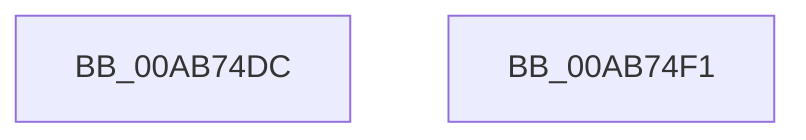

# RtlpFcConfigurationTypeToBufferType

- RVA: `0x00AB74DC`–`0x00AB74F2` (길이 `22` bytes)
- VA: `0x0000000140AB74DC`
- 실행 섹션: `PAGE`
- PDB 이름 있음: `예`; PDB Function 태그: `아니요`
- unwind 정보 RVA: `0x000DB714`
- 디코드: `6`개 명령, `22/22` bytes 표시
- 미해석 바이트: `0` (있으면 어셈블리에 `.byte`로 보존)

> 이 문서는 커널 이미지의 기계어와 PDB 기호를 분석해 생성했습니다. 4번과 5번은 함수 원형과 자료형을 바이너리 사용 방식에서 추정한 C 해석이며 원본 소스 복구 결과는 아닙니다.

## 1. Dependencies

- 직접 호출 지점: **0**; 고유 호출 대상: **0**
- 직접 호출자로 확인된 함수: **1**
- RIP 상대 이미지 참조: **0**

### Outgoing calls
- 직접 디코드된 call 명령이 없습니다.

### Direct callers
- [RtlpFcQueryAllInternalFeatureConfigurationsFromBufferSet](../../text/5F/RtlpFcQueryAllInternalFeatureConfigurationsFromBufferSet_function_005F0D98.md) at `0x005F0DB2`

### Static image references
- 디코드된 RIP-relative 메모리 참조가 없습니다.

## 2. Other-region calls and transfers

- 다른 실행 섹션으로 향하는 call: **0**
- 별도 외부 분기/꼬리 이동을 확인하지 못했습니다.

## 3. Assembly (complete function range)

```asm
00AB74DC  83 64 24 10 00                  and dword ptr [rsp + 0x10], 0
00AB74E1  48 63 C1                        movsxd rax, ecx
00AB74E4  C7 44 24 14 01 00 00 00         mov dword ptr [rsp + 0x14], 1
00AB74EC  8B 44 84 10                     mov eax, dword ptr [rsp + rax*4 + 0x10]
00AB74F0  C3                              ret
00AB74F1  CC                              int3
```

## 4. C-style interpretation (structured pseudocode)

```c
__int64 __fastcall RtlpFcConfigurationTypeToBufferType(int a1)
{
    unsigned int v_stack_p10;
    unsigned int v_stack_p14;

    v_stack_p14 = 1;
    return (unsigned int)(*(unsigned int *)(v_rsp + (int)(a1) * 4 + 16));
}
```

## 5. (Beta) C Style

```c
int64_t RtlpFcConfigurationTypeToBufferType(int32_t Arg1)
{
    uint32_t v_stack_p10;
    uint32_t v_stack_p14;

    v_stack_p14 = 1;
    return (uint32_t)(*(uint32_t *)(local_rsp + (int32_t)(Arg1) * 4 + 0x10));
}
```

## 6. Execution-region graph

[열기: 2D/3D 그래프와 함수 탐색 컨트롤 패널](../../../control-panel.html?section=page&rva=0x00AB74DC&view=graph)

- 2D 그래프는 위에서 아래로 흐르고, 3D 그래프는 빈 공간을 드래그해 회전합니다. Shift+드래그는 이동, 휠은 확대·축소, 함수 노드 선택은 대상 보고서 이동입니다.

### Static fallback


