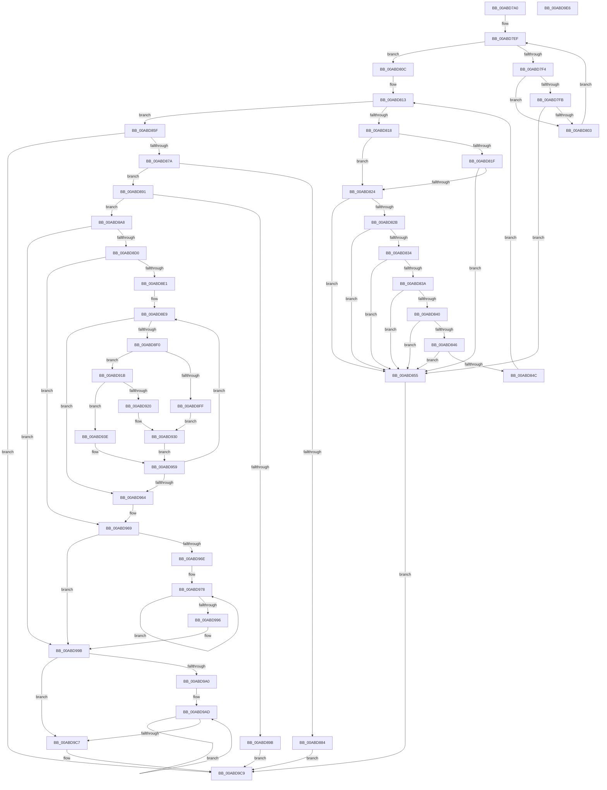

# RtlpFcUpdateFeatureConfiguration

- RVA: `0x00ABD7A0`–`0x00ABD9E7` (길이 `583` bytes)
- VA: `0x0000000140ABD7A0`
- 실행 섹션: `PAGE`
- PDB 이름 있음: `예`; PDB Function 태그: `아니요`
- unwind 정보 RVA: `0x000BD610`
- 디코드: `176`개 명령, `583/583` bytes 표시
- 미해석 바이트: `0` (있으면 어셈블리에 `.byte`로 보존)

> 이 문서는 커널 이미지의 기계어와 PDB 기호를 분석해 생성했습니다. 4번과 5번은 함수 원형과 자료형을 바이너리 사용 방식에서 추정한 C 해석이며 원본 소스 복구 결과는 아닙니다.

## 1. Dependencies

- 직접 호출 지점: **8**; 고유 호출 대상: **7**
- 직접 호출자로 확인된 함수: **1**
- RIP 상대 이미지 참조: **1**

### Outgoing calls
- `0x00ABD7E1` → [qsort](../../text/50/qsort_function_005009F0.md) (function, `0x005009F0`)
- `0x00ABD82B` → [RtlpIsImmutableFeatureConfigurationPriority](../../text/5F/RtlpIsImmutableFeatureConfigurationPriority_function_005F0F7C.md) (function, `0x005F0F7C`)
- `0x00ABD86D` → [RtlpFcCalculateRequiredSizeForNewFeatureTable](../AA/RtlpFcCalculateRequiredSizeForNewFeatureTable_function_00AAF250.md) (function, `0x00AAF250`)
- `0x00ABD8B2` → [memset](../../text/6C/memset_function_006C6C40.md) (function, `0x006C6C40`)
- `0x00ABD8F6` → [RtlpFcCompareFeatureToUpdate](../AA/RtlpFcCompareFeatureToUpdate_function_00AAF3B4.md) (function, `0x00AAF3B4`)
- `0x00ABD90D` → [RtlpFcApplyUpdateAndAddFeature](../79/RtlpFcApplyUpdateAndAddFeature_function_0079A614.md) (function, `0x0079A614`)
- `0x00ABD92B` → [RtlpFcCreateAndAddFeatureFromUpdate](../79/RtlpFcCreateAndAddFeatureFromUpdate_function_0079A688.md) (function, `0x0079A688`)
- `0x00ABD9B8` → [RtlpFcCreateAndAddFeatureFromUpdate](../79/RtlpFcCreateAndAddFeatureFromUpdate_function_0079A688.md) (function, `0x0079A688`)

### Direct callers
- [CmFcManagerUpdateFeatureConfigurations](../7F/CmFcManagerUpdateFeatureConfigurations_function_007F4CF4.md) at `0x007F4EC0`
- [CmFcManagerUpdateFeatureConfigurations](../7F/CmFcManagerUpdateFeatureConfigurations_function_007F4CF4.md) at `0x007F4F3A`

### Static image references
- `0x00ABD7CB` → RVA `0x00A9DC40` (`RtlpFcCompareUpdates`; read)

## 2. Other-region calls and transfers

- 다른 실행 섹션으로 향하는 call: **3**
  - `0x00ABD7E1` → [qsort](../../text/50/qsort_function_005009F0.md) (`PAGE` → `.text`)
  - `0x00ABD82B` → [RtlpIsImmutableFeatureConfigurationPriority](../../text/5F/RtlpIsImmutableFeatureConfigurationPriority_function_005F0F7C.md) (`PAGE` → `.text`)
  - `0x00ABD8B2` → [memset](../../text/6C/memset_function_006C6C40.md) (`PAGE` → `.text`)
- 별도 외부 분기/꼬리 이동을 확인하지 못했습니다.

## 3. Assembly (complete function range)

```asm
00ABD7A0  48 8B C4                        mov rax, rsp
00ABD7A3  48 89 58 08                     mov qword ptr [rax + 8], rbx
00ABD7A7  48 89 68 18                     mov qword ptr [rax + 0x18], rbp
00ABD7AB  48 89 70 20                     mov qword ptr [rax + 0x20], rsi
00ABD7AF  48 89 50 10                     mov qword ptr [rax + 0x10], rdx
00ABD7B3  57                              push rdi
00ABD7B4  41 54                           push r12
00ABD7B6  41 55                           push r13
00ABD7B8  41 56                           push r14
00ABD7BA  41 57                           push r15
00ABD7BC  48 83 EC 20                     sub rsp, 0x20
00ABD7C0  48 83 60 10 00                  and qword ptr [rax + 0x10], 0
00ABD7C5  49 8B F9                        mov rdi, r9
00ABD7C8  4D 8B E8                        mov r13, r8
00ABD7CB  4C 8D 0D 6E 04 FE FF            lea r9, [rip - 0x1fb92]
00ABD7D2  4C 8B E1                        mov r12, rcx
00ABD7D5  48 8B D7                        mov rdx, rdi
00ABD7D8  49 8B CD                        mov rcx, r13
00ABD7DB  41 B8 20 00 00 00               mov r8d, 0x20
00ABD7E1  E8 0A 32 A4 FF                  call 0x1405009f0
00ABD7E6  41 B9 01 00 00 00               mov r9d, 1
00ABD7EC  49 8B D5                        mov rdx, r13
00ABD7EF  4C 3B CF                        cmp r9, rdi
00ABD7F2  73 18                           jae 0x140abd80c
00ABD7F4  8B 02                           mov eax, dword ptr [rdx]
00ABD7F6  39 42 20                        cmp dword ptr [rdx + 0x20], eax
00ABD7F9  75 08                           jne 0x140abd803
00ABD7FB  8B 42 04                        mov eax, dword ptr [rdx + 4]
00ABD7FE  39 42 24                        cmp dword ptr [rdx + 0x24], eax
00ABD801  74 52                           je 0x140abd855
00ABD803  49 FF C1                        inc r9
00ABD806  48 83 C2 20                     add rdx, 0x20
00ABD80A  EB E3                           jmp 0x140abd7ef
00ABD80C  45 33 C0                        xor r8d, r8d
00ABD80F  49 8D 55 04                     lea rdx, [r13 + 4]
00ABD813  4C 3B C7                        cmp r8, rdi
00ABD816  73 47                           jae 0x140abd85f
00ABD818  8B 42 18                        mov eax, dword ptr [rdx + 0x18]
00ABD81B  A8 04                           test al, 4
00ABD81D  74 05                           je 0x140abd824
00ABD81F  83 F8 04                        cmp eax, 4
00ABD822  75 31                           jne 0x140abd855
00ABD824  8B 0A                           mov ecx, dword ptr [rdx]
00ABD826  83 F9 0F                        cmp ecx, 0xf
00ABD829  77 2A                           ja 0x140abd855
00ABD82B  E8 4C 37 B3 FF                  call 0x1405f0f7c
00ABD830  84 C0                           test al, al
00ABD832  75 21                           jne 0x140abd855
00ABD834  83 7A 04 02                     cmp dword ptr [rdx + 4], 2
00ABD838  77 1B                           ja 0x140abd855
00ABD83A  83 7A 08 01                     cmp dword ptr [rdx + 8], 1
00ABD83E  77 15                           ja 0x140abd855
00ABD840  80 7A 0C 40                     cmp byte ptr [rdx + 0xc], 0x40
00ABD844  73 0F                           jae 0x140abd855
00ABD846  83 7A 10 04                     cmp dword ptr [rdx + 0x10], 4
00ABD84A  73 09                           jae 0x140abd855
00ABD84C  49 FF C0                        inc r8
00ABD84F  48 83 C2 20                     add rdx, 0x20
00ABD853  EB BE                           jmp 0x140abd813
00ABD855  B8 0D 00 00 C0                  mov eax, 0xc000000d
00ABD85A  E9 6A 01 00 00                  jmp 0x140abd9c9
00ABD85F  4C 8D 4C 24 58                  lea r9, [rsp + 0x58]
00ABD864  4C 8B C7                        mov r8, rdi
00ABD867  49 8B D5                        mov rdx, r13
00ABD86A  49 8B CC                        mov rcx, r12
00ABD86D  E8 DE 19 FF FF                  call 0x140aaf250
00ABD872  85 C0                           test eax, eax
00ABD874  0F 88 4F 01 00 00               js 0x140abd9c9
00ABD87A  4C 8B 44 24 58                  mov r8, qword ptr [rsp + 0x58]
00ABD87F  4D 85 C0                        test r8, r8
00ABD882  75 0D                           jne 0x140abd891
00ABD884  48 8B 4C 24 78                  mov rcx, qword ptr [rsp + 0x78]
00ABD889  4C 21 01                        and qword ptr [rcx], r8
00ABD88C  E9 38 01 00 00                  jmp 0x140abd9c9
00ABD891  48 8B 44 24 78                  mov rax, qword ptr [rsp + 0x78]
00ABD896  4C 3B 00                        cmp r8, qword ptr [rax]
00ABD899  76 0D                           jbe 0x140abd8a8
00ABD89B  4C 89 00                        mov qword ptr [rax], r8
00ABD89E  B8 05 00 00 80                  mov eax, 0x80000005
00ABD8A3  E9 21 01 00 00                  jmp 0x140abd9c9
00ABD8A8  48 8B 74 24 70                  mov rsi, qword ptr [rsp + 0x70]
00ABD8AD  33 D2                           xor edx, edx
00ABD8AF  48 8B CE                        mov rcx, rsi
00ABD8B2  E8 89 93 C0 FF                  call 0x1406c6c40
00ABD8B7  83 26 00                        and dword ptr [rsi], 0
00ABD8BA  4C 8D 46 04                     lea r8, [rsi + 4]
00ABD8BE  33 DB                           xor ebx, ebx
00ABD8C0  4C 89 44 24 58                  mov qword ptr [rsp + 0x58], r8
00ABD8C5  33 ED                           xor ebp, ebp
00ABD8C7  4D 85 E4                        test r12, r12
00ABD8CA  0F 84 CB 00 00 00               je 0x140abd99b
00ABD8D0  41 8B 04 24                     mov eax, dword ptr [r12]
00ABD8D4  49 8D 54 24 04                  lea rdx, [r12 + 4]
00ABD8D9  85 C0                           test eax, eax
00ABD8DB  0F 84 88 00 00 00               je 0x140abd969
00ABD8E1  8B C8                           mov ecx, eax
00ABD8E3  4C 8B F2                        mov r14, rdx
00ABD8E6  4D 8B FD                        mov r15, r13
00ABD8E9  8B C1                           mov eax, ecx
00ABD8EB  48 3B EF                        cmp rbp, rdi
00ABD8EE  73 74                           jae 0x140abd964
00ABD8F0  49 8B D7                        mov rdx, r15
00ABD8F3  49 8B CE                        mov rcx, r14
00ABD8F6  E8 B9 1A FF FF                  call 0x140aaf3b4
00ABD8FB  85 C0                           test eax, eax
00ABD8FD  75 1C                           jne 0x140abd91b
00ABD8FF  4C 8B CE                        mov r9, rsi
00ABD902  4C 8D 44 24 58                  lea r8, [rsp + 0x58]
00ABD907  49 8B D6                        mov rdx, r14
00ABD90A  49 8B CF                        mov rcx, r15
00ABD90D  E8 02 CD CD FF                  call 0x14079a614
00ABD912  48 FF C3                        inc rbx
00ABD915  49 83 C6 10                     add r14, 0x10
00ABD919  EB 15                           jmp 0x140abd930
00ABD91B  83 F8 01                        cmp eax, 1
00ABD91E  75 1E                           jne 0x140abd93e
00ABD920  4C 8B C6                        mov r8, rsi
00ABD923  48 8D 54 24 58                  lea rdx, [rsp + 0x58]
00ABD928  49 8B CF                        mov rcx, r15
00ABD92B  E8 58 CD CD FF                  call 0x14079a688
00ABD930  4C 8B 44 24 58                  mov r8, qword ptr [rsp + 0x58]
00ABD935  48 FF C5                        inc rbp
00ABD938  49 83 C7 20                     add r15, 0x20
00ABD93C  EB 1B                           jmp 0x140abd959
00ABD93E  41 0F 10 06                     movups xmm0, xmmword ptr [r14]
00ABD942  48 FF C3                        inc rbx
00ABD945  F3 41 0F 7F 00                  movdqu xmmword ptr [r8], xmm0
00ABD94A  FF 06                           inc dword ptr [rsi]
00ABD94C  49 83 C0 10                     add r8, 0x10
00ABD950  4C 89 44 24 58                  mov qword ptr [rsp + 0x58], r8
00ABD955  49 83 C6 10                     add r14, 0x10
00ABD959  41 8B 0C 24                     mov ecx, dword ptr [r12]
00ABD95D  8B C1                           mov eax, ecx
00ABD95F  48 3B D9                        cmp rbx, rcx
00ABD962  72 85                           jb 0x140abd8e9
00ABD964  49 8D 54 24 04                  lea rdx, [r12 + 4]
00ABD969  48 3B D8                        cmp rbx, rax
00ABD96C  73 2D                           jae 0x140abd99b
00ABD96E  48 8B CB                        mov rcx, rbx
00ABD971  48 C1 E1 04                     shl rcx, 4
00ABD975  48 03 CA                        add rcx, rdx
00ABD978  0F 10 01                        movups xmm0, xmmword ptr [rcx]
00ABD97B  48 FF C3                        inc rbx
00ABD97E  48 8D 49 10                     lea rcx, [rcx + 0x10]
00ABD982  F3 41 0F 7F 00                  movdqu xmmword ptr [r8], xmm0
00ABD987  FF 06                           inc dword ptr [rsi]
00ABD989  49 83 C0 10                     add r8, 0x10
00ABD98D  41 8B 04 24                     mov eax, dword ptr [r12]
00ABD991  48 3B D8                        cmp rbx, rax
00ABD994  72 E2                           jb 0x140abd978
00ABD996  4C 89 44 24 58                  mov qword ptr [rsp + 0x58], r8
00ABD99B  48 3B EF                        cmp rbp, rdi
00ABD99E  73 27                           jae 0x140abd9c7
00ABD9A0  48 8B DD                        mov rbx, rbp
00ABD9A3  48 C1 E3 05                     shl rbx, 5
00ABD9A7  49 03 DD                        add rbx, r13
00ABD9AA  48 2B FD                        sub rdi, rbp
00ABD9AD  4C 8B C6                        mov r8, rsi
00ABD9B0  48 8D 54 24 58                  lea rdx, [rsp + 0x58]
00ABD9B5  48 8B CB                        mov rcx, rbx
00ABD9B8  E8 CB CC CD FF                  call 0x14079a688
00ABD9BD  48 83 C3 20                     add rbx, 0x20
00ABD9C1  48 83 EF 01                     sub rdi, 1
00ABD9C5  75 E6                           jne 0x140abd9ad
00ABD9C7  33 C0                           xor eax, eax
00ABD9C9  48 8B 5C 24 50                  mov rbx, qword ptr [rsp + 0x50]
00ABD9CE  48 8B 6C 24 60                  mov rbp, qword ptr [rsp + 0x60]
00ABD9D3  48 8B 74 24 68                  mov rsi, qword ptr [rsp + 0x68]
00ABD9D8  48 83 C4 20                     add rsp, 0x20
00ABD9DC  41 5F                           pop r15
00ABD9DE  41 5E                           pop r14
00ABD9E0  41 5D                           pop r13
00ABD9E2  41 5C                           pop r12
00ABD9E4  5F                              pop rdi
00ABD9E5  C3                              ret
00ABD9E6  CC                              int3
```

## 4. C-style interpretation (structured pseudocode)

```c
__int64 __fastcall RtlpFcUpdateFeatureConfiguration(__int64 a1, __int64 a2, __int64 a3, __int64 a4, __int64 a5, __int64 a6)
{
    __int64 result;
    __int64 v_r14;
    __int64 v_r15;
    __int64 v_rbp;
    __int64 v_rbx;
    __int64 v_rdi;
    __int64 v_rsp;
    unsigned __int64 v_stack_p10;
    unsigned __int64 v_stack_p18;
    unsigned __int64 v_stack_p20;
    unsigned __int64 v_stack_p8;

    *(unsigned __int64 *)(v_rsp + 8) = v_rbx;
    *(unsigned __int64 *)(v_rsp + 24) = v_rbp;
    *(unsigned __int64 *)(v_rsp + 32) = v_rsi;
    *(unsigned __int64 *)(v_rsp + 16) = a2;
    v_rsp = (v_rsp) - (32);
    result = qsort(a3, a4, 32, v_rip - 129938);
loc_00ABD7EF:
    if (1 >= a4) goto loc_00ABD80C;
    if ((*(unsigned int *)(a3 + 32)) != ((unsigned int)((unsigned int)(*(unsigned int *)(a3))))) goto loc_00ABD803;
    if ((*(unsigned int *)(a3 + 36)) == ((unsigned int)((unsigned int)(*(unsigned int *)(a3 + 4))))) goto loc_00ABD855;
loc_00ABD803:
    a4 = (1) + 1;
    a2 = (a3) + (32);
    goto loc_00ABD7EF;
loc_00ABD80C:
    a3 = 0;
loc_00ABD813:
    if (0 >= a4) goto loc_00ABD85F;
    if ((((unsigned __int8)((unsigned int)(*(unsigned int *)(a3 + 4 + 24)))) & (4)) == 0) goto loc_00ABD824;
    if (((unsigned int)((unsigned int)(*(unsigned int *)(a3 + 4 + 24)))) != 4) goto loc_00ABD855;
loc_00ABD824:
    if (((unsigned int)((unsigned int)(*(unsigned int *)(a3 + 4)))) > 15) goto loc_00ABD855;
    result = RtlpIsImmutableFeatureConfigurationPriority((unsigned int)(*(unsigned int *)(a3 + 4)), a3 + 4, a3, a4);
    if ((unsigned __int8)(result) != 0) goto loc_00ABD855;
    if ((*(unsigned int *)(a3 + 4 + 4)) > 2) goto loc_00ABD855;
    if ((*(unsigned int *)(a3 + 4 + 8)) > 1) goto loc_00ABD855;
    if ((*(unsigned __int8 *)(a3 + 4 + 12)) >= 64) goto loc_00ABD855;
    if ((*(unsigned int *)(a3 + 4 + 16)) >= 4) goto loc_00ABD855;
    a3 = (a3) + 1;
    a2 = (a3 + 4) + (32);
    goto loc_00ABD813;
loc_00ABD855:
    goto loc_00ABD9C9;
loc_00ABD85F:
    result = RtlpFcCalculateRequiredSizeForNewFeatureTable(a1, a3, a4, v_stack_p10);
    if (sign_flag) goto loc_00ABD9C9;
    if (v_stack_p10 != 0) goto loc_00ABD891;
    goto loc_00ABD9C9;
loc_00ABD891:
    if (v_stack_p10 <= (*(unsigned __int64 *)(a6))) goto loc_00ABD8A8;
    *(unsigned __int64 *)(a6) = v_stack_p10;
    goto loc_00ABD9C9;
loc_00ABD8A8:
    a2 = 0;
    result = memset(a5, a2, v_stack_p10, v_stack_p10);
    v_rbx = 0;
    v_stack_p10 = a5 + 4;
    v_rbp = 0;
    if (a1 == 0) goto loc_00ABD99B;
    if ((unsigned int)((unsigned int)(*(unsigned int *)(a1))) == 0) goto loc_00ABD969;
loc_00ABD8E9:
    if (0 >= a4) goto loc_00ABD964;
    result = RtlpFcCompareFeatureToUpdate(a1 + 4, a3, a5 + 4, v_stack_p10);
    if ((unsigned int)(result) != 0) goto loc_00ABD91B;
    result = RtlpFcApplyUpdateAndAddFeature(a3, a1 + 4, v_stack_p10, a5);
    v_rbx = (v_rbx) + 1;
    v_r14 = (a1 + 4) + (16);
    goto loc_00ABD930;
loc_00ABD91B:
    if (((unsigned int)(result)) != 1) goto loc_00ABD93E;
    result = RtlpFcCreateAndAddFeatureFromUpdate(a3, v_stack_p10, a5, a5);
loc_00ABD930:
    v_rbp = (v_rbp) + 1;
    v_r15 = (a3) + (32);
    goto loc_00ABD959;
loc_00ABD93E:
    v_rbx = (v_rbx) + 1;
    *(unsigned __int64 *)(v_stack_p10) = v_xmm0;
    a3 = (v_stack_p10) + (16);
    v_stack_p10 = a3;
    v_r14 = (v_r14) + (16);
loc_00ABD959:
    if (v_rbx < ((unsigned int)(*(unsigned int *)(a1)))) goto loc_00ABD8E9;
loc_00ABD964:
loc_00ABD969:
    if (v_rbx >= ((unsigned int)((unsigned int)((unsigned int)(*(unsigned int *)(a1)))))) goto loc_00ABD99B;
    a1 = (v_rbx) << (4);
    a1 = (a1) + (a1 + 4);
loc_00ABD978:
    v_rbx = (v_rbx) + 1;
    *(unsigned __int64 *)(a3) = v_xmm0;
    a3 = (a3) + (16);
    if (v_rbx < ((unsigned int)(*(unsigned int *)(a1)))) goto loc_00ABD978;
    v_stack_p10 = a3;
loc_00ABD99B:
    if (v_rbp >= a4) goto loc_00ABD9C7;
    v_rbx = (v_rbp) << (5);
    v_rbx = (v_rbx) + (a3);
    v_rdi = (a4) - (v_rbp);
loc_00ABD9AD:
    result = RtlpFcCreateAndAddFeatureFromUpdate(v_rbx, v_stack_p10, a5, a5);
    v_rbx = (v_rbx) + (32);
    v_rdi = (v_rdi) - (1);
    if (condition_is_not_equal) goto loc_00ABD9AD;
loc_00ABD9C7:
    result = 0;
loc_00ABD9C9:
    v_rsp = (v_rsp) + (32);
    return result;
}
```

## 5. (Beta) C Style

```c
int64_t RtlpFcUpdateFeatureConfiguration(int64_t Arg1, int64_t Arg2, void *Arg3, int64_t Arg4, void *Arg5, void *Arg6)
{
    uint8_t *arg3 = (uint8_t *)Arg3;
    uint8_t *arg5 = (uint8_t *)Arg5;
    uint8_t *arg6 = (uint8_t *)Arg6;

    int64_t result;
    int64_t local_r14;
    int64_t local_r15;
    int64_t local_rbp;
    int64_t local_rbx;
    int64_t local_rdi;
    int64_t local_rsp;
    uint64_t v_stack_p10;
    uint64_t v_stack_p18;
    uint64_t v_stack_p20;
    uint64_t v_stack_p8;

    *(uint64_t *)(local_rsp + 0x8) = local_rbx;
    *(uint64_t *)(local_rsp + 0x18) = local_rbp;
    *(uint64_t *)(local_rsp + 0x20) = local_rsi;
    *(uint64_t *)(local_rsp + 0x10) = Arg2;
    local_rsp = (local_rsp) - (32);
    result = qsort(Arg3, Arg4, 32, v_rip - 129938);
loc_00ABD7EF:
    if (1 >= Arg4) goto loc_00ABD80C;
    if ((*(uint32_t *)(arg3 + 0x20)) != ((uint32_t)((uint32_t)(*(uint32_t *)(arg3))))) goto loc_00ABD803;
    if ((*(uint32_t *)(arg3 + 0x24)) == ((uint32_t)((uint32_t)(*(uint32_t *)(arg3 + 0x4))))) goto loc_00ABD855;
loc_00ABD803:
    Arg4 = (1) + 1;
    Arg2 = (Arg3) + (32);
    goto loc_00ABD7EF;
loc_00ABD80C:
    Arg3 = 0;
loc_00ABD813:
    if (0 >= Arg4) goto loc_00ABD85F;
    if ((((uint8_t)((uint32_t)(*(uint32_t *)(arg3 + 0x4 + 0x18)))) & (4)) == 0) goto loc_00ABD824;
    if (((uint32_t)((uint32_t)(*(uint32_t *)(arg3 + 0x4 + 0x18)))) != 4) goto loc_00ABD855;
loc_00ABD824:
    if (((uint32_t)((uint32_t)(*(uint32_t *)(arg3 + 0x4)))) > 15) goto loc_00ABD855;
    result = RtlpIsImmutableFeatureConfigurationPriority((uint32_t)(*(uint32_t *)(arg3 + 0x4)), Arg3 + 4, Arg3, Arg4);
    if ((uint8_t)(result) != 0) goto loc_00ABD855;
    if ((*(uint32_t *)(arg3 + 0x4 + 0x4)) > 2) goto loc_00ABD855;
    if ((*(uint32_t *)(arg3 + 0x4 + 0x8)) > 1) goto loc_00ABD855;
    if ((*(uint8_t *)(arg3 + 0x4 + 0xC)) >= 64) goto loc_00ABD855;
    if ((*(uint32_t *)(arg3 + 0x4 + 0x10)) >= 4) goto loc_00ABD855;
    Arg3 = (Arg3) + 1;
    Arg2 = (Arg3 + 4) + (32);
    goto loc_00ABD813;
loc_00ABD855:
    goto loc_00ABD9C9;
loc_00ABD85F:
    result = RtlpFcCalculateRequiredSizeForNewFeatureTable(Arg1, Arg3, Arg4, v_stack_p10);
    if (sign_flag) goto loc_00ABD9C9;
    if (v_stack_p10 != 0) goto loc_00ABD891;
    goto loc_00ABD9C9;
loc_00ABD891:
    if (v_stack_p10 <= (*(uint64_t *)(arg6))) goto loc_00ABD8A8;
    *(uint64_t *)(arg6) = v_stack_p10;
    goto loc_00ABD9C9;
loc_00ABD8A8:
    Arg2 = 0;
    result = memset(Arg5, Arg2, v_stack_p10, v_stack_p10);
    local_rbx = 0;
    v_stack_p10 = Arg5 + 4;
    local_rbp = 0;
    if (Arg1 == 0) goto loc_00ABD99B;
    if ((uint32_t)((uint32_t)(*(uint32_t *)(Arg1))) == 0) goto loc_00ABD969;
loc_00ABD8E9:
    if (0 >= Arg4) goto loc_00ABD964;
    result = RtlpFcCompareFeatureToUpdate(Arg1 + 4, Arg3, Arg5 + 4, v_stack_p10);
    if ((uint32_t)(result) != 0) goto loc_00ABD91B;
    result = RtlpFcApplyUpdateAndAddFeature(Arg3, Arg1 + 4, v_stack_p10, Arg5);
    local_rbx = (local_rbx) + 1;
    local_r14 = (Arg1 + 4) + (16);
    goto loc_00ABD930;
loc_00ABD91B:
    if (((uint32_t)(result)) != 1) goto loc_00ABD93E;
    result = RtlpFcCreateAndAddFeatureFromUpdate(Arg3, v_stack_p10, Arg5, Arg5);
loc_00ABD930:
    local_rbp = (local_rbp) + 1;
    local_r15 = (Arg3) + (32);
    goto loc_00ABD959;
loc_00ABD93E:
    local_rbx = (local_rbx) + 1;
    *(uint64_t *)(v_stack_p10) = v_xmm0;
    Arg3 = (v_stack_p10) + (16);
    v_stack_p10 = Arg3;
    local_r14 = (local_r14) + (16);
loc_00ABD959:
    if (local_rbx < ((uint32_t)(*(uint32_t *)(Arg1)))) goto loc_00ABD8E9;
loc_00ABD964:
loc_00ABD969:
    if (local_rbx >= ((uint32_t)((uint32_t)((uint32_t)(*(uint32_t *)(Arg1)))))) goto loc_00ABD99B;
    Arg1 = (local_rbx) << (4);
    Arg1 = (Arg1) + (Arg1 + 4);
loc_00ABD978:
    local_rbx = (local_rbx) + 1;
    *(uint64_t *)(arg3) = v_xmm0;
    Arg3 = (Arg3) + (16);
    if (local_rbx < ((uint32_t)(*(uint32_t *)(Arg1)))) goto loc_00ABD978;
    v_stack_p10 = Arg3;
loc_00ABD99B:
    if (local_rbp >= Arg4) goto loc_00ABD9C7;
    local_rbx = (local_rbp) << (5);
    local_rbx = (local_rbx) + (Arg3);
    local_rdi = (Arg4) - (local_rbp);
loc_00ABD9AD:
    result = RtlpFcCreateAndAddFeatureFromUpdate(local_rbx, v_stack_p10, Arg5, Arg5);
    local_rbx = (local_rbx) + (32);
    local_rdi = (local_rdi) - (1);
    if (condition_is_not_equal) goto loc_00ABD9AD;
loc_00ABD9C7:
    result = 0;
loc_00ABD9C9:
    local_rsp = (local_rsp) + (32);
    return result;
}
```

### 관측된 메모리 오프셋

구조체 형식이 확인되지 않은 접근은 인자 기준의 오프셋으로만 기록했습니다.

| 기준 인자 | 오프셋 표현 | 폭 (bit) | 접근 |
|---|---:|---:|---|
| `Arg3` | `+ 0x0` | `32` | `R` |
| `Arg3` | `+ 0x4` | `32` | `R` |
| `Arg3` | `+ 0x4` | `64` | `R` |
| `Arg3` | `+ 0x20` | `32` | `R` |
| `Arg3` | `+ 0x24` | `32` | `R` |
| `Arg5` | `+ 0x0` | `32` | `R/W` |
| `Arg5` | `+ 0x4` | `64` | `R` |
| `Arg6` | `+ 0x0` | `64` | `R` |
| `Arg6` | `+ 0x0` | `64` | `R/W` |
| `Arg6` | `+ 0x0` | `64` | `W` |

## 6. Execution-region graph

[열기: 2D/3D 그래프와 함수 탐색 컨트롤 패널](../../../control-panel.html?section=page&rva=0x00ABD7A0&view=graph)

- 2D 그래프는 위에서 아래로 흐르고, 3D 그래프는 빈 공간을 드래그해 회전합니다. Shift+드래그는 이동, 휠은 확대·축소, 함수 노드 선택은 대상 보고서 이동입니다.

### Static fallback


