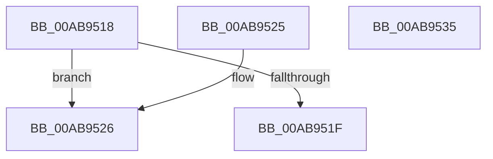

# RtlpGetCorrelationVectorBufferLength

- RVA: `0x00AB9518`–`0x00AB9536` (길이 `30` bytes)
- VA: `0x0000000140AB9518`
- 실행 섹션: `PAGE`
- PDB 이름 있음: `예`; PDB Function 태그: `예`
- unwind 정보 RVA: `0x000DB714`
- 디코드: `12`개 명령, `30/30` bytes 표시
- 미해석 바이트: `0` (있으면 어셈블리에 `.byte`로 보존)

> 이 문서는 커널 이미지의 기계어와 PDB 기호를 분석해 생성했습니다. 4번과 5번은 함수 원형과 자료형을 바이너리 사용 방식에서 추정한 C 해석이며 원본 소스 복구 결과는 아닙니다.

## 1. Dependencies

- 직접 호출 지점: **0**; 고유 호출 대상: **0**
- 직접 호출자로 확인된 함수: **6**
- RIP 상대 이미지 참조: **0**

### Outgoing calls
- 직접 디코드된 call 명령이 없습니다.

### Direct callers
- [RtlpGetCorrelationVectorEndPosition](../../text/5E/RtlpGetCorrelationVectorEndPosition_function_005EC52C.md) at `0x005EC536`
- [RtlpGetCorrelationVectorLastDotPosition](../../text/5E/RtlpGetCorrelationVectorLastDotPosition_function_005EC574.md) at `0x005EC582`
- [RtlValidateCorrelationVector](../70/RtlValidateCorrelationVector_function_007052E0.md) at `0x00705300`
- [RtlExtendCorrelationVector](../79/RtlExtendCorrelationVector_function_00791B70.md) at `0x00791B8B`
- [RtlpGetLastContiguosBase64Position](../79/RtlpGetLastContiguosBase64Position_function_00791D1C.md) at `0x00791D30`
- [RtlIncrementCorrelationVector](RtlIncrementCorrelationVector_function_00AB9430.md) at `0x00AB945B`

### Static image references
- 디코드된 RIP-relative 메모리 참조가 없습니다.

## 2. Other-region calls and transfers

- 다른 실행 섹션으로 향하는 call: **0**
- 별도 외부 분기/꼬리 이동을 확인하지 못했습니다.

## 3. Assembly (complete function range)

```asm
00AB9518  8A 11                           mov dl, byte ptr [rcx]
00AB951A  80 FA 01                        cmp dl, 1
00AB951D  75 07                           jne 0x140ab9526
00AB951F  B8 41 00 00 00                  mov eax, 0x41
00AB9524  C3                              ret
00AB9525  CC                              int3
00AB9526  83 C8 FF                        or eax, 0xffffffff
00AB9529  B9 81 00 00 00                  mov ecx, 0x81
00AB952E  80 FA 02                        cmp dl, 2
00AB9531  0F 44 C1                        cmove eax, ecx
00AB9534  C3                              ret
00AB9535  CC                              int3
```

## 4. C-style interpretation (structured pseudocode)

```c
__int64 __fastcall RtlpGetCorrelationVectorBufferLength(__int64 a1)
{
    __int64 result;

    if (((unsigned __int8)(*(unsigned __int8 *)(a1))) != 1) goto loc_00AB9526;
    return 65;
loc_00AB9526:
    result = (unsigned int)((65) | (0xFFFFFFFFULL));
    if (((unsigned __int8)(*(unsigned __int8 *)(a1))) == 2) { result = 129; }
    return result;
}
```

## 5. (Beta) C Style

```c
int64_t RtlpGetCorrelationVectorBufferLength(void *Arg1)
{
    uint8_t *arg1 = (uint8_t *)Arg1;

    int64_t result;

    if (((uint8_t)(*(uint8_t *)(arg1))) != 1) goto loc_00AB9526;
    return 65;
loc_00AB9526:
    result = (uint32_t)((65) | (0xFFFFFFFFULL));
    if (((uint8_t)(*(uint8_t *)(arg1))) == 2) { result = 129; }
    return result;
}
```

### 관측된 메모리 오프셋

구조체 형식이 확인되지 않은 접근은 인자 기준의 오프셋으로만 기록했습니다.

| 기준 인자 | 오프셋 표현 | 폭 (bit) | 접근 |
|---|---:|---:|---|
| `Arg1` | `+ 0x0` | `8` | `R` |

## 6. Execution-region graph

[열기: 2D/3D 그래프와 함수 탐색 컨트롤 패널](../../../control-panel.html?section=page&rva=0x00AB9518&view=graph)

- 2D 그래프는 위에서 아래로 흐르고, 3D 그래프는 빈 공간을 드래그해 회전합니다. Shift+드래그는 이동, 휠은 확대·축소, 함수 노드 선택은 대상 보고서 이동입니다.

### Static fallback


