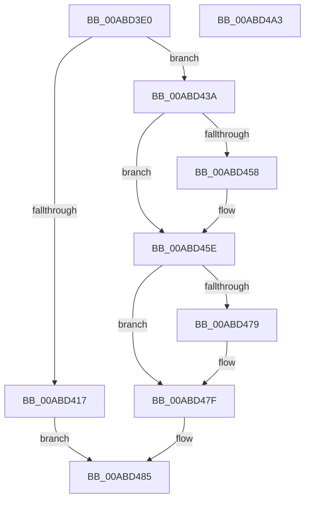

# SdbGetEntryFlags

- RVA: `0x00ABD3E0`–`0x00ABD4A4` (길이 `196` bytes)
- VA: `0x0000000140ABD3E0`
- 실행 섹션: `PAGE`
- PDB 이름 있음: `예`; PDB Function 태그: `아니요`
- unwind 정보 RVA: `0x000AF554`
- 디코드: `47`개 명령, `196/196` bytes 표시
- 미해석 바이트: `0` (있으면 어셈블리에 `.byte`로 보존)

> 이 문서는 커널 이미지의 기계어와 PDB 기호를 분석해 생성했습니다. 4번과 5번은 함수 원형과 자료형을 바이너리 사용 방식에서 추정한 C 해석이며 원본 소스 복구 결과는 아닙니다.

## 1. Dependencies

- 직접 호출 지점: **5**; 고유 호출 대상: **4**
- 직접 호출자로 확인된 함수: **2**
- RIP 상대 이미지 참조: **3**

### Outgoing calls
- `0x00ABD40E` → [AslGuidToString](AslGuidToString_function_00ABD4AC.md) (function, `0x00ABD4AC`)
- `0x00ABD433` → [AslLogCallPrintf](../95/AslLogCallPrintf_function_0095E4EC.md) (function, `0x0095E4EC`)
- `0x00ABD44F` → [SdbpQueryAppCompatFlagsByExeID](../81/SdbpQueryAppCompatFlagsByExeID_function_00818704.md) (function, `0x00818704`)
- `0x00ABD470` → [SdbpQueryAppCompatFlagsByExeID](../81/SdbpQueryAppCompatFlagsByExeID_function_00818704.md) (function, `0x00818704`)
- `0x00ABD495` → [_security_check_cookie](../../text/6A/_security_check_cookie_function_006AC640.md) (function, `0x006AC640`)

### Direct callers
- [SdbReadEntryInformation](../81/SdbReadEntryInformation_function_00813AEC.md) at `0x00813C16`
- [SdbpGetExeEntryFlags](../81/SdbpGetExeEntryFlags_function_00815A00.md) at `0x00815A98`

### Static image references
- `0x00ABD3E9` → RVA `0x00E0A740` (`.data`; read)
- `0x00ABD421` → RVA `0x0001E350` (`.rdata`; read)
- `0x00ABD428` → RVA `0x0001E378` (`.rdata`; read)

## 2. Other-region calls and transfers

- 다른 실행 섹션으로 향하는 call: **1**
  - `0x00ABD495` → [_security_check_cookie](../../text/6A/_security_check_cookie_function_006AC640.md) (`PAGE` → `.text`)
- 별도 외부 분기/꼬리 이동을 확인하지 못했습니다.

## 3. Assembly (complete function range)

```asm
00ABD3E0  40 53                           push rbx
00ABD3E2  48 81 EC A0 00 00 00            sub rsp, 0xa0
00ABD3E9  48 8B 05 50 D3 34 00            mov rax, qword ptr [rip + 0x34d350]
00ABD3F0  48 33 C4                        xor rax, rsp
00ABD3F3  48 89 84 24 90 00 00 00         mov qword ptr [rsp + 0x90], rax
00ABD3FB  83 22 00                        and dword ptr [rdx], 0
00ABD3FE  48 8B DA                        mov rbx, rdx
00ABD401  4C 8B C1                        mov r8, rcx
00ABD404  BA 27 00 00 00                  mov edx, 0x27
00ABD409  48 8D 4C 24 40                  lea rcx, [rsp + 0x40]
00ABD40E  E8 99 00 00 00                  call 0x140abd4ac
00ABD413  85 C0                           test eax, eax
00ABD415  79 23                           jns 0x140abd43a
00ABD417  41 B8 7D 00 00 00               mov r8d, 0x7d
00ABD41D  89 44 24 20                     mov dword ptr [rsp + 0x20], eax
00ABD421  4C 8D 0D 28 0F 56 FF            lea r9, [rip - 0xa9f0d8]
00ABD428  48 8D 15 49 0F 56 FF            lea rdx, [rip - 0xa9f0b7]
00ABD42F  41 8D 48 84                     lea ecx, [r8 - 0x7c]
00ABD433  E8 B4 10 EA FF                  call 0x14095e4ec
00ABD438  EB 4B                           jmp 0x140abd485
00ABD43A  83 64 24 30 00                  and dword ptr [rsp + 0x30], 0
00ABD43F  4C 8D 4C 24 30                  lea r9, [rsp + 0x30]
00ABD444  41 B8 01 00 00 00               mov r8d, 1
00ABD44A  48 8D 54 24 40                  lea rdx, [rsp + 0x40]
00ABD44F  E8 B0 B2 D5 FF                  call 0x140818704
00ABD454  85 C0                           test eax, eax
00ABD456  78 06                           js 0x140abd45e
00ABD458  8B 44 24 30                     mov eax, dword ptr [rsp + 0x30]
00ABD45C  89 03                           mov dword ptr [rbx], eax
00ABD45E  83 64 24 30 00                  and dword ptr [rsp + 0x30], 0
00ABD463  4C 8D 4C 24 30                  lea r9, [rsp + 0x30]
00ABD468  45 33 C0                        xor r8d, r8d
00ABD46B  48 8D 54 24 40                  lea rdx, [rsp + 0x40]
00ABD470  E8 8F B2 D5 FF                  call 0x140818704
00ABD475  85 C0                           test eax, eax
00ABD477  78 06                           js 0x140abd47f
00ABD479  8B 44 24 30                     mov eax, dword ptr [rsp + 0x30]
00ABD47D  09 03                           or dword ptr [rbx], eax
00ABD47F  81 23 FF 0F 00 00               and dword ptr [rbx], 0xfff
00ABD485  B8 01 00 00 00                  mov eax, 1
00ABD48A  48 8B 8C 24 90 00 00 00         mov rcx, qword ptr [rsp + 0x90]
00ABD492  48 33 CC                        xor rcx, rsp
00ABD495  E8 A6 F1 BE FF                  call 0x1406ac640
00ABD49A  48 81 C4 A0 00 00 00            add rsp, 0xa0
00ABD4A1  5B                              pop rbx
00ABD4A2  C3                              ret
00ABD4A3  CC                              int3
```

## 4. C-style interpretation (structured pseudocode)

```c
__int64 __fastcall SdbGetEntryFlags(__int64 a1, __int64 a2)
{
    __int64 result;
    __int64 v_rsp;
    unsigned __int64 v_stack_m18;
    unsigned __int64 v_stack_m68;
    unsigned int v_stack_m78;
    unsigned int v_stack_m88;

    v_rsp = (v_rsp) - (160);
    result = (*(unsigned __int64 *)(v_rip + 3461968)) ^ (v_rsp);
    v_stack_m18 = result;
    result = AslGuidToString(v_stack_m68, 39, a1, a4);
    if (!sign_flag) goto loc_00ABD43A;
    v_stack_m88 = (unsigned int)(result);
    result = AslLogCallPrintf(125 - 124, v_rip - 11137207, 125, v_rip - 11137240);
    goto loc_00ABD485;
loc_00ABD43A:
    result = SdbpQueryAppCompatFlagsByExeID(125 - 124, v_stack_m68, 1, v_stack_m78);
    if (!(sign_flag)) {
        result = v_stack_m78;
        *(unsigned int *)(a2) = (unsigned int)(result);
    }
    a3 = 0;
    result = SdbpQueryAppCompatFlagsByExeID(125 - 124, v_stack_m68, a3, v_stack_m78);
    if (!(sign_flag)) {
        result = v_stack_m78;
    }
loc_00ABD485:
    a1 = (v_stack_m18) ^ (v_rsp);
    result = _security_check_cookie(a1, v_stack_m68, a3, v_stack_m78);
    v_rsp = (v_rsp) + (160);
    return result;
}
```

## 5. (Beta) C Style

```c
int64_t SdbGetEntryFlags(int64_t Arg1, void *Arg2)
{
    uint8_t *arg2 = (uint8_t *)Arg2;

    int64_t result;
    int64_t local_rsp;
    uint64_t v_stack_m18;
    uint64_t v_stack_m68;
    uint32_t v_stack_m78;
    uint32_t v_stack_m88;

    local_rsp = (local_rsp) - (160);
    result = (*(uint64_t *)(v_rip + 0x34D350)) ^ (local_rsp);
    v_stack_m18 = result;
    result = AslGuidToString(v_stack_m68, 39, Arg1, a4);
    if (!sign_flag) goto loc_00ABD43A;
    v_stack_m88 = (uint32_t)(result);
    result = AslLogCallPrintf(125 - 124, v_rip - 11137207, 125, v_rip - 11137240);
    goto loc_00ABD485;
loc_00ABD43A:
    result = SdbpQueryAppCompatFlagsByExeID(125 - 124, v_stack_m68, 1, v_stack_m78);
    if (!(sign_flag)) {
        result = v_stack_m78;
        *(uint32_t *)(arg2) = (uint32_t)(result);
    }
    a3 = 0;
    result = SdbpQueryAppCompatFlagsByExeID(125 - 124, v_stack_m68, a3, v_stack_m78);
    if (!(sign_flag)) {
        result = v_stack_m78;
    }
loc_00ABD485:
    Arg1 = (v_stack_m18) ^ (local_rsp);
    result = _security_check_cookie(Arg1, v_stack_m68, a3, v_stack_m78);
    local_rsp = (local_rsp) + (160);
    return result;
}
```

### 관측된 메모리 오프셋

구조체 형식이 확인되지 않은 접근은 인자 기준의 오프셋으로만 기록했습니다.

| 기준 인자 | 오프셋 표현 | 폭 (bit) | 접근 |
|---|---:|---:|---|
| `Arg2` | `+ 0x0` | `32` | `R/W` |
| `Arg2` | `+ 0x0` | `32` | `W` |

## 6. Execution-region graph

[열기: 2D/3D 그래프와 함수 탐색 컨트롤 패널](../../../control-panel.html?section=page&rva=0x00ABD3E0&view=graph)

- 2D 그래프는 위에서 아래로 흐르고, 3D 그래프는 빈 공간을 드래그해 회전합니다. Shift+드래그는 이동, 휠은 확대·축소, 함수 노드 선택은 대상 보고서 이동입니다.

### Static fallback


