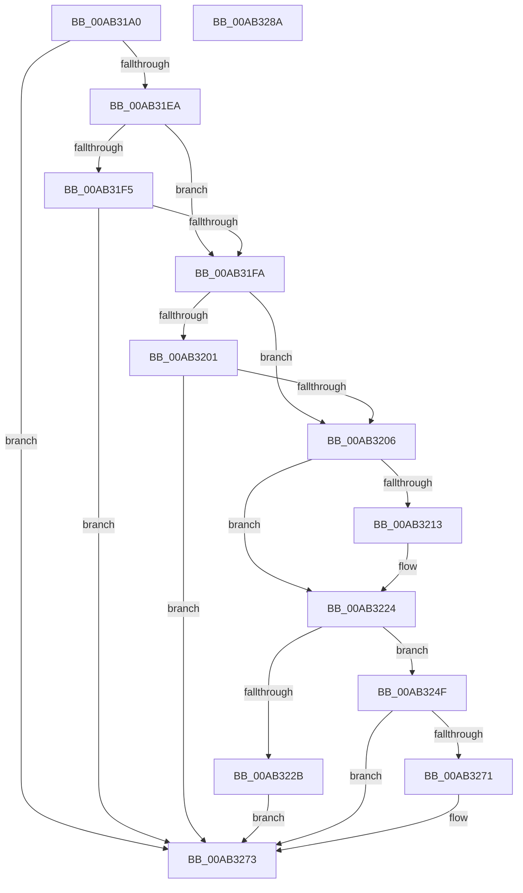

# SdbpCheckExe

- RVA: `0x00AB31A0`–`0x00AB328B` (길이 `235` bytes)
- VA: `0x0000000140AB31A0`
- 실행 섹션: `PAGE`
- PDB 이름 있음: `예`; PDB Function 태그: `아니요`
- unwind 정보 RVA: `0x0007D3C0`
- 디코드: `65`개 명령, `235/235` bytes 표시
- 미해석 바이트: `0` (있으면 어셈블리에 `.byte`로 보존)

> 이 문서는 커널 이미지의 기계어와 PDB 기호를 분석해 생성했습니다. 4번과 5번은 함수 원형과 자료형을 바이너리 사용 방식에서 추정한 C 해석이며 원본 소스 복구 결과는 아닙니다.

## 1. Dependencies

- 직접 호출 지점: **3**; 고유 호출 대상: **3**
- 직접 호출자로 확인된 함수: **1**
- RIP 상대 이미지 참조: **2**

### Outgoing calls
- `0x00AB31DD` → [SdbpCheckForMatch](SdbpCheckForMatch_function_00AB37BC.md) (function, `0x00AB37BC`)
- `0x00AB321C` → [memset](../../text/6C/memset_function_006C6C40.md) (function, `0x006C6C40`)
- `0x00AB3244` → [AslLogCallPrintf](../95/AslLogCallPrintf_function_0095E4EC.md) (function, `0x0095E4EC`)

### Direct callers
- [SdbpSearchDB](SdbpSearchDB_function_00AB3294.md) at `0x00AB3512`
- [SdbpSearchDB](SdbpSearchDB_function_00AB3294.md) at `0x00AB3610`
- [SdbpSearchDB](SdbpSearchDB_function_00AB3294.md) at `0x00AB370E`

### Static image references
- `0x00AB322B` → RVA `0x0003CC98` (`.rdata`; read)
- `0x00AB3238` → RVA `0x0003CC88` (`.rdata`; read)

## 2. Other-region calls and transfers

- 다른 실행 섹션으로 향하는 call: **1**
  - `0x00AB321C` → [memset](../../text/6C/memset_function_006C6C40.md) (`PAGE` → `.text`)
- 별도 외부 분기/꼬리 이동을 확인하지 못했습니다.

## 3. Assembly (complete function range)

```asm
00AB31A0  4C 8B DC                        mov r11, rsp
00AB31A3  49 89 5B 08                     mov qword ptr [r11 + 8], rbx
00AB31A7  49 89 6B 10                     mov qword ptr [r11 + 0x10], rbp
00AB31AB  49 89 73 18                     mov qword ptr [r11 + 0x18], rsi
00AB31AF  57                              push rdi
00AB31B0  48 83 EC 40                     sub rsp, 0x40
00AB31B4  49 8D 43 EC                     lea rax, [r11 - 0x14]
00AB31B8  C7 44 24 30 02 00 00 00         mov dword ptr [rsp + 0x30], 2
00AB31C0  49 89 43 E0                     mov qword ptr [r11 - 0x20], rax
00AB31C4  49 8B F1                        mov rsi, r9
00AB31C7  4C 8B 4C 24 70                  mov r9, qword ptr [rsp + 0x70]
00AB31CC  49 8D 43 E8                     lea rax, [r11 - 0x18]
00AB31D0  33 DB                           xor ebx, ebx
00AB31D2  49 89 43 D8                     mov qword ptr [r11 - 0x28], rax
00AB31D6  21 5C 24 34                     and dword ptr [rsp + 0x34], ebx
00AB31DA  41 8B E8                        mov ebp, r8d
00AB31DD  E8 DA 05 00 00                  call 0x140ab37bc
00AB31E2  85 C0                           test eax, eax
00AB31E4  0F 84 89 00 00 00               je 0x140ab3273
00AB31EA  83 7C 24 78 01                  cmp dword ptr [rsp + 0x78], 1
00AB31EF  8B 7C 24 30                     mov edi, dword ptr [rsp + 0x30]
00AB31F3  75 05                           jne 0x140ab31fa
00AB31F5  83 FF 02                        cmp edi, 2
00AB31F8  75 79                           jne 0x140ab3273
00AB31FA  83 7C 24 78 02                  cmp dword ptr [rsp + 0x78], 2
00AB31FF  75 05                           jne 0x140ab3206
00AB3201  83 FF 02                        cmp edi, 2
00AB3204  74 6D                           je 0x140ab3273
00AB3206  48 8B 9C 24 88 00 00 00         mov rbx, qword ptr [rsp + 0x88]
00AB320E  83 FF 01                        cmp edi, 1
00AB3211  75 11                           jne 0x140ab3224
00AB3213  33 D2                           xor edx, edx
00AB3215  44 8D 47 7F                     lea r8d, [rdi + 0x7f]
00AB3219  48 8B CB                        mov rcx, rbx
00AB321C  E8 1F 3A C1 FF                  call 0x1406c6c40
00AB3221  83 26 00                        and dword ptr [rsi], 0
00AB3224  8B 16                           mov edx, dword ptr [rsi]
00AB3226  83 FA 10                        cmp edx, 0x10
00AB3229  72 24                           jb 0x140ab324f
00AB322B  4C 8D 0D 66 9A 58 FF            lea r9, [rip - 0xa7659a]
00AB3232  41 B8 DC 10 00 00               mov r8d, 0x10dc
00AB3238  48 8D 15 49 9A 58 FF            lea rdx, [rip - 0xa765b7]
00AB323F  B9 01 00 00 00                  mov ecx, 1
00AB3244  E8 A3 B2 EA FF                  call 0x14095e4ec
00AB3249  FF 06                           inc dword ptr [rsi]
00AB324B  33 DB                           xor ebx, ebx
00AB324D  EB 24                           jmp 0x140ab3273
00AB324F  8B 44 24 34                     mov eax, dword ptr [rsp + 0x34]
00AB3253  89 2C D3                        mov dword ptr [rbx + rdx*8], ebp
00AB3256  89 44 D3 04                     mov dword ptr [rbx + rdx*8 + 4], eax
00AB325A  8D 42 01                        lea eax, [rdx + 1]
00AB325D  89 06                           mov dword ptr [rsi], eax
00AB325F  BB 01 00 00 00                  mov ebx, 1
00AB3264  48 8B 84 24 80 00 00 00         mov rax, qword ptr [rsp + 0x80]
00AB326C  48 85 C0                        test rax, rax
00AB326F  74 02                           je 0x140ab3273
00AB3271  89 38                           mov dword ptr [rax], edi
00AB3273  48 8B 6C 24 58                  mov rbp, qword ptr [rsp + 0x58]
00AB3278  8B C3                           mov eax, ebx
00AB327A  48 8B 5C 24 50                  mov rbx, qword ptr [rsp + 0x50]
00AB327F  48 8B 74 24 60                  mov rsi, qword ptr [rsp + 0x60]
00AB3284  48 83 C4 40                     add rsp, 0x40
00AB3288  5F                              pop rdi
00AB3289  C3                              ret
00AB328A  CC                              int3
```

## 4. C-style interpretation (structured pseudocode)

```c
__int64 __fastcall SdbpCheckExe(__int64 a1, int a2, int a3, __int64 a4, __int64 a5, unsigned int a6, __int64 a7, __int64 a8)
{
    __int64 result;
    __int64 v_rbx;
    __int64 v_rsp;
    unsigned int v_stack_m14;
    unsigned int v_stack_m18;
    unsigned __int64 v_stack_p10;
    unsigned __int64 v_stack_p18;
    unsigned __int64 v_stack_p8;

    *(unsigned __int64 *)(v_rsp + 8) = v_rbx;
    *(unsigned __int64 *)(v_rsp + 16) = v_rbp;
    *(unsigned __int64 *)(v_rsp + 24) = v_rsi;
    v_rsp = (v_rsp) - (64);
    v_stack_m18 = 2;
    *(unsigned __int64 *)(v_rsp - 32) = v_rsp - 20;
    v_rbx = 0;
    *(unsigned __int64 *)(v_rsp - 40) = v_rsp - 24;
    result = SdbpCheckForMatch(a1, a2, a3, a5);
    if ((unsigned int)(result) == 0) goto loc_00AB3273;
    if (a6 != 1) goto loc_00AB31FA;
    if (((unsigned int)((unsigned int)(v_stack_m18))) != 2) goto loc_00AB3273;
loc_00AB31FA:
    if (a6 != 2) goto loc_00AB3206;
    if (((unsigned int)((unsigned int)(v_stack_m18))) == 2) goto loc_00AB3273;
loc_00AB3206:
    if (((unsigned int)((unsigned int)(v_stack_m18))) == 1) {
        a2 = 0;
        a3 = (unsigned int)(v_stack_m18) + 127;
        a1 = a8;
        result = memset(a1, a2, a3, a5);
    }
    if (((unsigned int)((unsigned int)(*(unsigned int *)(a4)))) < 16) goto loc_00AB324F;
    result = AslLogCallPrintf(1, v_rip - 10970551, (unsigned int)(0x10DCULL), v_rip - 10970522);
    v_rbx = 0;
    goto loc_00AB3273;
loc_00AB324F:
    *(unsigned int *)(v_rbx + v_rip - 10970551 * 8) = (unsigned int)((unsigned int)(a3));
    *(unsigned int *)(v_rbx + v_rip - 10970551 * 8 + 4) = (unsigned int)((unsigned int)(v_stack_m14));
    *(unsigned int *)(a4) = (unsigned int)(v_rip - 10970551 + 1);
    if (a7 != 0) {
        *(unsigned int *)(a7) = (unsigned int)((unsigned int)(v_stack_m18));
    }
    v_rsp = (v_rsp) + (64);
    return 1;
}
```

## 5. (Beta) C Style

```c
int64_t SdbpCheckExe(int64_t Arg1, int32_t Arg2, int32_t Arg3, void *Arg4, int64_t Arg5, uint32_t Arg6, int64_t Arg7, void *Arg8)
{
    uint8_t *arg4 = (uint8_t *)Arg4;
    uint8_t *arg8 = (uint8_t *)Arg8;

    int64_t result;
    int64_t local_rbx;
    int64_t local_rsp;
    uint32_t v_stack_m14;
    uint32_t v_stack_m18;
    uint64_t v_stack_p10;
    uint64_t v_stack_p18;
    uint64_t v_stack_p8;

    *(uint64_t *)(local_rsp + 0x8) = local_rbx;
    *(uint64_t *)(local_rsp + 0x10) = local_rbp;
    *(uint64_t *)(local_rsp + 0x18) = local_rsi;
    local_rsp = (local_rsp) - (64);
    v_stack_m18 = 2;
    *(uint64_t *)(local_rsp - 0x20) = local_rsp - 20;
    local_rbx = 0;
    *(uint64_t *)(local_rsp - 0x28) = local_rsp - 24;
    result = SdbpCheckForMatch(Arg1, Arg2, Arg3, Arg5);
    if ((uint32_t)(result) == 0) goto loc_00AB3273;
    if (Arg6 != 1) goto loc_00AB31FA;
    if (((uint32_t)((uint32_t)(v_stack_m18))) != 2) goto loc_00AB3273;
loc_00AB31FA:
    if (Arg6 != 2) goto loc_00AB3206;
    if (((uint32_t)((uint32_t)(v_stack_m18))) == 2) goto loc_00AB3273;
loc_00AB3206:
    if (((uint32_t)((uint32_t)(v_stack_m18))) == 1) {
        Arg2 = 0;
        Arg3 = (uint32_t)(v_stack_m18) + 127;
        Arg1 = Arg8;
        result = memset(Arg1, Arg2, Arg3, Arg5);
    }
    if (((uint32_t)((uint32_t)(*(uint32_t *)(arg4)))) < 16) goto loc_00AB324F;
    result = AslLogCallPrintf(1, v_rip - 10970551, (uint32_t)(0x10DCULL), v_rip - 10970522);
    local_rbx = 0;
    goto loc_00AB3273;
loc_00AB324F:
    *(uint32_t *)(local_rbx + v_rip - 0xA765B7 * 8) = (uint32_t)((uint32_t)(Arg3));
    *(uint32_t *)(local_rbx + v_rip - 0xA765B7 * 8 + 0x4) = (uint32_t)((uint32_t)(v_stack_m14));
    *(uint32_t *)(arg4) = (uint32_t)(v_rip - 10970551 + 1);
    if (Arg7 != 0) {
        *(uint32_t *)(Arg7) = (uint32_t)((uint32_t)(v_stack_m18));
    }
    local_rsp = (local_rsp) + (64);
    return 1;
}
```

### 관측된 메모리 오프셋

구조체 형식이 확인되지 않은 접근은 인자 기준의 오프셋으로만 기록했습니다.

| 기준 인자 | 오프셋 표현 | 폭 (bit) | 접근 |
|---|---:|---:|---|
| `Arg4` | `+ 0x0` | `32` | `R` |
| `Arg4` | `+ 0x0` | `32` | `R/W` |
| `Arg4` | `+ 0x0` | `32` | `W` |
| `Arg8` | `+ 0x0 + rdx*8` | `32` | `W` |
| `Arg8` | `+ 0x4 + rdx*8` | `32` | `W` |

## 6. Execution-region graph

[열기: 2D/3D 그래프와 함수 탐색 컨트롤 패널](../../../control-panel.html?section=page&rva=0x00AB31A0&view=graph)

- 2D 그래프는 위에서 아래로 흐르고, 3D 그래프는 빈 공간을 드래그해 회전합니다. Shift+드래그는 이동, 휠은 확대·축소, 함수 노드 선택은 대상 보고서 이동입니다.

### Static fallback


