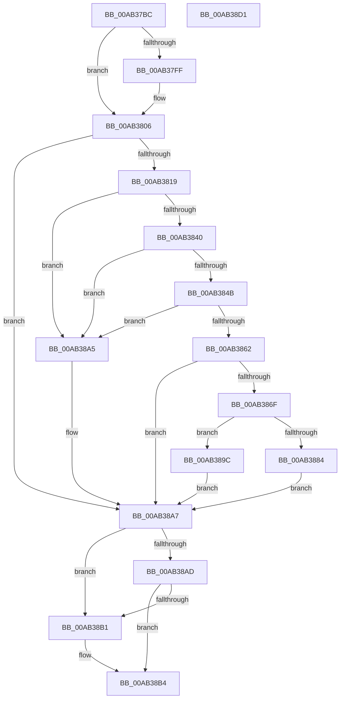

# SdbpCheckForMatch

- RVA: `0x00AB37BC`–`0x00AB38D2` (길이 `278` bytes)
- VA: `0x0000000140AB37BC`
- 실행 섹션: `PAGE`
- PDB 이름 있음: `예`; PDB Function 태그: `아니요`
- unwind 정보 RVA: `0x000BCA90`
- 디코드: `85`개 명령, `278/278` bytes 표시
- 미해석 바이트: `0` (있으면 어셈블리에 `.byte`로 보존)

> 이 문서는 커널 이미지의 기계어와 PDB 기호를 분석해 생성했습니다. 4번과 5번은 함수 원형과 자료형을 바이너리 사용 방식에서 추정한 C 해석이며 원본 소스 복구 결과는 아닙니다.

## 1. Dependencies

- 직접 호출 지점: **6**; 고유 호출 대상: **5**
- 직접 호출자로 확인된 함수: **3**
- RIP 상대 이미지 참조: **0**

### Outgoing calls
- `0x00AB37F2` → [SdbFindFirstTag](../95/SdbFindFirstTag_function_0095E34C.md) (function, `0x0095E34C`)
- `0x00AB380C` → [SdbpMatchOsVersion](../A1/SdbpMatchOsVersion_function_00A18FC0.md) (function, `0x00A18FC0`)
- `0x00AB3837` → [SdbpMatchList](../81/SdbpMatchList_function_00816734.md) (function, `0x00816734`)
- `0x00AB3859` → [SdbpGetExeEntryFlags](../81/SdbpGetExeEntryFlags_function_00815A00.md) (function, `0x00815A00`)
- `0x00AB387B` → [SdbFindFirstTag](../95/SdbFindFirstTag_function_0095E34C.md) (function, `0x0095E34C`)
- `0x00AB388F` → [SdbReadWORDTag](../95/SdbReadWORDTag_function_0095D898.md) (function, `0x0095D898`)

### Direct callers
- [SdbpCheckKObject](../95/SdbpCheckKObject_function_00959F04.md) at `0x00959FBA`
- [SdbpCheckExe](SdbpCheckExe_function_00AB31A0.md) at `0x00AB31DD`
- [SdbpSearchDB](SdbpSearchDB_function_00AB3294.md) at `0x00AB33E0`

### Static image references
- 디코드된 RIP-relative 메모리 참조가 없습니다.

## 2. Other-region calls and transfers

- 다른 실행 섹션으로 향하는 call: **0**
- 별도 외부 분기/꼬리 이동을 확인하지 못했습니다.

## 3. Assembly (complete function range)

```asm
00AB37BC  48 8B C4                        mov rax, rsp
00AB37BF  48 89 58 08                     mov qword ptr [rax + 8], rbx
00AB37C3  48 89 68 10                     mov qword ptr [rax + 0x10], rbp
00AB37C7  56                              push rsi
00AB37C8  57                              push rdi
00AB37C9  41 54                           push r12
00AB37CB  41 56                           push r14
00AB37CD  41 57                           push r15
00AB37CF  48 83 EC 40                     sub rsp, 0x40
00AB37D3  45 8B F8                        mov r15d, r8d
00AB37D6  48 8B F2                        mov rsi, rdx
00AB37D9  4C 8B F1                        mov r14, rcx
00AB37DC  33 DB                           xor ebx, ebx
00AB37DE  41 8B D7                        mov edx, r15d
00AB37E1  89 58 20                        mov dword ptr [rax + 0x20], ebx
00AB37E4  48 8B CE                        mov rcx, rsi
00AB37E7  41 B8 0D 10 00 00               mov r8d, 0x100d
00AB37ED  49 8B E9                        mov rbp, r9
00AB37F0  33 FF                           xor edi, edi
00AB37F2  E8 55 AB EA FF                  call 0x14095e34c
00AB37F7  44 8D 67 01                     lea r12d, [rdi + 1]
00AB37FB  85 C0                           test eax, eax
00AB37FD  74 07                           je 0x140ab3806
00AB37FF  39 5D 50                        cmp dword ptr [rbp + 0x50], ebx
00AB3802  41 0F 44 FC                     cmove edi, r12d
00AB3806  41 8B D7                        mov edx, r15d
00AB3809  48 8B CE                        mov rcx, rsi
00AB380C  E8 AF 57 F6 FF                  call 0x140a18fc0
00AB3811  85 C0                           test eax, eax
00AB3813  0F 84 8E 00 00 00               je 0x140ab38a7
00AB3819  21 5C 24 30                     and dword ptr [rsp + 0x30], ebx
00AB381D  48 8D 8C 24 88 00 00 00         lea rcx, [rsp + 0x88]
00AB3825  48 89 6C 24 28                  mov qword ptr [rsp + 0x28], rbp
00AB382A  4C 8B CE                        mov r9, rsi
00AB382D  4D 8B C6                        mov r8, r14
00AB3830  44 89 7C 24 20                  mov dword ptr [rsp + 0x20], r15d
00AB3835  33 D2                           xor edx, edx
00AB3837  E8 F8 2E D6 FF                  call 0x140816734
00AB383C  85 C0                           test eax, eax
00AB383E  74 65                           je 0x140ab38a5
00AB3840  8B 9C 24 88 00 00 00            mov ebx, dword ptr [rsp + 0x88]
00AB3847  85 DB                           test ebx, ebx
00AB3849  74 5A                           je 0x140ab38a5
00AB384B  4C 8B 84 24 98 00 00 00         mov r8, qword ptr [rsp + 0x98]
00AB3853  41 8B D7                        mov edx, r15d
00AB3856  48 8B CE                        mov rcx, rsi
00AB3859  E8 A2 21 D6 FF                  call 0x140815a00
00AB385E  85 C0                           test eax, eax
00AB3860  74 43                           je 0x140ab38a5
00AB3862  4C 8B B4 24 90 00 00 00         mov r14, qword ptr [rsp + 0x90]
00AB386A  4D 85 F6                        test r14, r14
00AB386D  74 38                           je 0x140ab38a7
00AB386F  41 B8 01 30 00 00               mov r8d, 0x3001
00AB3875  41 8B D7                        mov edx, r15d
00AB3878  48 8B CE                        mov rcx, rsi
00AB387B  E8 CC AA EA FF                  call 0x14095e34c
00AB3880  85 C0                           test eax, eax
00AB3882  74 18                           je 0x140ab389c
00AB3884  41 B8 02 00 00 00               mov r8d, 2
00AB388A  8B D0                           mov edx, eax
00AB388C  48 8B CE                        mov rcx, rsi
00AB388F  E8 04 A0 EA FF                  call 0x14095d898
00AB3894  0F B7 C0                        movzx eax, ax
00AB3897  41 89 06                        mov dword ptr [r14], eax
00AB389A  EB 0B                           jmp 0x140ab38a7
00AB389C  41 C7 06 02 00 00 00            mov dword ptr [r14], 2
00AB38A3  EB 02                           jmp 0x140ab38a7
00AB38A5  33 DB                           xor ebx, ebx
00AB38A7  83 7D 50 00                     cmp dword ptr [rbp + 0x50], 0
00AB38AB  74 04                           je 0x140ab38b1
00AB38AD  85 FF                           test edi, edi
00AB38AF  74 03                           je 0x140ab38b4
00AB38B1  45 33 E4                        xor r12d, r12d
00AB38B4  44 89 65 50                     mov dword ptr [rbp + 0x50], r12d
00AB38B8  8B C3                           mov eax, ebx
00AB38BA  48 8B 5C 24 70                  mov rbx, qword ptr [rsp + 0x70]
00AB38BF  48 8B 6C 24 78                  mov rbp, qword ptr [rsp + 0x78]
00AB38C4  48 83 C4 40                     add rsp, 0x40
00AB38C8  41 5F                           pop r15
00AB38CA  41 5E                           pop r14
00AB38CC  41 5C                           pop r12
00AB38CE  5F                              pop rdi
00AB38CF  5E                              pop rsi
00AB38D0  C3                              ret
00AB38D1  CC                              int3
```

## 4. C-style interpretation (structured pseudocode)

```c
__int64 __fastcall SdbpCheckForMatch(__int64 a1, __int64 a2, int a3, __int64 a4, __int64 a5, __int64 a6)
{
    __int64 result;
    __int64 v_r12;
    __int64 v_rbx;
    __int64 v_rdi;
    __int64 v_rsp;
    unsigned int v_stack_m38;
    unsigned __int64 v_stack_m40;
    unsigned int v_stack_m48;
    unsigned __int64 v_stack_p10;
    unsigned __int64 v_stack_p20;
    unsigned __int64 v_stack_p8;

    *(unsigned __int64 *)(v_rsp + 8) = v_rbx;
    *(unsigned __int64 *)(v_rsp + 16) = v_rbp;
    v_rsp = (v_rsp) - (64);
    v_rbx = 0;
    *(unsigned int *)(v_rsp + 32) = 0;
    v_rdi = 0;
    result = SdbFindFirstTag(a2, (unsigned int)((unsigned int)((unsigned int)(a3))), (unsigned int)(0x100DULL), a4);
    if ((unsigned int)(result) != 0) {
        if ((*(unsigned int *)(a4 + 80)) == 0) { v_rdi = (unsigned int)(v_rdi + 1); }
    }
    result = SdbpMatchOsVersion(a2, (unsigned int)((unsigned int)((unsigned int)(a3))), (unsigned int)(0x100DULL), a4);
    if ((unsigned int)(result) == 0) goto loc_00AB38A7;
    v_stack_m40 = a4;
    v_stack_m48 = (unsigned int)((unsigned int)(a3));
    a2 = 0;
    result = SdbpMatchList(v_stack_p20, a2, a1, a2);
    if ((unsigned int)(result) == 0) goto loc_00AB38A5;
    if ((unsigned int)((unsigned int)(v_stack_p20)) == 0) goto loc_00AB38A5;
    result = SdbpGetExeEntryFlags(0, (unsigned int)((unsigned int)((unsigned int)(a3))), a6, a2);
    if ((unsigned int)(result) == 0) goto loc_00AB38A5;
    if (a5 == 0) goto loc_00AB38A7;
    result = SdbFindFirstTag(0, (unsigned int)((unsigned int)((unsigned int)(a3))), (unsigned int)(0x3001ULL), a2);
    if ((unsigned int)(result) == 0) goto loc_00AB389C;
    result = SdbReadWORDTag(0, (unsigned int)((unsigned int)(result)), 2, a2);
    *(unsigned int *)(a5) = (unsigned int)((unsigned __int16)(result));
    goto loc_00AB38A7;
loc_00AB389C:
    *(unsigned int *)(a5) = 2;
    goto loc_00AB38A7;
loc_00AB38A5:
    v_rbx = 0;
loc_00AB38A7:
    if ((*(unsigned int *)(a4 + 80)) == 0) goto loc_00AB38B1;
    v_r12 = v_rdi + 1;
    if ((unsigned int)(v_rdi) != 0) {
        v_r12 = 0;
    }
    *(unsigned int *)(a4 + 80) = 0;
    v_rsp = (v_rsp) + (64);
    return 0;
}
```

## 5. (Beta) C Style

```c
int64_t SdbpCheckForMatch(int64_t Arg1, int64_t Arg2, int32_t Arg3, void *Arg4, int64_t Arg5, int64_t Arg6)
{
    uint8_t *arg4 = (uint8_t *)Arg4;

    int64_t result;
    int64_t local_r12;
    int64_t local_rbx;
    int64_t local_rdi;
    int64_t local_rsp;
    uint32_t v_stack_m38;
    uint64_t v_stack_m40;
    uint32_t v_stack_m48;
    uint64_t v_stack_p10;
    uint64_t v_stack_p20;
    uint64_t v_stack_p8;

    *(uint64_t *)(local_rsp + 0x8) = local_rbx;
    *(uint64_t *)(local_rsp + 0x10) = local_rbp;
    local_rsp = (local_rsp) - (64);
    local_rbx = 0;
    *(uint32_t *)(local_rsp + 0x20) = 0;
    local_rdi = 0;
    result = SdbFindFirstTag(Arg2, (uint32_t)((uint32_t)((uint32_t)(Arg3))), (uint32_t)(0x100DULL), Arg4);
    if ((uint32_t)(result) != 0) {
        if ((*(uint32_t *)(arg4 + 0x50)) == 0) { local_rdi = (uint32_t)(local_rdi + 1); }
    }
    result = SdbpMatchOsVersion(Arg2, (uint32_t)((uint32_t)((uint32_t)(Arg3))), (uint32_t)(0x100DULL), Arg4);
    if ((uint32_t)(result) == 0) goto loc_00AB38A7;
    v_stack_m40 = Arg4;
    v_stack_m48 = (uint32_t)((uint32_t)(Arg3));
    Arg2 = 0;
    result = SdbpMatchList(v_stack_p20, Arg2, Arg1, Arg2);
    if ((uint32_t)(result) == 0) goto loc_00AB38A5;
    if ((uint32_t)((uint32_t)(v_stack_p20)) == 0) goto loc_00AB38A5;
    result = SdbpGetExeEntryFlags(0, (uint32_t)((uint32_t)((uint32_t)(Arg3))), Arg6, Arg2);
    if ((uint32_t)(result) == 0) goto loc_00AB38A5;
    if (Arg5 == 0) goto loc_00AB38A7;
    result = SdbFindFirstTag(0, (uint32_t)((uint32_t)((uint32_t)(Arg3))), (uint32_t)(0x3001ULL), Arg2);
    if ((uint32_t)(result) == 0) goto loc_00AB389C;
    result = SdbReadWORDTag(0, (uint32_t)((uint32_t)(result)), 2, Arg2);
    *(uint32_t *)(Arg5) = (uint32_t)((uint16_t)(result));
    goto loc_00AB38A7;
loc_00AB389C:
    *(uint32_t *)(Arg5) = 2;
    goto loc_00AB38A7;
loc_00AB38A5:
    local_rbx = 0;
loc_00AB38A7:
    if ((*(uint32_t *)(arg4 + 0x50)) == 0) goto loc_00AB38B1;
    local_r12 = local_rdi + 1;
    if ((uint32_t)(local_rdi) != 0) {
        local_r12 = 0;
    }
    *(uint32_t *)(arg4 + 0x50) = 0;
    local_rsp = (local_rsp) + (64);
    return 0;
}
```

### 관측된 메모리 오프셋

구조체 형식이 확인되지 않은 접근은 인자 기준의 오프셋으로만 기록했습니다.

| 기준 인자 | 오프셋 표현 | 폭 (bit) | 접근 |
|---|---:|---:|---|
| `Arg4` | `+ 0x50` | `32` | `R` |
| `Arg4` | `+ 0x50` | `32` | `W` |

## 6. Execution-region graph

[열기: 2D/3D 그래프와 함수 탐색 컨트롤 패널](../../../control-panel.html?section=page&rva=0x00AB37BC&view=graph)

- 2D 그래프는 위에서 아래로 흐르고, 3D 그래프는 빈 공간을 드래그해 회전합니다. Shift+드래그는 이동, 휠은 확대·축소, 함수 노드 선택은 대상 보고서 이동입니다.

### Static fallback


