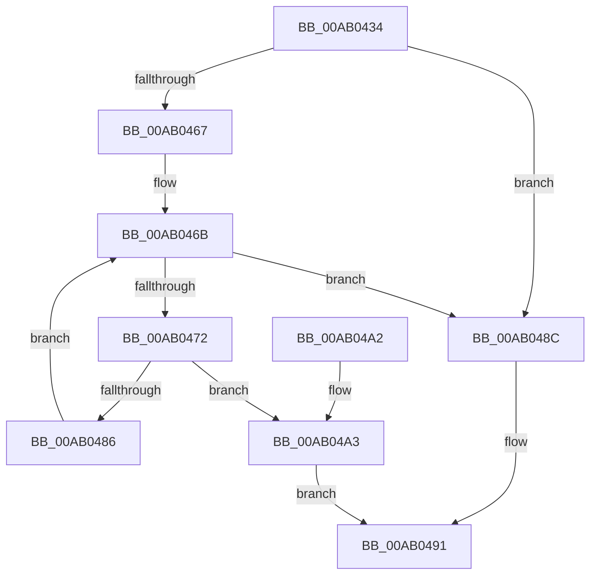

# SdbpFindMatcher

- RVA: `0x00AB0434`–`0x00AB04C5` (길이 `145` bytes)
- VA: `0x0000000140AB0434`
- 실행 섹션: `PAGE`
- PDB 이름 있음: `예`; PDB Function 태그: `아니요`
- unwind 정보 RVA: `0x000BC550`
- 디코드: `40`개 명령, `145/145` bytes 표시
- 미해석 바이트: `0` (있으면 어셈블리에 `.byte`로 보존)

> 이 문서는 커널 이미지의 기계어와 PDB 기호를 분석해 생성했습니다. 4번과 5번은 함수 원형과 자료형을 바이너리 사용 방식에서 추정한 C 해석이며 원본 소스 복구 결과는 아닙니다.

## 1. Dependencies

- 직접 호출 지점: **1**; 고유 호출 대상: **1**
- 직접 호출자로 확인된 함수: **1**
- RIP 상대 이미지 참조: **0**

### Outgoing calls
- `0x00AB0454` → [SdbGetTagFromTagID](../95/SdbGetTagFromTagID_function_0095E3C0.md) (function, `0x0095E3C0`)

### Direct callers
- [SdbpMatchList](../81/SdbpMatchList_function_00816734.md) at `0x0081679D`

### Static image references
- 디코드된 RIP-relative 메모리 참조가 없습니다.

## 2. Other-region calls and transfers

- 다른 실행 섹션으로 향하는 call: **0**
- 별도 외부 분기/꼬리 이동을 확인하지 못했습니다.

## 3. Assembly (complete function range)

```asm
00AB0434  48 89 74 24 08                  mov qword ptr [rsp + 8], rsi
00AB0439  48 89 7C 24 10                  mov qword ptr [rsp + 0x10], rdi
00AB043E  41 56                           push r14
00AB0440  48 83 EC 20                     sub rsp, 0x20
00AB0444  48 8B F2                        mov rsi, rdx
00AB0447  4C 8B F1                        mov r14, rcx
00AB044A  8B 54 24 50                     mov edx, dword ptr [rsp + 0x50]
00AB044E  49 8B C9                        mov rcx, r9
00AB0451  49 8B F8                        mov rdi, r8
00AB0454  E8 67 DF EA FF                  call 0x14095e3c0
00AB0459  45 33 D2                        xor r10d, r10d
00AB045C  44 0F B7 C0                     movzx r8d, ax
00AB0460  44 39 54 24 50                  cmp dword ptr [rsp + 0x50], r10d
00AB0465  74 25                           je 0x140ab048c
00AB0467  45 0F B7 CA                     movzx r9d, r10w
00AB046B  66 41 83 F9 20                  cmp r9w, 0x20
00AB0470  73 1A                           jae 0x140ab048c
00AB0472  41 0F B7 D1                     movzx edx, r9w
00AB0476  8B CA                           mov ecx, edx
00AB0478  48 C1 E1 05                     shl rcx, 5
00AB047C  44 3B 84 39 50 02 00 00         cmp r8d, dword ptr [rcx + rdi + 0x250]
00AB0484  74 1D                           je 0x140ab04a3
00AB0486  66 41 FF C1                     inc r9w
00AB048A  EB DF                           jmp 0x140ab046b
00AB048C  44 89 16                        mov dword ptr [rsi], r10d
00AB048F  33 C0                           xor eax, eax
00AB0491  48 8B 74 24 30                  mov rsi, qword ptr [rsp + 0x30]
00AB0496  48 8B 7C 24 38                  mov rdi, qword ptr [rsp + 0x38]
00AB049B  48 83 C4 20                     add rsp, 0x20
00AB049F  41 5E                           pop r14
00AB04A1  C3                              ret
00AB04A2  CC                              int3
00AB04A3  48 8D 42 13                     lea rax, [rdx + 0x13]
00AB04A7  48 C1 E0 05                     shl rax, 5
00AB04AB  48 8B 04 38                     mov rax, qword ptr [rax + rdi]
00AB04AF  49 89 06                        mov qword ptr [r14], rax
00AB04B2  8B 84 39 68 02 00 00            mov eax, dword ptr [rcx + rdi + 0x268]
00AB04B9  89 06                           mov dword ptr [rsi], eax
00AB04BB  48 8B 84 39 58 02 00 00         mov rax, qword ptr [rcx + rdi + 0x258]
00AB04C3  EB CC                           jmp 0x140ab0491
```

## 4. C-style interpretation (structured pseudocode)

```c
__int64 __fastcall SdbpFindMatcher(__int64 a1, __int64 a2, __int64 a3, __int64 a4, unsigned int a5)
{
    __int64 result;
    __int64 v_r10;
    __int64 v_rsp;
    unsigned __int64 v_stack_p10;
    unsigned __int64 v_stack_p8;

    v_stack_p8 = v_rsi;
    v_stack_p10 = v_rdi;
    v_rsp = (v_rsp) - (32);
    result = SdbGetTagFromTagID(a4, (unsigned int)(a5), a3, a4);
    v_r10 = 0;
    if (a5 == 0) goto loc_00AB048C;
loc_00AB046B:
    if (0 >= 32) goto loc_00AB048C;
    a1 = (0) << (5);
    if (((unsigned int)((unsigned __int16)(result))) == (*(unsigned int *)(a1 + a3 * 1 + 592))) goto loc_00AB04A3;
    a4 = (unsigned __int16)((0) + 1);
    goto loc_00AB046B;
loc_00AB048C:
    *(unsigned int *)(a2) = 0;
    result = 0;
loc_00AB0491:
    v_rsp = (v_rsp) + (32);
    return result;
loc_00AB04A3:
    result = (0 + 19) << (5);
    *(unsigned __int64 *)(a1) = *(unsigned __int64 *)(result + v_stack_p10 * 1);
    *(unsigned int *)(v_stack_p8) = (unsigned int)((unsigned int)(*(unsigned int *)(a1 + v_stack_p10 * 1 + 616)));
    goto loc_00AB0491;
}
```

## 5. (Beta) C Style

```c
int64_t SdbpFindMatcher(void *Arg1, void *Arg2, int64_t Arg3, int64_t Arg4, uint32_t Arg5)
{
    uint8_t *arg1 = (uint8_t *)Arg1;
    uint8_t *arg2 = (uint8_t *)Arg2;

    int64_t result;
    int64_t local_r10;
    int64_t local_rsp;
    uint64_t v_stack_p10;
    uint64_t v_stack_p8;

    v_stack_p8 = local_rsi;
    v_stack_p10 = local_rdi;
    local_rsp = (local_rsp) - (32);
    result = SdbGetTagFromTagID(Arg4, (uint32_t)(Arg5), Arg3, Arg4);
    local_r10 = 0;
    if (Arg5 == 0) goto loc_00AB048C;
loc_00AB046B:
    if (0 >= 32) goto loc_00AB048C;
    Arg1 = (0) << (5);
    if (((uint32_t)((uint16_t)(result))) == (*(uint32_t *)(arg1 + Arg3 * 1 + 0x250))) goto loc_00AB04A3;
    Arg4 = (uint16_t)((0) + 1);
    goto loc_00AB046B;
loc_00AB048C:
    *(uint32_t *)(arg2) = 0;
    result = 0;
loc_00AB0491:
    local_rsp = (local_rsp) + (32);
    return result;
loc_00AB04A3:
    result = (0 + 19) << (5);
    *(uint64_t *)(arg1) = *(uint64_t *)(result + v_stack_p10 * 1);
    *(uint32_t *)(v_stack_p8) = (uint32_t)((uint32_t)(*(uint32_t *)(arg1 + v_stack_p10 * 1 + 0x268)));
    goto loc_00AB0491;
}
```

### 관측된 메모리 오프셋

구조체 형식이 확인되지 않은 접근은 인자 기준의 오프셋으로만 기록했습니다.

| 기준 인자 | 오프셋 표현 | 폭 (bit) | 접근 |
|---|---:|---:|---|
| `Arg1` | `+ 0x0` | `64` | `W` |
| `Arg2` | `+ 0x0` | `32` | `W` |

## 6. Execution-region graph

[열기: 2D/3D 그래프와 함수 탐색 컨트롤 패널](../../../control-panel.html?section=page&rva=0x00AB0434&view=graph)

- 2D 그래프는 위에서 아래로 흐르고, 3D 그래프는 빈 공간을 드래그해 회전합니다. Shift+드래그는 이동, 휠은 확대·축소, 함수 노드 선택은 대상 보고서 이동입니다.

### Static fallback


