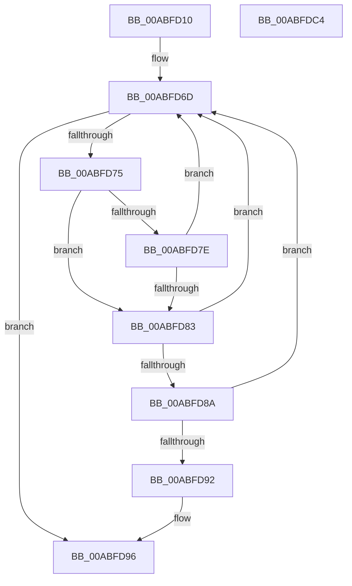

# SeMarkLogonSessionForTerminationNotificationEx

- RVA: `0x00ABFD10`–`0x00ABFDC5` (길이 `181` bytes)
- VA: `0x0000000140ABFD10`
- 실행 섹션: `PAGE`
- PDB 이름 있음: `예`; PDB Function 태그: `아니요`
- unwind 정보 RVA: `0x0005C954`
- 디코드: `49`개 명령, `181/181` bytes 표시
- 미해석 바이트: `0` (있으면 어셈블리에 `.byte`로 보존)

> 이 문서는 커널 이미지의 기계어와 PDB 기호를 분석해 생성했습니다. 4번과 5번은 함수 원형과 자료형을 바이너리 사용 방식에서 추정한 C 해석이며 원본 소스 복구 결과는 아닙니다.

## 1. Dependencies

- 직접 호출 지점: **3**; 고유 호출 대상: **3**
- 직접 호출자로 확인된 함수: **1**
- RIP 상대 이미지 참조: **2**

### Outgoing calls
- `0x00ABFD68` → [ExAcquireResourceExclusiveLite](../../text/21/ExAcquireResourceExclusiveLite_function_00214E20.md) (function, `0x00214E20`)
- `0x00ABFD99` → [ExReleaseResourceLite](../../text/25/ExReleaseResourceLite_function_0025FA10.md) (function, `0x0025FA10`)
- `0x00ABFD9E` → [KeLeaveCriticalRegion](../../text/25/KeLeaveCriticalRegion_function_0025D8B0.md) (function, `0x0025D8B0`)

### Direct callers
- [SeMarkLogonSessionForTerminationNotification](../7A/SeMarkLogonSessionForTerminationNotification_function_007A11E0.md) at `0x007A11E6`

### Static image references
- `0x00ABFD2E` → RVA `0x00FD9AF0` (`PAGEDATA`; read)
- `0x00ABFD5A` → RVA `0x00E67F20` (`.data`; read)

## 2. Other-region calls and transfers

- 다른 실행 섹션으로 향하는 call: **3**
  - `0x00ABFD68` → [ExAcquireResourceExclusiveLite](../../text/21/ExAcquireResourceExclusiveLite_function_00214E20.md) (`PAGE` → `.text`)
  - `0x00ABFD99` → [ExReleaseResourceLite](../../text/25/ExReleaseResourceLite_function_0025FA10.md) (`PAGE` → `.text`)
  - `0x00ABFD9E` → [KeLeaveCriticalRegion](../../text/25/KeLeaveCriticalRegion_function_0025D8B0.md) (`PAGE` → `.text`)
- 별도 외부 분기/꼬리 이동을 확인하지 못했습니다.

## 3. Assembly (complete function range)

```asm
00ABFD10  48 89 5C 24 08                  mov qword ptr [rsp + 8], rbx
00ABFD15  48 89 6C 24 10                  mov qword ptr [rsp + 0x10], rbp
00ABFD1A  48 89 74 24 18                  mov qword ptr [rsp + 0x18], rsi
00ABFD1F  57                              push rdi
00ABFD20  48 83 EC 20                     sub rsp, 0x20
00ABFD24  44 69 01 24 0A 25 5B            imul r8d, dword ptr [rcx], 0x5b250a24
00ABFD2B  48 8B F2                        mov rsi, rdx
00ABFD2E  48 8B 05 BB 9D 51 00            mov rax, qword ptr [rip + 0x519dbb]
00ABFD35  48 8B F9                        mov rdi, rcx
00ABFD38  B2 01                           mov dl, 1
00ABFD3A  49 C1 E8 1C                     shr r8, 0x1c
00ABFD3E  4A 8D 1C C0                     lea rbx, [rax + r8*8]
00ABFD42  65 48 8B 04 25 88 01 00 00      mov rax, qword ptr gs:[0x188]
00ABFD4B  41 83 E0 03                     and r8d, 3
00ABFD4F  49 6B E8 68                     imul rbp, r8, 0x68
00ABFD53  66 FF 88 E4 01 00 00            dec word ptr [rax + 0x1e4]
00ABFD5A  48 8D 05 BF 81 3A 00            lea rax, [rip + 0x3a81bf]
00ABFD61  48 03 E8                        add rbp, rax
00ABFD64  90                              nop
00ABFD65  48 8B CD                        mov rcx, rbp
00ABFD68  E8 B3 50 75 FF                  call 0x140214e20
00ABFD6D  48 8B 1B                        mov rbx, qword ptr [rbx]
00ABFD70  48 85 DB                        test rbx, rbx
00ABFD73  74 21                           je 0x140abfd96
00ABFD75  48 39 B3 A8 00 00 00            cmp qword ptr [rbx + 0xa8], rsi
00ABFD7C  74 05                           je 0x140abfd83
00ABFD7E  48 85 F6                        test rsi, rsi
00ABFD81  75 EA                           jne 0x140abfd6d
00ABFD83  8B 43 08                        mov eax, dword ptr [rbx + 8]
00ABFD86  39 07                           cmp dword ptr [rdi], eax
00ABFD88  75 E3                           jne 0x140abfd6d
00ABFD8A  8B 43 0C                        mov eax, dword ptr [rbx + 0xc]
00ABFD8D  39 47 04                        cmp dword ptr [rdi + 4], eax
00ABFD90  75 DB                           jne 0x140abfd6d
00ABFD92  83 4B 28 01                     or dword ptr [rbx + 0x28], 1
00ABFD96  48 8B CD                        mov rcx, rbp
00ABFD99  E8 72 FC 79 FF                  call 0x14025fa10
00ABFD9E  E8 0D DB 79 FF                  call 0x14025d8b0
00ABFDA3  48 8B 6C 24 38                  mov rbp, qword ptr [rsp + 0x38]
00ABFDA8  48 F7 DB                        neg rbx
00ABFDAB  48 8B 5C 24 30                  mov rbx, qword ptr [rsp + 0x30]
00ABFDB0  48 8B 74 24 40                  mov rsi, qword ptr [rsp + 0x40]
00ABFDB5  1B C0                           sbb eax, eax
00ABFDB7  F7 D0                           not eax
00ABFDB9  25 25 02 00 C0                  and eax, 0xc0000225
00ABFDBE  48 83 C4 20                     add rsp, 0x20
00ABFDC2  5F                              pop rdi
00ABFDC3  C3                              ret
00ABFDC4  CC                              int3
```

## 4. C-style interpretation (structured pseudocode)

```c
__int64 __fastcall SeMarkLogonSessionForTerminationNotificationEx(__int64 a1, __int64 a2)
{
    __int64 result;
    __int64 v_rbp;
    __int64 v_rbx;
    __int64 v_rsp;
    unsigned __int64 v_stack_p10;
    unsigned __int64 v_stack_p18;
    unsigned __int64 v_stack_p8;

    v_stack_p8 = v_rbx;
    v_stack_p10 = v_rbp;
    v_stack_p18 = v_rsi;
    v_rsp = (v_rsp) - (32);
    a3 = (unsigned int)((a3) * (*(unsigned int *)(a1)));
    a3 = (a3) >> (28);
    a3 = (unsigned int)((a3) & (3));
    v_rbp = (v_rbp) * (a3);
    v_rbp = (v_rbp) + (v_rip + 3834303);
    result = ExAcquireResourceExclusiveLite(v_rbp, 1, a3, a4);
loc_00ABFD6D:
    if (*(unsigned __int64 *)(*(unsigned __int64 *)(v_rip + 5348795) + a3 * 8) == 0) goto loc_00ABFD96;
    if ((*(unsigned __int64 *)(*(unsigned __int64 *)(*(unsigned __int64 *)(v_rip + 5348795) + a3 * 8) + 168)) == a2) goto loc_00ABFD83;
    if (a2 != 0) goto loc_00ABFD6D;
loc_00ABFD83:
    if ((*(unsigned int *)(a1)) != ((unsigned int)((unsigned int)(*(unsigned int *)(*(unsigned __int64 *)(*(unsigned __int64 *)(v_rip + 5348795) + a3 * 8) + 8))))) goto loc_00ABFD6D;
    if ((*(unsigned int *)(a1 + 4)) != ((unsigned int)((unsigned int)(*(unsigned int *)(*(unsigned __int64 *)(*(unsigned __int64 *)(v_rip + 5348795) + a3 * 8) + 12))))) goto loc_00ABFD6D;
loc_00ABFD96:
    result = ExReleaseResourceLite(v_rbp, 1, a3, a4);
    result = KeLeaveCriticalRegion(v_rbp, 1, a3, a4);
    v_rbx = -(*(unsigned __int64 *)(*(unsigned __int64 *)(v_rip + 5348795) + a3 * 8));
    result = (unsigned int)(~(result));
    result = (unsigned int)((result) & (0xC0000225ULL));
    v_rsp = (v_rsp) + (32);
    return result;
}
```

## 5. (Beta) C Style

```c
int64_t SeMarkLogonSessionForTerminationNotificationEx(void *Arg1, int64_t Arg2)
{
    uint8_t *arg1 = (uint8_t *)Arg1;

    int64_t result;
    int64_t local_rbp;
    int64_t local_rbx;
    int64_t local_rsp;
    uint64_t v_stack_p10;
    uint64_t v_stack_p18;
    uint64_t v_stack_p8;

    v_stack_p8 = local_rbx;
    v_stack_p10 = local_rbp;
    v_stack_p18 = local_rsi;
    local_rsp = (local_rsp) - (32);
    a3 = (uint32_t)((a3) * (*(uint32_t *)(arg1)));
    a3 = (a3) >> (28);
    a3 = (uint32_t)((a3) & (3));
    local_rbp = (local_rbp) * (a3);
    local_rbp = (local_rbp) + (v_rip + 3834303);
    result = ExAcquireResourceExclusiveLite(local_rbp, 1, a3, a4);
loc_00ABFD6D:
    if (*(uint64_t *)(*(uint64_t *)(v_rip + 0x519DBB) + a3 * 8) == 0) goto loc_00ABFD96;
    if ((*(uint64_t *)(*(uint64_t *)(*(uint64_t *)(v_rip + 0x519DBB) + a3 * 8) + 0xA8)) == Arg2) goto loc_00ABFD83;
    if (Arg2 != 0) goto loc_00ABFD6D;
loc_00ABFD83:
    if ((*(uint32_t *)(arg1)) != ((uint32_t)((uint32_t)(*(uint32_t *)(*(uint64_t *)(*(uint64_t *)(v_rip + 0x519DBB) + a3 * 8) + 0x8))))) goto loc_00ABFD6D;
    if ((*(uint32_t *)(arg1 + 0x4)) != ((uint32_t)((uint32_t)(*(uint32_t *)(*(uint64_t *)(*(uint64_t *)(v_rip + 0x519DBB) + a3 * 8) + 0xC))))) goto loc_00ABFD6D;
loc_00ABFD96:
    result = ExReleaseResourceLite(local_rbp, 1, a3, a4);
    result = KeLeaveCriticalRegion(local_rbp, 1, a3, a4);
    local_rbx = -(*(uint64_t *)(*(uint64_t *)(v_rip + 0x519DBB) + a3 * 8));
    result = (uint32_t)(~(result));
    result = (uint32_t)((result) & (0xC0000225ULL));
    local_rsp = (local_rsp) + (32);
    return result;
}
```

### 관측된 메모리 오프셋

구조체 형식이 확인되지 않은 접근은 인자 기준의 오프셋으로만 기록했습니다.

| 기준 인자 | 오프셋 표현 | 폭 (bit) | 접근 |
|---|---:|---:|---|
| `Arg1` | `+ 0x0` | `32` | `R` |
| `Arg1` | `+ 0x4` | `32` | `R` |

## 6. Execution-region graph

[열기: 2D/3D 그래프와 함수 탐색 컨트롤 패널](../../../control-panel.html?section=page&rva=0x00ABFD10&view=graph)

- 2D 그래프는 위에서 아래로 흐르고, 3D 그래프는 빈 공간을 드래그해 회전합니다. Shift+드래그는 이동, 휠은 확대·축소, 함수 노드 선택은 대상 보고서 이동입니다.

### Static fallback


