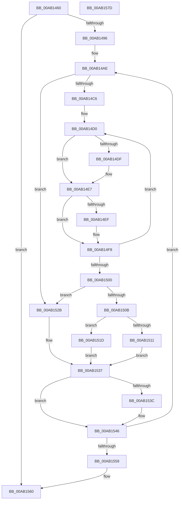

# SepRmSetAuditEventWrkr

- RVA: `0x00AB1460`–`0x00AB157E` (길이 `286` bytes)
- VA: `0x0000000140AB1460`
- 실행 섹션: `PAGE`
- PDB 이름 있음: `예`; PDB Function 태그: `아니요`
- unwind 정보 RVA: `0x0005D79C`
- 디코드: `79`개 명령, `286/286` bytes 표시
- 미해석 바이트: `0` (있으면 어셈블리에 `.byte`로 보존)

> 이 문서는 커널 이미지의 기계어와 PDB 기호를 분석해 생성했습니다. 4번과 5번은 함수 원형과 자료형을 바이너리 사용 방식에서 추정한 C 해석이며 원본 소스 복구 결과는 아닙니다.

## 1. Dependencies

- 직접 호출 지점: **1**; 고유 호출 대상: **1**
- 직접 호출자로 확인된 함수: **0**
- RIP 상대 이미지 참조: **4**

### Outgoing calls
- `0x00AB1489` → [PsIsCurrentThreadInServerSilo](../../text/43/PsIsCurrentThreadInServerSilo_function_004362E0.md) (function, `0x004362E0`)

### Direct callers
- 이 함수 시작 RVA로 연결되는 직접 call은 확인되지 않았습니다. 간접 호출은 완전히 역산할 수 없습니다.

### Static image references
- `0x00AB1496` → RVA `0x00F04B60` (`.data`; read)
- `0x00AB149D` → RVA `0x00FD8160` (`PAGEDATA`; read)
- `0x00AB14C9` → RVA `0x00F04AE0` (`.data`; read)
- `0x00AB1559` → RVA `0x00F04AC8` (`.data`; write)

## 2. Other-region calls and transfers

- 다른 실행 섹션으로 향하는 call: **1**
  - `0x00AB1489` → [PsIsCurrentThreadInServerSilo](../../text/43/PsIsCurrentThreadInServerSilo_function_004362E0.md) (`PAGE` → `.text`)
- 별도 외부 분기/꼬리 이동을 확인하지 못했습니다.

## 3. Assembly (complete function range)

```asm
00AB1460  48 89 5C 24 10                  mov qword ptr [rsp + 0x10], rbx
00AB1465  48 89 6C 24 18                  mov qword ptr [rsp + 0x18], rbp
00AB146A  48 89 74 24 20                  mov qword ptr [rsp + 0x20], rsi
00AB146F  57                              push rdi
00AB1470  41 54                           push r12
00AB1472  41 55                           push r13
00AB1474  41 56                           push r14
00AB1476  41 57                           push r15
00AB1478  48 83 EC 20                     sub rsp, 0x20
00AB147C  45 33 E4                        xor r12d, r12d
00AB147F  4C 8B F9                        mov r15, rcx
00AB1482  41 8B DC                        mov ebx, r12d
00AB1485  44 89 62 28                     mov dword ptr [rdx + 0x28], r12d
00AB1489  E8 52 4E 98 FF                  call 0x1404362e0
00AB148E  84 C0                           test al, al
00AB1490  0F 85 CA 00 00 00               jne 0x140ab1560
00AB1496  48 8D 3D C3 36 45 00            lea rdi, [rip + 0x4536c3]
00AB149D  48 8D 35 BC 6C 52 00            lea rsi, [rip + 0x526cbc]
00AB14A4  45 8D 74 24 09                  lea r14d, [r12 + 9]
00AB14A9  45 8D 6C 24 01                  lea r13d, [r12 + 1]
00AB14AE  44 0F B7 1E                     movzx r11d, word ptr [rsi]
00AB14B2  41 0F B7 D4                     movzx edx, r12w
00AB14B6  66 44 89 5C 24 50               mov word ptr [rsp + 0x50], r11w
00AB14BC  41 0F B7 CC                     movzx ecx, r12w
00AB14C0  66 45 3B E3                     cmp r12w, r11w
00AB14C4  73 65                           jae 0x140ab152b
00AB14C6  41 8B EB                        mov ebp, r11d
00AB14C9  4C 8D 1D 10 36 45 00            lea r11, [rip + 0x453610]
00AB14D0  44 8B C3                        mov r8d, ebx
00AB14D3  66 47 89 24 43                  mov word ptr [r11 + r8*2], r12w
00AB14D8  47 84 6C 47 2C                  test byte ptr [r15 + r8*2 + 0x2c], r13b
00AB14DD  74 08                           je 0x140ab14e7
00AB14DF  47 88 2C 43                     mov byte ptr [r11 + r8*2], r13b
00AB14E3  66 41 03 D5                     add dx, r13w
00AB14E7  43 F6 44 47 2C 02               test byte ptr [r15 + r8*2 + 0x2c], 2
00AB14ED  74 09                           je 0x140ab14f8
00AB14EF  47 88 6C 43 01                  mov byte ptr [r11 + r8*2 + 1], r13b
00AB14F4  66 41 03 CD                     add cx, r13w
00AB14F8  41 03 DD                        add ebx, r13d
00AB14FB  49 2B ED                        sub rbp, r13
00AB14FE  75 D0                           jne 0x140ab14d0
00AB1500  44 0F B7 5C 24 50               movzx r11d, word ptr [rsp + 0x50]
00AB1506  66 85 D2                        test dx, dx
00AB1509  74 20                           je 0x140ab152b
00AB150B  66 41 3B D3                     cmp dx, r11w
00AB150F  75 0C                           jne 0x140ab151d
00AB1511  8D 55 21                        lea edx, [rbp + 0x21]
00AB1514  8D 45 41                        lea eax, [rbp + 0x41]
00AB1517  44 8D 45 11                     lea r8d, [rbp + 0x11]
00AB151B  EB 1A                           jmp 0x140ab1537
00AB151D  BA 22 00 00 00                  mov edx, 0x22
00AB1522  8D 42 20                        lea eax, [rdx + 0x20]
00AB1525  44 8D 42 F0                     lea r8d, [rdx - 0x10]
00AB1529  EB 0C                           jmp 0x140ab1537
00AB152B  BA 24 00 00 00                  mov edx, 0x24
00AB1530  8D 42 20                        lea eax, [rdx + 0x20]
00AB1533  44 8D 42 F0                     lea r8d, [rdx - 0x10]
00AB1537  66 85 C9                        test cx, cx
00AB153A  74 0A                           je 0x140ab1546
00AB153C  66 41 3B CB                     cmp cx, r11w
00AB1540  8B C2                           mov eax, edx
00AB1542  41 0F 44 C0                     cmove eax, r8d
00AB1546  89 07                           mov dword ptr [rdi], eax
00AB1548  48 83 C6 02                     add rsi, 2
00AB154C  48 83 C7 04                     add rdi, 4
00AB1550  4D 2B F5                        sub r14, r13
00AB1553  0F 85 55 FF FF FF               jne 0x140ab14ae
00AB1559  44 89 2D 68 35 45 00            mov dword ptr [rip + 0x453568], r13d
00AB1560  48 8B 5C 24 58                  mov rbx, qword ptr [rsp + 0x58]
00AB1565  48 8B 6C 24 60                  mov rbp, qword ptr [rsp + 0x60]
00AB156A  48 8B 74 24 68                  mov rsi, qword ptr [rsp + 0x68]
00AB156F  48 83 C4 20                     add rsp, 0x20
00AB1573  41 5F                           pop r15
00AB1575  41 5E                           pop r14
00AB1577  41 5D                           pop r13
00AB1579  41 5C                           pop r12
00AB157B  5F                              pop rdi
00AB157C  C3                              ret
00AB157D  CC                              int3
```

## 4. C-style interpretation (structured pseudocode)

```c
__int64 __fastcall SepRmSetAuditEventWrkr(__int64 a1, __int64 a2)
{
    __int64 result;
    __int64 v_r12;
    __int64 v_r14;
    __int64 v_rbp;
    __int64 v_rbx;
    __int64 v_rdi;
    __int64 v_rsi;
    __int64 v_rsp;
    unsigned __int64 v_stack_p10;
    unsigned __int64 v_stack_p18;
    unsigned __int64 v_stack_p20;
    unsigned __int16 v_stack_p8;

    v_stack_p10 = v_rbx;
    v_stack_p18 = v_rbp;
    v_stack_p20 = v_rsi;
    v_rsp = (v_rsp) - (32);
    v_r12 = 0;
    *(unsigned int *)(a2 + 40) = 0;
    result = PsIsCurrentThreadInServerSilo(a1, a2, a3, a4);
    if ((unsigned __int8)(result) != 0) goto loc_00AB1560;
loc_00AB14AE:
    v_stack_p8 = (unsigned __int16)(*(unsigned __int16 *)(v_rip + 5401788));
    if (0 >= ((unsigned __int16)(*(unsigned __int16 *)(v_rip + 5401788)))) goto loc_00AB152B;
loc_00AB14D0:
    *(unsigned __int16 *)(v_rip + 4535824 + 0 * 2) = 0;
    if (((*(unsigned __int8 *)(a1 + 0 * 2 + 44)) & ((unsigned __int8)(v_r12 + 1))) != 0) {
        *(unsigned __int8 *)(v_rip + 4535824 + 0 * 2) = (unsigned __int8)(v_r12 + 1);
        a2 = (unsigned __int16)((0) + ((unsigned __int16)(v_r12 + 1)));
    }
    if (((*(unsigned __int8 *)(a1 + 0 * 2 + 44)) & (2)) != 0) {
        *(unsigned __int8 *)(v_rip + 4535824 + 0 * 2 + 1) = (unsigned __int8)(v_r12 + 1);
        a1 = (unsigned __int16)((0) + ((unsigned __int16)(v_r12 + 1)));
    }
    v_rbx = (unsigned int)((0) + ((unsigned int)(v_r12 + 1)));
    v_rbp = ((unsigned int)((unsigned int)(*(unsigned __int16 *)(v_rip + 5401788)))) - (v_r12 + 1);
    if (condition_is_not_equal) goto loc_00AB14D0;
    if ((unsigned __int16)(a2) == 0) goto loc_00AB152B;
    if (((unsigned __int16)(a2)) != ((unsigned __int16)(v_stack_p8))) goto loc_00AB151D;
    goto loc_00AB1537;
loc_00AB151D:
    goto loc_00AB1537;
loc_00AB152B:
loc_00AB1537:
    result = 36 + 32;
    if ((unsigned __int16)(a1) != 0) {
        result = 36;
        if (((unsigned __int16)(a1)) == ((unsigned __int16)(v_stack_p8))) { result = (unsigned int)(36 - 16); }
    }
    *(unsigned int *)(v_rip + 4536003) = (unsigned int)(result);
    v_rsi = (v_rip + 5401788) + (2);
    v_rdi = (v_rip + 4536003) + (4);
    v_r14 = (v_r12 + 9) - (v_r12 + 1);
    if (condition_is_not_equal) goto loc_00AB14AE;
    *(unsigned int *)(v_rip + 4535656) = (unsigned int)(v_r12 + 1);
loc_00AB1560:
    v_rsp = (v_rsp) + (32);
    return result;
}
```

## 5. (Beta) C Style

```c
int64_t SepRmSetAuditEventWrkr(void *Arg1, void *Arg2)
{
    uint8_t *arg1 = (uint8_t *)Arg1;
    uint8_t *arg2 = (uint8_t *)Arg2;

    int64_t result;
    int64_t local_r12;
    int64_t local_r14;
    int64_t local_rbp;
    int64_t local_rbx;
    int64_t local_rdi;
    int64_t local_rsi;
    int64_t local_rsp;
    uint64_t v_stack_p10;
    uint64_t v_stack_p18;
    uint64_t v_stack_p20;
    uint16_t v_stack_p8;

    v_stack_p10 = local_rbx;
    v_stack_p18 = local_rbp;
    v_stack_p20 = local_rsi;
    local_rsp = (local_rsp) - (32);
    local_r12 = 0;
    *(uint32_t *)(arg2 + 0x28) = 0;
    result = PsIsCurrentThreadInServerSilo(Arg1, Arg2, a3, a4);
    if ((uint8_t)(result) != 0) goto loc_00AB1560;
loc_00AB14AE:
    v_stack_p8 = (uint16_t)(*(uint16_t *)(v_rip + 0x526CBC));
    if (0 >= ((uint16_t)(*(uint16_t *)(v_rip + 0x526CBC)))) goto loc_00AB152B;
loc_00AB14D0:
    *(uint16_t *)(v_rip + 0x453610 + 0x0 * 2) = 0;
    if (((*(uint8_t *)(arg1 + 0x0 * 2 + 0x2C)) & ((uint8_t)(local_r12 + 1))) != 0) {
        *(uint8_t *)(v_rip + 0x453610 + 0x0 * 2) = (uint8_t)(local_r12 + 1);
        Arg2 = (uint16_t)((0) + ((uint16_t)(local_r12 + 1)));
    }
    if (((*(uint8_t *)(arg1 + 0x0 * 2 + 0x2C)) & (2)) != 0) {
        *(uint8_t *)(v_rip + 0x453610 + 0x0 * 2 + 0x1) = (uint8_t)(local_r12 + 1);
        Arg1 = (uint16_t)((0) + ((uint16_t)(local_r12 + 1)));
    }
    local_rbx = (uint32_t)((0) + ((uint32_t)(local_r12 + 1)));
    local_rbp = ((uint32_t)((uint32_t)(*(uint16_t *)(v_rip + 0x526CBC)))) - (local_r12 + 1);
    if (condition_is_not_equal) goto loc_00AB14D0;
    if ((uint16_t)(Arg2) == 0) goto loc_00AB152B;
    if (((uint16_t)(Arg2)) != ((uint16_t)(v_stack_p8))) goto loc_00AB151D;
    goto loc_00AB1537;
loc_00AB151D:
    goto loc_00AB1537;
loc_00AB152B:
loc_00AB1537:
    result = 36 + 32;
    if ((uint16_t)(Arg1) != 0) {
        result = 36;
        if (((uint16_t)(Arg1)) == ((uint16_t)(v_stack_p8))) { result = (uint32_t)(36 - 16); }
    }
    *(uint32_t *)(v_rip + 0x4536C3) = (uint32_t)(result);
    local_rsi = (v_rip + 5401788) + (2);
    local_rdi = (v_rip + 4536003) + (4);
    local_r14 = (local_r12 + 9) - (local_r12 + 1);
    if (condition_is_not_equal) goto loc_00AB14AE;
    *(uint32_t *)(v_rip + 0x453568) = (uint32_t)(local_r12 + 1);
loc_00AB1560:
    local_rsp = (local_rsp) + (32);
    return result;
}
```

### 관측된 메모리 오프셋

구조체 형식이 확인되지 않은 접근은 인자 기준의 오프셋으로만 기록했습니다.

| 기준 인자 | 오프셋 표현 | 폭 (bit) | 접근 |
|---|---:|---:|---|
| `Arg1` | `+ 0x2C + r8*2` | `8` | `R` |
| `Arg2` | `+ 0x28` | `32` | `W` |

## 6. Execution-region graph

[열기: 2D/3D 그래프와 함수 탐색 컨트롤 패널](../../../control-panel.html?section=page&rva=0x00AB1460&view=graph)

- 2D 그래프는 위에서 아래로 흐르고, 3D 그래프는 빈 공간을 드래그해 회전합니다. Shift+드래그는 이동, 휠은 확대·축소, 함수 노드 선택은 대상 보고서 이동입니다.

### Static fallback


