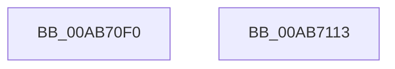

# SleepstudyHelperCreateLibrary

- RVA: `0x00AB70F0`–`0x00AB7114` (길이 `36` bytes)
- VA: `0x0000000140AB70F0`
- 실행 섹션: `PAGE`
- PDB 이름 있음: `예`; PDB Function 태그: `아니요`
- unwind 정보 RVA: `0x00097934`
- 디코드: `10`개 명령, `36/36` bytes 표시
- 미해석 바이트: `0` (있으면 어셈블리에 `.byte`로 보존)

> 이 문서는 커널 이미지의 기계어와 PDB 기호를 분석해 생성했습니다. 4번과 5번은 함수 원형과 자료형을 바이너리 사용 방식에서 추정한 C 해석이며 원본 소스 복구 결과는 아닙니다.

## 1. Dependencies

- 직접 호출 지점: **1**; 고유 호출 대상: **1**
- 직접 호출자로 확인된 함수: **1**
- RIP 상대 이미지 참조: **0**

### Outgoing calls
- `0x00AB7109` → [SleepstudyHelperCreateLibraryEx](../../text/4B/SleepstudyHelperCreateLibraryEx_function_004BAE50.md) (function, `0x004BAE50`)

### Direct callers
- [PopUserShutdownInitializeSleepstudyDiagnostics](../../init/C3/PopUserShutdownInitializeSleepstudyDiagnostics_function_00C3EF88.md) at `0x00C3EFC2`

### Static image references
- 디코드된 RIP-relative 메모리 참조가 없습니다.

## 2. Other-region calls and transfers

- 다른 실행 섹션으로 향하는 call: **1**
  - `0x00AB7109` → [SleepstudyHelperCreateLibraryEx](../../text/4B/SleepstudyHelperCreateLibraryEx_function_004BAE50.md) (`PAGE` → `.text`)
- 별도 외부 분기/꼬리 이동을 확인하지 못했습니다.

## 3. Assembly (complete function range)

```asm
00AB70F0  48 8B C4                        mov rax, rsp
00AB70F3  48 83 EC 38                     sub rsp, 0x38
00AB70F7  83 60 F0 00                     and dword ptr [rax - 0x10], 0
00AB70FB  89 48 EC                        mov dword ptr [rax - 0x14], ecx
00AB70FE  48 8D 48 E8                     lea rcx, [rax - 0x18]
00AB7102  C7 40 E8 01 00 00 00            mov dword ptr [rax - 0x18], 1
00AB7109  E8 42 3D A0 FF                  call 0x1404bae50
00AB710E  48 83 C4 38                     add rsp, 0x38
00AB7112  C3                              ret
00AB7113  CC                              int3
```

## 4. C-style interpretation (structured pseudocode)

```c
__int64 __fastcall SleepstudyHelperCreateLibrary(int a1)
{
    __int64 result;
    __int64 v_rsp;

    v_rsp = (v_rsp) - (56);
    *(unsigned int *)(v_rsp - 20) = a1;
    *(unsigned int *)(v_rsp - 24) = 1;
    result = SleepstudyHelperCreateLibraryEx(v_rsp - 24, a2, a3, a4);
    v_rsp = (v_rsp) + (56);
    return result;
}
```

## 5. (Beta) C Style

```c
int64_t SleepstudyHelperCreateLibrary(int32_t Arg1)
{
    int64_t result;
    int64_t local_rsp;

    local_rsp = (local_rsp) - (56);
    *(uint32_t *)(local_rsp - 0x14) = Arg1;
    *(uint32_t *)(local_rsp - 0x18) = 1;
    result = SleepstudyHelperCreateLibraryEx(local_rsp - 24, a2, a3, a4);
    local_rsp = (local_rsp) + (56);
    return result;
}
```

## 6. Execution-region graph

[열기: 2D/3D 그래프와 함수 탐색 컨트롤 패널](../../../control-panel.html?section=page&rva=0x00AB70F0&view=graph)

- 2D 그래프는 위에서 아래로 흐르고, 3D 그래프는 빈 공간을 드래그해 회전합니다. Shift+드래그는 이동, 휠은 확대·축소, 함수 노드 선택은 대상 보고서 이동입니다.

### Static fallback


