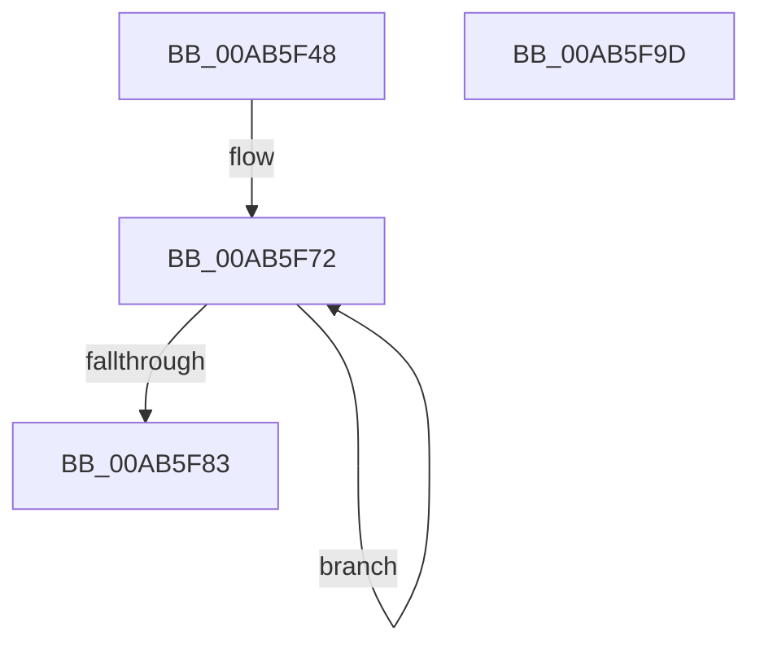

# SmHwAcceleratorMgrInitialize

- RVA: `0x00AB5F48`–`0x00AB5F9E` (길이 `86` bytes)
- VA: `0x0000000140AB5F48`
- 실행 섹션: `PAGE`
- PDB 이름 있음: `예`; PDB Function 태그: `아니요`
- unwind 정보 RVA: `0x0005CF00`
- 디코드: `22`개 명령, `86/86` bytes 표시
- 미해석 바이트: `0` (있으면 어셈블리에 `.byte`로 보존)

> 이 문서는 커널 이미지의 기계어와 PDB 기호를 분석해 생성했습니다. 4번과 5번은 함수 원형과 자료형을 바이너리 사용 방식에서 추정한 C 해석이며 원본 소스 복구 결과는 아닙니다.

## 1. Dependencies

- 직접 호출 지점: **1**; 고유 호출 대상: **1**
- 직접 호출자로 확인된 함수: **1**
- RIP 상대 이미지 참조: **0**

### Outgoing calls
- `0x00AB5F59` → [memset](../../text/6C/memset_function_006C6C40.md) (function, `0x006C6C40`)

### Direct callers
- [SmInitSystem](../../init/C7/SmInitSystem_function_00C7673C.md) at `0x00C7679D`

### Static image references
- 디코드된 RIP-relative 메모리 참조가 없습니다.

## 2. Other-region calls and transfers

- 다른 실행 섹션으로 향하는 call: **1**
  - `0x00AB5F59` → [memset](../../text/6C/memset_function_006C6C40.md) (`PAGE` → `.text`)
- 별도 외부 분기/꼬리 이동을 확인하지 못했습니다.

## 3. Assembly (complete function range)

```asm
00AB5F48  40 53                           push rbx
00AB5F4A  48 83 EC 20                     sub rsp, 0x20
00AB5F4E  33 D2                           xor edx, edx
00AB5F50  41 B8 30 05 00 00               mov r8d, 0x530
00AB5F56  48 8B D9                        mov rbx, rcx
00AB5F59  E8 E2 0C C1 FF                  call 0x1406c6c40
00AB5F5E  48 8D 43 08                     lea rax, [rbx + 8]
00AB5F62  B9 40 00 00 00                  mov ecx, 0x40
00AB5F67  48 89 40 08                     mov qword ptr [rax + 8], rax
00AB5F6B  48 89 00                        mov qword ptr [rax], rax
00AB5F6E  48 8D 43 18                     lea rax, [rbx + 0x18]
00AB5F72  48 89 40 08                     mov qword ptr [rax + 8], rax
00AB5F76  48 89 00                        mov qword ptr [rax], rax
00AB5F79  48 83 C0 10                     add rax, 0x10
00AB5F7D  48 83 E9 01                     sub rcx, 1
00AB5F81  75 EF                           jne 0x140ab5f72
00AB5F83  C7 83 1C 05 00 00 01 00 00 00   mov dword ptr [rbx + 0x51c], 1
00AB5F8D  C7 83 20 05 00 00 02 00 00 00   mov dword ptr [rbx + 0x520], 2
00AB5F97  48 83 C4 20                     add rsp, 0x20
00AB5F9B  5B                              pop rbx
00AB5F9C  C3                              ret
00AB5F9D  CC                              int3
```

## 4. C-style interpretation (structured pseudocode)

```c
__int64 __fastcall SmHwAcceleratorMgrInitialize(__int64 a1, int a2)
{
    __int64 result;
    __int64 v_rsp;

    v_rsp = (v_rsp) - (32);
    a2 = 0;
    result = memset(a1, a2, (unsigned int)(0x530ULL), a4);
    *(unsigned __int64 *)(a1 + 8 + 8) = a1 + 8;
    *(unsigned __int64 *)(a1 + 8) = a1 + 8;
loc_00AB5F72:
    *(unsigned __int64 *)(a1 + 24 + 8) = a1 + 24;
    *(unsigned __int64 *)(a1 + 24) = a1 + 24;
    result = (a1 + 24) + (16);
    a1 = (64) - (1);
    if (condition_is_not_equal) goto loc_00AB5F72;
    *(unsigned int *)(a1 + 1308) = 1;
    *(unsigned int *)(a1 + 1312) = 2;
    v_rsp = (v_rsp) + (32);
    return result;
}
```

## 5. (Beta) C Style

```c
int64_t SmHwAcceleratorMgrInitialize(void *Arg1, int32_t Arg2)
{
    uint8_t *arg1 = (uint8_t *)Arg1;

    int64_t result;
    int64_t local_rsp;

    local_rsp = (local_rsp) - (32);
    Arg2 = 0;
    result = memset(Arg1, Arg2, (uint32_t)(0x530ULL), a4);
    *(void **)(arg1 + 0x8 + 0x8) = Arg1 + 8;
    *(void **)(arg1 + 0x8) = Arg1 + 8;
loc_00AB5F72:
    *(void **)(arg1 + 0x18 + 0x8) = Arg1 + 24;
    *(void **)(arg1 + 0x18) = Arg1 + 24;
    result = (Arg1 + 24) + (16);
    Arg1 = (64) - (1);
    if (condition_is_not_equal) goto loc_00AB5F72;
    *(uint32_t *)(arg1 + 0x51C) = 1;
    *(uint32_t *)(arg1 + 0x520) = 2;
    local_rsp = (local_rsp) + (32);
    return result;
}
```

### 관측된 메모리 오프셋

구조체 형식이 확인되지 않은 접근은 인자 기준의 오프셋으로만 기록했습니다.

| 기준 인자 | 오프셋 표현 | 폭 (bit) | 접근 |
|---|---:|---:|---|
| `Arg1` | `+ 0x0` | `64` | `W` |
| `Arg1` | `+ 0x8` | `64` | `R` |
| `Arg1` | `+ 0x8` | `64` | `W` |
| `Arg1` | `+ 0x18` | `64` | `R` |
| `Arg1` | `+ 0x51C` | `32` | `W` |
| `Arg1` | `+ 0x520` | `32` | `W` |

## 6. Execution-region graph

[열기: 2D/3D 그래프와 함수 탐색 컨트롤 패널](../../../control-panel.html?section=page&rva=0x00AB5F48&view=graph)

- 2D 그래프는 위에서 아래로 흐르고, 3D 그래프는 빈 공간을 드래그해 회전합니다. Shift+드래그는 이동, 휠은 확대·축소, 함수 노드 선택은 대상 보고서 이동입니다.

### Static fallback


