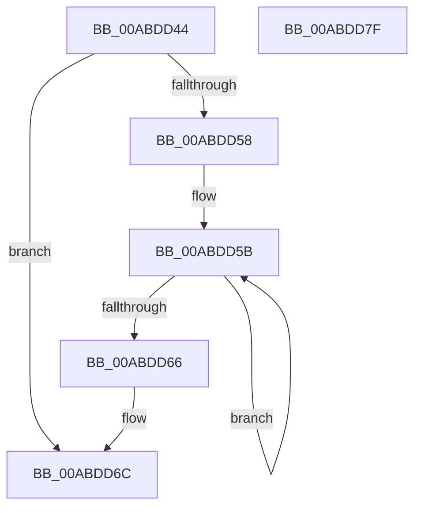

# SshpSessionManagerNormalizeLogHeader

- RVA: `0x00ABDD44`–`0x00ABDD80` (길이 `60` bytes)
- VA: `0x0000000140ABDD44`
- 실행 섹션: `PAGE`
- PDB 이름 있음: `예`; PDB Function 태그: `아니요`
- unwind 정보 RVA: `0x000DB714`
- 디코드: `22`개 명령, `60/60` bytes 표시
- 미해석 바이트: `0` (있으면 어셈블리에 `.byte`로 보존)

> 이 문서는 커널 이미지의 기계어와 PDB 기호를 분석해 생성했습니다. 4번과 5번은 함수 원형과 자료형을 바이너리 사용 방식에서 추정한 C 해석이며 원본 소스 복구 결과는 아닙니다.

## 1. Dependencies

- 직접 호출 지점: **0**; 고유 호출 대상: **0**
- 직접 호출자로 확인된 함수: **1**
- RIP 상대 이미지 참조: **0**

### Outgoing calls
- 직접 디코드된 call 명령이 없습니다.

### Direct callers
- [sub_00B4173C](../B4/Unknown_function_00B4173C.md) at `0x00B41740`

### Static image references
- 디코드된 RIP-relative 메모리 참조가 없습니다.

## 2. Other-region calls and transfers

- 다른 실행 섹션으로 향하는 call: **0**
- 별도 외부 분기/꼬리 이동을 확인하지 못했습니다.

## 3. Assembly (complete function range)

```asm
00ABDD44  44 8B 49 14                     mov r9d, dword ptr [rcx + 0x14]
00ABDD48  4C 8D 41 0C                     lea r8, [rcx + 0xc]
00ABDD4C  8B 51 10                        mov edx, dword ptr [rcx + 0x10]
00ABDD4F  47 8D 14 09                     lea r10d, [r9 + r9]
00ABDD53  41 3B D2                        cmp edx, r10d
00ABDD56  72 14                           jb 0x140abdd6c
00ABDD58  41 8B 00                        mov eax, dword ptr [r8]
00ABDD5B  41 2B D1                        sub edx, r9d
00ABDD5E  41 2B C1                        sub eax, r9d
00ABDD61  41 3B D2                        cmp edx, r10d
00ABDD64  73 F5                           jae 0x140abdd5b
00ABDD66  89 51 10                        mov dword ptr [rcx + 0x10], edx
00ABDD69  41 89 00                        mov dword ptr [r8], eax
00ABDD6C  8B 41 04                        mov eax, dword ptr [rcx + 4]
00ABDD6F  41 03 C1                        add eax, r9d
00ABDD72  41 03 00                        add eax, dword ptr [r8]
00ABDD75  03 01                           add eax, dword ptr [rcx]
00ABDD77  03 C2                           add eax, edx
00ABDD79  F7 D0                           not eax
00ABDD7B  89 41 08                        mov dword ptr [rcx + 8], eax
00ABDD7E  C3                              ret
00ABDD7F  CC                              int3
```

## 4. C-style interpretation (structured pseudocode)

```c
__int64 __fastcall SshpSessionManagerNormalizeLogHeader(__int64 a1)
{
    __int64 result;

    if (((unsigned int)((unsigned int)(*(unsigned int *)(a1 + 16)))) < ((unsigned int)((unsigned int)(*(unsigned int *)(a1 + 20)) + (unsigned int)(*(unsigned int *)(a1 + 20)) * 1))) goto loc_00ABDD6C;
loc_00ABDD5B:
    a2 = (unsigned int)(((unsigned int)(*(unsigned int *)(a1 + 16))) - ((unsigned int)((unsigned int)(*(unsigned int *)(a1 + 20)))));
    result = (unsigned int)(((unsigned int)(*(unsigned int *)(a1 + 12))) - ((unsigned int)((unsigned int)(*(unsigned int *)(a1 + 20)))));
    if (((unsigned int)(a2)) >= ((unsigned int)((unsigned int)(*(unsigned int *)(a1 + 20)) + (unsigned int)(*(unsigned int *)(a1 + 20)) * 1))) goto loc_00ABDD5B;
    *(unsigned int *)(a1 + 16) = (unsigned int)(a2);
    *(unsigned int *)(a1 + 12) = (unsigned int)(result);
loc_00ABDD6C:
    result = (unsigned int)(((unsigned int)(*(unsigned int *)(a1 + 4))) + ((unsigned int)((unsigned int)(*(unsigned int *)(a1 + 20)))));
    result = (unsigned int)((result) + (*(unsigned int *)(a1 + 12)));
    result = (unsigned int)((result) + (*(unsigned int *)(a1)));
    result = (unsigned int)((result) + ((unsigned int)(a2)));
    result = (unsigned int)(~(result));
    *(unsigned int *)(a1 + 8) = (unsigned int)(result);
    return result;
}
```

## 5. (Beta) C Style

```c
int64_t SshpSessionManagerNormalizeLogHeader(void *Arg1)
{
    uint8_t *arg1 = (uint8_t *)Arg1;

    int64_t result;

    if (((uint32_t)((uint32_t)(*(uint32_t *)(arg1 + 0x10)))) < ((uint32_t)((uint32_t)(*(uint32_t *)(arg1 + 0x14)) + (uint32_t)(*(uint32_t *)(arg1 + 0x14)) * 1))) goto loc_00ABDD6C;
loc_00ABDD5B:
    a2 = (uint32_t)(((uint32_t)(*(uint32_t *)(arg1 + 0x10))) - ((uint32_t)((uint32_t)(*(uint32_t *)(arg1 + 0x14)))));
    result = (uint32_t)(((uint32_t)(*(uint32_t *)(arg1 + 0xC))) - ((uint32_t)((uint32_t)(*(uint32_t *)(arg1 + 0x14)))));
    if (((uint32_t)(a2)) >= ((uint32_t)((uint32_t)(*(uint32_t *)(arg1 + 0x14)) + (uint32_t)(*(uint32_t *)(arg1 + 0x14)) * 1))) goto loc_00ABDD5B;
    *(uint32_t *)(arg1 + 0x10) = (uint32_t)(a2);
    *(uint32_t *)(arg1 + 0xC) = (uint32_t)(result);
loc_00ABDD6C:
    result = (uint32_t)(((uint32_t)(*(uint32_t *)(arg1 + 0x4))) + ((uint32_t)((uint32_t)(*(uint32_t *)(arg1 + 0x14)))));
    result = (uint32_t)((result) + (*(uint32_t *)(arg1 + 0xC)));
    result = (uint32_t)((result) + (*(uint32_t *)(arg1)));
    result = (uint32_t)((result) + ((uint32_t)(a2)));
    result = (uint32_t)(~(result));
    *(uint32_t *)(arg1 + 0x8) = (uint32_t)(result);
    return result;
}
```

### 관측된 메모리 오프셋

구조체 형식이 확인되지 않은 접근은 인자 기준의 오프셋으로만 기록했습니다.

| 기준 인자 | 오프셋 표현 | 폭 (bit) | 접근 |
|---|---:|---:|---|
| `Arg1` | `+ 0x0` | `32` | `R` |
| `Arg1` | `+ 0x0` | `32` | `W` |
| `Arg1` | `+ 0x4` | `32` | `R` |
| `Arg1` | `+ 0x8` | `32` | `W` |
| `Arg1` | `+ 0xC` | `64` | `R` |
| `Arg1` | `+ 0x10` | `32` | `R` |
| `Arg1` | `+ 0x10` | `32` | `W` |
| `Arg1` | `+ 0x14` | `32` | `R` |

## 6. Execution-region graph

[열기: 2D/3D 그래프와 함수 탐색 컨트롤 패널](../../../control-panel.html?section=page&rva=0x00ABDD44&view=graph)

- 2D 그래프는 위에서 아래로 흐르고, 3D 그래프는 빈 공간을 드래그해 회전합니다. Shift+드래그는 이동, 휠은 확대·축소, 함수 노드 선택은 대상 보고서 이동입니다.

### Static fallback


