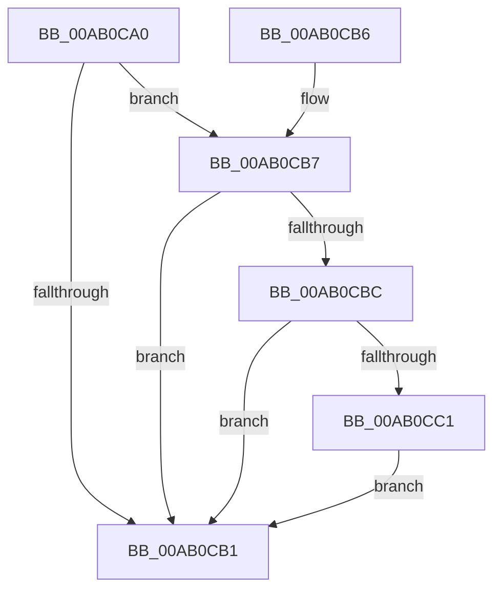

# VmSecureBackingMemory

- RVA: `0x00AB0CA0`–`0x00AB0CD2` (길이 `50` bytes)
- VA: `0x0000000140AB0CA0`
- 실행 섹션: `PAGE`
- PDB 이름 있음: `예`; PDB Function 태그: `아니요`
- unwind 정보 RVA: `0x00094EEC`
- 디코드: `16`개 명령, `50/50` bytes 표시
- 미해석 바이트: `0` (있으면 어셈블리에 `.byte`로 보존)

> 이 문서는 커널 이미지의 기계어와 PDB 기호를 분석해 생성했습니다. 4번과 5번은 함수 원형과 자료형을 바이너리 사용 방식에서 추정한 C 해석이며 원본 소스 복구 결과는 아닙니다.

## 1. Dependencies

- 직접 호출 지점: **1**; 고유 호출 대상: **1**
- 직접 호출자로 확인된 함수: **0**
- RIP 상대 이미지 참조: **0**

### Outgoing calls
- `0x00AB0CCB` → [MmSecureVirtualMemoryEx](../9F/MmSecureVirtualMemoryEx_function_009F5620.md) (function, `0x009F5620`)

### Direct callers
- 이 함수 시작 RVA로 연결되는 직접 call은 확인되지 않았습니다. 간접 호출은 완전히 역산할 수 없습니다.

### Static image references
- 디코드된 RIP-relative 메모리 참조가 없습니다.

## 2. Other-region calls and transfers

- 다른 실행 섹션으로 향하는 call: **0**
- 별도 외부 분기/꼬리 이동을 확인하지 못했습니다.

## 3. Assembly (complete function range)

```asm
00AB0CA0  48 83 EC 28                     sub rsp, 0x28
00AB0CA4  33 C0                           xor eax, eax
00AB0CA6  41 B8 FF 0F 00 00               mov r8d, 0xfff
00AB0CAC  49 85 C8                        test r8, rcx
00AB0CAF  74 06                           je 0x140ab0cb7
00AB0CB1  48 83 C4 28                     add rsp, 0x28
00AB0CB5  C3                              ret
00AB0CB6  CC                              int3
00AB0CB7  48 85 D2                        test rdx, rdx
00AB0CBA  74 F5                           je 0x140ab0cb1
00AB0CBC  49 85 D0                        test r8, rdx
00AB0CBF  75 F0                           jne 0x140ab0cb1
00AB0CC1  41 B9 0E 00 00 00               mov r9d, 0xe
00AB0CC7  45 8D 41 F3                     lea r8d, [r9 - 0xd]
00AB0CCB  E8 50 49 F4 FF                  call 0x1409f5620
00AB0CD0  EB DF                           jmp 0x140ab0cb1
```

## 4. C-style interpretation (structured pseudocode)

```c
__int64 __fastcall VmSecureBackingMemory(__int64 a1, __int64 a2)
{
    __int64 result;
    __int64 v_rsp;

    v_rsp = (v_rsp) - (40);
    result = 0;
    if ((((unsigned int)(0xFFFULL)) & (a1)) == 0) goto loc_00AB0CB7;
loc_00AB0CB1:
    v_rsp = (v_rsp) + (40);
    return result;
loc_00AB0CB7:
    if (a2 == 0) goto loc_00AB0CB1;
    if ((((unsigned int)(0xFFFULL)) & (a2)) != 0) goto loc_00AB0CB1;
    result = MmSecureVirtualMemoryEx(a1, a2, 14 - 13, 14);
    goto loc_00AB0CB1;
}
```

## 5. (Beta) C Style

```c
int64_t VmSecureBackingMemory(int64_t Arg1, int64_t Arg2)
{
    int64_t result;
    int64_t local_rsp;

    local_rsp = (local_rsp) - (40);
    result = 0;
    if ((((uint32_t)(0xFFFULL)) & (Arg1)) == 0) goto loc_00AB0CB7;
loc_00AB0CB1:
    local_rsp = (local_rsp) + (40);
    return result;
loc_00AB0CB7:
    if (Arg2 == 0) goto loc_00AB0CB1;
    if ((((uint32_t)(0xFFFULL)) & (Arg2)) != 0) goto loc_00AB0CB1;
    result = MmSecureVirtualMemoryEx(Arg1, Arg2, 14 - 13, 14);
    goto loc_00AB0CB1;
}
```

## 6. Execution-region graph

[열기: 2D/3D 그래프와 함수 탐색 컨트롤 패널](../../../control-panel.html?section=page&rva=0x00AB0CA0&view=graph)

- 2D 그래프는 위에서 아래로 흐르고, 3D 그래프는 빈 공간을 드래그해 회전합니다. Shift+드래그는 이동, 휠은 확대·축소, 함수 노드 선택은 대상 보고서 이동입니다.

### Static fallback


