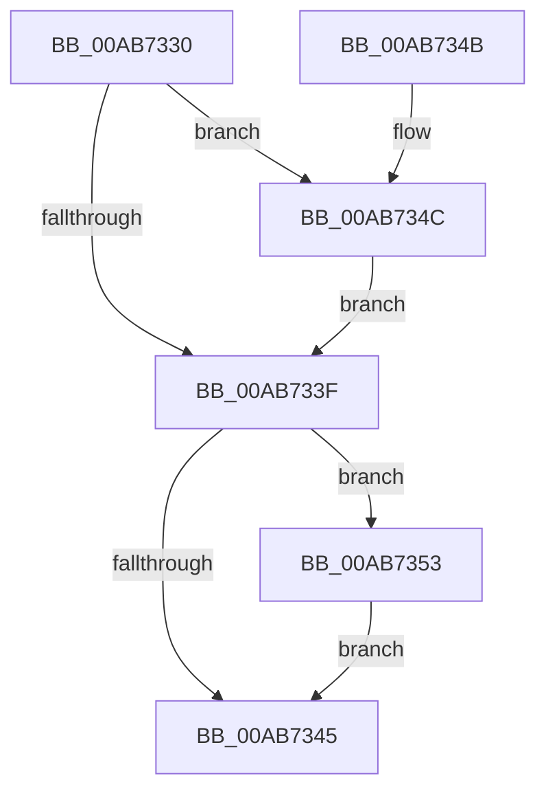

# VrpJobContextDelete

- RVA: `0x00AB7330`–`0x00AB735A` (길이 `42` bytes)
- VA: `0x0000000140AB7330`
- 실행 섹션: `PAGE`
- PDB 이름 있음: `예`; PDB Function 태그: `아니요`
- unwind 정보 RVA: `0x000704F4`
- 디코드: `15`개 명령, `42/42` bytes 표시
- 미해석 바이트: `0` (있으면 어셈블리에 `.byte`로 보존)

> 이 문서는 커널 이미지의 기계어와 PDB 기호를 분석해 생성했습니다. 4번과 5번은 함수 원형과 자료형을 바이너리 사용 방식에서 추정한 C 해석이며 원본 소스 복구 결과는 아닙니다.

## 1. Dependencies

- 직접 호출 지점: **2**; 고유 호출 대상: **2**
- 직접 호출자로 확인된 함수: **0**
- RIP 상대 이미지 참조: **0**

### Outgoing calls
- `0x00AB734C` → [VrpCleanupNamespace](../93/VrpCleanupNamespace_function_0093649C.md) (function, `0x0093649C`)
- `0x00AB7353` → [VrpDecrementSiloCount](../AC/VrpDecrementSiloCount_function_00AC33C8.md) (function, `0x00AC33C8`)

### Direct callers
- 이 함수 시작 RVA로 연결되는 직접 call은 확인되지 않았습니다. 간접 호출은 완전히 역산할 수 없습니다.

### Static image references
- 디코드된 RIP-relative 메모리 참조가 없습니다.

## 2. Other-region calls and transfers

- 다른 실행 섹션으로 향하는 call: **0**
- 별도 외부 분기/꼬리 이동을 확인하지 못했습니다.

## 3. Assembly (complete function range)

```asm
00AB7330  40 53                           push rbx
00AB7332  48 83 EC 20                     sub rsp, 0x20
00AB7336  83 79 54 00                     cmp dword ptr [rcx + 0x54], 0
00AB733A  48 8B D9                        mov rbx, rcx
00AB733D  74 0D                           je 0x140ab734c
00AB733F  83 7B 58 00                     cmp dword ptr [rbx + 0x58], 0
00AB7343  75 0E                           jne 0x140ab7353
00AB7345  48 83 C4 20                     add rsp, 0x20
00AB7349  5B                              pop rbx
00AB734A  C3                              ret
00AB734B  CC                              int3
00AB734C  E8 4B F1 E7 FF                  call 0x14093649c
00AB7351  EB EC                           jmp 0x140ab733f
00AB7353  E8 70 C0 00 00                  call 0x140ac33c8
00AB7358  EB EB                           jmp 0x140ab7345
```

## 4. C-style interpretation (structured pseudocode)

```c
__int64 __fastcall VrpJobContextDelete(__int64 a1)
{
    __int64 result;
    __int64 v_rsp;

    v_rsp = (v_rsp) - (32);
    if ((*(unsigned int *)(a1 + 84)) == 0) goto loc_00AB734C;
loc_00AB733F:
    if ((*(unsigned int *)(a1 + 88)) != 0) goto loc_00AB7353;
loc_00AB7345:
    v_rsp = (v_rsp) + (32);
    return result;
loc_00AB734C:
    result = VrpCleanupNamespace(a1, a2, a3, a4);
    goto loc_00AB733F;
loc_00AB7353:
    result = VrpDecrementSiloCount(a1, a2, a3, a4);
    goto loc_00AB7345;
}
```

## 5. (Beta) C Style

```c
int64_t VrpJobContextDelete(void *Arg1)
{
    uint8_t *arg1 = (uint8_t *)Arg1;

    int64_t result;
    int64_t local_rsp;

    local_rsp = (local_rsp) - (32);
    if ((*(uint32_t *)(arg1 + 0x54)) == 0) goto loc_00AB734C;
loc_00AB733F:
    if ((*(uint32_t *)(arg1 + 0x58)) != 0) goto loc_00AB7353;
loc_00AB7345:
    local_rsp = (local_rsp) + (32);
    return result;
loc_00AB734C:
    result = VrpCleanupNamespace(Arg1, a2, a3, a4);
    goto loc_00AB733F;
loc_00AB7353:
    result = VrpDecrementSiloCount(Arg1, a2, a3, a4);
    goto loc_00AB7345;
}
```

### 관측된 메모리 오프셋

구조체 형식이 확인되지 않은 접근은 인자 기준의 오프셋으로만 기록했습니다.

| 기준 인자 | 오프셋 표현 | 폭 (bit) | 접근 |
|---|---:|---:|---|
| `Arg1` | `+ 0x54` | `32` | `R` |
| `Arg1` | `+ 0x58` | `32` | `R` |

## 6. Execution-region graph

[열기: 2D/3D 그래프와 함수 탐색 컨트롤 패널](../../../control-panel.html?section=page&rva=0x00AB7330&view=graph)

- 2D 그래프는 위에서 아래로 흐르고, 3D 그래프는 빈 공간을 드래그해 회전합니다. Shift+드래그는 이동, 휠은 확대·축소, 함수 노드 선택은 대상 보고서 이동입니다.

### Static fallback


