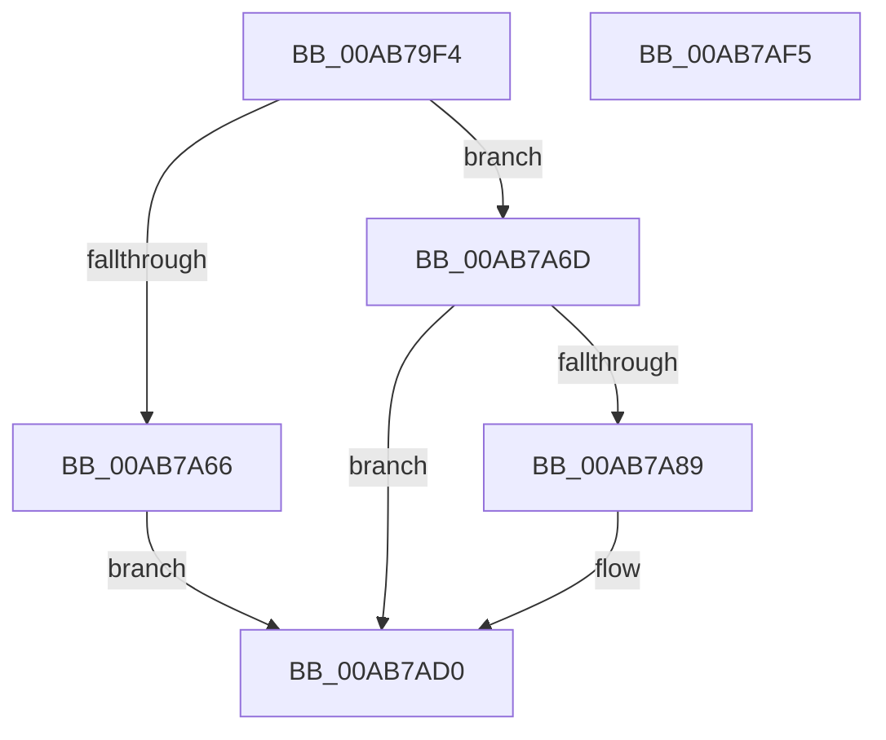

# VslCaptureSecureImageIat

- RVA: `0x00AB79F4`–`0x00AB7AF6` (길이 `258` bytes)
- VA: `0x0000000140AB79F4`
- 실행 섹션: `PAGE`
- PDB 이름 있음: `예`; PDB Function 태그: `아니요`
- unwind 정보 RVA: `0x000BD0D0`
- 디코드: `59`개 명령, `258/258` bytes 표시
- 미해석 바이트: `0` (있으면 어셈블리에 `.byte`로 보존)

> 이 문서는 커널 이미지의 기계어와 PDB 기호를 분석해 생성했습니다. 4번과 5번은 함수 원형과 자료형을 바이너리 사용 방식에서 추정한 C 해석이며 원본 소스 복구 결과는 아닙니다.

## 1. Dependencies

- 직접 호출 지점: **6**; 고유 호출 대상: **5**
- 직접 호출자로 확인된 함수: **1**
- RIP 상대 이미지 참조: **1**

### Outgoing calls
- `0x00AB7A2F` → [memset](../../text/6C/memset_function_006C6C40.md) (function, `0x006C6C40`)
- `0x00AB7A3F` → [memset](../../text/6C/memset_function_006C6C40.md) (function, `0x006C6C40`)
- `0x00AB7A80` → [VslpLockPagesForTransfer](../../text/29/VslpLockPagesForTransfer_function_0029E0FC.md) (function, `0x0029E0FC`)
- `0x00AB7ABD` → [VslpEnterIumSecureMode](../../text/23/VslpEnterIumSecureMode_function_00235E50.md) (function, `0x00235E50`)
- `0x00AB7AC9` → [VslpUnlockPagesForTransfer](../../text/29/VslpUnlockPagesForTransfer_function_0029EE4C.md) (function, `0x0029EE4C`)
- `0x00AB7ADB` → [_security_check_cookie](../../text/6A/_security_check_cookie_function_006AC640.md) (function, `0x006AC640`)

### Direct callers
- [sub_00B49200](../B4/Unknown_function_00B49200.md) at `0x00B49246`

### Static image references
- `0x00AB7A06` → RVA `0x00E0A740` (`.data`; read)

## 2. Other-region calls and transfers

- 다른 실행 섹션으로 향하는 call: **6**
  - `0x00AB7A2F` → [memset](../../text/6C/memset_function_006C6C40.md) (`PAGE` → `.text`)
  - `0x00AB7A3F` → [memset](../../text/6C/memset_function_006C6C40.md) (`PAGE` → `.text`)
  - `0x00AB7A80` → [VslpLockPagesForTransfer](../../text/29/VslpLockPagesForTransfer_function_0029E0FC.md) (`PAGE` → `.text`)
  - `0x00AB7ABD` → [VslpEnterIumSecureMode](../../text/23/VslpEnterIumSecureMode_function_00235E50.md) (`PAGE` → `.text`)
  - `0x00AB7AC9` → [VslpUnlockPagesForTransfer](../../text/29/VslpUnlockPagesForTransfer_function_0029EE4C.md) (`PAGE` → `.text`)
  - `0x00AB7ADB` → [_security_check_cookie](../../text/6A/_security_check_cookie_function_006AC640.md) (`PAGE` → `.text`)
- 별도 외부 분기/꼬리 이동을 확인하지 못했습니다.

## 3. Assembly (complete function range)

```asm
00AB79F4  48 89 5C 24 08                  mov qword ptr [rsp + 8], rbx
00AB79F9  48 89 74 24 20                  mov qword ptr [rsp + 0x20], rsi
00AB79FE  57                              push rdi
00AB79FF  48 81 EC 00 01 00 00            sub rsp, 0x100
00AB7A06  48 8B 05 33 2D 35 00            mov rax, qword ptr [rip + 0x352d33]
00AB7A0D  48 33 C4                        xor rax, rsp
00AB7A10  48 89 84 24 F0 00 00 00         mov qword ptr [rsp + 0xf0], rax
00AB7A18  48 8B DA                        mov rbx, rdx
00AB7A1B  49 8B F8                        mov rdi, r8
00AB7A1E  33 D2                           xor edx, edx
00AB7A20  48 8B F1                        mov rsi, rcx
00AB7A23  48 8D 8C 24 80 00 00 00         lea rcx, [rsp + 0x80]
00AB7A2B  44 8D 42 68                     lea r8d, [rdx + 0x68]
00AB7A2F  E8 0C F2 C0 FF                  call 0x1406c6c40
00AB7A34  33 D2                           xor edx, edx
00AB7A36  48 8D 4C 24 30                  lea rcx, [rsp + 0x30]
00AB7A3B  44 8D 42 48                     lea r8d, [rdx + 0x48]
00AB7A3F  E8 FC F1 C0 FF                  call 0x1406c6c40
00AB7A44  48 8B C3                        mov rax, rbx
00AB7A47  48 8D 8F FF 0F 00 00            lea rcx, [rdi + 0xfff]
00AB7A4E  25 FF 0F 00 00                  and eax, 0xfff
00AB7A53  48 03 C8                        add rcx, rax
00AB7A56  48 81 E1 00 F0 FF FF            and rcx, 0xfffffffffffff000
00AB7A5D  48 81 F9 00 A0 1F 00            cmp rcx, 0x1fa000
00AB7A64  76 07                           jbe 0x140ab7a6d
00AB7A66  B8 0D 00 00 C0                  mov eax, 0xc000000d
00AB7A6B  EB 63                           jmp 0x140ab7ad0
00AB7A6D  83 64 24 20 00                  and dword ptr [rsp + 0x20], 0
00AB7A72  48 8D 4C 24 30                  lea rcx, [rsp + 0x30]
00AB7A77  45 33 C9                        xor r9d, r9d
00AB7A7A  44 8B C7                        mov r8d, edi
00AB7A7D  48 8B D3                        mov rdx, rbx
00AB7A80  E8 77 66 7E FF                  call 0x14029e0fc
00AB7A85  85 C0                           test eax, eax
00AB7A87  78 47                           js 0x140ab7ad0
00AB7A89  48 8B 44 24 30                  mov rax, qword ptr [rsp + 0x30]
00AB7A8E  4C 8D 8C 24 80 00 00 00         lea r9, [rsp + 0x80]
00AB7A96  48 89 84 24 90 00 00 00         mov qword ptr [rsp + 0x90], rax
00AB7A9E  BA 2B 00 00 00                  mov edx, 0x2b
00AB7AA3  48 8B 44 24 68                  mov rax, qword ptr [rsp + 0x68]
00AB7AA8  45 33 C0                        xor r8d, r8d
00AB7AAB  B1 02                           mov cl, 2
00AB7AAD  48 89 84 24 98 00 00 00         mov qword ptr [rsp + 0x98], rax
00AB7AB5  48 89 B4 24 88 00 00 00         mov qword ptr [rsp + 0x88], rsi
00AB7ABD  E8 8E E3 77 FF                  call 0x140235e50
00AB7AC2  48 8D 4C 24 30                  lea rcx, [rsp + 0x30]
00AB7AC7  8B D8                           mov ebx, eax
00AB7AC9  E8 7E 73 7E FF                  call 0x14029ee4c
00AB7ACE  8B C3                           mov eax, ebx
00AB7AD0  48 8B 8C 24 F0 00 00 00         mov rcx, qword ptr [rsp + 0xf0]
00AB7AD8  48 33 CC                        xor rcx, rsp
00AB7ADB  E8 60 4B BF FF                  call 0x1406ac640
00AB7AE0  4C 8D 9C 24 00 01 00 00         lea r11, [rsp + 0x100]
00AB7AE8  49 8B 5B 10                     mov rbx, qword ptr [r11 + 0x10]
00AB7AEC  49 8B 73 28                     mov rsi, qword ptr [r11 + 0x28]
00AB7AF0  49 8B E3                        mov rsp, r11
00AB7AF3  5F                              pop rdi
00AB7AF4  C3                              ret
00AB7AF5  CC                              int3
```

## 4. C-style interpretation (structured pseudocode)

```c
__int64 __fastcall VslCaptureSecureImageIat(__int64 a1, __int64 a2, __int64 a3, int a4)
{
    __int64 result;
    __int64 v_rbx;
    __int64 v_rsp;
    unsigned __int64 v_stack_m18;
    unsigned __int64 v_stack_m70;
    unsigned __int64 v_stack_m78;
    unsigned __int64 v_stack_m8;
    unsigned __int64 v_stack_m80;
    unsigned __int64 v_stack_m88;
    unsigned __int64 v_stack_mA0;
    unsigned __int64 v_stack_mD8;
    unsigned int v_stack_mE8;
    unsigned __int64 v_stack_p20;
    unsigned __int64 v_stack_p8;

    v_stack_p8 = v_rbx;
    v_stack_p20 = v_rsi;
    v_rsp = (v_rsp) - (256);
    result = (*(unsigned __int64 *)(v_rip + 3484979)) ^ (v_rsp);
    v_stack_m18 = result;
    a2 = 0;
    result = memset(v_stack_m88, a2, a2 + 104, a4);
    a2 = 0;
    result = memset(v_stack_mD8, a2, a2 + 72, a4);
    result = (unsigned int)((0) & (0xFFFULL));
    a1 = (a3 + 4095) + (result);
    a1 = (a1) & (0xFFFFFFFFFFFFF000ULL);
    if (a1 <= 0x1FA000ULL) goto loc_00AB7A6D;
    goto loc_00AB7AD0;
loc_00AB7A6D:
    a4 = 0;
    result = VslpLockPagesForTransfer(v_stack_mD8, 0, (unsigned int)((unsigned int)(a3)), a4);
    v_rbx = a2;
    if (!(sign_flag)) {
        result = v_stack_mD8;
        a4 = v_stack_m88;
        v_stack_m78 = result;
        a2 = 43;
        result = v_stack_mA0;
        a3 = 0;
        a1 = 2;
        v_stack_m70 = result;
        v_stack_m80 = a1;
        result = VslpEnterIumSecureMode(a1, a2, a3, a4);
        a1 = v_stack_mD8;
        v_rbx = (unsigned int)(result);
        result = VslpUnlockPagesForTransfer(a1, a2, a3, a4);
        result = (unsigned int)(v_rbx);
    }
    a1 = (v_stack_m18) ^ (v_rsp);
    result = _security_check_cookie(a1, a2, a3, a4);
    return result;
}
```

## 5. (Beta) C Style

```c
int64_t VslCaptureSecureImageIat(int64_t Arg1, int64_t Arg2, void *Arg3, int32_t Arg4)
{
    uint8_t *arg3 = (uint8_t *)Arg3;

    int64_t result;
    int64_t local_rbx;
    int64_t local_rsp;
    uint64_t v_stack_m18;
    uint64_t v_stack_m70;
    uint64_t v_stack_m78;
    uint64_t v_stack_m8;
    uint64_t v_stack_m80;
    uint64_t v_stack_m88;
    uint64_t v_stack_mA0;
    uint64_t v_stack_mD8;
    uint32_t v_stack_mE8;
    uint64_t v_stack_p20;
    uint64_t v_stack_p8;

    v_stack_p8 = local_rbx;
    v_stack_p20 = local_rsi;
    local_rsp = (local_rsp) - (256);
    result = (*(uint64_t *)(v_rip + 0x352D33)) ^ (local_rsp);
    v_stack_m18 = result;
    Arg2 = 0;
    result = memset(v_stack_m88, Arg2, Arg2 + 104, Arg4);
    Arg2 = 0;
    result = memset(v_stack_mD8, Arg2, Arg2 + 72, Arg4);
    result = (uint32_t)((0) & (0xFFFULL));
    Arg1 = (Arg3 + 4095) + (result);
    Arg1 = (Arg1) & (0xFFFFFFFFFFFFF000ULL);
    if (Arg1 <= 0x1FA000ULL) goto loc_00AB7A6D;
    goto loc_00AB7AD0;
loc_00AB7A6D:
    Arg4 = 0;
    result = VslpLockPagesForTransfer(v_stack_mD8, 0, (uint32_t)((uint32_t)(Arg3)), Arg4);
    local_rbx = Arg2;
    if (!(sign_flag)) {
        result = v_stack_mD8;
        Arg4 = v_stack_m88;
        v_stack_m78 = result;
        Arg2 = 43;
        result = v_stack_mA0;
        Arg3 = 0;
        Arg1 = 2;
        v_stack_m70 = result;
        v_stack_m80 = Arg1;
        result = VslpEnterIumSecureMode(Arg1, Arg2, Arg3, Arg4);
        Arg1 = v_stack_mD8;
        local_rbx = (uint32_t)(result);
        result = VslpUnlockPagesForTransfer(Arg1, Arg2, Arg3, Arg4);
        result = (uint32_t)(local_rbx);
    }
    Arg1 = (v_stack_m18) ^ (local_rsp);
    result = _security_check_cookie(Arg1, Arg2, Arg3, Arg4);
    return result;
}
```

### 관측된 메모리 오프셋

구조체 형식이 확인되지 않은 접근은 인자 기준의 오프셋으로만 기록했습니다.

| 기준 인자 | 오프셋 표현 | 폭 (bit) | 접근 |
|---|---:|---:|---|
| `Arg3` | `+ 0xFFF` | `64` | `R` |

## 6. Execution-region graph

[열기: 2D/3D 그래프와 함수 탐색 컨트롤 패널](../../../control-panel.html?section=page&rva=0x00AB79F4&view=graph)

- 2D 그래프는 위에서 아래로 흐르고, 3D 그래프는 빈 공간을 드래그해 회전합니다. Shift+드래그는 이동, 휠은 확대·축소, 함수 노드 선택은 대상 보고서 이동입니다.

### Static fallback


