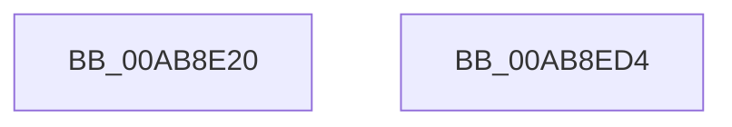

# VslIumEtwEnableCallback

- RVA: `0x00AB8E20`–`0x00AB8ED5` (길이 `181` bytes)
- VA: `0x0000000140AB8E20`
- 실행 섹션: `PAGE`
- PDB 이름 있음: `예`; PDB Function 태그: `아니요`
- unwind 정보 RVA: `0x00068468`
- 디코드: `41`개 명령, `181/181` bytes 표시
- 미해석 바이트: `0` (있으면 어셈블리에 `.byte`로 보존)

> 이 문서는 커널 이미지의 기계어와 PDB 기호를 분석해 생성했습니다. 4번과 5번은 함수 원형과 자료형을 바이너리 사용 방식에서 추정한 C 해석이며 원본 소스 복구 결과는 아닙니다.

## 1. Dependencies

- 직접 호출 지점: **3**; 고유 호출 대상: **3**
- 직접 호출자로 확인된 함수: **0**
- RIP 상대 이미지 참조: **1**

### Outgoing calls
- `0x00AB8E60` → [memset](../../text/6C/memset_function_006C6C40.md) (function, `0x006C6C40`)
- `0x00AB8EA6` → [VslpEnterIumSecureMode](../../text/23/VslpEnterIumSecureMode_function_00235E50.md) (function, `0x00235E50`)
- `0x00AB8EB6` → [_security_check_cookie](../../text/6A/_security_check_cookie_function_006AC640.md) (function, `0x006AC640`)

### Direct callers
- 이 함수 시작 RVA로 연결되는 직접 call은 확인되지 않았습니다. 간접 호출은 완전히 역산할 수 없습니다.

### Static image references
- `0x00AB8E37` → RVA `0x00E0A740` (`.data`; read)

## 2. Other-region calls and transfers

- 다른 실행 섹션으로 향하는 call: **3**
  - `0x00AB8E60` → [memset](../../text/6C/memset_function_006C6C40.md) (`PAGE` → `.text`)
  - `0x00AB8EA6` → [VslpEnterIumSecureMode](../../text/23/VslpEnterIumSecureMode_function_00235E50.md) (`PAGE` → `.text`)
  - `0x00AB8EB6` → [_security_check_cookie](../../text/6A/_security_check_cookie_function_006AC640.md) (`PAGE` → `.text`)
- 별도 외부 분기/꼬리 이동을 확인하지 못했습니다.

## 3. Assembly (complete function range)

```asm
00AB8E20  48 89 5C 24 08                  mov qword ptr [rsp + 8], rbx
00AB8E25  48 89 6C 24 10                  mov qword ptr [rsp + 0x10], rbp
00AB8E2A  48 89 74 24 18                  mov qword ptr [rsp + 0x18], rsi
00AB8E2F  57                              push rdi
00AB8E30  48 81 EC A0 00 00 00            sub rsp, 0xa0
00AB8E37  48 8B 05 02 19 35 00            mov rax, qword ptr [rip + 0x351902]
00AB8E3E  48 33 C4                        xor rax, rsp
00AB8E41  48 89 84 24 90 00 00 00         mov qword ptr [rsp + 0x90], rax
00AB8E49  8B FA                           mov edi, edx
00AB8E4B  48 8B D9                        mov rbx, rcx
00AB8E4E  33 D2                           xor edx, edx
00AB8E50  41 0F B6 F0                     movzx esi, r8b
00AB8E54  48 8D 4C 24 20                  lea rcx, [rsp + 0x20]
00AB8E59  49 8B E9                        mov rbp, r9
00AB8E5C  44 8D 42 68                     lea r8d, [rdx + 0x68]
00AB8E60  E8 DB DD C0 FF                  call 0x1406c6c40
00AB8E65  48 8B 84 24 D0 00 00 00         mov rax, qword ptr [rsp + 0xd0]
00AB8E6D  4C 8D 4C 24 20                  lea r9, [rsp + 0x20]
00AB8E72  0F 10 03                        movups xmm0, xmmword ptr [rbx]
00AB8E75  48 89 44 24 50                  mov qword ptr [rsp + 0x50], rax
00AB8E7A  BA D5 00 00 00                  mov edx, 0xd5
00AB8E7F  48 8B 84 24 E0 00 00 00         mov rax, qword ptr [rsp + 0xe0]
00AB8E87  45 33 C0                        xor r8d, r8d
00AB8E8A  B1 02                           mov cl, 2
00AB8E8C  48 89 44 24 58                  mov qword ptr [rsp + 0x58], rax
00AB8E91  F3 0F 7F 44 24 28               movdqu xmmword ptr [rsp + 0x28], xmm0
00AB8E97  48 89 7C 24 38                  mov qword ptr [rsp + 0x38], rdi
00AB8E9C  48 89 74 24 40                  mov qword ptr [rsp + 0x40], rsi
00AB8EA1  48 89 6C 24 48                  mov qword ptr [rsp + 0x48], rbp
00AB8EA6  E8 A5 CF 77 FF                  call 0x140235e50
00AB8EAB  48 8B 8C 24 90 00 00 00         mov rcx, qword ptr [rsp + 0x90]
00AB8EB3  48 33 CC                        xor rcx, rsp
00AB8EB6  E8 85 37 BF FF                  call 0x1406ac640
00AB8EBB  4C 8D 9C 24 A0 00 00 00         lea r11, [rsp + 0xa0]
00AB8EC3  49 8B 5B 10                     mov rbx, qword ptr [r11 + 0x10]
00AB8EC7  49 8B 6B 18                     mov rbp, qword ptr [r11 + 0x18]
00AB8ECB  49 8B 73 20                     mov rsi, qword ptr [r11 + 0x20]
00AB8ECF  49 8B E3                        mov rsp, r11
00AB8ED2  5F                              pop rdi
00AB8ED3  C3                              ret
00AB8ED4  CC                              int3
```

## 4. C-style interpretation (structured pseudocode)

```c
__int64 __fastcall VslIumEtwEnableCallback(__int64 a1, int a2, unsigned __int8 a3, __int64 a4, __int64 a5, __int64 a6, __int64 a7)
{
    __int64 result;
    __int64 v_rsp;
    unsigned __int64 v_stack_m18;
    unsigned __int64 v_stack_m50;
    unsigned __int64 v_stack_m58;
    unsigned __int64 v_stack_m60;
    unsigned __int64 v_stack_m68;
    unsigned __int64 v_stack_m70;
    unsigned __int64 v_stack_m8;
    unsigned __int64 v_stack_m80;
    unsigned __int64 v_stack_m88;
    unsigned __int64 v_stack_p10;
    unsigned __int64 v_stack_p18;
    unsigned __int64 v_stack_p8;

    v_stack_p8 = v_rbx;
    v_stack_p10 = v_rbp;
    v_stack_p18 = v_rsi;
    v_rsp = (v_rsp) - (160);
    result = (*(unsigned __int64 *)(v_rip + 3479810)) ^ (v_rsp);
    v_stack_m18 = result;
    a2 = 0;
    result = memset(v_stack_m88, a2, a2 + 104, a4);
    v_stack_m58 = a5;
    a3 = 0;
    v_stack_m50 = a7;
    v_stack_m80 = v_xmm0;
    v_stack_m70 = (unsigned int)(a2);
    v_stack_m68 = 0;
    v_stack_m60 = a4;
    result = VslpEnterIumSecureMode(2, 213, a3, v_stack_m88);
    a1 = (v_stack_m18) ^ (v_rsp);
    result = _security_check_cookie(a1, 213, a3, v_stack_m88);
    return result;
}
```

## 5. (Beta) C Style

```c
int64_t VslIumEtwEnableCallback(void *Arg1, int32_t Arg2, uint8_t Arg3, int64_t Arg4, int64_t Arg5, uint64_t Arg6, int64_t Arg7)
{
    uint8_t *arg1 = (uint8_t *)Arg1;

    int64_t result;
    int64_t local_rsp;
    uint64_t v_stack_m18;
    uint64_t v_stack_m50;
    uint64_t v_stack_m58;
    uint64_t v_stack_m60;
    uint64_t v_stack_m68;
    uint64_t v_stack_m70;
    uint64_t v_stack_m8;
    uint64_t v_stack_m80;
    uint64_t v_stack_m88;
    uint64_t v_stack_p10;
    uint64_t v_stack_p18;
    uint64_t v_stack_p8;

    v_stack_p8 = local_rbx;
    v_stack_p10 = local_rbp;
    v_stack_p18 = local_rsi;
    local_rsp = (local_rsp) - (160);
    result = (*(uint64_t *)(v_rip + 0x351902)) ^ (local_rsp);
    v_stack_m18 = result;
    Arg2 = 0;
    result = memset(v_stack_m88, Arg2, Arg2 + 104, Arg4);
    v_stack_m58 = Arg5;
    Arg3 = 0;
    v_stack_m50 = Arg7;
    v_stack_m80 = v_xmm0;
    v_stack_m70 = (uint32_t)(Arg2);
    v_stack_m68 = 0;
    v_stack_m60 = Arg4;
    result = VslpEnterIumSecureMode(2, 213, Arg3, v_stack_m88);
    Arg1 = (v_stack_m18) ^ (local_rsp);
    result = _security_check_cookie(Arg1, 213, Arg3, v_stack_m88);
    return result;
}
```

### 관측된 메모리 오프셋

구조체 형식이 확인되지 않은 접근은 인자 기준의 오프셋으로만 기록했습니다.

| 기준 인자 | 오프셋 표현 | 폭 (bit) | 접근 |
|---|---:|---:|---|
| `Arg1` | `+ 0x0` | `128` | `R` |

## 6. Execution-region graph

[열기: 2D/3D 그래프와 함수 탐색 컨트롤 패널](../../../control-panel.html?section=page&rva=0x00AB8E20&view=graph)

- 2D 그래프는 위에서 아래로 흐르고, 3D 그래프는 빈 공간을 드래그해 회전합니다. Shift+드래그는 이동, 휠은 확대·축소, 함수 노드 선택은 대상 보고서 이동입니다.

### Static fallback


