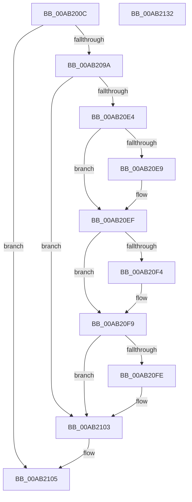

# VslLoadEnclaveModule

- RVA: `0x00AB200C`–`0x00AB2133` (길이 `295` bytes)
- VA: `0x0000000140AB200C`
- 실행 섹션: `PAGE`
- PDB 이름 있음: `예`; PDB Function 태그: `아니요`
- unwind 정보 RVA: `0x000BC8F8`
- 디코드: `85`개 명령, `295/295` bytes 표시
- 미해석 바이트: `0` (있으면 어셈블리에 `.byte`로 보존)

> 이 문서는 커널 이미지의 기계어와 PDB 기호를 분석해 생성했습니다. 4번과 5번은 함수 원형과 자료형을 바이너리 사용 방식에서 추정한 C 해석이며 원본 소스 복구 결과는 아닙니다.

## 1. Dependencies

- 직접 호출 지점: **6**; 고유 호출 대상: **5**
- 직접 호출자로 확인된 함수: **1**
- RIP 상대 이미지 참조: **1**

### Outgoing calls
- `0x00AB2068` → [memset](../../text/6C/memset_function_006C6C40.md) (function, `0x006C6C40`)
- `0x00AB2078` → [memset](../../text/6C/memset_function_006C6C40.md) (function, `0x006C6C40`)
- `0x00AB2091` → [VslpLockPagesForTransfer](../../text/29/VslpLockPagesForTransfer_function_0029E0FC.md) (function, `0x0029E0FC`)
- `0x00AB20CF` → [VslpEnterIumSecureMode](../../text/23/VslpEnterIumSecureMode_function_00235E50.md) (function, `0x00235E50`)
- `0x00AB20DB` → [VslpUnlockPagesForTransfer](../../text/29/VslpUnlockPagesForTransfer_function_0029EE4C.md) (function, `0x0029EE4C`)
- `0x00AB210C` → [_security_check_cookie](../../text/6A/_security_check_cookie_function_006AC640.md) (function, `0x006AC640`)

### Direct callers
- [MiLoadSectionIntoVsmEnclave](MiLoadSectionIntoVsmEnclave_function_00AB1D4C.md) at `0x00AB1F99`

### Static image references
- `0x00AB202F` → RVA `0x00E0A740` (`.data`; read)

## 2. Other-region calls and transfers

- 다른 실행 섹션으로 향하는 call: **6**
  - `0x00AB2068` → [memset](../../text/6C/memset_function_006C6C40.md) (`PAGE` → `.text`)
  - `0x00AB2078` → [memset](../../text/6C/memset_function_006C6C40.md) (`PAGE` → `.text`)
  - `0x00AB2091` → [VslpLockPagesForTransfer](../../text/29/VslpLockPagesForTransfer_function_0029E0FC.md) (`PAGE` → `.text`)
  - `0x00AB20CF` → [VslpEnterIumSecureMode](../../text/23/VslpEnterIumSecureMode_function_00235E50.md) (`PAGE` → `.text`)
  - `0x00AB20DB` → [VslpUnlockPagesForTransfer](../../text/29/VslpUnlockPagesForTransfer_function_0029EE4C.md) (`PAGE` → `.text`)
  - `0x00AB210C` → [_security_check_cookie](../../text/6A/_security_check_cookie_function_006AC640.md) (`PAGE` → `.text`)
- 별도 외부 분기/꼬리 이동을 확인하지 못했습니다.

## 3. Assembly (complete function range)

```asm
00AB200C  48 8B C4                        mov rax, rsp
00AB200F  48 89 58 08                     mov qword ptr [rax + 8], rbx
00AB2013  48 89 70 10                     mov qword ptr [rax + 0x10], rsi
00AB2017  48 89 78 18                     mov qword ptr [rax + 0x18], rdi
00AB201B  55                              push rbp
00AB201C  41 54                           push r12
00AB201E  41 55                           push r13
00AB2020  41 56                           push r14
00AB2022  41 57                           push r15
00AB2024  48 8D 68 C8                     lea rbp, [rax - 0x38]
00AB2028  48 81 EC 10 01 00 00            sub rsp, 0x110
00AB202F  48 8B 05 0A 87 35 00            mov rax, qword ptr [rip + 0x35870a]
00AB2036  48 33 C4                        xor rax, rsp
00AB2039  48 89 45 00                     mov qword ptr [rbp], rax
00AB203D  48 8B 5D 60                     mov rbx, qword ptr [rbp + 0x60]
00AB2041  4C 8B EA                        mov r13, rdx
00AB2044  4C 8B 75 70                     mov r14, qword ptr [rbp + 0x70]
00AB2048  33 D2                           xor edx, edx
00AB204A  48 8B 75 78                     mov rsi, qword ptr [rbp + 0x78]
00AB204E  4D 8B E0                        mov r12, r8
00AB2051  48 8B BD 80 00 00 00            mov rdi, qword ptr [rbp + 0x80]
00AB2058  4D 8B F9                        mov r15, r9
00AB205B  48 89 4C 24 30                  mov qword ptr [rsp + 0x30], rcx
00AB2060  48 8D 4D 90                     lea rcx, [rbp - 0x70]
00AB2064  44 8D 42 68                     lea r8d, [rdx + 0x68]
00AB2068  E8 D3 4B C1 FF                  call 0x1406c6c40
00AB206D  33 D2                           xor edx, edx
00AB206F  48 8D 4C 24 40                  lea rcx, [rsp + 0x40]
00AB2074  44 8D 42 48                     lea r8d, [rdx + 0x48]
00AB2078  E8 C3 4B C1 FF                  call 0x1406c6c40
00AB207D  44 8B 45 68                     mov r8d, dword ptr [rbp + 0x68]
00AB2081  48 8D 4C 24 40                  lea rcx, [rsp + 0x40]
00AB2086  83 64 24 20 00                  and dword ptr [rsp + 0x20], 0
00AB208B  45 33 C9                        xor r9d, r9d
00AB208E  48 8B D3                        mov rdx, rbx
00AB2091  E8 66 C0 7E FF                  call 0x14029e0fc
00AB2096  85 C0                           test eax, eax
00AB2098  78 6B                           js 0x140ab2105
00AB209A  48 8B 44 24 30                  mov rax, qword ptr [rsp + 0x30]
00AB209F  4C 8D 4D 90                     lea r9, [rbp - 0x70]
00AB20A3  48 89 45 98                     mov qword ptr [rbp - 0x68], rax
00AB20A7  BA 31 00 00 00                  mov edx, 0x31
00AB20AC  48 8B 44 24 40                  mov rax, qword ptr [rsp + 0x40]
00AB20B1  45 33 C0                        xor r8d, r8d
00AB20B4  48 89 45 B8                     mov qword ptr [rbp - 0x48], rax
00AB20B8  B1 02                           mov cl, 2
00AB20BA  48 8B 44 24 78                  mov rax, qword ptr [rsp + 0x78]
00AB20BF  48 89 45 C0                     mov qword ptr [rbp - 0x40], rax
00AB20C3  4C 89 6D A0                     mov qword ptr [rbp - 0x60], r13
00AB20C7  4C 89 7D A8                     mov qword ptr [rbp - 0x58], r15
00AB20CB  4C 89 65 B0                     mov qword ptr [rbp - 0x50], r12
00AB20CF  E8 7C 3D 78 FF                  call 0x140235e50
00AB20D4  48 8D 4C 24 40                  lea rcx, [rsp + 0x40]
00AB20D9  8B D8                           mov ebx, eax
00AB20DB  E8 6C CD 7E FF                  call 0x14029ee4c
00AB20E0  85 DB                           test ebx, ebx
00AB20E2  78 1F                           js 0x140ab2103
00AB20E4  4D 85 F6                        test r14, r14
00AB20E7  74 06                           je 0x140ab20ef
00AB20E9  8A 4D A0                        mov cl, byte ptr [rbp - 0x60]
00AB20EC  41 88 0E                        mov byte ptr [r14], cl
00AB20EF  48 85 F6                        test rsi, rsi
00AB20F2  74 05                           je 0x140ab20f9
00AB20F4  8B 45 A8                        mov eax, dword ptr [rbp - 0x58]
00AB20F7  89 06                           mov dword ptr [rsi], eax
00AB20F9  48 85 FF                        test rdi, rdi
00AB20FC  74 05                           je 0x140ab2103
00AB20FE  8B 45 B0                        mov eax, dword ptr [rbp - 0x50]
00AB2101  89 07                           mov dword ptr [rdi], eax
00AB2103  8B C3                           mov eax, ebx
00AB2105  48 8B 4D 00                     mov rcx, qword ptr [rbp]
00AB2109  48 33 CC                        xor rcx, rsp
00AB210C  E8 2F A5 BF FF                  call 0x1406ac640
00AB2111  4C 8D 9C 24 10 01 00 00         lea r11, [rsp + 0x110]
00AB2119  49 8B 5B 30                     mov rbx, qword ptr [r11 + 0x30]
00AB211D  49 8B 73 38                     mov rsi, qword ptr [r11 + 0x38]
00AB2121  49 8B 7B 40                     mov rdi, qword ptr [r11 + 0x40]
00AB2125  49 8B E3                        mov rsp, r11
00AB2128  41 5F                           pop r15
00AB212A  41 5E                           pop r14
00AB212C  41 5D                           pop r13
00AB212E  41 5C                           pop r12
00AB2130  5D                              pop rbp
00AB2131  C3                              ret
00AB2132  CC                              int3
```

## 4. C-style interpretation (structured pseudocode)

```c
__int64 __fastcall VslLoadEnclaveModule(__int64 a1, __int64 a2, __int64 a3, __int64 a4)
{
    __int64 result;
    __int64 v_rsp;
    unsigned __int64 v_stack_m108;
    unsigned int v_stack_m118;
    unsigned __int64 v_stack_m28;
    unsigned __int64 v_stack_mC0;
    unsigned __int64 v_stack_mF8;

    *(unsigned __int64 *)(v_rsp + 8) = v_rbx;
    *(unsigned __int64 *)(v_rsp + 16) = v_rsi;
    *(unsigned __int64 *)(v_rsp + 24) = v_rdi;
    v_rsp = (v_rsp) - (272);
    result = (*(unsigned __int64 *)(v_rip + 3507978)) ^ (v_rsp);
    *(unsigned __int64 *)(v_rsp - 56) = result;
    a2 = 0;
    v_stack_m108 = a1;
    result = memset(v_rsp - 56 - 112, a2, a2 + 104, a4);
    a2 = 0;
    result = memset(v_stack_mF8, a2, a2 + 72, a4);
    a4 = 0;
    result = VslpLockPagesForTransfer(v_stack_mF8, *(unsigned __int64 *)(v_rsp - 56 + 96), (unsigned int)(*(unsigned int *)(v_rsp - 56 + 104)), a4);
    if (sign_flag) goto loc_00AB2105;
    *(unsigned __int64 *)(v_rsp - 56 - 104) = v_stack_m108;
    a3 = 0;
    *(unsigned __int64 *)(v_rsp - 56 - 72) = v_stack_mF8;
    *(unsigned __int64 *)(v_rsp - 56 - 64) = v_stack_mC0;
    *(unsigned __int64 *)(v_rsp - 56 - 96) = 0;
    *(unsigned __int64 *)(v_rsp - 56 - 88) = 0;
    *(unsigned __int64 *)(v_rsp - 56 - 80) = 0;
    result = VslpEnterIumSecureMode(2, 49, a3, v_rsp - 56 - 112);
    result = VslpUnlockPagesForTransfer(v_stack_mF8, 49, a3, v_rsp - 56 - 112);
    if (sign_flag) goto loc_00AB2103;
    if (*(unsigned __int64 *)(v_rsp - 56 + 112) != 0) {
        a1 = *(unsigned __int8 *)(v_rsp - 56 - 96);
        *(unsigned __int8 *)(*(unsigned __int64 *)(v_rsp - 56 + 112)) = (unsigned __int8)(a1);
    }
    if (*(unsigned __int64 *)(v_rsp - 56 + 120) != 0) {
        result = *(unsigned int *)(v_rsp - 56 - 88);
        *(unsigned int *)(*(unsigned __int64 *)(v_rsp - 56 + 120)) = (unsigned int)(result);
    }
    if (*(unsigned __int64 *)(v_rsp - 56 + 128) != 0) {
        result = *(unsigned int *)(v_rsp - 56 - 80);
        *(unsigned int *)(*(unsigned __int64 *)(v_rsp - 56 + 128)) = (unsigned int)(result);
    }
loc_00AB2105:
    a1 = (*(unsigned __int64 *)(v_rsp - 56)) ^ (v_rsp);
    result = _security_check_cookie(a1, 49, a3, v_rsp - 56 - 112);
    return result;
}
```

## 5. (Beta) C Style

```c
int64_t VslLoadEnclaveModule(int64_t Arg1, int64_t Arg2, int64_t Arg3, int64_t Arg4)
{
    int64_t result;
    int64_t local_rsp;
    uint64_t v_stack_m108;
    uint32_t v_stack_m118;
    uint64_t v_stack_m28;
    uint64_t v_stack_mC0;
    uint64_t v_stack_mF8;

    *(uint64_t *)(local_rsp + 0x8) = local_rbx;
    *(uint64_t *)(local_rsp + 0x10) = local_rsi;
    *(uint64_t *)(local_rsp + 0x18) = local_rdi;
    local_rsp = (local_rsp) - (272);
    result = (*(uint64_t *)(v_rip + 0x35870A)) ^ (local_rsp);
    *(uint64_t *)(local_rsp - 0x38) = result;
    Arg2 = 0;
    v_stack_m108 = Arg1;
    result = memset(local_rsp - 56 - 112, Arg2, Arg2 + 104, Arg4);
    Arg2 = 0;
    result = memset(v_stack_mF8, Arg2, Arg2 + 72, Arg4);
    Arg4 = 0;
    result = VslpLockPagesForTransfer(v_stack_mF8, *(uint64_t *)(local_rsp - 0x38 + 0x60), (uint32_t)(*(uint32_t *)(local_rsp - 0x38 + 0x68)), Arg4);
    if (sign_flag) goto loc_00AB2105;
    *(uint64_t *)(local_rsp - 0x38 - 0x68) = v_stack_m108;
    Arg3 = 0;
    *(uint64_t *)(local_rsp - 0x38 - 0x48) = v_stack_mF8;
    *(uint64_t *)(local_rsp - 0x38 - 0x40) = v_stack_mC0;
    *(uint64_t *)(local_rsp - 0x38 - 0x60) = 0;
    *(uint64_t *)(local_rsp - 0x38 - 0x58) = 0;
    *(uint64_t *)(local_rsp - 0x38 - 0x50) = 0;
    result = VslpEnterIumSecureMode(2, 49, Arg3, local_rsp - 56 - 112);
    result = VslpUnlockPagesForTransfer(v_stack_mF8, 49, Arg3, local_rsp - 56 - 112);
    if (sign_flag) goto loc_00AB2103;
    if (*(uint64_t *)(local_rsp - 0x38 + 0x70) != 0) {
        Arg1 = *(uint8_t *)(local_rsp - 0x38 - 0x60);
        *(uint8_t *)(*(uint64_t *)(local_rsp - 0x38 + 0x70)) = (uint8_t)(Arg1);
    }
    if (*(uint64_t *)(local_rsp - 0x38 + 0x78) != 0) {
        result = *(uint32_t *)(local_rsp - 0x38 - 0x58);
        *(uint32_t *)(*(uint64_t *)(local_rsp - 0x38 + 0x78)) = (uint32_t)(result);
    }
    if (*(uint64_t *)(local_rsp - 0x38 + 0x80) != 0) {
        result = *(uint32_t *)(local_rsp - 0x38 - 0x50);
        *(uint32_t *)(*(uint64_t *)(local_rsp - 0x38 + 0x80)) = (uint32_t)(result);
    }
loc_00AB2105:
    Arg1 = (*(uint64_t *)(local_rsp - 0x38)) ^ (local_rsp);
    result = _security_check_cookie(Arg1, 49, Arg3, local_rsp - 56 - 112);
    return result;
}
```

## 6. Execution-region graph

[열기: 2D/3D 그래프와 함수 탐색 컨트롤 패널](../../../control-panel.html?section=page&rva=0x00AB200C&view=graph)

- 2D 그래프는 위에서 아래로 흐르고, 3D 그래프는 빈 공간을 드래그해 회전합니다. Shift+드래그는 이동, 휠은 확대·축소, 함수 노드 선택은 대상 보고서 이동입니다.

### Static fallback


