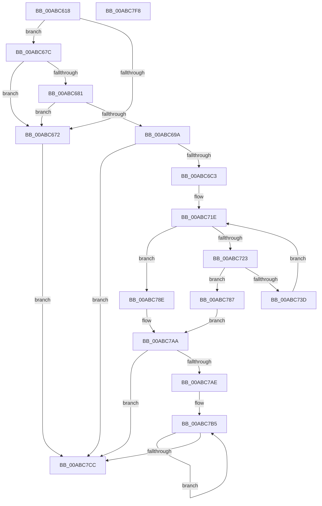

# WdipSemWriteSemActionsEvent

- RVA: `0x00ABC618`–`0x00ABC7F9` (길이 `481` bytes)
- VA: `0x0000000140ABC618`
- 실행 섹션: `PAGE`
- PDB 이름 있음: `예`; PDB Function 태그: `아니요`
- unwind 정보 RVA: `0x000BD4B0`
- 디코드: `121`개 명령, `481/481` bytes 표시
- 미해석 바이트: `0` (있으면 어셈블리에 `.byte`로 보존)

> 이 문서는 커널 이미지의 기계어와 PDB 기호를 분석해 생성했습니다. 4번과 5번은 함수 원형과 자료형을 바이너리 사용 방식에서 추정한 C 해석이며 원본 소스 복구 결과는 아닙니다.

## 1. Dependencies

- 직접 호출 지점: **6**; 고유 호출 대상: **6**
- 직접 호출자로 확인된 함수: **2**
- RIP 상대 이미지 참조: **3**

### Outgoing calls
- `0x00ABC65D` → [memset](../../text/6C/memset_function_006C6C40.md) (function, `0x006C6C40`)
- `0x00ABC6B4` → [WmiQueryTraceInformation](../7B/WmiQueryTraceInformation_function_007B9370.md) (function, `0x007B9370`)
- `0x00ABC730` → [WdipSemFastAllocate](../A5/WdipSemFastAllocate_function_00A5DC04.md) (function, `0x00A5DC04`)
- `0x00ABC7A3` → [WdipSemWriteEvent](../A9/WdipSemWriteEvent_function_00A9B6D4.md) (function, `0x00A9B6D4`)
- `0x00ABC7BD` → [WdipSemFastFree](../70/WdipSemFastFree_function_0070303C.md) (function, `0x0070303C`)
- `0x00ABC7D8` → [_security_check_cookie](../../text/6A/_security_check_cookie_function_006AC640.md) (function, `0x006AC640`)

### Direct callers
- [WdipSemDisableScenario](../A5/WdipSemDisableScenario_function_00A5BC00.md) at `0x00A5BD61`
- [WdipSemEnableScenario](../A5/WdipSemEnableScenario_function_00A5C424.md) at `0x00A5C5BD`

### Static image references
- `0x00ABC637` → RVA `0x00E0A740` (`.data`; read)
- `0x00ABC681` → RVA `0x00F02454` (`.data`; read)
- `0x00ABC687` → RVA `0x00F02454` (`.data`; read/write)

## 2. Other-region calls and transfers

- 다른 실행 섹션으로 향하는 call: **2**
  - `0x00ABC65D` → [memset](../../text/6C/memset_function_006C6C40.md) (`PAGE` → `.text`)
  - `0x00ABC7D8` → [_security_check_cookie](../../text/6A/_security_check_cookie_function_006AC640.md) (`PAGE` → `.text`)
- 별도 외부 분기/꼬리 이동을 확인하지 못했습니다.

## 3. Assembly (complete function range)

```asm
00ABC618  48 89 5C 24 18                  mov qword ptr [rsp + 0x18], rbx
00ABC61D  55                              push rbp
00ABC61E  56                              push rsi
00ABC61F  57                              push rdi
00ABC620  41 54                           push r12
00ABC622  41 55                           push r13
00ABC624  41 56                           push r14
00ABC626  41 57                           push r15
00ABC628  48 8D AC 24 C0 F4 FF FF         lea rbp, [rsp - 0xb40]
00ABC630  48 81 EC 40 0C 00 00            sub rsp, 0xc40
00ABC637  48 8B 05 02 E1 34 00            mov rax, qword ptr [rip + 0x34e102]
00ABC63E  48 33 C4                        xor rax, rsp
00ABC641  48 89 85 30 0B 00 00            mov qword ptr [rbp + 0xb30], rax
00ABC648  48 8B F2                        mov rsi, rdx
00ABC64B  4C 8B F9                        mov r15, rcx
00ABC64E  33 D2                           xor edx, edx
00ABC650  48 8D 8D 50 07 00 00            lea rcx, [rbp + 0x750]
00ABC657  41 B8 E0 03 00 00               mov r8d, 0x3e0
00ABC65D  E8 DE A5 C0 FF                  call 0x1406c6c40
00ABC662  45 33 E4                        xor r12d, r12d
00ABC665  44 89 64 24 38                  mov dword ptr [rsp + 0x38], r12d
00ABC66A  41 8B FC                        mov edi, r12d
00ABC66D  4D 85 FF                        test r15, r15
00ABC670  75 0A                           jne 0x140abc67c
00ABC672  BB 0D 00 00 C0                  mov ebx, 0xc000000d
00ABC677  E9 50 01 00 00                  jmp 0x140abc7cc
00ABC67C  48 85 F6                        test rsi, rsi
00ABC67F  74 F1                           je 0x140abc672
00ABC681  8B 05 CD 5D 44 00               mov eax, dword ptr [rip + 0x445dcd]
00ABC687  87 05 C7 5D 44 00               xchg dword ptr [rip + 0x445dc7], eax
00ABC68D  89 44 24 40                     mov dword ptr [rsp + 0x40], eax
00ABC691  44 89 64 24 34                  mov dword ptr [rsp + 0x34], r12d
00ABC696  85 C0                           test eax, eax
00ABC698  74 D8                           je 0x140abc672
00ABC69A  45 33 C9                        xor r9d, r9d
00ABC69D  48 8D 44 24 40                  lea rax, [rsp + 0x40]
00ABC6A2  48 8D 54 24 34                  lea rdx, [rsp + 0x34]
00ABC6A7  48 89 44 24 20                  mov qword ptr [rsp + 0x20], rax
00ABC6AC  45 8D 41 04                     lea r8d, [r9 + 4]
00ABC6B0  41 8D 49 08                     lea ecx, [r9 + 8]
00ABC6B4  E8 B7 CC CF FF                  call 0x1407b9370
00ABC6B9  8B D8                           mov ebx, eax
00ABC6BB  85 C0                           test eax, eax
00ABC6BD  0F 88 09 01 00 00               js 0x140abc7cc
00ABC6C3  48 8B 5E 20                     mov rbx, qword ptr [rsi + 0x20]
00ABC6C7  8B 44 24 34                     mov eax, dword ptr [rsp + 0x34]
00ABC6CB  89 44 24 38                     mov dword ptr [rsp + 0x38], eax
00ABC6CF  44 8B 73 30                     mov r14d, dword ptr [rbx + 0x30]
00ABC6D3  48 8D 43 10                     lea rax, [rbx + 0x10]
00ABC6D7  48 89 44 24 60                  mov qword ptr [rsp + 0x60], rax
00ABC6DC  48 8D 44 24 38                  lea rax, [rsp + 0x38]
00ABC6E1  48 89 44 24 70                  mov qword ptr [rsp + 0x70], rax
00ABC6E6  48 89 5C 24 50                  mov qword ptr [rsp + 0x50], rbx
00ABC6EB  48 C7 44 24 58 10 00 00 00      mov qword ptr [rsp + 0x58], 0x10
00ABC6F4  48 C7 44 24 68 02 00 00 00      mov qword ptr [rsp + 0x68], 2
00ABC6FD  48 C7 44 24 78 04 00 00 00      mov qword ptr [rsp + 0x78], 4
00ABC706  8A 43 30                        mov al, byte ptr [rbx + 0x30]
00ABC709  88 44 24 30                     mov byte ptr [rsp + 0x30], al
00ABC70D  48 8D 44 24 30                  lea rax, [rsp + 0x30]
00ABC712  48 89 45 80                     mov qword ptr [rbp - 0x80], rax
00ABC716  48 C7 45 88 01 00 00 00         mov qword ptr [rbp - 0x78], 1
00ABC71E  3B 7B 30                        cmp edi, dword ptr [rbx + 0x30]
00ABC721  73 6B                           jae 0x140abc78e
00ABC723  4C 8B 6C FB 38                  mov r13, qword ptr [rbx + rdi*8 + 0x38]
00ABC728  BA 28 00 00 00                  mov edx, 0x28
00ABC72D  8D 4A DC                        lea ecx, [rdx - 0x24]
00ABC730  E8 CF 14 FA FF                  call 0x140a5dc04
00ABC735  48 8B D0                        mov rdx, rax
00ABC738  48 85 C0                        test rax, rax
00ABC73B  74 4A                           je 0x140abc787
00ABC73D  41 0F 10 45 00                  movups xmm0, xmmword ptr [r13]
00ABC742  8D 4F 04                        lea ecx, [rdi + 4]
00ABC745  48 89 94 FD 50 07 00 00         mov qword ptr [rbp + rdi*8 + 0x750], rdx
00ABC74D  48 03 C9                        add rcx, rcx
00ABC750  F3 0F 7F 00                     movdqu xmmword ptr [rax], xmm0
00ABC754  41 8A 45 12                     mov al, byte ptr [r13 + 0x12]
00ABC758  88 42 10                        mov byte ptr [rdx + 0x10], al
00ABC75B  49 8B 45 18                     mov rax, qword ptr [r13 + 0x18]
00ABC75F  48 89 42 18                     mov qword ptr [rdx + 0x18], rax
00ABC763  41 8B 45 24                     mov eax, dword ptr [r13 + 0x24]
00ABC767  89 42 20                        mov dword ptr [rdx + 0x20], eax
00ABC76A  8B 44 BE 30                     mov eax, dword ptr [rsi + rdi*4 + 0x30]
00ABC76E  89 42 24                        mov dword ptr [rdx + 0x24], eax
00ABC771  44 21 64 CC 5C                  and dword ptr [rsp + rcx*8 + 0x5c], r12d
00ABC776  FF C7                           inc edi
00ABC778  48 89 54 CC 50                  mov qword ptr [rsp + rcx*8 + 0x50], rdx
00ABC77D  C7 44 CC 58 28 00 00 00         mov dword ptr [rsp + rcx*8 + 0x58], 0x28
00ABC785  EB 97                           jmp 0x140abc71e
00ABC787  BB 9A 00 00 C0                  mov ebx, 0xc000009a
00ABC78C  EB 1C                           jmp 0x140abc7aa
00ABC78E  48 8D 44 24 50                  lea rax, [rsp + 0x50]
00ABC793  49 8B D7                        mov rdx, r15
00ABC796  4C 8D 46 10                     lea r8, [rsi + 0x10]
00ABC79A  48 89 44 24 20                  mov qword ptr [rsp + 0x20], rax
00ABC79F  45 8D 4E 04                     lea r9d, [r14 + 4]
00ABC7A3  E8 2C EF FD FF                  call 0x140a9b6d4
00ABC7A8  8B D8                           mov ebx, eax
00ABC7AA  85 FF                           test edi, edi
00ABC7AC  74 1E                           je 0x140abc7cc
00ABC7AE  48 8D B5 50 07 00 00            lea rsi, [rbp + 0x750]
00ABC7B5  48 8B 16                        mov rdx, qword ptr [rsi]
00ABC7B8  B9 04 00 00 00                  mov ecx, 4
00ABC7BD  E8 7A 68 C4 FF                  call 0x14070303c
00ABC7C2  48 8D 76 08                     lea rsi, [rsi + 8]
00ABC7C6  48 83 EF 01                     sub rdi, 1
00ABC7CA  75 E9                           jne 0x140abc7b5
00ABC7CC  8B C3                           mov eax, ebx
00ABC7CE  48 8B 8D 30 0B 00 00            mov rcx, qword ptr [rbp + 0xb30]
00ABC7D5  48 33 CC                        xor rcx, rsp
00ABC7D8  E8 63 FE BE FF                  call 0x1406ac640
00ABC7DD  48 8B 9C 24 90 0C 00 00         mov rbx, qword ptr [rsp + 0xc90]
00ABC7E5  48 81 C4 40 0C 00 00            add rsp, 0xc40
00ABC7EC  41 5F                           pop r15
00ABC7EE  41 5E                           pop r14
00ABC7F0  41 5D                           pop r13
00ABC7F2  41 5C                           pop r12
00ABC7F4  5F                              pop rdi
00ABC7F5  5E                              pop rsi
00ABC7F6  5D                              pop rbp
00ABC7F7  C3                              ret
00ABC7F8  CC                              int3
```

## 4. C-style interpretation (structured pseudocode)

```c
__int64 __fastcall WdipSemWriteSemActionsEvent(__int64 a1, __int64 a2, __int64 a3, int a4)
{
    __int64 result;
    __int64 v_r12;
    __int64 v_rdi;
    __int64 v_rsp;
    unsigned __int64 v_stack_m428;
    unsigned __int64 v_stack_m48;
    unsigned __int64 v_stack_mB78;
    unsigned __int64 v_stack_mBF0;
    unsigned __int64 v_stack_mBF8;
    unsigned __int64 v_stack_mC00;
    unsigned __int64 v_stack_mC08;
    unsigned __int64 v_stack_mC10;
    unsigned __int64 v_stack_mC18;
    unsigned __int64 v_stack_mC20;
    unsigned __int64 v_stack_mC28;
    unsigned int v_stack_mC38;
    unsigned int v_stack_mC40;
    unsigned int v_stack_mC44;
    unsigned __int8 v_stack_mC48;
    unsigned __int64 v_stack_mC58;
    unsigned __int64 v_stack_p18;

    v_stack_p18 = v_rbx;
    v_rsp = (v_rsp) - (0xC40ULL);
    result = (*(unsigned __int64 *)(v_rip + 3465474)) ^ (v_rsp);
    v_stack_m48 = result;
    a2 = 0;
    result = memset(v_stack_m428, a2, 992, a4);
    v_r12 = 0;
    v_stack_mC40 = 0;
    if (a1 != 0) goto loc_00ABC67C;
loc_00ABC672:
    goto loc_00ABC7CC;
loc_00ABC67C:
    if (0 == 0) goto loc_00ABC672;
    v_stack_mC38 = (unsigned int)((unsigned int)(*(unsigned int *)(v_rip + 4480461)));
    v_stack_mC44 = 0;
    if ((unsigned int)((unsigned int)(*(unsigned int *)(v_rip + 4480461))) == 0) goto loc_00ABC672;
    a4 = 0;
    v_stack_mC58 = v_stack_mC38;
    result = WmiQueryTraceInformation(a4 + 8, v_stack_mC44, a4 + 4, a4);
    if (sign_flag) goto loc_00ABC7CC;
    v_stack_mC40 = (unsigned int)((unsigned int)(v_stack_mC44));
    v_stack_mC18 = *(unsigned __int64 *)(a2 + 32) + 16;
    v_stack_mC08 = v_stack_mC40;
    v_stack_mC28 = *(unsigned __int64 *)(a2 + 32);
    v_stack_mC20 = 16;
    v_stack_mC10 = 2;
    v_stack_mC00 = 4;
    v_stack_mC48 = (unsigned __int8)(*(unsigned __int8 *)(*(unsigned __int64 *)(a2 + 32) + 48));
    v_stack_mBF8 = v_stack_mC48;
    v_stack_mBF0 = 1;
loc_00ABC71E:
    if (0 >= (*(unsigned int *)(*(unsigned __int64 *)(a2 + 32) + 48))) goto loc_00ABC78E;
    result = WdipSemFastAllocate(40 - 36, 40, a4 + 4, a4);
    if (result == 0) goto loc_00ABC787;
    *(unsigned __int64 *)(v_stack_mB78 + 0 * 8 + 1872) = result;
    a1 = (0 + 4) + (0 + 4);
    *(unsigned __int64 *)(result) = v_xmm0;
    *(unsigned __int8 *)(result + 16) = (unsigned __int8)(*(unsigned __int8 *)(*(unsigned __int64 *)(*(unsigned __int64 *)(a2 + 32) + 0 * 8 + 56) + 18));
    *(unsigned __int64 *)(result + 24) = *(unsigned __int64 *)(*(unsigned __int64 *)(*(unsigned __int64 *)(a2 + 32) + 0 * 8 + 56) + 24);
    *(unsigned int *)(result + 32) = (unsigned int)((unsigned int)(*(unsigned int *)(*(unsigned __int64 *)(*(unsigned __int64 *)(a2 + 32) + 0 * 8 + 56) + 36)));
    *(unsigned int *)(result + 36) = (unsigned int)((unsigned int)(*(unsigned int *)(a2 + 0 * 4 + 48)));
    v_rdi = (unsigned int)((0) + 1);
    *(unsigned __int64 *)(v_rsp + a1 * 8 + 80) = result;
    *(unsigned int *)(v_rsp + a1 * 8 + 88) = 40;
    goto loc_00ABC71E;
loc_00ABC787:
    goto loc_00ABC7AA;
loc_00ABC78E:
    v_stack_mC58 = v_stack_mC28;
    result = WdipSemWriteEvent(a1, a1, a2 + 16, (unsigned int)(*(unsigned int *)(*(unsigned __int64 *)(a2 + 32) + 48)) + 4);
loc_00ABC7AA:
    if ((unsigned int)(v_rdi) == 0) goto loc_00ABC7CC;
loc_00ABC7B5:
    result = WdipSemFastFree(4, *(unsigned __int64 *)(v_stack_m428), a2 + 16, (unsigned int)(*(unsigned int *)(*(unsigned __int64 *)(a2 + 32) + 48)) + 4);
    v_rdi = (v_rdi) - (1);
    if (condition_is_not_equal) goto loc_00ABC7B5;
loc_00ABC7CC:
    a1 = (v_stack_m48) ^ (v_rsp);
    result = _security_check_cookie(a1, *(unsigned __int64 *)(v_stack_m428), a2 + 16, (unsigned int)(*(unsigned int *)(*(unsigned __int64 *)(a2 + 32) + 48)) + 4);
    v_rsp = (v_rsp) + (0xC40ULL);
    return result;
}
```

## 5. (Beta) C Style

```c
int64_t WdipSemWriteSemActionsEvent(int64_t Arg1, int64_t Arg2, int64_t Arg3, int32_t Arg4)
{
    int64_t result;
    int64_t local_r12;
    int64_t local_rdi;
    int64_t local_rsp;
    uint64_t v_stack_m428;
    uint64_t v_stack_m48;
    uint64_t v_stack_mB78;
    uint64_t v_stack_mBF0;
    uint64_t v_stack_mBF8;
    uint64_t v_stack_mC00;
    uint64_t v_stack_mC08;
    uint64_t v_stack_mC10;
    uint64_t v_stack_mC18;
    uint64_t v_stack_mC20;
    uint64_t v_stack_mC28;
    uint32_t v_stack_mC38;
    uint32_t v_stack_mC40;
    uint32_t v_stack_mC44;
    uint8_t v_stack_mC48;
    uint64_t v_stack_mC58;
    uint64_t v_stack_p18;

    v_stack_p18 = local_rbx;
    local_rsp = (local_rsp) - (0xC40ULL);
    result = (*(uint64_t *)(v_rip + 0x34E102)) ^ (local_rsp);
    v_stack_m48 = result;
    Arg2 = 0;
    result = memset(v_stack_m428, Arg2, 992, Arg4);
    local_r12 = 0;
    v_stack_mC40 = 0;
    if (Arg1 != 0) goto loc_00ABC67C;
loc_00ABC672:
    goto loc_00ABC7CC;
loc_00ABC67C:
    if (0 == 0) goto loc_00ABC672;
    v_stack_mC38 = (uint32_t)((uint32_t)(*(uint32_t *)(v_rip + 0x445DCD)));
    v_stack_mC44 = 0;
    if ((uint32_t)((uint32_t)(*(uint32_t *)(v_rip + 0x445DCD))) == 0) goto loc_00ABC672;
    Arg4 = 0;
    v_stack_mC58 = v_stack_mC38;
    result = WmiQueryTraceInformation(Arg4 + 8, v_stack_mC44, Arg4 + 4, Arg4);
    if (sign_flag) goto loc_00ABC7CC;
    v_stack_mC40 = (uint32_t)((uint32_t)(v_stack_mC44));
    v_stack_mC18 = *(uint64_t *)(Arg2 + 0x20) + 16;
    v_stack_mC08 = v_stack_mC40;
    v_stack_mC28 = *(uint64_t *)(Arg2 + 0x20);
    v_stack_mC20 = 16;
    v_stack_mC10 = 2;
    v_stack_mC00 = 4;
    v_stack_mC48 = (uint8_t)(*(uint8_t *)(*(uint64_t *)(Arg2 + 0x20) + 0x30));
    v_stack_mBF8 = v_stack_mC48;
    v_stack_mBF0 = 1;
loc_00ABC71E:
    if (0 >= (*(uint32_t *)(*(uint64_t *)(Arg2 + 0x20) + 0x30))) goto loc_00ABC78E;
    result = WdipSemFastAllocate(40 - 36, 40, Arg4 + 4, Arg4);
    if (result == 0) goto loc_00ABC787;
    *(uint64_t *)(v_stack_mB78 + 0x0 * 8 + 0x750) = result;
    Arg1 = (0 + 4) + (0 + 4);
    *(uint64_t *)(result) = v_xmm0;
    *(uint8_t *)(result + 0x10) = (uint8_t)(*(uint8_t *)(*(uint64_t *)(*(uint64_t *)(Arg2 + 0x20) + 0x0 * 8 + 0x38) + 0x12));
    *(uint64_t *)(result + 0x18) = *(uint64_t *)(*(uint64_t *)(*(uint64_t *)(Arg2 + 0x20) + 0x0 * 8 + 0x38) + 0x18);
    *(uint32_t *)(result + 0x20) = (uint32_t)((uint32_t)(*(uint32_t *)(*(uint64_t *)(*(uint64_t *)(Arg2 + 0x20) + 0x0 * 8 + 0x38) + 0x24)));
    *(uint32_t *)(result + 0x24) = (uint32_t)((uint32_t)(*(uint32_t *)(Arg2 + 0x0 * 4 + 0x30)));
    local_rdi = (uint32_t)((0) + 1);
    *(uint64_t *)(local_rsp + Arg1 * 8 + 0x50) = result;
    *(uint32_t *)(local_rsp + Arg1 * 8 + 0x58) = 40;
    goto loc_00ABC71E;
loc_00ABC787:
    goto loc_00ABC7AA;
loc_00ABC78E:
    v_stack_mC58 = v_stack_mC28;
    result = WdipSemWriteEvent(Arg1, Arg1, Arg2 + 16, (uint32_t)(*(uint32_t *)(*(uint64_t *)(Arg2 + 0x20) + 0x30)) + 4);
loc_00ABC7AA:
    if ((uint32_t)(local_rdi) == 0) goto loc_00ABC7CC;
loc_00ABC7B5:
    result = WdipSemFastFree(4, *(uint64_t *)(v_stack_m428), Arg2 + 16, (uint32_t)(*(uint32_t *)(*(uint64_t *)(Arg2 + 0x20) + 0x30)) + 4);
    local_rdi = (local_rdi) - (1);
    if (condition_is_not_equal) goto loc_00ABC7B5;
loc_00ABC7CC:
    Arg1 = (v_stack_m48) ^ (local_rsp);
    result = _security_check_cookie(Arg1, *(uint64_t *)(v_stack_m428), Arg2 + 16, (uint32_t)(*(uint32_t *)(*(uint64_t *)(Arg2 + 0x20) + 0x30)) + 4);
    local_rsp = (local_rsp) + (0xC40ULL);
    return result;
}
```

## 6. Execution-region graph

[열기: 2D/3D 그래프와 함수 탐색 컨트롤 패널](../../../control-panel.html?section=page&rva=0x00ABC618&view=graph)

- 2D 그래프는 위에서 아래로 흐르고, 3D 그래프는 빈 공간을 드래그해 회전합니다. Shift+드래그는 이동, 휠은 확대·축소, 함수 노드 선택은 대상 보고서 이동입니다.

### Static fallback


