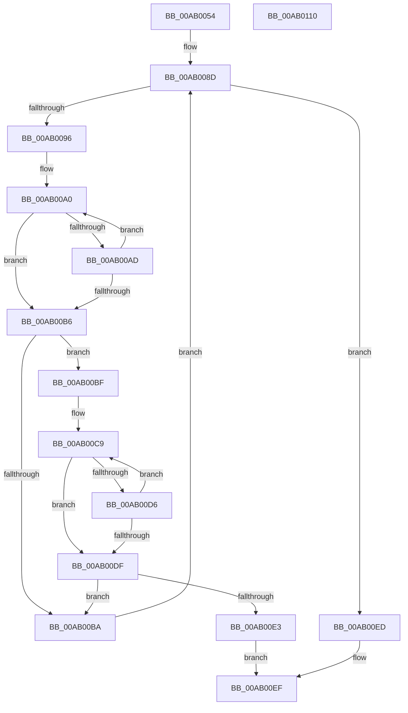

# WmipFindMRByNames

- RVA: `0x00AB0054`–`0x00AB0111` (길이 `189` bytes)
- VA: `0x0000000140AB0054`
- 실행 섹션: `PAGE`
- PDB 이름 있음: `예`; PDB Function 태그: `아니요`
- unwind 정보 RVA: `0x000794E0`
- 디코드: `56`개 명령, `189/189` bytes 표시
- 미해석 바이트: `0` (있으면 어셈블리에 `.byte`로 보존)

> 이 문서는 커널 이미지의 기계어와 PDB 기호를 분석해 생성했습니다. 4번과 5번은 함수 원형과 자료형을 바이너리 사용 방식에서 추정한 C 해석이며 원본 소스 복구 결과는 아닙니다.

## 1. Dependencies

- 직접 호출 지점: **3**; 고유 호출 대상: **3**
- 직접 호출자로 확인된 함수: **1**
- RIP 상대 이미지 참조: **2**

### Outgoing calls
- `0x00AB007E` → [KeWaitForSingleObject](../../text/20/KeWaitForSingleObject_function_0020E6B0.md) (function, `0x0020E6B0`)
- `0x00AB00E6` → [WmipReferenceEntry](../9E/WmipReferenceEntry_function_009E1BF8.md) (function, `0x009E1BF8`)
- `0x00AB00F8` → [KeReleaseMutex](../../text/39/KeReleaseMutex_function_00396810.md) (function, `0x00396810`)

### Direct callers
- [WmipAddMofResource](../7B/WmipAddMofResource_function_007B4188.md) at `0x007B41B6`

### Static image references
- `0x00AB0071` → RVA `0x00EFFA60` (`.data`; read)
- `0x00AB0083` → RVA `0x00EFFAE0` (`.data`; read)

## 2. Other-region calls and transfers

- 다른 실행 섹션으로 향하는 call: **2**
  - `0x00AB007E` → [KeWaitForSingleObject](../../text/20/KeWaitForSingleObject_function_0020E6B0.md) (`PAGE` → `.text`)
  - `0x00AB00F8` → [KeReleaseMutex](../../text/39/KeReleaseMutex_function_00396810.md) (`PAGE` → `.text`)
- 별도 외부 분기/꼬리 이동을 확인하지 못했습니다.

## 3. Assembly (complete function range)

```asm
00AB0054  48 89 5C 24 08                  mov qword ptr [rsp + 8], rbx
00AB0059  48 89 74 24 10                  mov qword ptr [rsp + 0x10], rsi
00AB005E  57                              push rdi
00AB005F  48 83 EC 30                     sub rsp, 0x30
00AB0063  48 83 64 24 20 00               and qword ptr [rsp + 0x20], 0
00AB0069  48 8B FA                        mov rdi, rdx
00AB006C  48 8B F1                        mov rsi, rcx
00AB006F  33 D2                           xor edx, edx
00AB0071  48 8D 0D E8 F9 44 00            lea rcx, [rip + 0x44f9e8]
00AB0078  45 33 C9                        xor r9d, r9d
00AB007B  45 33 C0                        xor r8d, r8d
00AB007E  E8 2D E6 75 FF                  call 0x14020e6b0
00AB0083  48 8B 05 56 FA 44 00            mov rax, qword ptr [rip + 0x44fa56]
00AB008A  48 8B 18                        mov rbx, qword ptr [rax]
00AB008D  48 3B 1D 4C FA 44 00            cmp rbx, qword ptr [rip + 0x44fa4c]
00AB0094  74 57                           je 0x140ab00ed
00AB0096  48 8B 43 28                     mov rax, qword ptr [rbx + 0x28]
00AB009A  48 8B D6                        mov rdx, rsi
00AB009D  48 2B D0                        sub rdx, rax
00AB00A0  0F B7 08                        movzx ecx, word ptr [rax]
00AB00A3  44 0F B7 04 10                  movzx r8d, word ptr [rax + rdx]
00AB00A8  41 2B C8                        sub ecx, r8d
00AB00AB  75 09                           jne 0x140ab00b6
00AB00AD  48 83 C0 02                     add rax, 2
00AB00B1  45 85 C0                        test r8d, r8d
00AB00B4  75 EA                           jne 0x140ab00a0
00AB00B6  85 C9                           test ecx, ecx
00AB00B8  74 05                           je 0x140ab00bf
00AB00BA  48 8B 1B                        mov rbx, qword ptr [rbx]
00AB00BD  EB CE                           jmp 0x140ab008d
00AB00BF  48 8B 43 30                     mov rax, qword ptr [rbx + 0x30]
00AB00C3  48 8B D7                        mov rdx, rdi
00AB00C6  48 2B D0                        sub rdx, rax
00AB00C9  0F B7 08                        movzx ecx, word ptr [rax]
00AB00CC  44 0F B7 04 10                  movzx r8d, word ptr [rax + rdx]
00AB00D1  41 2B C8                        sub ecx, r8d
00AB00D4  75 09                           jne 0x140ab00df
00AB00D6  48 83 C0 02                     add rax, 2
00AB00DA  45 85 C0                        test r8d, r8d
00AB00DD  75 EA                           jne 0x140ab00c9
00AB00DF  85 C9                           test ecx, ecx
00AB00E1  75 D7                           jne 0x140ab00ba
00AB00E3  48 8B CB                        mov rcx, rbx
00AB00E6  E8 0D 1B F3 FF                  call 0x1409e1bf8
00AB00EB  EB 02                           jmp 0x140ab00ef
00AB00ED  33 DB                           xor ebx, ebx
00AB00EF  33 D2                           xor edx, edx
00AB00F1  48 8D 0D 68 F9 44 00            lea rcx, [rip + 0x44f968]
00AB00F8  E8 13 67 8E FF                  call 0x140396810
00AB00FD  48 8B 74 24 48                  mov rsi, qword ptr [rsp + 0x48]
00AB0102  48 8B C3                        mov rax, rbx
00AB0105  48 8B 5C 24 40                  mov rbx, qword ptr [rsp + 0x40]
00AB010A  48 83 C4 30                     add rsp, 0x30
00AB010E  5F                              pop rdi
00AB010F  C3                              ret
00AB0110  CC                              int3
```

## 4. C-style interpretation (structured pseudocode)

```c
__int64 __fastcall WmipFindMRByNames(__int64 a1, __int64 a2, int a3, int a4)
{
    __int64 result;
    __int64 v_rbx;
    __int64 v_rsp;
    unsigned __int64 v_stack_m18;
    unsigned __int64 v_stack_p10;
    unsigned __int64 v_stack_p8;

    v_stack_p8 = v_rbx;
    v_stack_p10 = v_rsi;
    v_rsp = (v_rsp) - (48);
    a2 = 0;
    a4 = 0;
    a3 = 0;
    result = KeWaitForSingleObject(v_rip + 4520424, a2, a3, a4);
loc_00AB008D:
    if ((*(unsigned __int64 *)(*(unsigned __int64 *)(v_rip + 4520534))) == (*(unsigned __int64 *)(v_rip + 4520524))) goto loc_00AB00ED;
    a2 = (a1) - (*(unsigned __int64 *)(*(unsigned __int64 *)(*(unsigned __int64 *)(v_rip + 4520534)) + 40));
loc_00AB00A0:
    a1 = (unsigned int)((*(unsigned __int16 *)(*(unsigned __int64 *)(*(unsigned __int64 *)(*(unsigned __int64 *)(v_rip + 4520534)) + 40))) - ((unsigned int)(*(unsigned __int16 *)(*(unsigned __int64 *)(*(unsigned __int64 *)(*(unsigned __int64 *)(v_rip + 4520534)) + 40) + a2 * 1))));
    if (condition_is_not_equal) goto loc_00AB00B6;
    result = (*(unsigned __int64 *)(*(unsigned __int64 *)(*(unsigned __int64 *)(v_rip + 4520534)) + 40)) + (2);
    if ((unsigned int)(*(unsigned __int16 *)(*(unsigned __int64 *)(*(unsigned __int64 *)(*(unsigned __int64 *)(v_rip + 4520534)) + 40) + a2 * 1)) != 0) goto loc_00AB00A0;
loc_00AB00B6:
    if ((unsigned int)(a1) == 0) goto loc_00AB00BF;
loc_00AB00BA:
    goto loc_00AB008D;
loc_00AB00BF:
    a2 = (a2) - (*(unsigned __int64 *)(*(unsigned __int64 *)(*(unsigned __int64 *)(*(unsigned __int64 *)(v_rip + 4520534))) + 48));
loc_00AB00C9:
    a1 = (unsigned int)((*(unsigned __int16 *)(*(unsigned __int64 *)(*(unsigned __int64 *)(*(unsigned __int64 *)(*(unsigned __int64 *)(v_rip + 4520534))) + 48))) - ((unsigned int)(*(unsigned __int16 *)(*(unsigned __int64 *)(*(unsigned __int64 *)(*(unsigned __int64 *)(*(unsigned __int64 *)(v_rip + 4520534))) + 48) + a2 * 1))));
    if (condition_is_not_equal) goto loc_00AB00DF;
    result = (*(unsigned __int64 *)(*(unsigned __int64 *)(*(unsigned __int64 *)(*(unsigned __int64 *)(v_rip + 4520534))) + 48)) + (2);
    if ((unsigned int)(*(unsigned __int16 *)(*(unsigned __int64 *)(*(unsigned __int64 *)(*(unsigned __int64 *)(*(unsigned __int64 *)(v_rip + 4520534))) + 48) + a2 * 1)) != 0) goto loc_00AB00C9;
loc_00AB00DF:
    if ((unsigned int)(a1) != 0) goto loc_00AB00BA;
    result = WmipReferenceEntry(*(unsigned __int64 *)(*(unsigned __int64 *)(*(unsigned __int64 *)(v_rip + 4520534))), a2, *(unsigned __int16 *)(*(unsigned __int64 *)(*(unsigned __int64 *)(*(unsigned __int64 *)(*(unsigned __int64 *)(v_rip + 4520534))) + 48) + a2 * 1), a4);
    goto loc_00AB00EF;
loc_00AB00ED:
    v_rbx = 0;
loc_00AB00EF:
    a2 = 0;
    result = KeReleaseMutex(v_rip + 4520296, a2, *(unsigned __int16 *)(*(unsigned __int64 *)(*(unsigned __int64 *)(*(unsigned __int64 *)(*(unsigned __int64 *)(v_rip + 4520534))) + 48) + a2 * 1), a4);
    v_rsp = (v_rsp) + (48);
    return 0;
}
```

## 5. (Beta) C Style

```c
int64_t WmipFindMRByNames(int64_t Arg1, int64_t Arg2, int32_t Arg3, int32_t Arg4)
{
    int64_t result;
    int64_t local_rbx;
    int64_t local_rsp;
    uint64_t v_stack_m18;
    uint64_t v_stack_p10;
    uint64_t v_stack_p8;

    v_stack_p8 = local_rbx;
    v_stack_p10 = local_rsi;
    local_rsp = (local_rsp) - (48);
    Arg2 = 0;
    Arg4 = 0;
    Arg3 = 0;
    result = KeWaitForSingleObject(v_rip + 4520424, Arg2, Arg3, Arg4);
loc_00AB008D:
    if ((*(uint64_t *)(*(uint64_t *)(v_rip + 0x44FA56))) == (*(uint64_t *)(v_rip + 0x44FA4C))) goto loc_00AB00ED;
    Arg2 = (Arg1) - (*(uint64_t *)(*(uint64_t *)(*(uint64_t *)(v_rip + 0x44FA56)) + 0x28));
loc_00AB00A0:
    Arg1 = (uint32_t)((*(uint16_t *)(*(uint64_t *)(*(uint64_t *)(*(uint64_t *)(v_rip + 0x44FA56)) + 0x28))) - ((uint32_t)(*(uint16_t *)(*(uint64_t *)(*(uint64_t *)(*(uint64_t *)(v_rip + 0x44FA56)) + 0x28) + Arg2 * 1))));
    if (condition_is_not_equal) goto loc_00AB00B6;
    result = (*(uint64_t *)(*(uint64_t *)(*(uint64_t *)(v_rip + 0x44FA56)) + 0x28)) + (2);
    if ((uint32_t)(*(uint16_t *)(*(uint64_t *)(*(uint64_t *)(*(uint64_t *)(v_rip + 0x44FA56)) + 0x28) + Arg2 * 1)) != 0) goto loc_00AB00A0;
loc_00AB00B6:
    if ((uint32_t)(Arg1) == 0) goto loc_00AB00BF;
loc_00AB00BA:
    goto loc_00AB008D;
loc_00AB00BF:
    Arg2 = (Arg2) - (*(uint64_t *)(*(uint64_t *)(*(uint64_t *)(*(uint64_t *)(v_rip + 0x44FA56))) + 0x30));
loc_00AB00C9:
    Arg1 = (uint32_t)((*(uint16_t *)(*(uint64_t *)(*(uint64_t *)(*(uint64_t *)(*(uint64_t *)(v_rip + 0x44FA56))) + 0x30))) - ((uint32_t)(*(uint16_t *)(*(uint64_t *)(*(uint64_t *)(*(uint64_t *)(*(uint64_t *)(v_rip + 0x44FA56))) + 0x30) + Arg2 * 1))));
    if (condition_is_not_equal) goto loc_00AB00DF;
    result = (*(uint64_t *)(*(uint64_t *)(*(uint64_t *)(*(uint64_t *)(v_rip + 0x44FA56))) + 0x30)) + (2);
    if ((uint32_t)(*(uint16_t *)(*(uint64_t *)(*(uint64_t *)(*(uint64_t *)(*(uint64_t *)(v_rip + 0x44FA56))) + 0x30) + Arg2 * 1)) != 0) goto loc_00AB00C9;
loc_00AB00DF:
    if ((uint32_t)(Arg1) != 0) goto loc_00AB00BA;
    result = WmipReferenceEntry(*(uint64_t *)(*(uint64_t *)(*(uint64_t *)(v_rip + 0x44FA56))), Arg2, *(uint16_t *)(*(uint64_t *)(*(uint64_t *)(*(uint64_t *)(*(uint64_t *)(v_rip + 0x44FA56))) + 0x30) + Arg2 * 1), Arg4);
    goto loc_00AB00EF;
loc_00AB00ED:
    local_rbx = 0;
loc_00AB00EF:
    Arg2 = 0;
    result = KeReleaseMutex(v_rip + 4520296, Arg2, *(uint16_t *)(*(uint64_t *)(*(uint64_t *)(*(uint64_t *)(*(uint64_t *)(v_rip + 0x44FA56))) + 0x30) + Arg2 * 1), Arg4);
    local_rsp = (local_rsp) + (48);
    return 0;
}
```

## 6. Execution-region graph

[열기: 2D/3D 그래프와 함수 탐색 컨트롤 패널](../../../control-panel.html?section=page&rva=0x00AB0054&view=graph)

- 2D 그래프는 위에서 아래로 흐르고, 3D 그래프는 빈 공간을 드래그해 회전합니다. Shift+드래그는 이동, 휠은 확대·축소, 함수 노드 선택은 대상 보고서 이동입니다.

### Static fallback


