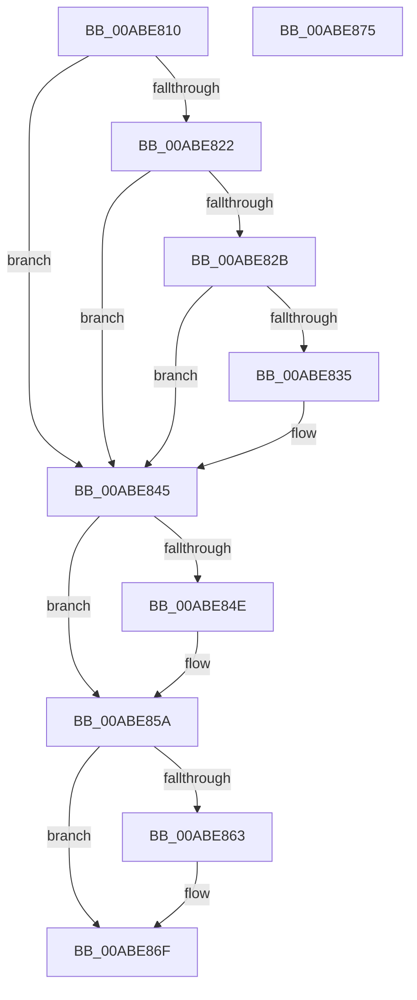

# WmipMRCleanup

- RVA: `0x00ABE810`–`0x00ABE876` (길이 `102` bytes)
- VA: `0x0000000140ABE810`
- 실행 섹션: `PAGE`
- PDB 이름 있음: `예`; PDB Function 태그: `아니요`
- unwind 정보 RVA: `0x0005CF00`
- 디코드: `31`개 명령, `102/102` bytes 표시
- 미해석 바이트: `0` (있으면 어셈블리에 `.byte`로 보존)

> 이 문서는 커널 이미지의 기계어와 PDB 기호를 분석해 생성했습니다. 4번과 5번은 함수 원형과 자료형을 바이너리 사용 방식에서 추정한 C 해석이며 원본 소스 복구 결과는 아닙니다.

## 1. Dependencies

- 직접 호출 지점: **3**; 고유 호출 대상: **2**
- 직접 호출자로 확인된 함수: **0**
- RIP 상대 이미지 참조: **1**

### Outgoing calls
- `0x00ABE840` → [WmipGenerateMofResourceNotification](../AC/WmipGenerateMofResourceNotification_function_00AC83F4.md) (function, `0x00AC83F4`)
- `0x00ABE850` → [ExFreePoolWithTag](../../poolcode/B8/ExFreePoolWithTag_function_00B82870.md) (function, `0x00B82870`)
- `0x00ABE865` → [ExFreePoolWithTag](../../poolcode/B8/ExFreePoolWithTag_function_00B82870.md) (function, `0x00B82870`)

### Direct callers
- 이 함수 시작 RVA로 연결되는 직접 call은 확인되지 않았습니다. 간접 호출은 완전히 역산할 수 없습니다.

### Static image references
- `0x00ABE839` → RVA `0x00B4B0A0` (`GUID_MOF_RESOURCE_REMOVED_NOTIFICATION`; read)

## 2. Other-region calls and transfers

- 다른 실행 섹션으로 향하는 call: **2**
  - `0x00ABE850` → [ExFreePoolWithTag](../../poolcode/B8/ExFreePoolWithTag_function_00B82870.md) (`PAGE` → `POOLCODE`)
  - `0x00ABE865` → [ExFreePoolWithTag](../../poolcode/B8/ExFreePoolWithTag_function_00B82870.md) (`PAGE` → `POOLCODE`)
- 별도 외부 분기/꼬리 이동을 확인하지 못했습니다.

## 3. Assembly (complete function range)

```asm
00ABE810  40 53                           push rbx
00ABE812  48 83 EC 20                     sub rsp, 0x20
00ABE816  48 8B D9                        mov rbx, rcx
00ABE819  48 8B 49 28                     mov rcx, qword ptr [rcx + 0x28]
00ABE81D  48 85 C9                        test rcx, rcx
00ABE820  74 23                           je 0x140abe845
00ABE822  48 8B 53 30                     mov rdx, qword ptr [rbx + 0x30]
00ABE826  48 85 D2                        test rdx, rdx
00ABE829  74 1A                           je 0x140abe845
00ABE82B  44 8B 4B 10                     mov r9d, dword ptr [rbx + 0x10]
00ABE82F  41 83 E1 01                     and r9d, 1
00ABE833  75 10                           jne 0x140abe845
00ABE835  41 83 F1 01                     xor r9d, 1
00ABE839  4C 8D 05 60 C8 08 00            lea r8, [rip + 0x8c860]
00ABE840  E8 AF 9B 00 00                  call 0x140ac83f4
00ABE845  48 8B 4B 28                     mov rcx, qword ptr [rbx + 0x28]
00ABE849  48 85 C9                        test rcx, rcx
00ABE84C  74 0C                           je 0x140abe85a
00ABE84E  33 D2                           xor edx, edx
00ABE850  E8 1B 40 0C 00                  call 0x140b82870
00ABE855  48 83 63 28 00                  and qword ptr [rbx + 0x28], 0
00ABE85A  48 8B 4B 30                     mov rcx, qword ptr [rbx + 0x30]
00ABE85E  48 85 C9                        test rcx, rcx
00ABE861  74 0C                           je 0x140abe86f
00ABE863  33 D2                           xor edx, edx
00ABE865  E8 06 40 0C 00                  call 0x140b82870
00ABE86A  48 83 63 30 00                  and qword ptr [rbx + 0x30], 0
00ABE86F  48 83 C4 20                     add rsp, 0x20
00ABE873  5B                              pop rbx
00ABE874  C3                              ret
00ABE875  CC                              int3
```

## 4. C-style interpretation (structured pseudocode)

```c
__int64 __fastcall WmipMRCleanup(__int64 a1)
{
    __int64 result;
    __int64 v_rsp;

    v_rsp = (v_rsp) - (32);
    if (*(unsigned __int64 *)(a1 + 40) == 0) goto loc_00ABE845;
    if (*(unsigned __int64 *)(a1 + 48) == 0) goto loc_00ABE845;
    a4 = (unsigned int)(((unsigned int)(*(unsigned int *)(a1 + 16))) & (1));
    if (!(condition_is_not_equal)) {
        a4 = (unsigned int)((a4) ^ (1));
        a3 = v_rip + 575584;
        result = WmipGenerateMofResourceNotification(*(unsigned __int64 *)(a1 + 40), *(unsigned __int64 *)(a1 + 48), a3, a4);
    }
    if (*(unsigned __int64 *)(a1 + 40) != 0) {
        a2 = 0;
        result = ExFreePoolWithTag(*(unsigned __int64 *)(a1 + 40), a2, a3, a4);
    }
    if (*(unsigned __int64 *)(a1 + 48) != 0) {
        a2 = 0;
        result = ExFreePoolWithTag(*(unsigned __int64 *)(a1 + 48), a2, a3, a4);
    }
    v_rsp = (v_rsp) + (32);
    return result;
}
```

## 5. (Beta) C Style

```c
int64_t WmipMRCleanup(void *Arg1)
{
    uint8_t *arg1 = (uint8_t *)Arg1;

    int64_t result;
    int64_t local_rsp;

    local_rsp = (local_rsp) - (32);
    if (*(uint64_t *)(arg1 + 0x28) == 0) goto loc_00ABE845;
    if (*(uint64_t *)(arg1 + 0x30) == 0) goto loc_00ABE845;
    a4 = (uint32_t)(((uint32_t)(*(uint32_t *)(arg1 + 0x10))) & (1));
    if (!(condition_is_not_equal)) {
        a4 = (uint32_t)((a4) ^ (1));
        a3 = v_rip + 575584;
        result = WmipGenerateMofResourceNotification(*(uint64_t *)(arg1 + 0x28), *(uint64_t *)(arg1 + 0x30), a3, a4);
    }
    if (*(uint64_t *)(arg1 + 0x28) != 0) {
        a2 = 0;
        result = ExFreePoolWithTag(*(uint64_t *)(arg1 + 0x28), a2, a3, a4);
    }
    if (*(uint64_t *)(arg1 + 0x30) != 0) {
        a2 = 0;
        result = ExFreePoolWithTag(*(uint64_t *)(arg1 + 0x30), a2, a3, a4);
    }
    local_rsp = (local_rsp) + (32);
    return result;
}
```

### 관측된 메모리 오프셋

구조체 형식이 확인되지 않은 접근은 인자 기준의 오프셋으로만 기록했습니다.

| 기준 인자 | 오프셋 표현 | 폭 (bit) | 접근 |
|---|---:|---:|---|
| `Arg1` | `+ 0x10` | `32` | `R` |
| `Arg1` | `+ 0x28` | `64` | `R` |
| `Arg1` | `+ 0x28` | `64` | `R/W` |
| `Arg1` | `+ 0x30` | `64` | `R` |
| `Arg1` | `+ 0x30` | `64` | `R/W` |

## 6. Execution-region graph

[열기: 2D/3D 그래프와 함수 탐색 컨트롤 패널](../../../control-panel.html?section=page&rva=0x00ABE810&view=graph)

- 2D 그래프는 위에서 아래로 흐르고, 3D 그래프는 빈 공간을 드래그해 회전합니다. Shift+드래그는 이동, 휠은 확대·축소, 함수 노드 선택은 대상 보고서 이동입니다.

### Static fallback


