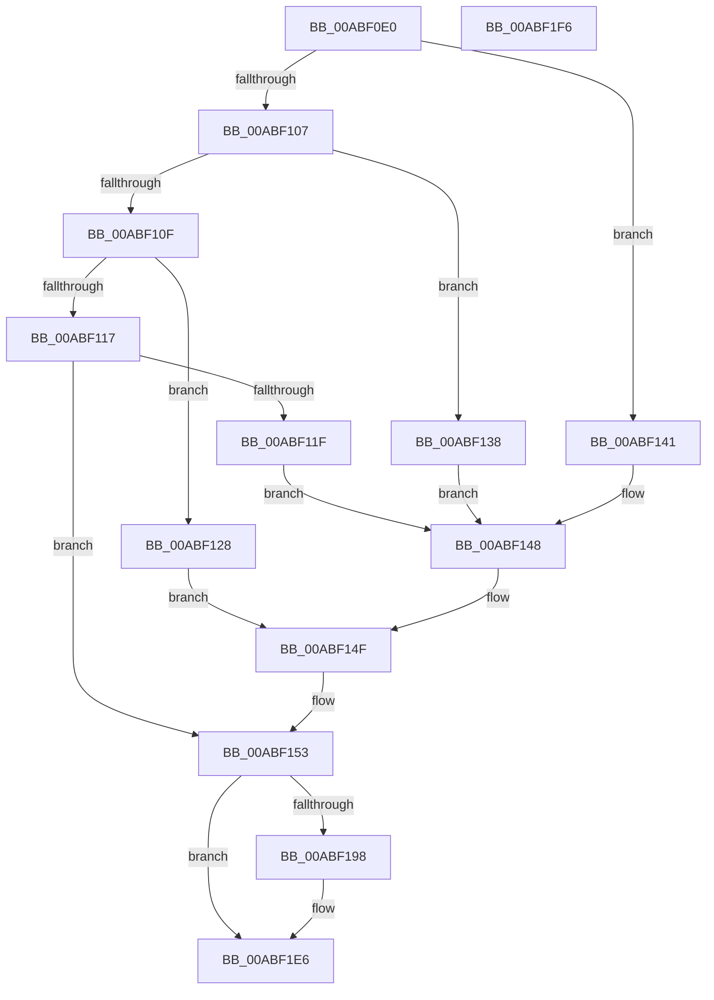

# WmipSetTraceNotify

- RVA: `0x00ABF0E0`–`0x00ABF1F7` (길이 `279` bytes)
- VA: `0x0000000140ABF0E0`
- 실행 섹션: `PAGE`
- PDB 이름 있음: `예`; PDB Function 태그: `아니요`
- unwind 정보 RVA: `0x00091FE0`
- 디코드: `68`개 명령, `279/279` bytes 표시
- 미해석 바이트: `0` (있으면 어셈블리에 `.byte`로 보존)

> 이 문서는 커널 이미지의 기계어와 PDB 기호를 분석해 생성했습니다. 4번과 5번은 함수 원형과 자료형을 바이너리 사용 방식에서 추정한 C 해석이며 원본 소스 복구 결과는 아닙니다.

## 1. Dependencies

- 직접 호출 지점: **6**; 고유 호출 대상: **6**
- 직접 호출자로 확인된 함수: **1**
- RIP 상대 이미지 참조: **6**

### Outgoing calls
- `0x00ABF168` → [KeWaitForSingleObject](../../text/20/KeWaitForSingleObject_function_0020E6B0.md) (function, `0x0020E6B0`)
- `0x00ABF182` → [KeReleaseMutex](../../text/39/KeReleaseMutex_function_00396810.md) (function, `0x00396810`)
- `0x00ABF18B` → [IoAllocateIrp](../../text/20/IoAllocateIrp_function_002065D0.md) (function, `0x002065D0`)
- `0x00ABF1B8` → [IoWMIDeviceObjectToProviderId](../../text/46/IoWMIDeviceObjectToProviderId_function_0046C2B0.md) (function, `0x0046C2B0`)
- `0x00ABF1D9` → [WmipForwardWmiIrp](../9E/WmipForwardWmiIrp_function_009E0DB4.md) (function, `0x009E0DB4`)
- `0x00ABF1E1` → [IoFreeIrp](../../text/24/IoFreeIrp_function_0024DF70.md) (function, `0x0024DF70`)

### Direct callers
- [IoWMIRegistrationControl](../9E/IoWMIRegistrationControl_function_009E2D60.md) at `0x009E2EA8`

### Static image references
- `0x00ABF11F` → RVA `0x00E68498` (`.data`; read)
- `0x00ABF12F` → RVA `0x00E03688` (`.data`; read)
- `0x00ABF138` → RVA `0x00E684C8` (`.data`; read)
- `0x00ABF141` → RVA `0x00E684A8` (`.data`; read)
- `0x00ABF159` → RVA `0x00EFFA60` (`.data`; read)
- `0x00ABF16D` → RVA `0x00EFFA98` (`.data`; read)

## 2. Other-region calls and transfers

- 다른 실행 섹션으로 향하는 call: **5**
  - `0x00ABF168` → [KeWaitForSingleObject](../../text/20/KeWaitForSingleObject_function_0020E6B0.md) (`PAGE` → `.text`)
  - `0x00ABF182` → [KeReleaseMutex](../../text/39/KeReleaseMutex_function_00396810.md) (`PAGE` → `.text`)
  - `0x00ABF18B` → [IoAllocateIrp](../../text/20/IoAllocateIrp_function_002065D0.md) (`PAGE` → `.text`)
  - `0x00ABF1B8` → [IoWMIDeviceObjectToProviderId](../../text/46/IoWMIDeviceObjectToProviderId_function_0046C2B0.md) (`PAGE` → `.text`)
  - `0x00ABF1E1` → [IoFreeIrp](../../text/24/IoFreeIrp_function_0024DF70.md) (`PAGE` → `.text`)
- 별도 외부 분기/꼬리 이동을 확인하지 못했습니다.

## 3. Assembly (complete function range)

```asm
00ABF0E0  48 89 5C 24 08                  mov qword ptr [rsp + 8], rbx
00ABF0E5  48 89 7C 24 10                  mov qword ptr [rsp + 0x10], rdi
00ABF0EA  55                              push rbp
00ABF0EB  48 8B EC                        mov rbp, rsp
00ABF0EE  48 83 EC 40                     sub rsp, 0x40
00ABF0F2  33 C0                           xor eax, eax
00ABF0F4  48 8B F9                        mov rdi, rcx
00ABF0F7  48 89 45 F4                     mov qword ptr [rbp - 0xc], rax
00ABF0FB  48 89 45 F0                     mov qword ptr [rbp - 0x10], rax
00ABF0FF  81 FA 00 00 10 00               cmp edx, 0x100000
00ABF105  74 3A                           je 0x140abf141
00ABF107  81 FA 00 00 20 00               cmp edx, 0x200000
00ABF10D  74 29                           je 0x140abf138
00ABF10F  81 FA 00 00 40 00               cmp edx, 0x400000
00ABF115  74 11                           je 0x140abf128
00ABF117  81 FA 00 00 80 00               cmp edx, 0x800000
00ABF11D  75 34                           jne 0x140abf153
00ABF11F  48 8D 05 72 93 3A 00            lea rax, [rip + 0x3a9372]
00ABF126  EB 20                           jmp 0x140abf148
00ABF128  C7 45 F0 02 00 00 00            mov dword ptr [rbp - 0x10], 2
00ABF12F  48 8D 05 52 45 34 00            lea rax, [rip + 0x344552]
00ABF136  EB 17                           jmp 0x140abf14f
00ABF138  48 8B 05 89 93 3A 00            mov rax, qword ptr [rip + 0x3a9389]
00ABF13F  EB 07                           jmp 0x140abf148
00ABF141  48 8D 05 60 93 3A 00            lea rax, [rip + 0x3a9360]
00ABF148  C7 45 F0 01 00 00 00            mov dword ptr [rbp - 0x10], 1
00ABF14F  48 89 45 F8                     mov qword ptr [rbp - 8], rax
00ABF153  48 83 64 24 20 00               and qword ptr [rsp + 0x20], 0
00ABF159  48 8D 0D 00 09 44 00            lea rcx, [rip + 0x440900]
00ABF160  45 33 C9                        xor r9d, r9d
00ABF163  45 33 C0                        xor r8d, r8d
00ABF166  33 D2                           xor edx, edx
00ABF168  E8 43 F5 74 FF                  call 0x14020e6b0
00ABF16D  48 8B 05 24 09 44 00            mov rax, qword ptr [rip + 0x440924]
00ABF174  48 8D 0D E5 08 44 00            lea rcx, [rip + 0x4408e5]
00ABF17B  33 D2                           xor edx, edx
00ABF17D  8A 58 4C                        mov bl, byte ptr [rax + 0x4c]
00ABF180  FE C3                           inc bl
00ABF182  E8 89 76 8D FF                  call 0x140396810
00ABF187  33 D2                           xor edx, edx
00ABF189  8A CB                           mov cl, bl
00ABF18B  E8 40 74 74 FF                  call 0x1402065d0
00ABF190  48 8B D8                        mov rbx, rax
00ABF193  48 85 C0                        test rax, rax
00ABF196  74 4E                           je 0x140abf1e6
00ABF198  48 83 80 B8 00 00 00 B8         add qword ptr [rax + 0xb8], -0x48
00ABF1A0  FE 48 43                        dec byte ptr [rax + 0x43]
00ABF1A3  48 8B 0D EE 08 44 00            mov rcx, qword ptr [rip + 0x4408ee]
00ABF1AA  48 8B 90 B8 00 00 00            mov rdx, qword ptr [rax + 0xb8]
00ABF1B1  48 89 4A 28                     mov qword ptr [rdx + 0x28], rcx
00ABF1B5  48 8B CF                        mov rcx, rdi
00ABF1B8  E8 F3 D0 9A FF                  call 0x14046c2b0
00ABF1BD  44 8B C0                        mov r8d, eax
00ABF1C0  45 33 C9                        xor r9d, r9d
00ABF1C3  48 8D 45 F0                     lea rax, [rbp - 0x10]
00ABF1C7  B2 0D                           mov dl, 0xd
00ABF1C9  48 89 44 24 28                  mov qword ptr [rsp + 0x28], rax
00ABF1CE  48 8B CB                        mov rcx, rbx
00ABF1D1  C7 44 24 20 10 00 00 00         mov dword ptr [rsp + 0x20], 0x10
00ABF1D9  E8 D6 1B F2 FF                  call 0x1409e0db4
00ABF1DE  48 8B CB                        mov rcx, rbx
00ABF1E1  E8 8A ED 78 FF                  call 0x14024df70
00ABF1E6  48 8B 5C 24 50                  mov rbx, qword ptr [rsp + 0x50]
00ABF1EB  48 8B 7C 24 58                  mov rdi, qword ptr [rsp + 0x58]
00ABF1F0  48 83 C4 40                     add rsp, 0x40
00ABF1F4  5D                              pop rbp
00ABF1F5  C3                              ret
00ABF1F6  CC                              int3
```

## 4. C-style interpretation (structured pseudocode)

```c
__int64 __fastcall WmipSetTraceNotify(__int64 a1, int a2, int a3, int a4)
{
    __int64 result;
    __int64 v_rbx;
    __int64 v_rsp;
    unsigned __int64 v_stack_m10;
    unsigned __int64 v_stack_m14;
    unsigned __int64 v_stack_m18;
    unsigned __int64 v_stack_m20;
    unsigned __int64 v_stack_m28;
    unsigned __int64 v_stack_p10;
    unsigned __int64 v_stack_p8;

    v_stack_p8 = v_rbx;
    v_stack_p10 = v_rdi;
    v_rsp = (v_rsp) - (64);
    result = 0;
    v_stack_m14 = 0;
    v_stack_m18 = 0;
    if (a2 == 0x100000ULL) goto loc_00ABF141;
    if (a2 == 0x200000ULL) goto loc_00ABF138;
    if (a2 == 0x400000ULL) goto loc_00ABF128;
    if (a2 != 0x800000ULL) goto loc_00ABF153;
    goto loc_00ABF148;
loc_00ABF128:
    v_stack_m18 = 2;
    goto loc_00ABF14F;
loc_00ABF138:
    goto loc_00ABF148;
loc_00ABF141:
loc_00ABF148:
    v_stack_m18 = 1;
loc_00ABF14F:
    v_stack_m10 = v_rip + 3838816;
loc_00ABF153:
    a4 = 0;
    a3 = 0;
    a2 = 0;
    result = KeWaitForSingleObject(v_rip + 4458752, a2, a3, a4);
    a2 = 0;
    v_rbx = (unsigned __int8)((*(unsigned __int8 *)(*(unsigned __int64 *)(v_rip + 4458788) + 76)) + 1);
    result = KeReleaseMutex(v_rip + 4458725, a2, a3, a4);
    a2 = 0;
    result = IoAllocateIrp((unsigned __int8)(v_rbx), a2, a3, a4);
    if (result != 0) {
        a1 = *(unsigned __int64 *)(v_rip + 4458734);
        a2 = *(unsigned __int64 *)(result + 184);
        *(unsigned __int64 *)(a2 + 40) = a1;
        a1 = a1;
        result = IoWMIDeviceObjectToProviderId(a1, a2, a3, a4);
        a3 = (unsigned int)(result);
        a4 = 0;
        result = v_stack_m18;
        a2 = 13;
        v_stack_m20 = result;
        a1 = result;
        v_stack_m28 = 16;
        result = WmipForwardWmiIrp(a1, a2, a3, a4);
        a1 = result;
        result = IoFreeIrp(a1, a2, a3, a4);
    }
    v_rsp = (v_rsp) + (64);
    return result;
}
```

## 5. (Beta) C Style

```c
int64_t WmipSetTraceNotify(int64_t Arg1, int32_t Arg2, int32_t Arg3, int32_t Arg4)
{
    int64_t result;
    int64_t local_rbx;
    int64_t local_rsp;
    uint64_t v_stack_m10;
    uint64_t v_stack_m14;
    uint64_t v_stack_m18;
    uint64_t v_stack_m20;
    uint64_t v_stack_m28;
    uint64_t v_stack_p10;
    uint64_t v_stack_p8;

    v_stack_p8 = local_rbx;
    v_stack_p10 = local_rdi;
    local_rsp = (local_rsp) - (64);
    result = 0;
    v_stack_m14 = 0;
    v_stack_m18 = 0;
    if (Arg2 == 0x100000ULL) goto loc_00ABF141;
    if (Arg2 == 0x200000ULL) goto loc_00ABF138;
    if (Arg2 == 0x400000ULL) goto loc_00ABF128;
    if (Arg2 != 0x800000ULL) goto loc_00ABF153;
    goto loc_00ABF148;
loc_00ABF128:
    v_stack_m18 = 2;
    goto loc_00ABF14F;
loc_00ABF138:
    goto loc_00ABF148;
loc_00ABF141:
loc_00ABF148:
    v_stack_m18 = 1;
loc_00ABF14F:
    v_stack_m10 = v_rip + 3838816;
loc_00ABF153:
    Arg4 = 0;
    Arg3 = 0;
    Arg2 = 0;
    result = KeWaitForSingleObject(v_rip + 4458752, Arg2, Arg3, Arg4);
    Arg2 = 0;
    local_rbx = (uint8_t)((*(uint8_t *)(*(uint64_t *)(v_rip + 0x440924) + 0x4C)) + 1);
    result = KeReleaseMutex(v_rip + 4458725, Arg2, Arg3, Arg4);
    Arg2 = 0;
    result = IoAllocateIrp((uint8_t)(local_rbx), Arg2, Arg3, Arg4);
    if (result != 0) {
        Arg1 = *(uint64_t *)(v_rip + 0x4408EE);
        Arg2 = *(uint64_t *)(result + 0xB8);
        *(uint64_t *)(Arg2 + 0x28) = Arg1;
        Arg1 = Arg1;
        result = IoWMIDeviceObjectToProviderId(Arg1, Arg2, Arg3, Arg4);
        Arg3 = (uint32_t)(result);
        Arg4 = 0;
        result = v_stack_m18;
        Arg2 = 13;
        v_stack_m20 = result;
        Arg1 = result;
        v_stack_m28 = 16;
        result = WmipForwardWmiIrp(Arg1, Arg2, Arg3, Arg4);
        Arg1 = result;
        result = IoFreeIrp(Arg1, Arg2, Arg3, Arg4);
    }
    local_rsp = (local_rsp) + (64);
    return result;
}
```

## 6. Execution-region graph

[열기: 2D/3D 그래프와 함수 탐색 컨트롤 패널](../../../control-panel.html?section=page&rva=0x00ABF0E0&view=graph)

- 2D 그래프는 위에서 아래로 흐르고, 3D 그래프는 빈 공간을 드래그해 회전합니다. Shift+드래그는 이동, 휠은 확대·축소, 함수 노드 선택은 대상 보고서 이동입니다.

### Static fallback


