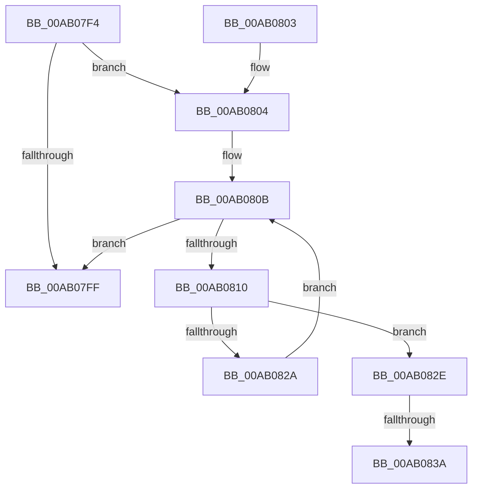

# _CmSetDeviceContainerMappedProperty

- RVA: `0x00AB07F4`–`0x00AB0847` (길이 `83` bytes)
- VA: `0x0000000140AB07F4`
- 실행 섹션: `PAGE`
- PDB 이름 있음: `예`; PDB Function 태그: `예`
- unwind 정보 RVA: `0x000DB714`
- 디코드: `25`개 명령, `83/83` bytes 표시
- 미해석 바이트: `0` (있으면 어셈블리에 `.byte`로 보존)

> 이 문서는 커널 이미지의 기계어와 PDB 기호를 분석해 생성했습니다. 4번과 5번은 함수 원형과 자료형을 바이너리 사용 방식에서 추정한 C 해석이며 원본 소스 복구 결과는 아닙니다.

## 1. Dependencies

- 직접 호출 지점: **0**; 고유 호출 대상: **0**
- 직접 호출자로 확인된 함수: **2**
- RIP 상대 이미지 참조: **1**

### Outgoing calls
- 직접 디코드된 call 명령이 없습니다.

### Direct callers
- [CmDeleteDeviceContainerWorker](../82/CmDeleteDeviceContainerWorker_function_0082B37C.md) at `0x0082B4AB`
- [_PnpDispatchDeviceContainer](../8F/_PnpDispatchDeviceContainer_function_008F6880.md) at `0x008F69B1`

### Static image references
- `0x00AB0812` → RVA `0x000055D0` (`.rdata`; read)

## 2. Other-region calls and transfers

- 다른 실행 섹션으로 향하는 call: **0**
- call이 아닌 외부 분기/꼬리 이동: **2**
  - `0x00AB0834` → `0x00B4A91C` (`tail-transfer`)
  - `0x00AB0842` → `0x00B4A91C` (`tail-transfer`)

## 3. Assembly (complete function range)

```asm
00AB07F4  41 B8 16 00 00 C0               mov r8d, 0xc0000016
00AB07FA  4D 85 C9                        test r9, r9
00AB07FD  74 05                           je 0x140ab0804
00AB07FF  41 8B C0                        mov eax, r8d
00AB0802  C3                              ret
00AB0803  CC                              int3
00AB0804  4C 8B 4C 24 28                  mov r9, qword ptr [rsp + 0x28]
00AB0809  33 C9                           xor ecx, ecx
00AB080B  83 F9 04                        cmp ecx, 4
00AB080E  73 EF                           jae 0x140ab07ff
00AB0810  8B C1                           mov eax, ecx
00AB0812  4C 8D 15 B7 4D 55 FF            lea r10, [rip - 0xaab249]
00AB0819  48 03 C0                        add rax, rax
00AB081C  4D 8B 14 C2                     mov r10, qword ptr [r10 + rax*8]
00AB0820  41 8B 42 10                     mov eax, dword ptr [r10 + 0x10]
00AB0824  41 39 41 10                     cmp dword ptr [r9 + 0x10], eax
00AB0828  74 04                           je 0x140ab082e
00AB082A  FF C1                           inc ecx
00AB082C  EB DD                           jmp 0x140ab080b
00AB082E  49 8B 11                        mov rdx, qword ptr [r9]
00AB0831  49 2B 12                        sub rdx, qword ptr [r10]
00AB0834  0F 85 E2 A0 09 00               jne 0x140b4a91c
00AB083A  49 8B 51 08                     mov rdx, qword ptr [r9 + 8]
00AB083E  49 2B 52 08                     sub rdx, qword ptr [r10 + 8]
00AB0842  E9 D5 A0 09 00                  jmp 0x140b4a91c
```

## 4. C-style interpretation (structured pseudocode)

```c
__int64 __fastcall _CmSetDeviceContainerMappedProperty(int a1, __int64 a2, __int64 a3, __int64 a4, __int64 a5)
{
    __int64 result;

    if (a4 == 0) goto loc_00AB0804;
loc_00AB07FF:
    return (unsigned int)((unsigned int)((unsigned int)(0xC0000016ULL)));
loc_00AB0804:
    a1 = 0;
loc_00AB080B:
    if (0 >= 4) goto loc_00AB07FF;
    result = (0) + (0);
    if ((*(unsigned int *)(a5 + 16)) == ((unsigned int)((unsigned int)(*(unsigned int *)(*(unsigned __int64 *)(v_rip - 11186761 + result * 8) + 16))))) goto loc_00AB082E;
    a1 = (unsigned int)((a1) + 1);
    goto loc_00AB080B;
loc_00AB082E:
    a2 = (*(unsigned __int64 *)(a5)) - (*(unsigned __int64 *)(*(unsigned __int64 *)(v_rip - 11186761 + result * 8)));
    a2 = (*(unsigned __int64 *)(a5 + 8)) - (*(unsigned __int64 *)(*(unsigned __int64 *)(v_rip - 11186761 + result * 8) + 8));
}
```

## 5. (Beta) C Style

```c
int64_t _CmSetDeviceContainerMappedProperty(int32_t Arg1, int64_t Arg2, int64_t Arg3, int64_t Arg4, void *Arg5)
{
    uint8_t *arg5 = (uint8_t *)Arg5;

    int64_t result;

    if (Arg4 == 0) goto loc_00AB0804;
loc_00AB07FF:
    return (uint32_t)((uint32_t)((uint32_t)(0xC0000016ULL)));
loc_00AB0804:
    Arg1 = 0;
loc_00AB080B:
    if (0 >= 4) goto loc_00AB07FF;
    result = (0) + (0);
    if ((*(uint32_t *)(arg5 + 0x10)) == ((uint32_t)((uint32_t)(*(uint32_t *)(*(uint64_t *)(v_rip - 0xAAB249 + result * 8) + 0x10))))) goto loc_00AB082E;
    Arg1 = (uint32_t)((Arg1) + 1);
    goto loc_00AB080B;
loc_00AB082E:
    Arg2 = (*(uint64_t *)(arg5)) - (*(uint64_t *)(*(uint64_t *)(v_rip - 0xAAB249 + result * 8)));
    Arg2 = (*(uint64_t *)(arg5 + 0x8)) - (*(uint64_t *)(*(uint64_t *)(v_rip - 0xAAB249 + result * 8) + 0x8));
}
```

### 관측된 메모리 오프셋

구조체 형식이 확인되지 않은 접근은 인자 기준의 오프셋으로만 기록했습니다.

| 기준 인자 | 오프셋 표현 | 폭 (bit) | 접근 |
|---|---:|---:|---|
| `Arg5` | `+ 0x0` | `64` | `R` |
| `Arg5` | `+ 0x8` | `64` | `R` |
| `Arg5` | `+ 0x10` | `32` | `R` |

## 6. Execution-region graph

[열기: 2D/3D 그래프와 함수 탐색 컨트롤 패널](../../../control-panel.html?section=page&rva=0x00AB07F4&view=graph)

- 2D 그래프는 위에서 아래로 흐르고, 3D 그래프는 빈 공간을 드래그해 회전합니다. Shift+드래그는 이동, 휠은 확대·축소, 함수 노드 선택은 대상 보고서 이동입니다.

### Static fallback


