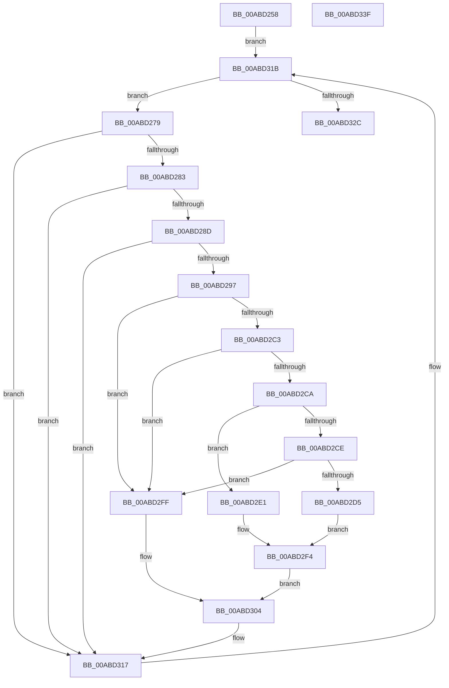

# wil_details_UpdateFeatureConfiguredStates

- RVA: `0x00ABD258`–`0x00ABD340` (길이 `232` bytes)
- VA: `0x0000000140ABD258`
- 실행 섹션: `PAGE`
- PDB 이름 있음: `예`; PDB Function 태그: `아니요`
- unwind 정보 RVA: `0x000A5A24`
- 디코드: `61`개 명령, `232/232` bytes 표시
- 미해석 바이트: `0` (있으면 어셈블리에 `.byte`로 보존)

> 이 문서는 커널 이미지의 기계어와 PDB 기호를 분석해 생성했습니다. 4번과 5번은 함수 원형과 자료형을 바이너리 사용 방식에서 추정한 C 해석이며 원본 소스 복구 결과는 아닙니다.

## 1. Dependencies

- 직접 호출 지점: **3**; 고유 호출 대상: **3**
- 직접 호출자로 확인된 함수: **1**
- RIP 상대 이미지 참조: **2**

### Outgoing calls
- `0x00ABD2B7` → [RtlQueryFeatureConfiguration](../../text/4B/RtlQueryFeatureConfiguration_function_004BDD10.md) (function, `0x004BDD10`)
- `0x00ABD31B` → [wil_details_FeatureDescriptors_SkipPadding](../../text/4C/wil_details_FeatureDescriptors_SkipPadding_function_004C9934.md) (function, `0x004C9934`)
- `0x00ABD334` → [_security_check_cookie](../../text/6A/_security_check_cookie_function_006AC640.md) (function, `0x006AC640`)

### Direct callers
- [wil_details_ReevaluateOnFeatureConfigurationChange](../7E/wil_details_ReevaluateOnFeatureConfigurationChange_function_007E6030.md) at `0x007E6034`

### Static image references
- `0x00ABD25E` → RVA `0x00E0A740` (`.data`; read)
- `0x00ABD26D` → RVA `0x000DC0C0` (`.rdata`; read)

## 2. Other-region calls and transfers

- 다른 실행 섹션으로 향하는 call: **3**
  - `0x00ABD2B7` → [RtlQueryFeatureConfiguration](../../text/4B/RtlQueryFeatureConfiguration_function_004BDD10.md) (`PAGE` → `.text`)
  - `0x00ABD31B` → [wil_details_FeatureDescriptors_SkipPadding](../../text/4C/wil_details_FeatureDescriptors_SkipPadding_function_004C9934.md) (`PAGE` → `.text`)
  - `0x00ABD334` → [_security_check_cookie](../../text/6A/_security_check_cookie_function_006AC640.md) (`PAGE` → `.text`)
- 별도 외부 분기/꼬리 이동을 확인하지 못했습니다.

## 3. Assembly (complete function range)

```asm
00ABD258  40 53                           push rbx
00ABD25A  48 83 EC 40                     sub rsp, 0x40
00ABD25E  48 8B 05 DB D4 34 00            mov rax, qword ptr [rip + 0x34d4db]
00ABD265  48 33 C4                        xor rax, rsp
00ABD268  48 89 44 24 38                  mov qword ptr [rsp + 0x38], rax
00ABD26D  48 8D 0D 4C EE 61 FF            lea rcx, [rip - 0x9e11b4]
00ABD274  E9 A2 00 00 00                  jmp 0x140abd31b
00ABD279  80 7B 1D 00                     cmp byte ptr [rbx + 0x1d], 0
00ABD27D  0F 85 94 00 00 00               jne 0x140abd317
00ABD283  80 7B 1E 00                     cmp byte ptr [rbx + 0x1e], 0
00ABD287  0F 85 8A 00 00 00               jne 0x140abd317
00ABD28D  80 7B 1C 00                     cmp byte ptr [rbx + 0x1c], 0
00ABD291  0F 85 80 00 00 00               jne 0x140abd317
00ABD297  8B 4B 18                        mov ecx, dword ptr [rbx + 0x18]
00ABD29A  4C 8D 4C 24 28                  lea r9, [rsp + 0x28]
00ABD29F  33 C0                           xor eax, eax
00ABD2A1  4C 8D 44 24 20                  lea r8, [rsp + 0x20]
00ABD2A6  48 21 44 24 20                  and qword ptr [rsp + 0x20], rax
00ABD2AB  48 89 44 24 28                  mov qword ptr [rsp + 0x28], rax
00ABD2B0  89 44 24 30                     mov dword ptr [rsp + 0x30], eax
00ABD2B4  8D 50 01                        lea edx, [rax + 1]
00ABD2B7  E8 54 0A A0 FF                  call 0x1404bdd10
00ABD2BC  3D 22 00 00 80                  cmp eax, 0x80000022
00ABD2C1  74 3C                           je 0x140abd2ff
00ABD2C3  3D 25 02 00 C0                  cmp eax, 0xc0000225
00ABD2C8  74 35                           je 0x140abd2ff
00ABD2CA  85 C0                           test eax, eax
00ABD2CC  74 13                           je 0x140abd2e1
00ABD2CE  3D 17 01 00 00                  cmp eax, 0x117
00ABD2D3  75 2A                           jne 0x140abd2ff
00ABD2D5  8B 54 24 2C                     mov edx, dword ptr [rsp + 0x2c]
00ABD2D9  81 E2 80 00 00 00               and edx, 0x80
00ABD2DF  EB 13                           jmp 0x140abd2f4
00ABD2E1  8B 44 24 2C                     mov eax, dword ptr [rsp + 0x2c]
00ABD2E5  8B D0                           mov edx, eax
00ABD2E7  83 E2 40                        and edx, 0x40
00ABD2EA  25 B0 00 00 00                  and eax, 0xb0
00ABD2EF  C1 E2 02                        shl edx, 2
00ABD2F2  0B D0                           or edx, eax
00ABD2F4  C1 E2 03                        shl edx, 3
00ABD2F7  81 CA 06 02 00 00               or edx, 0x206
00ABD2FD  EB 05                           jmp 0x140abd304
00ABD2FF  BA 06 02 00 00                  mov edx, 0x206
00ABD304  48 8B 03                        mov rax, qword ptr [rbx]
00ABD307  8B 08                           mov ecx, dword ptr [rax]
00ABD309  48 8B 03                        mov rax, qword ptr [rbx]
00ABD30C  33 CA                           xor ecx, edx
00ABD30E  81 E1 80 0F 00 00               and ecx, 0xf80
00ABD314  F0 31 08                        lock xor dword ptr [rax], ecx
00ABD317  48 8D 4B 38                     lea rcx, [rbx + 0x38]
00ABD31B  E8 14 C6 A0 FF                  call 0x1404c9934
00ABD320  48 8B D8                        mov rbx, rax
00ABD323  48 85 C0                        test rax, rax
00ABD326  0F 85 4D FF FF FF               jne 0x140abd279
00ABD32C  48 8B 4C 24 38                  mov rcx, qword ptr [rsp + 0x38]
00ABD331  48 33 CC                        xor rcx, rsp
00ABD334  E8 07 F3 BE FF                  call 0x1406ac640
00ABD339  48 83 C4 40                     add rsp, 0x40
00ABD33D  5B                              pop rbx
00ABD33E  C3                              ret
00ABD33F  CC                              int3
```

## 4. C-style interpretation (structured pseudocode)

```c
__int64 __fastcall wil_details_UpdateFeatureConfiguredStates(void)
{
    __int64 result;
    __int64 v_rsp;
    unsigned __int64 v_stack_m10;
    unsigned int v_stack_m18;
    unsigned int v_stack_m1C;
    unsigned __int64 v_stack_m20;
    unsigned __int64 v_stack_m28;

    v_rsp = (v_rsp) - (64);
    result = (*(unsigned __int64 *)(v_rip + 3462363)) ^ (v_rsp);
    v_stack_m10 = result;
    goto loc_00ABD31B;
loc_00ABD279:
    if ((*(unsigned __int8 *)(v_rbx + 29)) != 0) goto loc_00ABD317;
    if ((*(unsigned __int8 *)(v_rbx + 30)) != 0) goto loc_00ABD317;
    if ((*(unsigned __int8 *)(v_rbx + 28)) != 0) goto loc_00ABD317;
    result = 0;
    v_stack_m20 = 0;
    v_stack_m18 = 0;
    result = RtlQueryFeatureConfiguration((unsigned int)(*(unsigned int *)(v_rbx + 24)), result + 1, v_stack_m28, v_stack_m20);
    if (((unsigned int)(result)) == 0x80000022ULL) goto loc_00ABD2FF;
    if (((unsigned int)(result)) == 0xC0000225ULL) goto loc_00ABD2FF;
    if ((unsigned int)(result) == 0) goto loc_00ABD2E1;
    if (((unsigned int)(result)) != 279) goto loc_00ABD2FF;
    a2 = (unsigned int)(((unsigned int)(v_stack_m1C)) & (128));
    goto loc_00ABD2F4;
loc_00ABD2E1:
    a2 = (unsigned int)(((unsigned int)((unsigned int)((unsigned int)(v_stack_m1C)))) & (64));
    result = (unsigned int)(((unsigned int)(v_stack_m1C)) & (176));
    a2 = (unsigned int)((a2) << (2));
    a2 = (unsigned int)((a2) | ((unsigned int)(result)));
loc_00ABD2F4:
    a2 = (unsigned int)((a2) << (3));
    a2 = (unsigned int)((a2) | (518));
    goto loc_00ABD304;
loc_00ABD2FF:
loc_00ABD304:
    a1 = (unsigned int)(((unsigned int)(*(unsigned int *)(*(unsigned __int64 *)(v_rbx)))) ^ (518));
    a1 = (unsigned int)((a1) & (0xF80ULL));
loc_00ABD317:
loc_00ABD31B:
    result = wil_details_FeatureDescriptors_SkipPadding(v_rbx + 56, 518, v_stack_m28, v_stack_m20);
    if (result != 0) goto loc_00ABD279;
    a1 = (v_stack_m10) ^ (v_rsp);
    result = _security_check_cookie(a1, 518, v_stack_m28, v_stack_m20);
    v_rsp = (v_rsp) + (64);
    return result;
}
```

## 5. (Beta) C Style

```c
void wil_details_UpdateFeatureConfiguredStates(void)
{
    int64_t result;
    int64_t local_rsp;
    uint64_t v_stack_m10;
    uint32_t v_stack_m18;
    uint32_t v_stack_m1C;
    uint64_t v_stack_m20;
    uint64_t v_stack_m28;

    local_rsp = (local_rsp) - (64);
    result = (*(uint64_t *)(v_rip + 0x34D4DB)) ^ (local_rsp);
    v_stack_m10 = result;
    goto loc_00ABD31B;
loc_00ABD279:
    if ((*(uint8_t *)(local_rbx + 0x1D)) != 0) goto loc_00ABD317;
    if ((*(uint8_t *)(local_rbx + 0x1E)) != 0) goto loc_00ABD317;
    if ((*(uint8_t *)(local_rbx + 0x1C)) != 0) goto loc_00ABD317;
    result = 0;
    v_stack_m20 = 0;
    v_stack_m18 = 0;
    result = RtlQueryFeatureConfiguration((uint32_t)(*(uint32_t *)(local_rbx + 0x18)), result + 1, v_stack_m28, v_stack_m20);
    if (((uint32_t)(result)) == 0x80000022ULL) goto loc_00ABD2FF;
    if (((uint32_t)(result)) == 0xC0000225ULL) goto loc_00ABD2FF;
    if ((uint32_t)(result) == 0) goto loc_00ABD2E1;
    if (((uint32_t)(result)) != 279) goto loc_00ABD2FF;
    a2 = (uint32_t)(((uint32_t)(v_stack_m1C)) & (128));
    goto loc_00ABD2F4;
loc_00ABD2E1:
    a2 = (uint32_t)(((uint32_t)((uint32_t)((uint32_t)(v_stack_m1C)))) & (64));
    result = (uint32_t)(((uint32_t)(v_stack_m1C)) & (176));
    a2 = (uint32_t)((a2) << (2));
    a2 = (uint32_t)((a2) | ((uint32_t)(result)));
loc_00ABD2F4:
    a2 = (uint32_t)((a2) << (3));
    a2 = (uint32_t)((a2) | (518));
    goto loc_00ABD304;
loc_00ABD2FF:
loc_00ABD304:
    a1 = (uint32_t)(((uint32_t)(*(uint32_t *)(*(uint64_t *)(local_rbx)))) ^ (518));
    a1 = (uint32_t)((a1) & (0xF80ULL));
loc_00ABD317:
loc_00ABD31B:
    result = wil_details_FeatureDescriptors_SkipPadding(local_rbx + 56, 518, v_stack_m28, v_stack_m20);
    if (result != 0) goto loc_00ABD279;
    a1 = (v_stack_m10) ^ (local_rsp);
    result = _security_check_cookie(a1, 518, v_stack_m28, v_stack_m20);
    local_rsp = (local_rsp) + (64);
    return result;
}
```

## 6. Execution-region graph

[열기: 2D/3D 그래프와 함수 탐색 컨트롤 패널](../../../control-panel.html?section=page&rva=0x00ABD258&view=graph)

- 2D 그래프는 위에서 아래로 흐르고, 3D 그래프는 빈 공간을 드래그해 회전합니다. Shift+드래그는 이동, 휠은 확대·축소, 함수 노드 선택은 대상 보고서 이동입니다.

### Static fallback


