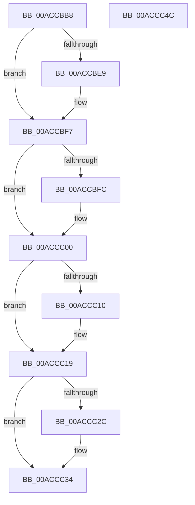

# AlpcpEnterFreeEventMessageLog

- RVA: `0x00ACCBB8`–`0x00ACCC4D` (길이 `149` bytes)
- VA: `0x0000000140ACCBB8`
- 실행 섹션: `PAGE`
- PDB 이름 있음: `예`; PDB Function 태그: `아니요`
- unwind 정보 RVA: `0x00060BC4`
- 디코드: `41`개 명령, `149/149` bytes 표시
- 미해석 바이트: `0` (있으면 어셈블리에 `.byte`로 보존)

> 이 문서는 커널 이미지의 기계어와 PDB 기호를 분석해 생성했습니다. 4번과 5번은 함수 원형과 자료형을 바이너리 사용 방식에서 추정한 C 해석이며 원본 소스 복구 결과는 아닙니다.

## 1. Dependencies

- 직접 호출 지점: **5**; 고유 호출 대상: **5**
- 직접 호출자로 확인된 함수: **2**
- RIP 상대 이미지 참조: **2**

### Outgoing calls
- `0x00ACCBD9` → [KeAbPreAcquire](../../text/21/KeAbPreAcquire_function_00210230.md) (function, `0x00210230`)
- `0x00ACCBF2` → [ExfAcquirePushLockExclusiveEx](../../text/20/ExfAcquirePushLockExclusiveEx_function_0020FC90.md) (function, `0x0020FC90`)
- `0x00ACCC06` → [AlpcpLocateMessageLog](AlpcpLocateMessageLog_function_00ACCC54.md) (function, `0x00ACCC54`)
- `0x00ACCC2F` → [ExfTryToWakePushLock](../../text/26/ExfTryToWakePushLock_function_00265DD0.md) (function, `0x00265DD0`)
- `0x00ACCC37` → [KeAbPostRelease](../../text/2E/KeAbPostRelease_function_002E1600.md) (function, `0x002E1600`)

### Direct callers
- [sub_0088B6F6](../88/Unknown_function_0088B6F6.md) at `0x0088B713`
- [AlpcpProcessSynchronousRequest](../92/AlpcpProcessSynchronousRequest_function_00921FCC.md) at `0x0092233B`

### Static image references
- `0x00ACCBCA` → RVA `0x00F10080` (`.data`; read)
- `0x00ACCC1D` → RVA `0x00F10080` (`.data`; read/write)

## 2. Other-region calls and transfers

- 다른 실행 섹션으로 향하는 call: **4**
  - `0x00ACCBD9` → [KeAbPreAcquire](../../text/21/KeAbPreAcquire_function_00210230.md) (`PAGE` → `.text`)
  - `0x00ACCBF2` → [ExfAcquirePushLockExclusiveEx](../../text/20/ExfAcquirePushLockExclusiveEx_function_0020FC90.md) (`PAGE` → `.text`)
  - `0x00ACCC2F` → [ExfTryToWakePushLock](../../text/26/ExfTryToWakePushLock_function_00265DD0.md) (`PAGE` → `.text`)
  - `0x00ACCC37` → [KeAbPostRelease](../../text/2E/KeAbPostRelease_function_002E1600.md) (`PAGE` → `.text`)
- 별도 외부 분기/꼬리 이동을 확인하지 못했습니다.

## 3. Assembly (complete function range)

```asm
00ACCBB8  48 89 5C 24 08                  mov qword ptr [rsp + 8], rbx
00ACCBBD  48 89 74 24 10                  mov qword ptr [rsp + 0x10], rsi
00ACCBC2  57                              push rdi
00ACCBC3  48 83 EC 20                     sub rsp, 0x20
00ACCBC7  48 8B F9                        mov rdi, rcx
00ACCBCA  48 8D 35 AF 34 44 00            lea rsi, [rip + 0x4434af]
00ACCBD1  48 8B CE                        mov rcx, rsi
00ACCBD4  45 33 C0                        xor r8d, r8d
00ACCBD7  33 D2                           xor edx, edx
00ACCBD9  E8 52 36 74 FF                  call 0x140210230
00ACCBDE  F0 48 0F BA 2E 00               lock bts qword ptr [rsi], 0
00ACCBE4  48 8B D8                        mov rbx, rax
00ACCBE7  73 0E                           jae 0x140accbf7
00ACCBE9  4C 8B C6                        mov r8, rsi
00ACCBEC  48 8B D0                        mov rdx, rax
00ACCBEF  48 8B CE                        mov rcx, rsi
00ACCBF2  E8 99 30 74 FF                  call 0x14020fc90
00ACCBF7  48 85 DB                        test rbx, rbx
00ACCBFA  74 04                           je 0x140accc00
00ACCBFC  C6 43 0A 01                     mov byte ptr [rbx + 0xa], 1
00ACCC00  8B 8F 08 01 00 00               mov ecx, dword ptr [rdi + 0x108]
00ACCC06  E8 49 00 00 00                  call 0x140accc54
00ACCC0B  48 85 C0                        test rax, rax
00ACCC0E  74 09                           je 0x140accc19
00ACCC10  83 60 2C 00                     and dword ptr [rax + 0x2c], 0
00ACCC14  48 83 60 20 00                  and qword ptr [rax + 0x20], 0
00ACCC19  48 83 C8 FF                     or rax, 0xffffffffffffffff
00ACCC1D  F0 48 0F C1 05 5A 34 44 00      lock xadd qword ptr [rip + 0x44345a], rax
00ACCC26  24 06                           and al, 6
00ACCC28  3C 02                           cmp al, 2
00ACCC2A  75 08                           jne 0x140accc34
00ACCC2C  48 8B CE                        mov rcx, rsi
00ACCC2F  E8 9C 91 79 FF                  call 0x140265dd0
00ACCC34  48 8B CE                        mov rcx, rsi
00ACCC37  E8 C4 49 81 FF                  call 0x1402e1600
00ACCC3C  48 8B 5C 24 30                  mov rbx, qword ptr [rsp + 0x30]
00ACCC41  48 8B 74 24 38                  mov rsi, qword ptr [rsp + 0x38]
00ACCC46  48 83 C4 20                     add rsp, 0x20
00ACCC4A  5F                              pop rdi
00ACCC4B  C3                              ret
00ACCC4C  CC                              int3
```

## 4. C-style interpretation (structured pseudocode)

```c
__int64 __fastcall AlpcpEnterFreeEventMessageLog(__int64 a1, int a2, int a3)
{
    __int64 result;
    __int64 v_rsp;
    unsigned __int64 v_stack_p10;
    unsigned __int64 v_stack_p8;

    v_stack_p8 = v_rbx;
    v_stack_p10 = v_rsi;
    v_rsp = (v_rsp) - (32);
    a3 = 0;
    a2 = 0;
    result = KeAbPreAcquire(v_rip + 4469935, a2, a3, a4);
    if (!(condition_is_above_or_equal)) {
        a3 = v_rip + 4469935;
        a2 = result;
        a1 = v_rip + 4469935;
        result = ExfAcquirePushLockExclusiveEx(a1, a2, a3, a4);
    }
    if (result != 0) {
        *(unsigned __int8 *)(result + 10) = 1;
    }
    result = AlpcpLocateMessageLog((unsigned int)(*(unsigned int *)(a1 + 264)), a2, a3, a4);
    if (result != 0) {
    }
    result = (result) | (-1);
    result = (unsigned __int8)((result) & (6));
    if (((unsigned __int8)(result)) == 2) {
        a1 = v_rip + 4469935;
        result = ExfTryToWakePushLock(a1, a2, a3, a4);
    }
    result = KeAbPostRelease(v_rip + 4469935, a2, a3, a4);
    v_rsp = (v_rsp) + (32);
    return result;
}
```

## 5. (Beta) C Style

```c
int64_t AlpcpEnterFreeEventMessageLog(void *Arg1, int32_t Arg2, int32_t Arg3)
{
    uint8_t *arg1 = (uint8_t *)Arg1;

    int64_t result;
    int64_t local_rsp;
    uint64_t v_stack_p10;
    uint64_t v_stack_p8;

    v_stack_p8 = local_rbx;
    v_stack_p10 = local_rsi;
    local_rsp = (local_rsp) - (32);
    Arg3 = 0;
    Arg2 = 0;
    result = KeAbPreAcquire(v_rip + 4469935, Arg2, Arg3, a4);
    if (!(condition_is_above_or_equal)) {
        Arg3 = v_rip + 4469935;
        Arg2 = result;
        Arg1 = v_rip + 4469935;
        result = ExfAcquirePushLockExclusiveEx(Arg1, Arg2, Arg3, a4);
    }
    if (result != 0) {
        *(uint8_t *)(result + 0xA) = 1;
    }
    result = AlpcpLocateMessageLog((uint32_t)(*(uint32_t *)(arg1 + 0x108)), Arg2, Arg3, a4);
    if (result != 0) {
    }
    result = (result) | (-1);
    result = (uint8_t)((result) & (6));
    if (((uint8_t)(result)) == 2) {
        Arg1 = v_rip + 4469935;
        result = ExfTryToWakePushLock(Arg1, Arg2, Arg3, a4);
    }
    result = KeAbPostRelease(v_rip + 4469935, Arg2, Arg3, a4);
    local_rsp = (local_rsp) + (32);
    return result;
}
```

### 관측된 메모리 오프셋

구조체 형식이 확인되지 않은 접근은 인자 기준의 오프셋으로만 기록했습니다.

| 기준 인자 | 오프셋 표현 | 폭 (bit) | 접근 |
|---|---:|---:|---|
| `Arg1` | `+ 0x108` | `32` | `R` |

## 6. Execution-region graph

[열기: 2D/3D 그래프와 함수 탐색 컨트롤 패널](../../../control-panel.html?section=page&rva=0x00ACCBB8&view=graph)

- 2D 그래프는 위에서 아래로 흐르고, 3D 그래프는 빈 공간을 드래그해 회전합니다. Shift+드래그는 이동, 휠은 확대·축소, 함수 노드 선택은 대상 보고서 이동입니다.

### Static fallback


