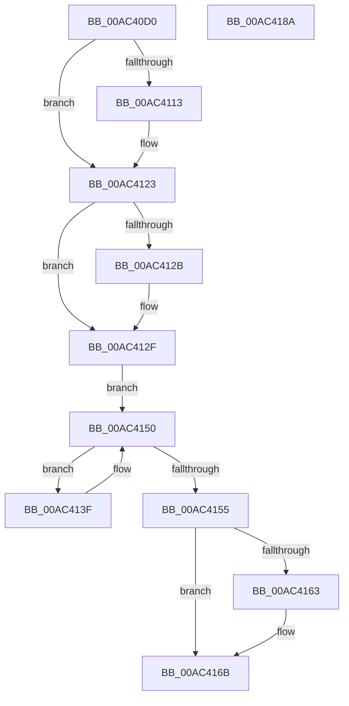

# AlpcpInvokeLogCallbacks

- RVA: `0x00AC40D0`–`0x00AC418B` (길이 `187` bytes)
- VA: `0x0000000140AC40D0`
- 실행 섹션: `PAGE`
- PDB 이름 있음: `예`; PDB Function 태그: `아니요`
- unwind 정보 RVA: `0x0008DF5C`
- 디코드: `56`개 명령, `187/187` bytes 표시
- 미해석 바이트: `0` (있으면 어셈블리에 `.byte`로 보존)

> 이 문서는 커널 이미지의 기계어와 PDB 기호를 분석해 생성했습니다. 4번과 5번은 함수 원형과 자료형을 바이너리 사용 방식에서 추정한 C 해석이며 원본 소스 복구 결과는 아닙니다.

## 1. Dependencies

- 직접 호출 지점: **5**; 고유 호출 대상: **5**
- 직접 호출자로 확인된 함수: **9**
- RIP 상대 이미지 참조: **2**

### Outgoing calls
- `0x00AC40FA` → [KeAbPreAcquire](../../text/21/KeAbPreAcquire_function_00210230.md) (function, `0x00210230`)
- `0x00AC411E` → [ExfAcquirePushLockSharedEx](../../text/21/ExfAcquirePushLockSharedEx_function_0021044C.md) (function, `0x0021044C`)
- `0x00AC4148` → [guard_dispatch_icall](../../text/6B/guard_dispatch_icall_function_006BAAD0.md) (function, `0x006BAAD0`)
- `0x00AC4166` → [ExfReleasePushLockShared](../../text/26/ExfReleasePushLockShared_function_00263440.md) (function, `0x00263440`)
- `0x00AC416E` → [KeAbPostRelease](../../text/2E/KeAbPostRelease_function_002E1600.md) (function, `0x002E1600`)

### Direct callers
- [AlpcpLogClosePort](../74/AlpcpLogClosePort_function_0074D068.md) at `0x0074D0BA`
- [AlpcpLogConnectFail](../74/AlpcpLogConnectFail_function_0074D0D8.md) at `0x0074D12B`
- [AlpcpLogConnectRequest](../74/AlpcpLogConnectRequest_function_0074D14C.md) at `0x0074D19E`
- [AlpcpLogConnectSuccess](../74/AlpcpLogConnectSuccess_function_0074D1BC.md) at `0x0074D208`
- [AlpcpLogUnwait](../74/AlpcpLogUnwait_function_0074D228.md) at `0x0074D274`
- [AlpcpLogWaitForNewMessage](../74/AlpcpLogWaitForNewMessage_function_0074D294.md) at `0x0074D358`
- [AlpcpLogWaitForReply](../74/AlpcpLogWaitForReply_function_0074D390.md) at `0x0074D3E2`
- [AlpcpLogReceiveMessage](../88/AlpcpLogReceiveMessage_function_0088F80C.md) at `0x0088F85E`
- [AlpcpLogSendMessage](../89/AlpcpLogSendMessage_function_008903B4.md) at `0x00890406`

### Static image references
- `0x00AC40E8` → RVA `0x00F100D8` (`.data`; read)
- `0x00AC412F` → RVA `0x00E07490` (`.data`; read)

## 2. Other-region calls and transfers

- 다른 실행 섹션으로 향하는 call: **5**
  - `0x00AC40FA` → [KeAbPreAcquire](../../text/21/KeAbPreAcquire_function_00210230.md) (`PAGE` → `.text`)
  - `0x00AC411E` → [ExfAcquirePushLockSharedEx](../../text/21/ExfAcquirePushLockSharedEx_function_0021044C.md) (`PAGE` → `.text`)
  - `0x00AC4148` → [guard_dispatch_icall](../../text/6B/guard_dispatch_icall_function_006BAAD0.md) (`PAGE` → `.text`)
  - `0x00AC4166` → [ExfReleasePushLockShared](../../text/26/ExfReleasePushLockShared_function_00263440.md) (`PAGE` → `.text`)
  - `0x00AC416E` → [KeAbPostRelease](../../text/2E/KeAbPostRelease_function_002E1600.md) (`PAGE` → `.text`)
- 별도 외부 분기/꼬리 이동을 확인하지 못했습니다.

## 3. Assembly (complete function range)

```asm
00AC40D0  48 89 5C 24 08                  mov qword ptr [rsp + 8], rbx
00AC40D5  48 89 6C 24 10                  mov qword ptr [rsp + 0x10], rbp
00AC40DA  56                              push rsi
00AC40DB  57                              push rdi
00AC40DC  41 54                           push r12
00AC40DE  41 56                           push r14
00AC40E0  41 57                           push r15
00AC40E2  48 83 EC 20                     sub rsp, 0x20
00AC40E6  8B FA                           mov edi, edx
00AC40E8  48 8D 2D E9 BF 44 00            lea rbp, [rip + 0x44bfe9]
00AC40EF  48 8B F1                        mov rsi, rcx
00AC40F2  45 33 C0                        xor r8d, r8d
00AC40F5  48 8B CD                        mov rcx, rbp
00AC40F8  33 D2                           xor edx, edx
00AC40FA  E8 31 C1 74 FF                  call 0x140210230
00AC40FF  48 8B D8                        mov rbx, rax
00AC4102  33 C0                           xor eax, eax
00AC4104  44 8D 60 11                     lea r12d, [rax + 0x11]
00AC4108  F0 4C 0F B1 25 C7 BF 44 00      lock cmpxchg qword ptr [rip + 0x44bfc7], r12
00AC4111  74 10                           je 0x140ac4123
00AC4113  4C 8B CD                        mov r9, rbp
00AC4116  4C 8B C3                        mov r8, rbx
00AC4119  33 D2                           xor edx, edx
00AC411B  48 8B CD                        mov rcx, rbp
00AC411E  E8 29 C3 74 FF                  call 0x14021044c
00AC4123  45 33 F6                        xor r14d, r14d
00AC4126  48 85 DB                        test rbx, rbx
00AC4129  74 04                           je 0x140ac412f
00AC412B  C6 43 0A 01                     mov byte ptr [rbx + 0xa], 1
00AC412F  48 8B 1D 5A 33 34 00            mov rbx, qword ptr [rip + 0x34335a]
00AC4136  4C 8D 3D 53 33 34 00            lea r15, [rip + 0x343353]
00AC413D  EB 11                           jmp 0x140ac4150
00AC413F  48 8B 43 10                     mov rax, qword ptr [rbx + 0x10]
00AC4143  8B D7                           mov edx, edi
00AC4145  48 8B CE                        mov rcx, rsi
00AC4148  E8 83 69 BF FF                  call 0x1406baad0
00AC414D  48 8B 1B                        mov rbx, qword ptr [rbx]
00AC4150  49 3B DF                        cmp rbx, r15
00AC4153  75 EA                           jne 0x140ac413f
00AC4155  49 8B C4                        mov rax, r12
00AC4158  F0 4C 0F B1 35 77 BF 44 00      lock cmpxchg qword ptr [rip + 0x44bf77], r14
00AC4161  74 08                           je 0x140ac416b
00AC4163  48 8B CD                        mov rcx, rbp
00AC4166  E8 D5 F2 79 FF                  call 0x140263440
00AC416B  48 8B CD                        mov rcx, rbp
00AC416E  E8 8D D4 81 FF                  call 0x1402e1600
00AC4173  48 8B 5C 24 50                  mov rbx, qword ptr [rsp + 0x50]
00AC4178  48 8B 6C 24 58                  mov rbp, qword ptr [rsp + 0x58]
00AC417D  48 83 C4 20                     add rsp, 0x20
00AC4181  41 5F                           pop r15
00AC4183  41 5E                           pop r14
00AC4185  41 5C                           pop r12
00AC4187  5F                              pop rdi
00AC4188  5E                              pop rsi
00AC4189  C3                              ret
00AC418A  CC                              int3
```

## 4. C-style interpretation (structured pseudocode)

```c
__int64 __fastcall AlpcpInvokeLogCallbacks(__int64 a1, int a2, int a3)
{
    __int64 result;
    __int64 v_r14;
    __int64 v_rsp;
    unsigned __int64 v_stack_p10;
    unsigned __int64 v_stack_p8;

    v_stack_p8 = v_rbx;
    v_stack_p10 = v_rbp;
    v_rsp = (v_rsp) - (32);
    a3 = 0;
    a2 = 0;
    result = KeAbPreAcquire(v_rip + 4505577, a2, a3, a4);
    result = 0;
    if (!(condition_is_equal)) {
        a4 = v_rip + 4505577;
        a3 = 0;
        a2 = 0;
        a1 = v_rip + 4505577;
        result = ExfAcquirePushLockSharedEx(a1, a2, a3, a4);
    }
    v_r14 = 0;
    if (result != 0) {
        *(unsigned __int8 *)(result + 10) = 1;
    }
    goto loc_00AC4150;
loc_00AC413F:
    result = guard_dispatch_icall(a1, (unsigned int)((unsigned int)((unsigned int)(a2))), a3, a4);
loc_00AC4150:
    if ((*(unsigned __int64 *)(*(unsigned __int64 *)(v_rip + 3421018))) != (v_rip + 3421011)) goto loc_00AC413F;
    result = result + 17;
    if ((*(unsigned __int64 *)(*(unsigned __int64 *)(v_rip + 3421018))) != (v_rip + 3421011)) {
        a1 = v_rip + 4505577;
        result = ExfReleasePushLockShared(a1, (unsigned int)((unsigned int)((unsigned int)(a2))), a3, a4);
    }
    result = KeAbPostRelease(v_rip + 4505577, (unsigned int)((unsigned int)((unsigned int)(a2))), a3, a4);
    v_rsp = (v_rsp) + (32);
    return result;
}
```

## 5. (Beta) C Style

```c
int64_t AlpcpInvokeLogCallbacks(int64_t Arg1, int32_t Arg2, int32_t Arg3)
{
    int64_t result;
    int64_t local_r14;
    int64_t local_rsp;
    uint64_t v_stack_p10;
    uint64_t v_stack_p8;

    v_stack_p8 = local_rbx;
    v_stack_p10 = local_rbp;
    local_rsp = (local_rsp) - (32);
    Arg3 = 0;
    Arg2 = 0;
    result = KeAbPreAcquire(v_rip + 4505577, Arg2, Arg3, a4);
    result = 0;
    if (!(condition_is_equal)) {
        a4 = v_rip + 4505577;
        Arg3 = 0;
        Arg2 = 0;
        Arg1 = v_rip + 4505577;
        result = ExfAcquirePushLockSharedEx(Arg1, Arg2, Arg3, a4);
    }
    local_r14 = 0;
    if (result != 0) {
        *(uint8_t *)(result + 0xA) = 1;
    }
    goto loc_00AC4150;
loc_00AC413F:
    result = guard_dispatch_icall(Arg1, (uint32_t)((uint32_t)((uint32_t)(Arg2))), Arg3, a4);
loc_00AC4150:
    if ((*(uint64_t *)(*(uint64_t *)(v_rip + 0x34335A))) != (v_rip + 3421011)) goto loc_00AC413F;
    result = result + 17;
    if ((*(uint64_t *)(*(uint64_t *)(v_rip + 0x34335A))) != (v_rip + 3421011)) {
        Arg1 = v_rip + 4505577;
        result = ExfReleasePushLockShared(Arg1, (uint32_t)((uint32_t)((uint32_t)(Arg2))), Arg3, a4);
    }
    result = KeAbPostRelease(v_rip + 4505577, (uint32_t)((uint32_t)((uint32_t)(Arg2))), Arg3, a4);
    local_rsp = (local_rsp) + (32);
    return result;
}
```

## 6. Execution-region graph

[열기: 2D/3D 그래프와 함수 탐색 컨트롤 패널](../../../control-panel.html?section=page&rva=0x00AC40D0&view=graph)

- 2D 그래프는 위에서 아래로 흐르고, 3D 그래프는 빈 공간을 드래그해 회전합니다. Shift+드래그는 이동, 휠은 확대·축소, 함수 노드 선택은 대상 보고서 이동입니다.

### Static fallback


