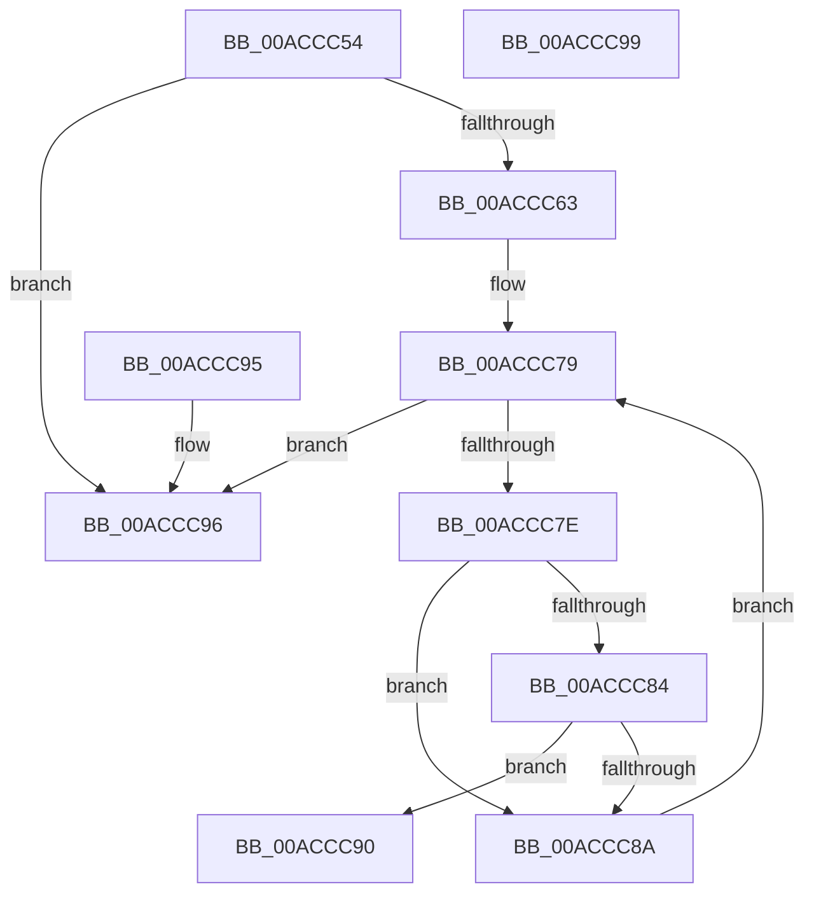

# AlpcpLocateMessageLog

- RVA: `0x00ACCC54`–`0x00ACCC9A` (길이 `70` bytes)
- VA: `0x0000000140ACCC54`
- 실행 섹션: `PAGE`
- PDB 이름 있음: `예`; PDB Function 태그: `아니요`
- unwind 정보 RVA: `0x000DB714`
- 디코드: `24`개 명령, `70/70` bytes 표시
- 미해석 바이트: `0` (있으면 어셈블리에 `.byte`로 보존)

> 이 문서는 커널 이미지의 기계어와 PDB 기호를 분석해 생성했습니다. 4번과 5번은 함수 원형과 자료형을 바이너리 사용 방식에서 추정한 C 해석이며 원본 소스 복구 결과는 아닙니다.

## 1. Dependencies

- 직접 호출 지점: **0**; 고유 호출 대상: **0**
- 직접 호출자로 확인된 함수: **2**
- RIP 상대 이미지 참조: **1**

### Outgoing calls
- 직접 디코드된 call 명령이 없습니다.

### Direct callers
- [AlpcpEnterStateChangeEventMessageLog](../89/AlpcpEnterStateChangeEventMessageLog_function_00897CF8.md) at `0x00897D4C`
- [AlpcpEnterFreeEventMessageLog](AlpcpEnterFreeEventMessageLog_function_00ACCBB8.md) at `0x00ACCC06`

### Static image references
- `0x00ACCC54` → RVA `0x00F100A0` (`.data`; read)

## 2. Other-region calls and transfers

- 다른 실행 섹션으로 향하는 call: **0**
- 별도 외부 분기/꼬리 이동을 확인하지 못했습니다.

## 3. Assembly (complete function range)

```asm
00ACCC54  48 8B 15 45 34 44 00            mov rdx, qword ptr [rip + 0x443445]
00ACCC5B  44 8B C1                        mov r8d, ecx
00ACCC5E  48 85 D2                        test rdx, rdx
00ACCC61  74 33                           je 0x140accc96
00ACCC63  8B C1                           mov eax, ecx
00ACCC65  48 C1 E8 02                     shr rax, 2
00ACCC69  25 FF 03 00 00                  and eax, 0x3ff
00ACCC6E  48 C1 E0 04                     shl rax, 4
00ACCC72  48 03 C2                        add rax, rdx
00ACCC75  48 8B 48 08                     mov rcx, qword ptr [rax + 8]
00ACCC79  48 3B C8                        cmp rcx, rax
00ACCC7C  74 18                           je 0x140accc96
00ACCC7E  83 79 1C 00                     cmp dword ptr [rcx + 0x1c], 0
00ACCC82  74 06                           je 0x140accc8a
00ACCC84  44 39 41 18                     cmp dword ptr [rcx + 0x18], r8d
00ACCC88  74 06                           je 0x140accc90
00ACCC8A  48 8B 49 08                     mov rcx, qword ptr [rcx + 8]
00ACCC8E  EB E9                           jmp 0x140accc79
00ACCC90  48 8D 41 F0                     lea rax, [rcx - 0x10]
00ACCC94  C3                              ret
00ACCC95  CC                              int3
00ACCC96  33 C0                           xor eax, eax
00ACCC98  C3                              ret
00ACCC99  CC                              int3
```

## 4. C-style interpretation (structured pseudocode)

```c
__int64 __fastcall AlpcpLocateMessageLog(int a1)
{
    __int64 result;

    if (*(unsigned __int64 *)(v_rip + 4469829) == 0) goto loc_00ACCC96;
    result = ((unsigned int)(a1)) >> (2);
    result = (unsigned int)((result) & (0x3FFULL));
    result = (result) << (4);
    result = (result) + (*(unsigned __int64 *)(v_rip + 4469829));
loc_00ACCC79:
    if ((*(unsigned __int64 *)(result + 8)) == result) goto loc_00ACCC96;
    if ((*(unsigned int *)(*(unsigned __int64 *)(result + 8) + 28)) == 0) goto loc_00ACCC8A;
    if ((*(unsigned int *)(*(unsigned __int64 *)(result + 8) + 24)) == ((unsigned int)((unsigned int)(a1)))) goto loc_00ACCC90;
loc_00ACCC8A:
    goto loc_00ACCC79;
loc_00ACCC90:
    return *(unsigned __int64 *)(*(unsigned __int64 *)(result + 8) + 8) - 16;
loc_00ACCC96:
    result = 0;
    return result;
}
```

## 5. (Beta) C Style

```c
int64_t AlpcpLocateMessageLog(int32_t Arg1)
{
    int64_t result;

    if (*(uint64_t *)(v_rip + 0x443445) == 0) goto loc_00ACCC96;
    result = ((uint32_t)(Arg1)) >> (2);
    result = (uint32_t)((result) & (0x3FFULL));
    result = (result) << (4);
    result = (result) + (*(uint64_t *)(v_rip + 0x443445));
loc_00ACCC79:
    if ((*(uint64_t *)(result + 0x8)) == result) goto loc_00ACCC96;
    if ((*(uint32_t *)(*(uint64_t *)(result + 0x8) + 0x1C)) == 0) goto loc_00ACCC8A;
    if ((*(uint32_t *)(*(uint64_t *)(result + 0x8) + 0x18)) == ((uint32_t)((uint32_t)(Arg1)))) goto loc_00ACCC90;
loc_00ACCC8A:
    goto loc_00ACCC79;
loc_00ACCC90:
    return *(uint64_t *)(*(uint64_t *)(result + 0x8) + 0x8) - 16;
loc_00ACCC96:
    result = 0;
    return result;
}
```

## 6. Execution-region graph

[열기: 2D/3D 그래프와 함수 탐색 컨트롤 패널](../../../control-panel.html?section=page&rva=0x00ACCC54&view=graph)

- 2D 그래프는 위에서 아래로 흐르고, 3D 그래프는 빈 공간을 드래그해 회전합니다. Shift+드래그는 이동, 휠은 확대·축소, 함수 노드 선택은 대상 보고서 이동입니다.

### Static fallback


