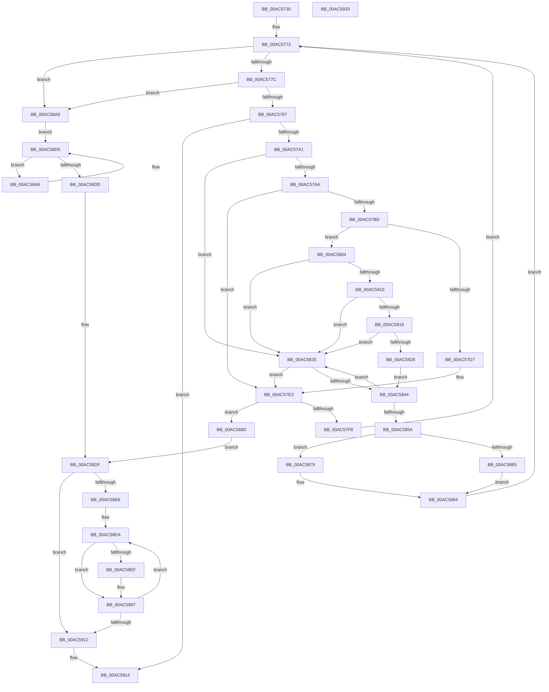

# ArbAllocateEntry

- RVA: `0x00AC5730`–`0x00AC5934` (길이 `516` bytes)
- VA: `0x0000000140AC5730`
- 실행 섹션: `PAGE`
- PDB 이름 있음: `예`; PDB Function 태그: `아니요`
- unwind 정보 RVA: `0x0008A350`
- 디코드: `135`개 명령, `516/516` bytes 표시
- 미해석 바이트: `0` (있으면 어셈블리에 `.byte`로 보존)

> 이 문서는 커널 이미지의 기계어와 PDB 기호를 분석해 생성했습니다. 4번과 5번은 함수 원형과 자료형을 바이너리 사용 방식에서 추정한 C 해석이며 원본 소스 복구 결과는 아닙니다.

## 1. Dependencies

- 직접 호출 지점: **7**; 고유 호출 대상: **2**
- 직접 호출자로 확인된 함수: **0**
- RIP 상대 이미지 참조: **0**

### Outgoing calls
- `0x00AC5794` → [guard_dispatch_icall](../../text/6B/guard_dispatch_icall_function_006BAAD0.md) (function, `0x006BAAD0`)
- `0x00AC57CA` → [guard_dispatch_icall](../../text/6B/guard_dispatch_icall_function_006BAAD0.md) (function, `0x006BAAD0`)
- `0x00AC583B` → [guard_dispatch_icall](../../text/6B/guard_dispatch_icall_function_006BAAD0.md) (function, `0x006BAAD0`)
- `0x00AC5851` → [guard_dispatch_icall](../../text/6B/guard_dispatch_icall_function_006BAAD0.md) (function, `0x006BAAD0`)
- `0x00AC5872` → [guard_dispatch_icall](../../text/6B/guard_dispatch_icall_function_006BAAD0.md) (function, `0x006BAAD0`)
- `0x00AC58BD` → [guard_dispatch_icall](../../text/6B/guard_dispatch_icall_function_006BAAD0.md) (function, `0x006BAAD0`)
- `0x00AC58F5` → [ExFreePoolWithTag](../../poolcode/B8/ExFreePoolWithTag_function_00B82870.md) (function, `0x00B82870`)

### Direct callers
- 이 함수 시작 RVA로 연결되는 직접 call은 확인되지 않았습니다. 간접 호출은 완전히 역산할 수 없습니다.

### Static image references
- 디코드된 RIP-relative 메모리 참조가 없습니다.

## 2. Other-region calls and transfers

- 다른 실행 섹션으로 향하는 call: **7**
  - `0x00AC5794` → [guard_dispatch_icall](../../text/6B/guard_dispatch_icall_function_006BAAD0.md) (`PAGE` → `.text`)
  - `0x00AC57CA` → [guard_dispatch_icall](../../text/6B/guard_dispatch_icall_function_006BAAD0.md) (`PAGE` → `.text`)
  - `0x00AC583B` → [guard_dispatch_icall](../../text/6B/guard_dispatch_icall_function_006BAAD0.md) (`PAGE` → `.text`)
  - `0x00AC5851` → [guard_dispatch_icall](../../text/6B/guard_dispatch_icall_function_006BAAD0.md) (`PAGE` → `.text`)
  - `0x00AC5872` → [guard_dispatch_icall](../../text/6B/guard_dispatch_icall_function_006BAAD0.md) (`PAGE` → `.text`)
  - `0x00AC58BD` → [guard_dispatch_icall](../../text/6B/guard_dispatch_icall_function_006BAAD0.md) (`PAGE` → `.text`)
  - `0x00AC58F5` → [ExFreePoolWithTag](../../poolcode/B8/ExFreePoolWithTag_function_00B82870.md) (`PAGE` → `POOLCODE`)
- 별도 외부 분기/꼬리 이동을 확인하지 못했습니다.

## 3. Assembly (complete function range)

```asm
00AC5730  48 8B C4                        mov rax, rsp
00AC5733  48 89 58 08                     mov qword ptr [rax + 8], rbx
00AC5737  48 89 68 10                     mov qword ptr [rax + 0x10], rbp
00AC573B  48 89 70 18                     mov qword ptr [rax + 0x18], rsi
00AC573F  48 89 78 20                     mov qword ptr [rax + 0x20], rdi
00AC5743  41 55                           push r13
00AC5745  41 56                           push r14
00AC5747  41 57                           push r15
00AC5749  48 83 EC 20                     sub rsp, 0x20
00AC574D  48 A1 08 00 00 00 80 F7 FF FF   movabs rax, qword ptr [0xfffff78000000008]
00AC5757  45 32 F6                        xor r14b, r14b
00AC575A  48 8B F2                        mov rsi, rdx
00AC575D  48 8B E9                        mov rbp, rcx
00AC5760  48 8B DA                        mov rbx, rdx
00AC5763  40 32 FF                        xor dil, dil
00AC5766  41 BD 01 00 00 00               mov r13d, 1
00AC576C  4C 8D B8 80 96 98 00            lea r15, [rax + 0x989680]
00AC5773  48 3B DE                        cmp rbx, rsi
00AC5776  0F 82 24 01 00 00               jb 0x140ac58a0
00AC577C  48 83 7B 20 00                  cmp qword ptr [rbx + 0x20], 0
00AC5781  0F 84 19 01 00 00               je 0x140ac58a0
00AC5787  48 8B 85 E0 00 00 00            mov rax, qword ptr [rbp + 0xe0]
00AC578E  48 8B D3                        mov rdx, rbx
00AC5791  48 8B CD                        mov rcx, rbp
00AC5794  E8 37 53 BF FF                  call 0x1406baad0
00AC5799  85 C0                           test eax, eax
00AC579B  0F 88 73 01 00 00               js 0x140ac5914
00AC57A1  45 84 F6                        test r14b, r14b
00AC57A4  0F 84 84 00 00 00               je 0x140ac582e
00AC57AA  48 8B 43 28                     mov rax, qword ptr [rbx + 0x28]
00AC57AE  45 32 F6                        xor r14b, r14b
00AC57B1  48 83 63 78 00                  and qword ptr [rbx + 0x78], 0
00AC57B6  48 83 78 10 00                  cmp qword ptr [rax + 0x10], 0
00AC57BB  74 26                           je 0x140ac57e3
00AC57BD  48 8B 85 08 01 00 00            mov rax, qword ptr [rbp + 0x108]
00AC57C4  48 8B D3                        mov rdx, rbx
00AC57C7  48 8B CD                        mov rcx, rbp
00AC57CA  E8 01 53 BF FF                  call 0x1406baad0
00AC57CF  0F B7 43 40                     movzx eax, word ptr [rbx + 0x40]
00AC57D3  A8 40                           test al, 0x40
00AC57D5  74 2D                           je 0x140ac5804
00AC57D7  B9 BF FF 00 00                  mov ecx, 0xffbf
00AC57DC  66 23 C1                        and ax, cx
00AC57DF  66 89 43 40                     mov word ptr [rbx + 0x40], ax
00AC57E3  F6 43 40 20                     test byte ptr [rbx + 0x40], 0x20
00AC57E7  40 0F B6 FF                     movzx edi, dil
00AC57EB  41 0F 45 FD                     cmovne edi, r13d
00AC57EF  48 3B DE                        cmp rbx, rsi
00AC57F2  0F 84 95 00 00 00               je 0x140ac588d
00AC57F8  45 8A F5                        mov r14b, r13b
00AC57FB  48 83 EB 50                     sub rbx, 0x50
00AC57FF  E9 6F FF FF FF                  jmp 0x140ac5773
00AC5804  48 8B 03                        mov rax, qword ptr [rbx]
00AC5807  48 8D 48 FF                     lea rcx, [rax - 1]
00AC580B  48 3B C8                        cmp rcx, rax
00AC580E  77 1E                           ja 0x140ac582e
00AC5810  48 8B 43 28                     mov rax, qword ptr [rbx + 0x28]
00AC5814  48 3B 08                        cmp rcx, qword ptr [rax]
00AC5817  72 15                           jb 0x140ac582e
00AC5819  48 A1 08 00 00 00 80 F7 FF FF   movabs rax, qword ptr [0xfffff78000000008]
00AC5823  49 3B C7                        cmp rax, r15
00AC5826  77 06                           ja 0x140ac582e
00AC5828  48 89 4B 18                     mov qword ptr [rbx + 0x18], rcx
00AC582C  EB 16                           jmp 0x140ac5844
00AC582E  48 8B 85 F0 00 00 00            mov rax, qword ptr [rbp + 0xf0]
00AC5835  48 8B D3                        mov rdx, rbx
00AC5838  48 8B CD                        mov rcx, rbp
00AC583B  E8 90 52 BF FF                  call 0x1406baad0
00AC5840  84 C0                           test al, al
00AC5842  74 9F                           je 0x140ac57e3
00AC5844  48 8B 85 F8 00 00 00            mov rax, qword ptr [rbp + 0xf8]
00AC584B  48 8B D3                        mov rdx, rbx
00AC584E  48 8B CD                        mov rcx, rbp
00AC5851  E8 7A 52 BF FF                  call 0x1406baad0
00AC5856  84 C0                           test al, al
00AC5858  74 D4                           je 0x140ac582e
00AC585A  48 8B 43 28                     mov rax, qword ptr [rbx + 0x28]
00AC585E  48 83 78 10 00                  cmp qword ptr [rax + 0x10], 0
00AC5863  74 14                           je 0x140ac5879
00AC5865  48 8B 85 00 01 00 00            mov rax, qword ptr [rbp + 0x100]
00AC586C  48 8B D3                        mov rdx, rbx
00AC586F  48 8B CD                        mov rcx, rbp
00AC5872  E8 59 52 BF FF                  call 0x1406baad0
00AC5877  EB 0B                           jmp 0x140ac5884
00AC5879  48 8B 43 20                     mov rax, qword ptr [rbx + 0x20]
00AC587D  C7 40 58 02 00 00 00            mov dword ptr [rax + 0x58], 2
00AC5884  48 83 C3 50                     add rbx, 0x50
00AC5888  E9 E6 FE FF FF                  jmp 0x140ac5773
00AC588D  40 F6 DF                        neg dil
00AC5890  1B FF                           sbb edi, edi
00AC5892  81 E7 07 09 00 00               and edi, 0x907
00AC5898  81 C7 01 00 00 C0               add edi, 0xc0000001
00AC589E  EB 3F                           jmp 0x140ac58df
00AC58A0  48 8D 5E 20                     lea rbx, [rsi + 0x20]
00AC58A4  EB 2F                           jmp 0x140ac58d5
00AC58A6  48 8B 4B 08                     mov rcx, qword ptr [rbx + 8]
00AC58AA  4C 8B 42 48                     mov r8, qword ptr [rdx + 0x48]
00AC58AE  48 8B 85 80 00 00 00            mov rax, qword ptr [rbp + 0x80]
00AC58B5  48 8B 53 E0                     mov rdx, qword ptr [rbx - 0x20]
00AC58B9  48 8B 49 28                     mov rcx, qword ptr [rcx + 0x28]
00AC58BD  E8 0E 52 BF FF                  call 0x1406baad0
00AC58C2  48 8B 43 08                     mov rax, qword ptr [rbx + 8]
00AC58C6  48 8B 0B                        mov rcx, qword ptr [rbx]
00AC58C9  48 8D 5B 50                     lea rbx, [rbx + 0x50]
00AC58CD  48 8B 40 28                     mov rax, qword ptr [rax + 0x28]
00AC58D1  48 89 41 50                     mov qword ptr [rcx + 0x50], rax
00AC58D5  48 8B 13                        mov rdx, qword ptr [rbx]
00AC58D8  48 85 D2                        test rdx, rdx
00AC58DB  75 C9                           jne 0x140ac58a6
00AC58DD  33 FF                           xor edi, edi
00AC58DF  48 83 7E 20 00                  cmp qword ptr [rsi + 0x20], 0
00AC58E4  74 2C                           je 0x140ac5912
00AC58E6  48 8D 5E 40                     lea rbx, [rsi + 0x40]
00AC58EA  F6 03 10                        test byte ptr [rbx], 0x10
00AC58ED  74 18                           je 0x140ac5907
00AC58EF  48 8B 4B 08                     mov rcx, qword ptr [rbx + 8]
00AC58F3  33 D2                           xor edx, edx
00AC58F5  E8 76 CF 0B 00                  call 0x140b82870
00AC58FA  48 83 63 08 00                  and qword ptr [rbx + 8], 0
00AC58FF  B8 EF FF 00 00                  mov eax, 0xffef
00AC5904  66 21 03                        and word ptr [rbx], ax
00AC5907  48 83 C3 50                     add rbx, 0x50
00AC590B  48 83 7B E0 00                  cmp qword ptr [rbx - 0x20], 0
00AC5910  75 D8                           jne 0x140ac58ea
00AC5912  8B C7                           mov eax, edi
00AC5914  48 8B 5C 24 40                  mov rbx, qword ptr [rsp + 0x40]
00AC5919  48 8B 6C 24 48                  mov rbp, qword ptr [rsp + 0x48]
00AC591E  48 8B 74 24 50                  mov rsi, qword ptr [rsp + 0x50]
00AC5923  48 8B 7C 24 58                  mov rdi, qword ptr [rsp + 0x58]
00AC5928  48 83 C4 20                     add rsp, 0x20
00AC592C  41 5F                           pop r15
00AC592E  41 5E                           pop r14
00AC5930  41 5D                           pop r13
00AC5932  C3                              ret
00AC5933  CC                              int3
```

## 4. C-style interpretation (structured pseudocode)

```c
__int64 __fastcall ArbAllocateEntry(__int64 a1, __int64 a2)
{
    __int64 result;
    __int64 v_r14;
    __int64 v_rbx;
    __int64 v_rdi;
    __int64 v_rsp;
    unsigned __int64 v_stack_p10;
    unsigned __int64 v_stack_p18;
    unsigned __int64 v_stack_p20;
    unsigned __int64 v_stack_p8;

    *(unsigned __int64 *)(v_rsp + 8) = v_rbx;
    *(unsigned __int64 *)(v_rsp + 16) = v_rbp;
    *(unsigned __int64 *)(v_rsp + 24) = v_rsi;
    *(unsigned __int64 *)(v_rsp + 32) = v_rdi;
    v_rsp = (v_rsp) - (32);
    v_r14 = 0;
    v_rdi = 0;
loc_00AC5773:
    if (a2 < a2) goto loc_00AC58A0;
    if ((*(unsigned __int64 *)(a2 + 32)) == 0) goto loc_00AC58A0;
    result = guard_dispatch_icall(a1, a2, a3, a4);
    if (sign_flag) goto loc_00AC5914;
    if (0 == 0) goto loc_00AC582E;
    v_r14 = 0;
    if ((*(unsigned __int64 *)(*(unsigned __int64 *)(a2 + 40) + 16)) == 0) goto loc_00AC57E3;
    result = guard_dispatch_icall(a1, a2, a3, a4);
    if ((((unsigned __int8)(*(unsigned __int16 *)(a2 + 64))) & (64)) == 0) goto loc_00AC5804;
    result = (unsigned __int16)((*(unsigned __int16 *)(a2 + 64)) & ((unsigned __int16)((unsigned int)(0xFFBFULL))));
    *(unsigned __int16 *)(a2 + 64) = (unsigned __int16)(result);
loc_00AC57E3:
    v_rdi = 0;
    if (((*(unsigned __int8 *)(a2 + 64)) & (32)) != 0) { v_rdi = 1; }
    if (a2 == a2) goto loc_00AC588D;
    v_rbx = (a2) - (80);
    goto loc_00AC5773;
loc_00AC5804:
    if ((*(unsigned __int64 *)(v_rbx) - 1) > (*(unsigned __int64 *)(v_rbx))) goto loc_00AC582E;
    if ((*(unsigned __int64 *)(v_rbx) - 1) < (*(unsigned __int64 *)(*(unsigned __int64 *)(v_rbx + 40)))) goto loc_00AC582E;
    if ((*(unsigned __int64 *)(v_rbx + 40)) > (v_rsp + 10000000)) goto loc_00AC582E;
    *(unsigned __int64 *)(v_rbx + 24) = *(unsigned __int64 *)(v_rbx) - 1;
    goto loc_00AC5844;
loc_00AC582E:
    result = guard_dispatch_icall(a1, v_rbx, a3, a4);
    if ((unsigned __int8)(result) == 0) goto loc_00AC57E3;
loc_00AC5844:
    result = guard_dispatch_icall(a1, v_rbx, a3, a4);
    if ((unsigned __int8)(result) == 0) goto loc_00AC582E;
    if ((*(unsigned __int64 *)(*(unsigned __int64 *)(v_rbx + 40) + 16)) == 0) goto loc_00AC5879;
    result = guard_dispatch_icall(a1, v_rbx, a3, a4);
    goto loc_00AC5884;
loc_00AC5879:
    *(unsigned int *)(*(unsigned __int64 *)(v_rbx + 32) + 88) = 2;
loc_00AC5884:
    v_rbx = (v_rbx) + (80);
    goto loc_00AC5773;
loc_00AC588D:
    v_rdi = (unsigned __int8)(-(v_rdi));
    v_rdi = (unsigned int)((v_rdi) & (0x907ULL));
    v_rdi = (unsigned int)((v_rdi) + (0xC0000001ULL));
    goto loc_00AC58DF;
loc_00AC58A0:
    goto loc_00AC58D5;
loc_00AC58A6:
    result = guard_dispatch_icall(*(unsigned __int64 *)(*(unsigned __int64 *)(a2 + 32 + 8) + 40), *(unsigned __int64 *)(a2 + 32 - 32), *(unsigned __int64 *)(v_rbx + 72), a4);
    *(unsigned __int64 *)(*(unsigned __int64 *)(a2 + 32) + 80) = *(unsigned __int64 *)(*(unsigned __int64 *)(a2 + 32 + 8) + 40);
loc_00AC58D5:
    if (*(unsigned __int64 *)(a2 + 32 + 80) != 0) goto loc_00AC58A6;
    v_rdi = 0;
loc_00AC58DF:
    if ((*(unsigned __int64 *)(a2 + 32)) == 0) goto loc_00AC5912;
loc_00AC58EA:
    result = *(unsigned __int64 *)(*(unsigned __int64 *)(a2 + 32 + 8) + 40);
    if (((*(unsigned __int8 *)(a2 + 64)) & (16)) != 0) {
        a1 = *(unsigned __int64 *)(a2 + 64 + 8);
        a2 = 0;
        result = ExFreePoolWithTag(a1, a2, *(unsigned __int64 *)(v_rbx + 72), a4);
        result = 0xFFEFULL;
    }
    v_rbx = (a2 + 64) + (80);
    if ((*(unsigned __int64 *)(v_rbx - 32)) != 0) goto loc_00AC58EA;
loc_00AC5912:
loc_00AC5914:
    v_rsp = (v_rsp) + (32);
    return 0;
}
```

## 5. (Beta) C Style

```c
int64_t ArbAllocateEntry(void *Arg1, void *Arg2)
{
    uint8_t *arg1 = (uint8_t *)Arg1;
    uint8_t *arg2 = (uint8_t *)Arg2;

    int64_t result;
    int64_t local_r14;
    int64_t local_rbx;
    int64_t local_rdi;
    int64_t local_rsp;
    uint64_t v_stack_p10;
    uint64_t v_stack_p18;
    uint64_t v_stack_p20;
    uint64_t v_stack_p8;

    *(uint64_t *)(local_rsp + 0x8) = local_rbx;
    *(uint64_t *)(local_rsp + 0x10) = local_rbp;
    *(uint64_t *)(local_rsp + 0x18) = local_rsi;
    *(uint64_t *)(local_rsp + 0x20) = local_rdi;
    local_rsp = (local_rsp) - (32);
    local_r14 = 0;
    local_rdi = 0;
loc_00AC5773:
    if (Arg2 < Arg2) goto loc_00AC58A0;
    if ((*(uint64_t *)(arg2 + 0x20)) == 0) goto loc_00AC58A0;
    result = guard_dispatch_icall(Arg1, Arg2, a3, a4);
    if (sign_flag) goto loc_00AC5914;
    if (0 == 0) goto loc_00AC582E;
    local_r14 = 0;
    if ((*(uint64_t *)(*(uint64_t *)(arg2 + 0x28) + 0x10)) == 0) goto loc_00AC57E3;
    result = guard_dispatch_icall(Arg1, Arg2, a3, a4);
    if ((((uint8_t)(*(uint16_t *)(arg2 + 0x40))) & (64)) == 0) goto loc_00AC5804;
    result = (uint16_t)((*(uint16_t *)(arg2 + 0x40)) & ((uint16_t)((uint32_t)(0xFFBFULL))));
    *(uint16_t *)(arg2 + 0x40) = (uint16_t)(result);
loc_00AC57E3:
    local_rdi = 0;
    if (((*(uint8_t *)(arg2 + 0x40)) & (32)) != 0) { local_rdi = 1; }
    if (Arg2 == Arg2) goto loc_00AC588D;
    local_rbx = (Arg2) - (80);
    goto loc_00AC5773;
loc_00AC5804:
    if ((*(uint64_t *)(local_rbx) - 1) > (*(uint64_t *)(local_rbx))) goto loc_00AC582E;
    if ((*(uint64_t *)(local_rbx) - 1) < (*(uint64_t *)(*(uint64_t *)(local_rbx + 0x28)))) goto loc_00AC582E;
    if ((*(uint64_t *)(local_rbx + 0x28)) > (local_rsp + 10000000)) goto loc_00AC582E;
    *(uint64_t *)(local_rbx + 0x18) = *(uint64_t *)(local_rbx) - 1;
    goto loc_00AC5844;
loc_00AC582E:
    result = guard_dispatch_icall(Arg1, local_rbx, a3, a4);
    if ((uint8_t)(result) == 0) goto loc_00AC57E3;
loc_00AC5844:
    result = guard_dispatch_icall(Arg1, local_rbx, a3, a4);
    if ((uint8_t)(result) == 0) goto loc_00AC582E;
    if ((*(uint64_t *)(*(uint64_t *)(local_rbx + 0x28) + 0x10)) == 0) goto loc_00AC5879;
    result = guard_dispatch_icall(Arg1, local_rbx, a3, a4);
    goto loc_00AC5884;
loc_00AC5879:
    *(uint32_t *)(*(uint64_t *)(local_rbx + 0x20) + 0x58) = 2;
loc_00AC5884:
    local_rbx = (local_rbx) + (80);
    goto loc_00AC5773;
loc_00AC588D:
    local_rdi = (uint8_t)(-(local_rdi));
    local_rdi = (uint32_t)((local_rdi) & (0x907ULL));
    local_rdi = (uint32_t)((local_rdi) + (0xC0000001ULL));
    goto loc_00AC58DF;
loc_00AC58A0:
    goto loc_00AC58D5;
loc_00AC58A6:
    result = guard_dispatch_icall(*(uint64_t *)(*(uint64_t *)(arg2 + 0x20 + 0x8) + 0x28), *(uint64_t *)(arg2 + 0x20 - 0x20), *(uint64_t *)(local_rbx + 0x48), a4);
    *(uint64_t *)(*(uint64_t *)(arg2 + 0x20) + 0x50) = *(uint64_t *)(*(uint64_t *)(arg2 + 0x20 + 0x8) + 0x28);
loc_00AC58D5:
    if (*(uint64_t *)(arg2 + 0x20 + 0x50) != 0) goto loc_00AC58A6;
    local_rdi = 0;
loc_00AC58DF:
    if ((*(uint64_t *)(arg2 + 0x20)) == 0) goto loc_00AC5912;
loc_00AC58EA:
    result = *(uint64_t *)(*(uint64_t *)(arg2 + 0x20 + 0x8) + 0x28);
    if (((*(uint8_t *)(arg2 + 0x40)) & (16)) != 0) {
        Arg1 = *(uint64_t *)(arg2 + 0x40 + 0x8);
        Arg2 = 0;
        result = ExFreePoolWithTag(Arg1, Arg2, *(uint64_t *)(local_rbx + 0x48), a4);
        result = 0xFFEFULL;
    }
    local_rbx = (Arg2 + 64) + (80);
    if ((*(uint64_t *)(local_rbx - 0x20)) != 0) goto loc_00AC58EA;
loc_00AC5912:
loc_00AC5914:
    local_rsp = (local_rsp) + (32);
    return 0;
}
```

### 관측된 메모리 오프셋

구조체 형식이 확인되지 않은 접근은 인자 기준의 오프셋으로만 기록했습니다.

| 기준 인자 | 오프셋 표현 | 폭 (bit) | 접근 |
|---|---:|---:|---|
| `Arg1` | `+ 0x80` | `64` | `R` |
| `Arg1` | `+ 0xE0` | `64` | `R` |
| `Arg1` | `+ 0xF0` | `64` | `R` |
| `Arg1` | `+ 0xF8` | `64` | `R` |
| `Arg1` | `+ 0x100` | `64` | `R` |
| `Arg1` | `+ 0x108` | `64` | `R` |
| `Arg2` | `- 0x20` | `64` | `R` |
| `Arg2` | `+ 0x0` | `8` | `R` |
| `Arg2` | `+ 0x0` | `16` | `R/W` |
| `Arg2` | `+ 0x0` | `64` | `R` |
| `Arg2` | `+ 0x8` | `64` | `R` |
| `Arg2` | `+ 0x8` | `64` | `R/W` |
| `Arg2` | `+ 0x20` | `64` | `R` |
| `Arg2` | `+ 0x40` | `64` | `R` |
| `Arg2` | `+ 0x50` | `64` | `R` |

## 6. Execution-region graph

[열기: 2D/3D 그래프와 함수 탐색 컨트롤 패널](../../../control-panel.html?section=page&rva=0x00AC5730&view=graph)

- 2D 그래프는 위에서 아래로 흐르고, 3D 그래프는 빈 공간을 드래그해 회전합니다. Shift+드래그는 이동, 휠은 확대·축소, 함수 노드 선택은 대상 보고서 이동입니다.

### Static fallback


