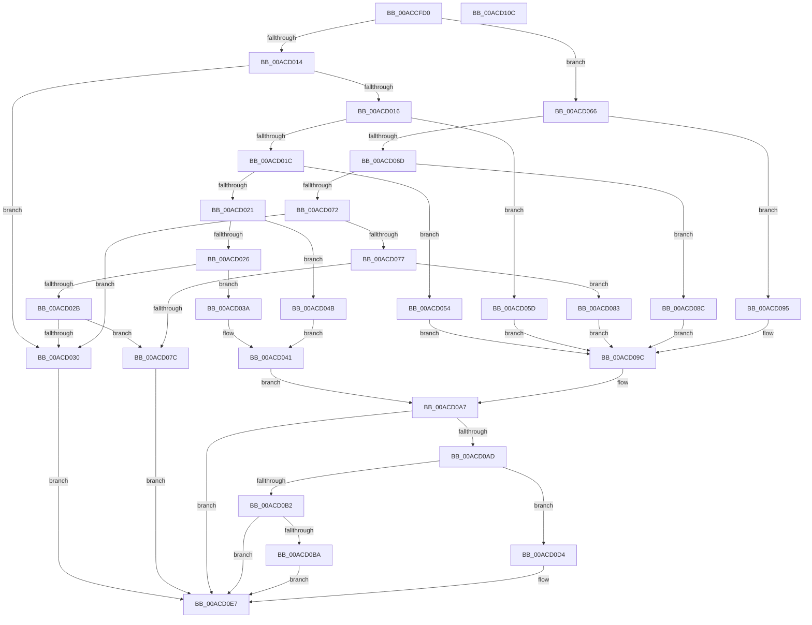

# ArbArbiterHandler

- RVA: `0x00ACCFD0`–`0x00ACD10D` (길이 `317` bytes)
- VA: `0x0000000140ACCFD0`
- 실행 섹션: `PAGE`
- PDB 이름 있음: `예`; PDB Function 태그: `아니요`
- unwind 정보 RVA: `0x000794E0`
- 디코드: `90`개 명령, `317/317` bytes 표시
- 미해석 바이트: `0` (있으면 어셈블리에 `.byte`로 보존)

> 이 문서는 커널 이미지의 기계어와 PDB 기호를 분석해 생성했습니다. 4번과 5번은 함수 원형과 자료형을 바이너리 사용 방식에서 추정한 C 해석이며 원본 소스 복구 결과는 아닙니다.

## 1. Dependencies

- 직접 호출 지점: **7**; 고유 호출 대상: **5**
- 직접 호출자로 확인된 함수: **0**
- RIP 상대 이미지 참조: **0**

### Outgoing calls
- `0x00ACD00A` → [KeWaitForSingleObject](../../text/20/KeWaitForSingleObject_function_0020E6B0.md) (function, `0x0020E6B0`)
- `0x00ACD044` → [guard_dispatch_icall](../../text/6B/guard_dispatch_icall_function_006BAAD0.md) (function, `0x006BAAD0`)
- `0x00ACD0A2` → [guard_dispatch_icall](../../text/6B/guard_dispatch_icall_function_006BAAD0.md) (function, `0x006BAAD0`)
- `0x00ACD0CD` → [KeSetEvent](../../text/33/KeSetEvent_function_0033F310.md) (function, `0x0033F310`)
- `0x00ACD0E2` → [KeResetEvent](../../text/24/KeResetEvent_function_00248350.md) (function, `0x00248350`)
- `0x00ACD0F0` → [KeSetEvent](../../text/33/KeSetEvent_function_0033F310.md) (function, `0x0033F310`)
- `0x00ACD0F5` → [KeLeaveCriticalRegion](../../text/25/KeLeaveCriticalRegion_function_0025D8B0.md) (function, `0x0025D8B0`)

### Direct callers
- 이 함수 시작 RVA로 연결되는 직접 call은 확인되지 않았습니다. 간접 호출은 완전히 역산할 수 없습니다.

### Static image references
- 디코드된 RIP-relative 메모리 참조가 없습니다.

## 2. Other-region calls and transfers

- 다른 실행 섹션으로 향하는 call: **7**
  - `0x00ACD00A` → [KeWaitForSingleObject](../../text/20/KeWaitForSingleObject_function_0020E6B0.md) (`PAGE` → `.text`)
  - `0x00ACD044` → [guard_dispatch_icall](../../text/6B/guard_dispatch_icall_function_006BAAD0.md) (`PAGE` → `.text`)
  - `0x00ACD0A2` → [guard_dispatch_icall](../../text/6B/guard_dispatch_icall_function_006BAAD0.md) (`PAGE` → `.text`)
  - `0x00ACD0CD` → [KeSetEvent](../../text/33/KeSetEvent_function_0033F310.md) (`PAGE` → `.text`)
  - `0x00ACD0E2` → [KeResetEvent](../../text/24/KeResetEvent_function_00248350.md) (`PAGE` → `.text`)
  - `0x00ACD0F0` → [KeSetEvent](../../text/33/KeSetEvent_function_0033F310.md) (`PAGE` → `.text`)
  - `0x00ACD0F5` → [KeLeaveCriticalRegion](../../text/25/KeLeaveCriticalRegion_function_0025D8B0.md) (`PAGE` → `.text`)
- 별도 외부 분기/꼬리 이동을 확인하지 못했습니다.

## 3. Assembly (complete function range)

```asm
00ACCFD0  48 89 5C 24 08                  mov qword ptr [rsp + 8], rbx
00ACCFD5  48 89 74 24 10                  mov qword ptr [rsp + 0x10], rsi
00ACCFDA  57                              push rdi
00ACCFDB  48 83 EC 30                     sub rsp, 0x30
00ACCFDF  65 48 8B 04 25 88 01 00 00      mov rax, qword ptr gs:[0x188]
00ACCFE8  49 8B F8                        mov rdi, r8
00ACCFEB  48 83 64 24 20 00               and qword ptr [rsp + 0x20], 0
00ACCFF1  8B F2                           mov esi, edx
00ACCFF3  48 8B D9                        mov rbx, rcx
00ACCFF6  45 33 C9                        xor r9d, r9d
00ACCFF9  45 33 C0                        xor r8d, r8d
00ACCFFC  33 D2                           xor edx, edx
00ACCFFE  66 FF 88 E4 01 00 00            dec word ptr [rax + 0x1e4]
00ACD005  90                              nop
00ACD006  48 8B 49 08                     mov rcx, qword ptr [rcx + 8]
00ACD00A  E8 A1 16 74 FF                  call 0x14020e6b0
00ACD00F  83 FE 05                        cmp esi, 5
00ACD012  7F 52                           jg 0x140acd066
00ACD014  74 1A                           je 0x140acd030
00ACD016  8B CE                           mov ecx, esi
00ACD018  85 F6                           test esi, esi
00ACD01A  74 41                           je 0x140acd05d
00ACD01C  83 E9 01                        sub ecx, 1
00ACD01F  74 33                           je 0x140acd054
00ACD021  83 E9 01                        sub ecx, 1
00ACD024  74 25                           je 0x140acd04b
00ACD026  83 E9 01                        sub ecx, 1
00ACD029  74 0F                           je 0x140acd03a
00ACD02B  83 F9 01                        cmp ecx, 1
00ACD02E  75 4C                           jne 0x140acd07c
00ACD030  BF 02 00 00 C0                  mov edi, 0xc0000002
00ACD035  E9 AD 00 00 00                  jmp 0x140acd0e7
00ACD03A  48 8B 83 B0 00 00 00            mov rax, qword ptr [rbx + 0xb0]
00ACD041  48 8B CB                        mov rcx, rbx
00ACD044  E8 87 DA BE FF                  call 0x1406baad0
00ACD049  EB 5C                           jmp 0x140acd0a7
00ACD04B  48 8B 83 A8 00 00 00            mov rax, qword ptr [rbx + 0xa8]
00ACD052  EB ED                           jmp 0x140acd041
00ACD054  48 8B 83 A0 00 00 00            mov rax, qword ptr [rbx + 0xa0]
00ACD05B  EB 3F                           jmp 0x140acd09c
00ACD05D  48 8B 83 98 00 00 00            mov rax, qword ptr [rbx + 0x98]
00ACD064  EB 36                           jmp 0x140acd09c
00ACD066  8B CE                           mov ecx, esi
00ACD068  83 E9 06                        sub ecx, 6
00ACD06B  74 28                           je 0x140acd095
00ACD06D  83 E9 01                        sub ecx, 1
00ACD070  74 1A                           je 0x140acd08c
00ACD072  83 E9 01                        sub ecx, 1
00ACD075  74 B9                           je 0x140acd030
00ACD077  83 F9 01                        cmp ecx, 1
00ACD07A  74 07                           je 0x140acd083
00ACD07C  BF 0D 00 00 C0                  mov edi, 0xc000000d
00ACD081  EB 64                           jmp 0x140acd0e7
00ACD083  48 8B 83 B8 00 00 00            mov rax, qword ptr [rbx + 0xb8]
00ACD08A  EB 10                           jmp 0x140acd09c
00ACD08C  48 8B 83 C0 00 00 00            mov rax, qword ptr [rbx + 0xc0]
00ACD093  EB 07                           jmp 0x140acd09c
00ACD095  48 8B 83 C8 00 00 00            mov rax, qword ptr [rbx + 0xc8]
00ACD09C  48 8B D7                        mov rdx, rdi
00ACD09F  48 8B CB                        mov rcx, rbx
00ACD0A2  E8 29 DA BE FF                  call 0x1406baad0
00ACD0A7  8B F8                           mov edi, eax
00ACD0A9  85 C0                           test eax, eax
00ACD0AB  78 3A                           js 0x140acd0e7
00ACD0AD  83 FE 01                        cmp esi, 1
00ACD0B0  76 22                           jbe 0x140acd0d4
00ACD0B2  8D 46 FE                        lea eax, [rsi - 2]
00ACD0B5  83 F8 01                        cmp eax, 1
00ACD0B8  77 2D                           ja 0x140acd0e7
00ACD0BA  48 8B 8B 30 01 00 00            mov rcx, qword ptr [rbx + 0x130]
00ACD0C1  45 33 C0                        xor r8d, r8d
00ACD0C4  33 D2                           xor edx, edx
00ACD0C6  C6 83 28 01 00 00 00            mov byte ptr [rbx + 0x128], 0
00ACD0CD  E8 3E 22 87 FF                  call 0x14033f310
00ACD0D2  EB 13                           jmp 0x140acd0e7
00ACD0D4  48 8B 8B 30 01 00 00            mov rcx, qword ptr [rbx + 0x130]
00ACD0DB  C6 83 28 01 00 00 01            mov byte ptr [rbx + 0x128], 1
00ACD0E2  E8 69 B2 77 FF                  call 0x140248350
00ACD0E7  48 8B 4B 08                     mov rcx, qword ptr [rbx + 8]
00ACD0EB  45 33 C0                        xor r8d, r8d
00ACD0EE  33 D2                           xor edx, edx
00ACD0F0  E8 1B 22 87 FF                  call 0x14033f310
00ACD0F5  E8 B6 07 79 FF                  call 0x14025d8b0
00ACD0FA  48 8B 5C 24 40                  mov rbx, qword ptr [rsp + 0x40]
00ACD0FF  8B C7                           mov eax, edi
00ACD101  48 8B 74 24 48                  mov rsi, qword ptr [rsp + 0x48]
00ACD106  48 83 C4 30                     add rsp, 0x30
00ACD10A  5F                              pop rdi
00ACD10B  C3                              ret
00ACD10C  CC                              int3
```

## 4. C-style interpretation (structured pseudocode)

```c
__int64 __fastcall ArbArbiterHandler(__int64 a1, int a2, __int64 a3, int a4)
{
    __int64 result;
    __int64 v_rsp;
    unsigned __int64 v_stack_m18;
    unsigned __int64 v_stack_p10;
    unsigned __int64 v_stack_p8;

    v_stack_p8 = v_rbx;
    v_stack_p10 = v_rsi;
    v_rsp = (v_rsp) - (48);
    a4 = 0;
    a3 = 0;
    a2 = 0;
    result = KeWaitForSingleObject(*(unsigned __int64 *)(a1 + 8), a2, a3, a4);
    if (((unsigned int)((unsigned int)(a2))) > 5) goto loc_00ACD066;
    if (((unsigned int)((unsigned int)(a2))) == 5) goto loc_00ACD030;
    if ((unsigned int)((unsigned int)(a2)) == 0) goto loc_00ACD05D;
    a1 = (unsigned int)(((unsigned int)((unsigned int)((unsigned int)(a2)))) - (1));
    if (condition_is_equal) goto loc_00ACD054;
    a1 = (unsigned int)((a1) - (1));
    if (condition_is_equal) goto loc_00ACD04B;
    a1 = (unsigned int)((a1) - (1));
    if (condition_is_equal) goto loc_00ACD03A;
    if (((unsigned int)(a1)) != 1) goto loc_00ACD07C;
loc_00ACD030:
    goto loc_00ACD0E7;
loc_00ACD03A:
loc_00ACD041:
    result = guard_dispatch_icall(a1, a2, a3, a4);
    goto loc_00ACD0A7;
loc_00ACD04B:
    goto loc_00ACD041;
loc_00ACD054:
    goto loc_00ACD09C;
loc_00ACD05D:
    goto loc_00ACD09C;
loc_00ACD066:
    a1 = (unsigned int)(((unsigned int)((unsigned int)((unsigned int)(a2)))) - (6));
    if (condition_is_equal) goto loc_00ACD095;
    a1 = (unsigned int)((a1) - (1));
    if (condition_is_equal) goto loc_00ACD08C;
    a1 = (unsigned int)((a1) - (1));
    if (condition_is_equal) goto loc_00ACD030;
    if (((unsigned int)(a1)) == 1) goto loc_00ACD083;
loc_00ACD07C:
    goto loc_00ACD0E7;
loc_00ACD083:
    goto loc_00ACD09C;
loc_00ACD08C:
    goto loc_00ACD09C;
loc_00ACD095:
loc_00ACD09C:
    result = guard_dispatch_icall(a1, (unsigned int)(0xC000000DULL), a3, a4);
loc_00ACD0A7:
    if (sign_flag) goto loc_00ACD0E7;
    if (((unsigned int)((unsigned int)(a2))) <= 1) goto loc_00ACD0D4;
    if (((unsigned int)((unsigned int)(a2) - 2)) > 1) goto loc_00ACD0E7;
    a3 = 0;
    a2 = 0;
    *(unsigned __int8 *)(a1 + 296) = 0;
    result = KeSetEvent(*(unsigned __int64 *)(a1 + 304), a2, a3, a4);
    goto loc_00ACD0E7;
loc_00ACD0D4:
    *(unsigned __int8 *)(a1 + 296) = 1;
    result = KeResetEvent(*(unsigned __int64 *)(a1 + 304), a2, a3, a4);
loc_00ACD0E7:
    a3 = 0;
    a2 = 0;
    result = KeSetEvent(*(unsigned __int64 *)(a1 + 8), a2, a3, a4);
    result = KeLeaveCriticalRegion(*(unsigned __int64 *)(a1 + 8), a2, a3, a4);
    v_rsp = (v_rsp) + (48);
    return (unsigned int)((unsigned int)((unsigned int)((unsigned int)(result))));
}
```

## 5. (Beta) C Style

```c
int64_t ArbArbiterHandler(void *Arg1, int32_t Arg2, int64_t Arg3, int32_t Arg4)
{
    uint8_t *arg1 = (uint8_t *)Arg1;

    int64_t result;
    int64_t local_rsp;
    uint64_t v_stack_m18;
    uint64_t v_stack_p10;
    uint64_t v_stack_p8;

    v_stack_p8 = local_rbx;
    v_stack_p10 = local_rsi;
    local_rsp = (local_rsp) - (48);
    Arg4 = 0;
    Arg3 = 0;
    Arg2 = 0;
    result = KeWaitForSingleObject(*(uint64_t *)(arg1 + 0x8), Arg2, Arg3, Arg4);
    if (((uint32_t)((uint32_t)(Arg2))) > 5) goto loc_00ACD066;
    if (((uint32_t)((uint32_t)(Arg2))) == 5) goto loc_00ACD030;
    if ((uint32_t)((uint32_t)(Arg2)) == 0) goto loc_00ACD05D;
    Arg1 = (uint32_t)(((uint32_t)((uint32_t)((uint32_t)(Arg2)))) - (1));
    if (condition_is_equal) goto loc_00ACD054;
    Arg1 = (uint32_t)((Arg1) - (1));
    if (condition_is_equal) goto loc_00ACD04B;
    Arg1 = (uint32_t)((Arg1) - (1));
    if (condition_is_equal) goto loc_00ACD03A;
    if (((uint32_t)(Arg1)) != 1) goto loc_00ACD07C;
loc_00ACD030:
    goto loc_00ACD0E7;
loc_00ACD03A:
loc_00ACD041:
    result = guard_dispatch_icall(Arg1, Arg2, Arg3, Arg4);
    goto loc_00ACD0A7;
loc_00ACD04B:
    goto loc_00ACD041;
loc_00ACD054:
    goto loc_00ACD09C;
loc_00ACD05D:
    goto loc_00ACD09C;
loc_00ACD066:
    Arg1 = (uint32_t)(((uint32_t)((uint32_t)((uint32_t)(Arg2)))) - (6));
    if (condition_is_equal) goto loc_00ACD095;
    Arg1 = (uint32_t)((Arg1) - (1));
    if (condition_is_equal) goto loc_00ACD08C;
    Arg1 = (uint32_t)((Arg1) - (1));
    if (condition_is_equal) goto loc_00ACD030;
    if (((uint32_t)(Arg1)) == 1) goto loc_00ACD083;
loc_00ACD07C:
    goto loc_00ACD0E7;
loc_00ACD083:
    goto loc_00ACD09C;
loc_00ACD08C:
    goto loc_00ACD09C;
loc_00ACD095:
loc_00ACD09C:
    result = guard_dispatch_icall(Arg1, (uint32_t)(0xC000000DULL), Arg3, Arg4);
loc_00ACD0A7:
    if (sign_flag) goto loc_00ACD0E7;
    if (((uint32_t)((uint32_t)(Arg2))) <= 1) goto loc_00ACD0D4;
    if (((uint32_t)((uint32_t)(Arg2) - 2)) > 1) goto loc_00ACD0E7;
    Arg3 = 0;
    Arg2 = 0;
    *(uint8_t *)(arg1 + 0x128) = 0;
    result = KeSetEvent(*(uint64_t *)(arg1 + 0x130), Arg2, Arg3, Arg4);
    goto loc_00ACD0E7;
loc_00ACD0D4:
    *(uint8_t *)(arg1 + 0x128) = 1;
    result = KeResetEvent(*(uint64_t *)(arg1 + 0x130), Arg2, Arg3, Arg4);
loc_00ACD0E7:
    Arg3 = 0;
    Arg2 = 0;
    result = KeSetEvent(*(uint64_t *)(arg1 + 0x8), Arg2, Arg3, Arg4);
    result = KeLeaveCriticalRegion(*(uint64_t *)(arg1 + 0x8), Arg2, Arg3, Arg4);
    local_rsp = (local_rsp) + (48);
    return (uint32_t)((uint32_t)((uint32_t)((uint32_t)(result))));
}
```

### 관측된 메모리 오프셋

구조체 형식이 확인되지 않은 접근은 인자 기준의 오프셋으로만 기록했습니다.

| 기준 인자 | 오프셋 표현 | 폭 (bit) | 접근 |
|---|---:|---:|---|
| `Arg1` | `+ 0x8` | `64` | `R` |
| `Arg1` | `+ 0x98` | `64` | `R` |
| `Arg1` | `+ 0xA0` | `64` | `R` |
| `Arg1` | `+ 0xA8` | `64` | `R` |
| `Arg1` | `+ 0xB0` | `64` | `R` |
| `Arg1` | `+ 0xB8` | `64` | `R` |
| `Arg1` | `+ 0xC0` | `64` | `R` |
| `Arg1` | `+ 0xC8` | `64` | `R` |
| `Arg1` | `+ 0x128` | `8` | `W` |
| `Arg1` | `+ 0x130` | `64` | `R` |

## 6. Execution-region graph

[열기: 2D/3D 그래프와 함수 탐색 컨트롤 패널](../../../control-panel.html?section=page&rva=0x00ACCFD0&view=graph)

- 2D 그래프는 위에서 아래로 흐르고, 3D 그래프는 빈 공간을 드래그해 회전합니다. Shift+드래그는 이동, 휠은 확대·축소, 함수 노드 선택은 대상 보고서 이동입니다.

### Static fallback


