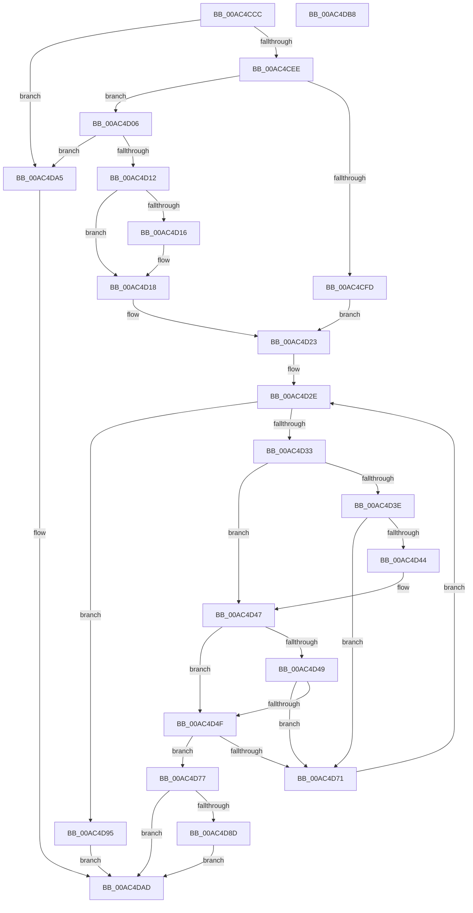

# ArbpUpdatePriority

- RVA: `0x00AC4CCC`–`0x00AC4DB9` (길이 `237` bytes)
- VA: `0x0000000140AC4CCC`
- 실행 섹션: `PAGE`
- PDB 이름 있음: `예`; PDB Function 태그: `아니요`
- unwind 정보 RVA: `0x000950EC`
- 디코드: `72`개 명령, `237/237` bytes 표시
- 미해석 바이트: `0` (있으면 어셈블리에 `.byte`로 보존)

> 이 문서는 커널 이미지의 기계어와 PDB 기호를 분석해 생성했습니다. 4번과 5번은 함수 원형과 자료형을 바이너리 사용 방식에서 추정한 C 해석이며 원본 소스 복구 결과는 아닙니다.

## 1. Dependencies

- 직접 호출 지점: **0**; 고유 호출 대상: **0**
- 직접 호출자로 확인된 함수: **1**
- RIP 상대 이미지 참조: **0**

### Outgoing calls
- 직접 디코드된 call 명령이 없습니다.

### Direct callers
- [ArbGetNextAllocationRange](../70/ArbGetNextAllocationRange_function_0070EB30.md) at `0x0070EB51`
- [ArbGetNextAllocationRange](../70/ArbGetNextAllocationRange_function_0070EB30.md) at `0x0070EB81`

### Static image references
- 디코드된 RIP-relative 메모리 참조가 없습니다.

## 2. Other-region calls and transfers

- 다른 실행 섹션으로 향하는 call: **0**
- 별도 외부 분기/꼬리 이동을 확인하지 못했습니다.

## 3. Assembly (complete function range)

```asm
00AC4CCC  48 89 5C 24 08                  mov qword ptr [rsp + 8], rbx
00AC4CD1  48 89 7C 24 10                  mov qword ptr [rsp + 0x10], rdi
00AC4CD6  4C 8B C2                        mov r8, rdx
00AC4CD9  48 8B D9                        mov rbx, rcx
00AC4CDC  8B 52 20                        mov edx, dword ptr [rdx + 0x20]
00AC4CDF  8D 82 03 00 00 80               lea eax, [rdx - 0x7ffffffd]
00AC4CE5  83 F8 01                        cmp eax, 1
00AC4CE8  0F 86 B7 00 00 00               jbe 0x140ac4da5
00AC4CEE  49 8B 40 28                     mov rax, qword ptr [r8 + 0x28]
00AC4CF2  44 8A 08                        mov r9b, byte ptr [rax]
00AC4CF5  41 80 E1 01                     and r9b, 1
00AC4CF9  85 D2                           test edx, edx
00AC4CFB  75 09                           jne 0x140ac4d06
00AC4CFD  48 8B 51 40                     mov rdx, qword ptr [rcx + 0x40]
00AC4D01  48 8B CA                        mov rcx, rdx
00AC4D04  EB 1D                           jmp 0x140ac4d23
00AC4D06  41 8B 40 24                     mov eax, dword ptr [r8 + 0x24]
00AC4D0A  A8 02                           test al, 2
00AC4D0C  0F 85 93 00 00 00               jne 0x140ac4da5
00AC4D12  85 D2                           test edx, edx
00AC4D14  7F 02                           jg 0x140ac4d18
00AC4D16  F7 DA                           neg edx
00AC4D18  48 8B 49 40                     mov rcx, qword ptr [rcx + 0x40]
00AC4D1C  48 C1 E2 04                     shl rdx, 4
00AC4D20  48 03 D1                        add rdx, rcx
00AC4D23  0F B7 7B 38                     movzx edi, word ptr [rbx + 0x38]
00AC4D27  48 C1 E7 04                     shl rdi, 4
00AC4D2B  48 03 F9                        add rdi, rcx
00AC4D2E  48 3B D7                        cmp rdx, rdi
00AC4D31  73 62                           jae 0x140ac4d95
00AC4D33  4D 8B 18                        mov r11, qword ptr [r8]
00AC4D36  4C 8B 12                        mov r10, qword ptr [rdx]
00AC4D39  4D 3B D3                        cmp r10, r11
00AC4D3C  76 09                           jbe 0x140ac4d47
00AC4D3E  4D 39 50 08                     cmp qword ptr [r8 + 8], r10
00AC4D42  72 2D                           jb 0x140ac4d71
00AC4D44  4D 3B D3                        cmp r10, r11
00AC4D47  73 06                           jae 0x140ac4d4f
00AC4D49  4C 39 5A 08                     cmp qword ptr [rdx + 8], r11
00AC4D4D  72 22                           jb 0x140ac4d71
00AC4D4F  49 8B 48 08                     mov rcx, qword ptr [r8 + 8]
00AC4D53  48 8B 42 08                     mov rax, qword ptr [rdx + 8]
00AC4D57  48 3B C8                        cmp rcx, rax
00AC4D5A  48 0F 43 C8                     cmovae rcx, rax
00AC4D5E  4D 3B DA                        cmp r11, r10
00AC4D61  4D 0F 47 D3                     cmova r10, r11
00AC4D65  49 2B CA                        sub rcx, r10
00AC4D68  48 FF C1                        inc rcx
00AC4D6B  49 3B 48 10                     cmp rcx, qword ptr [r8 + 0x10]
00AC4D6F  73 06                           jae 0x140ac4d77
00AC4D71  48 83 C2 10                     add rdx, 0x10
00AC4D75  EB B7                           jmp 0x140ac4d2e
00AC4D77  48 2B 53 40                     sub rdx, qword ptr [rbx + 0x40]
00AC4D7B  48 C1 FA 04                     sar rdx, 4
00AC4D7F  8D 42 01                        lea eax, [rdx + 1]
00AC4D82  41 89 40 20                     mov dword ptr [r8 + 0x20], eax
00AC4D86  8B C8                           mov ecx, eax
00AC4D88  45 84 C9                        test r9b, r9b
00AC4D8B  74 20                           je 0x140ac4dad
00AC4D8D  F7 D9                           neg ecx
00AC4D8F  41 89 48 20                     mov dword ptr [r8 + 0x20], ecx
00AC4D93  EB 18                           jmp 0x140ac4dad
00AC4D95  41 F6 D9                        neg r9b
00AC4D98  1B C0                           sbb eax, eax
00AC4D9A  05 FE FF FF 7F                  add eax, 0x7ffffffe
00AC4D9F  41 89 40 20                     mov dword ptr [r8 + 0x20], eax
00AC4DA3  EB 08                           jmp 0x140ac4dad
00AC4DA5  41 C7 40 20 FF FF FF 7F         mov dword ptr [r8 + 0x20], 0x7fffffff
00AC4DAD  48 8B 5C 24 08                  mov rbx, qword ptr [rsp + 8]
00AC4DB2  48 8B 7C 24 10                  mov rdi, qword ptr [rsp + 0x10]
00AC4DB7  C3                              ret
00AC4DB8  CC                              int3
```

## 4. C-style interpretation (structured pseudocode)

```c
__int64 __fastcall ArbpUpdatePriority(__int64 a1, __int64 a2)
{
    __int64 result;
    __int64 v_r10;
    __int64 v_rdi;
    unsigned __int64 v_stack_p10;
    unsigned __int64 v_stack_p8;

    v_stack_p8 = v_rbx;
    v_stack_p10 = v_rdi;
    if (((unsigned int)((unsigned int)(*(unsigned int *)(a2 + 32)) - 2147483645)) <= 1) goto loc_00AC4DA5;
    a4 = (unsigned __int8)((*(unsigned __int8 *)(*(unsigned __int64 *)(a2 + 40))) & (1));
    if ((unsigned int)((unsigned int)(*(unsigned int *)(a2 + 32))) != 0) goto loc_00AC4D06;
    goto loc_00AC4D23;
loc_00AC4D06:
    if ((((unsigned __int8)((unsigned int)(*(unsigned int *)(a2 + 36)))) & (2)) != 0) goto loc_00AC4DA5;
    if (!(condition_is_greater)) {
        a2 = (unsigned int)(-(*(unsigned __int64 *)(a1 + 64)));
    }
    a2 = (a2) << (4);
    a2 = (a2) + (*(unsigned __int64 *)(*(unsigned __int64 *)(a1 + 64) + 64));
loc_00AC4D23:
    v_rdi = (*(unsigned __int16 *)(a1 + 56)) << (4);
    v_rdi = (v_rdi) + (*(unsigned __int64 *)(*(unsigned __int64 *)(a1 + 64) + 64));
loc_00AC4D2E:
    if (a2 >= v_rdi) goto loc_00AC4D95;
    if ((*(unsigned __int64 *)(a2)) <= (*(unsigned __int64 *)(a2))) goto loc_00AC4D47;
    if ((*(unsigned __int64 *)(a2 + 8)) < (*(unsigned __int64 *)(a2))) goto loc_00AC4D71;
loc_00AC4D47:
    if ((*(unsigned __int64 *)(a2)) >= (*(unsigned __int64 *)(a2))) goto loc_00AC4D4F;
    if ((*(unsigned __int64 *)(a2 + 8)) < (*(unsigned __int64 *)(a2))) goto loc_00AC4D71;
loc_00AC4D4F:
    a1 = *(unsigned __int64 *)(a2 + 8);
    if ((*(unsigned __int64 *)(a2 + 8)) >= (*(unsigned __int64 *)(a2 + 8))) { a1 = *(unsigned __int64 *)(a2 + 8); }
    v_r10 = *(unsigned __int64 *)(a2);
    if ((*(unsigned __int64 *)(a2)) > (*(unsigned __int64 *)(a2))) { v_r10 = *(unsigned __int64 *)(a2); }
    a1 = (a1) - (v_r10);
    a1 = (a1) + 1;
    if (a1 >= (*(unsigned __int64 *)(a2 + 16))) goto loc_00AC4D77;
loc_00AC4D71:
    a2 = (a2) + (16);
    goto loc_00AC4D2E;
loc_00AC4D77:
    a2 = (a2) - (*(unsigned __int64 *)(a1 + 64));
    a2 = (a2) >> (4);
    *(unsigned int *)(a2 + 32) = (unsigned int)(a2 + 1);
    if ((unsigned __int8)(a4) == 0) goto loc_00AC4DAD;
    a1 = (unsigned int)(-((unsigned int)((unsigned int)(a2 + 1))));
    *(unsigned int *)(a2 + 32) = (unsigned int)(a1);
    goto loc_00AC4DAD;
loc_00AC4D95:
    a4 = (unsigned __int8)(-(a4));
    result = (unsigned int)((a2 + 1) + (0x7FFFFFFEULL));
    *(unsigned int *)(a2 + 32) = (unsigned int)(result);
    goto loc_00AC4DAD;
loc_00AC4DA5:
    *(unsigned int *)(a2 + 32) = 0x7FFFFFFFULL;
loc_00AC4DAD:
    return result;
}
```

## 5. (Beta) C Style

```c
int64_t ArbpUpdatePriority(void *Arg1, void *Arg2)
{
    uint8_t *arg1 = (uint8_t *)Arg1;
    uint8_t *arg2 = (uint8_t *)Arg2;

    int64_t result;
    int64_t local_r10;
    int64_t local_rdi;
    uint64_t v_stack_p10;
    uint64_t v_stack_p8;

    v_stack_p8 = local_rbx;
    v_stack_p10 = local_rdi;
    if (((uint32_t)((uint32_t)(*(uint32_t *)(arg2 + 0x20)) - 2147483645)) <= 1) goto loc_00AC4DA5;
    a4 = (uint8_t)((*(uint8_t *)(*(uint64_t *)(arg2 + 0x28))) & (1));
    if ((uint32_t)((uint32_t)(*(uint32_t *)(arg2 + 0x20))) != 0) goto loc_00AC4D06;
    goto loc_00AC4D23;
loc_00AC4D06:
    if ((((uint8_t)((uint32_t)(*(uint32_t *)(arg2 + 0x24)))) & (2)) != 0) goto loc_00AC4DA5;
    if (!(condition_is_greater)) {
        Arg2 = (uint32_t)(-(*(uint64_t *)(arg1 + 0x40)));
    }
    Arg2 = (Arg2) << (4);
    Arg2 = (Arg2) + (*(uint64_t *)(*(uint64_t *)(arg1 + 0x40) + 0x40));
loc_00AC4D23:
    local_rdi = (*(uint16_t *)(arg1 + 0x38)) << (4);
    local_rdi = (local_rdi) + (*(uint64_t *)(*(uint64_t *)(arg1 + 0x40) + 0x40));
loc_00AC4D2E:
    if (Arg2 >= local_rdi) goto loc_00AC4D95;
    if ((*(uint64_t *)(arg2)) <= (*(uint64_t *)(arg2))) goto loc_00AC4D47;
    if ((*(uint64_t *)(arg2 + 0x8)) < (*(uint64_t *)(arg2))) goto loc_00AC4D71;
loc_00AC4D47:
    if ((*(uint64_t *)(arg2)) >= (*(uint64_t *)(arg2))) goto loc_00AC4D4F;
    if ((*(uint64_t *)(arg2 + 0x8)) < (*(uint64_t *)(arg2))) goto loc_00AC4D71;
loc_00AC4D4F:
    Arg1 = *(uint64_t *)(arg2 + 0x8);
    if ((*(uint64_t *)(arg2 + 0x8)) >= (*(uint64_t *)(arg2 + 0x8))) { Arg1 = *(uint64_t *)(arg2 + 0x8); }
    local_r10 = *(uint64_t *)(arg2);
    if ((*(uint64_t *)(arg2)) > (*(uint64_t *)(arg2))) { local_r10 = *(uint64_t *)(arg2); }
    Arg1 = (Arg1) - (local_r10);
    Arg1 = (Arg1) + 1;
    if (Arg1 >= (*(uint64_t *)(arg2 + 0x10))) goto loc_00AC4D77;
loc_00AC4D71:
    Arg2 = (Arg2) + (16);
    goto loc_00AC4D2E;
loc_00AC4D77:
    Arg2 = (Arg2) - (*(uint64_t *)(arg1 + 0x40));
    Arg2 = (Arg2) >> (4);
    *(uint32_t *)(arg2 + 0x20) = (uint32_t)(Arg2 + 1);
    if ((uint8_t)(a4) == 0) goto loc_00AC4DAD;
    Arg1 = (uint32_t)(-((uint32_t)((uint32_t)(Arg2 + 1))));
    *(uint32_t *)(arg2 + 0x20) = (uint32_t)(Arg1);
    goto loc_00AC4DAD;
loc_00AC4D95:
    a4 = (uint8_t)(-(a4));
    result = (uint32_t)((Arg2 + 1) + (0x7FFFFFFEULL));
    *(uint32_t *)(arg2 + 0x20) = (uint32_t)(result);
    goto loc_00AC4DAD;
loc_00AC4DA5:
    *(uint32_t *)(arg2 + 0x20) = 0x7FFFFFFFULL;
loc_00AC4DAD:
    return result;
}
```

### 관측된 메모리 오프셋

구조체 형식이 확인되지 않은 접근은 인자 기준의 오프셋으로만 기록했습니다.

| 기준 인자 | 오프셋 표현 | 폭 (bit) | 접근 |
|---|---:|---:|---|
| `Arg1` | `+ 0x38` | `16` | `R` |
| `Arg1` | `+ 0x40` | `64` | `R` |
| `Arg2` | `+ 0x0` | `64` | `R` |
| `Arg2` | `+ 0x8` | `64` | `R` |
| `Arg2` | `+ 0x10` | `64` | `R` |
| `Arg2` | `+ 0x20` | `32` | `R` |
| `Arg2` | `+ 0x20` | `32` | `W` |
| `Arg2` | `+ 0x24` | `32` | `R` |
| `Arg2` | `+ 0x28` | `64` | `R` |

## 6. Execution-region graph

[열기: 2D/3D 그래프와 함수 탐색 컨트롤 패널](../../../control-panel.html?section=page&rva=0x00AC4CCC&view=graph)

- 2D 그래프는 위에서 아래로 흐르고, 3D 그래프는 빈 공간을 드래그해 회전합니다. Shift+드래그는 이동, 휠은 확대·축소, 함수 노드 선택은 대상 보고서 이동입니다.

### Static fallback


