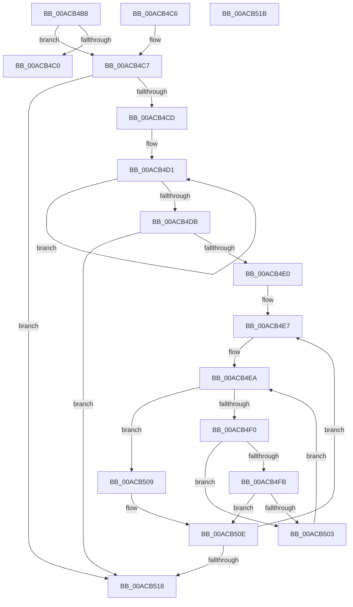

# AslStringXmlSanitize

- RVA: `0x00ACB4B8`–`0x00ACB51C` (길이 `100` bytes)
- VA: `0x0000000140ACB4B8`
- 실행 섹션: `PAGE`
- PDB 이름 있음: `예`; PDB Function 태그: `아니요`
- unwind 정보 RVA: `0x000DB714`
- 디코드: `32`개 명령, `100/100` bytes 표시
- 미해석 바이트: `0` (있으면 어셈블리에 `.byte`로 보존)

> 이 문서는 커널 이미지의 기계어와 PDB 기호를 분석해 생성했습니다. 4번과 5번은 함수 원형과 자료형을 바이너리 사용 방식에서 추정한 C 해석이며 원본 소스 복구 결과는 아닙니다.

## 1. Dependencies

- 직접 호출 지점: **0**; 고유 호출 대상: **0**
- 직접 호출자로 확인된 함수: **4**
- RIP 상대 이미지 참조: **1**

### Outgoing calls
- 직접 디코드된 call 명령이 없습니다.

### Direct callers
- [AslpFileGetClrVersionAttribute](../81/AslpFileGetClrVersionAttribute_function_0081E54C.md) at `0x0081E661`
- [AslpFileGetHeaderAttributesNE](../81/AslpFileGetHeaderAttributesNE_function_0081EE80.md) at `0x0081EF66`
- [AslpFileGetHeaderAttributesNE](../81/AslpFileGetHeaderAttributesNE_function_0081EE80.md) at `0x0081EFD5`
- [AslpFileGetPeExportNameAttribute](../81/AslpFileGetPeExportNameAttribute_function_0081F884.md) at `0x0081F8F5`
- [AslpFileMakeStringVersionAttributes](../82/AslpFileMakeStringVersionAttributes_function_00820964.md) at `0x00820AAB`

### Static image references
- `0x00ACB4E0` → RVA `0x0001EC70` (`.rdata`; read)

## 2. Other-region calls and transfers

- 다른 실행 섹션으로 향하는 call: **0**
- 별도 외부 분기/꼬리 이동을 확인하지 못했습니다.

## 3. Assembly (complete function range)

```asm
00ACB4B8  45 33 C9                        xor r9d, r9d
00ACB4BB  48 85 C9                        test rcx, rcx
00ACB4BE  75 07                           jne 0x140acb4c7
00ACB4C0  B8 0D 00 00 C0                  mov eax, 0xc000000d
00ACB4C5  C3                              ret
00ACB4C6  CC                              int3
00ACB4C7  66 44 39 09                     cmp word ptr [rcx], r9w
00ACB4CB  74 4B                           je 0x140acb518
00ACB4CD  48 83 C8 FF                     or rax, 0xffffffffffffffff
00ACB4D1  48 FF C0                        inc rax
00ACB4D4  66 44 39 0C 41                  cmp word ptr [rcx + rax*2], r9w
00ACB4D9  75 F6                           jne 0x140acb4d1
00ACB4DB  48 85 C0                        test rax, rax
00ACB4DE  74 38                           je 0x140acb518
00ACB4E0  4C 8D 15 89 37 55 FF            lea r10, [rip - 0xaac877]
00ACB4E7  49 8B D1                        mov rdx, r9
00ACB4EA  48 83 FA 14                     cmp rdx, 0x14
00ACB4EE  73 19                           jae 0x140acb509
00ACB4F0  44 0F B7 01                     movzx r8d, word ptr [rcx]
00ACB4F4  66 46 3B 04 12                  cmp r8w, word ptr [rdx + r10]
00ACB4F9  72 08                           jb 0x140acb503
00ACB4FB  66 46 3B 44 12 02               cmp r8w, word ptr [rdx + r10 + 2]
00ACB501  76 0B                           jbe 0x140acb50e
00ACB503  48 83 C2 04                     add rdx, 4
00ACB507  EB E1                           jmp 0x140acb4ea
00ACB509  66 C7 01 40 00                  mov word ptr [rcx], 0x40
00ACB50E  48 83 C1 02                     add rcx, 2
00ACB512  48 83 E8 01                     sub rax, 1
00ACB516  75 CF                           jne 0x140acb4e7
00ACB518  33 C0                           xor eax, eax
00ACB51A  C3                              ret
00ACB51B  CC                              int3
```

## 4. C-style interpretation (structured pseudocode)

```c
__int64 __fastcall AslStringXmlSanitize(__int64 a1, __int64 a2, __int64 a3, int a4)
{
    __int64 result;

    a4 = 0;
    if (a1 != 0) goto loc_00ACB4C7;
    return (unsigned int)(0xC000000DULL);
loc_00ACB4C7:
    if ((*(unsigned __int16 *)(a1)) == 0) goto loc_00ACB518;
    result = ((unsigned int)(0xC000000DULL)) | (-1);
loc_00ACB4D1:
    result = (result) + 1;
    if ((*(unsigned __int16 *)(a1 + result * 2)) != 0) goto loc_00ACB4D1;
    if (result == 0) goto loc_00ACB518;
loc_00ACB4E7:
loc_00ACB4EA:
    if (0 >= 20) goto loc_00ACB509;
    if (((unsigned __int16)(*(unsigned __int16 *)(a1))) < (*(unsigned __int16 *)(0 + v_rip - 11192439 * 1))) goto loc_00ACB503;
    if (((unsigned __int16)(*(unsigned __int16 *)(a1))) <= (*(unsigned __int16 *)(0 + v_rip - 11192439 * 1 + 2))) goto loc_00ACB50E;
loc_00ACB503:
    a2 = (0) + (4);
    goto loc_00ACB4EA;
loc_00ACB509:
    *(unsigned __int16 *)(a1) = 64;
loc_00ACB50E:
    a1 = (a1) + (2);
    result = (result) - (1);
    if (condition_is_not_equal) goto loc_00ACB4E7;
loc_00ACB518:
    result = 0;
    return result;
}
```

## 5. (Beta) C Style

```c
int64_t AslStringXmlSanitize(int64_t Arg1, int64_t Arg2, int64_t Arg3, int32_t Arg4)
{
    int64_t result;

    Arg4 = 0;
    if (Arg1 != 0) goto loc_00ACB4C7;
    return (uint32_t)(0xC000000DULL);
loc_00ACB4C7:
    if ((*(uint16_t *)(Arg1)) == 0) goto loc_00ACB518;
    result = ((uint32_t)(0xC000000DULL)) | (-1);
loc_00ACB4D1:
    result = (result) + 1;
    if ((*(uint16_t *)(Arg1 + result * 2)) != 0) goto loc_00ACB4D1;
    if (result == 0) goto loc_00ACB518;
loc_00ACB4E7:
loc_00ACB4EA:
    if (0 >= 20) goto loc_00ACB509;
    if (((uint16_t)(*(uint16_t *)(Arg1))) < (*(uint16_t *)(0 + v_rip - 0xAAC877 * 1))) goto loc_00ACB503;
    if (((uint16_t)(*(uint16_t *)(Arg1))) <= (*(uint16_t *)(0 + v_rip - 0xAAC877 * 1 + 0x2))) goto loc_00ACB50E;
loc_00ACB503:
    Arg2 = (0) + (4);
    goto loc_00ACB4EA;
loc_00ACB509:
    *(uint16_t *)(Arg1) = 64;
loc_00ACB50E:
    Arg1 = (Arg1) + (2);
    result = (result) - (1);
    if (condition_is_not_equal) goto loc_00ACB4E7;
loc_00ACB518:
    result = 0;
    return result;
}
```

## 6. Execution-region graph

[열기: 2D/3D 그래프와 함수 탐색 컨트롤 패널](../../../control-panel.html?section=page&rva=0x00ACB4B8&view=graph)

- 2D 그래프는 위에서 아래로 흐르고, 3D 그래프는 빈 공간을 드래그해 회전합니다. Shift+드래그는 이동, 휠은 확대·축소, 함수 노드 선택은 대상 보고서 이동입니다.

### Static fallback


