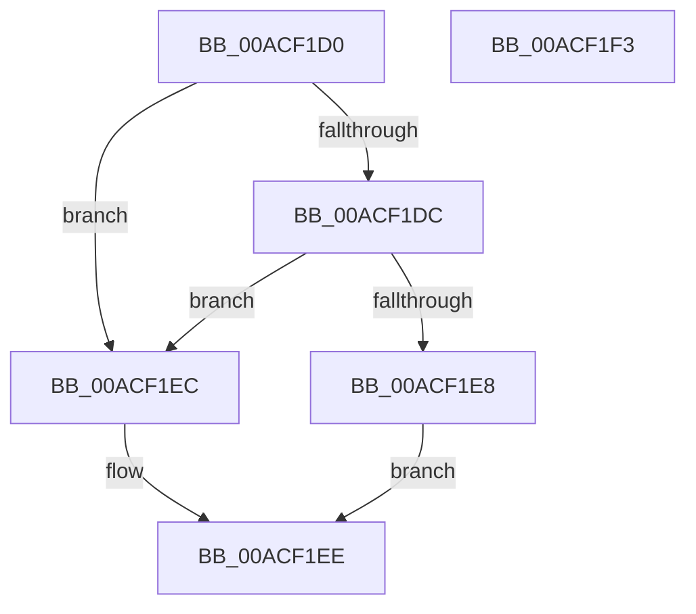

# BiAreBootEntriesEqual

- RVA: `0x00ACF1D0`–`0x00ACF1F4` (길이 `36` bytes)
- VA: `0x0000000140ACF1D0`
- 실행 섹션: `PAGE`
- PDB 이름 있음: `예`; PDB Function 태그: `아니요`
- unwind 정보 RVA: `0x0005C788`
- 디코드: `14`개 명령, `36/36` bytes 표시
- 미해석 바이트: `0` (있으면 어셈블리에 `.byte`로 보존)

> 이 문서는 커널 이미지의 기계어와 PDB 기호를 분석해 생성했습니다. 4번과 5번은 함수 원형과 자료형을 바이너리 사용 방식에서 추정한 C 해석이며 원본 소스 복구 결과는 아닙니다.

## 1. Dependencies

- 직접 호출 지점: **1**; 고유 호출 대상: **1**
- 직접 호출자로 확인된 함수: **2**
- RIP 상대 이미지 참조: **0**

### Outgoing calls
- `0x00ACF1DF` → [memcmp](../../text/6C/memcmp_function_006C6B10.md) (function, `0x006C6B10`)

### Direct callers
- [BiUpdateBcdObject](../82/BiUpdateBcdObject_function_008270D0.md) at `0x00827356`
- [BiUpdateEfiEntry](../A3/BiUpdateEfiEntry_function_00A3CCC0.md) at `0x00A3CDFC`

### Static image references
- 디코드된 RIP-relative 메모리 참조가 없습니다.

## 2. Other-region calls and transfers

- 다른 실행 섹션으로 향하는 call: **1**
  - `0x00ACF1DF` → [memcmp](../../text/6C/memcmp_function_006C6B10.md) (`PAGE` → `.text`)
- 별도 외부 분기/꼬리 이동을 확인하지 못했습니다.

## 3. Assembly (complete function range)

```asm
00ACF1D0  48 83 EC 28                     sub rsp, 0x28
00ACF1D4  8B 41 04                        mov eax, dword ptr [rcx + 4]
00ACF1D7  3B 42 04                        cmp eax, dword ptr [rdx + 4]
00ACF1DA  75 10                           jne 0x140acf1ec
00ACF1DC  44 8B C0                        mov r8d, eax
00ACF1DF  E8 2C 79 BF FF                  call 0x1406c6b10
00ACF1E4  85 C0                           test eax, eax
00ACF1E6  75 04                           jne 0x140acf1ec
00ACF1E8  B0 01                           mov al, 1
00ACF1EA  EB 02                           jmp 0x140acf1ee
00ACF1EC  32 C0                           xor al, al
00ACF1EE  48 83 C4 28                     add rsp, 0x28
00ACF1F2  C3                              ret
00ACF1F3  CC                              int3
```

## 4. C-style interpretation (structured pseudocode)

```c
__int64 __fastcall BiAreBootEntriesEqual(__int64 a1, __int64 a2)
{
    __int64 result;
    __int64 v_rsp;

    v_rsp = (v_rsp) - (40);
    if (((unsigned int)((unsigned int)(*(unsigned int *)(a1 + 4)))) != (*(unsigned int *)(a2 + 4))) goto loc_00ACF1EC;
    result = memcmp(a1, a2, (unsigned int)((unsigned int)((unsigned int)(*(unsigned int *)(a1 + 4)))), a4);
    if ((unsigned int)(result) != 0) goto loc_00ACF1EC;
    goto loc_00ACF1EE;
loc_00ACF1EC:
    result = 0;
loc_00ACF1EE:
    v_rsp = (v_rsp) + (40);
    return result;
}
```

## 5. (Beta) C Style

```c
int64_t BiAreBootEntriesEqual(void *Arg1, void *Arg2)
{
    uint8_t *arg1 = (uint8_t *)Arg1;
    uint8_t *arg2 = (uint8_t *)Arg2;

    int64_t result;
    int64_t local_rsp;

    local_rsp = (local_rsp) - (40);
    if (((uint32_t)((uint32_t)(*(uint32_t *)(arg1 + 0x4)))) != (*(uint32_t *)(arg2 + 0x4))) goto loc_00ACF1EC;
    result = memcmp(Arg1, Arg2, (uint32_t)((uint32_t)((uint32_t)(*(uint32_t *)(arg1 + 0x4)))), a4);
    if ((uint32_t)(result) != 0) goto loc_00ACF1EC;
    goto loc_00ACF1EE;
loc_00ACF1EC:
    result = 0;
loc_00ACF1EE:
    local_rsp = (local_rsp) + (40);
    return result;
}
```

### 관측된 메모리 오프셋

구조체 형식이 확인되지 않은 접근은 인자 기준의 오프셋으로만 기록했습니다.

| 기준 인자 | 오프셋 표현 | 폭 (bit) | 접근 |
|---|---:|---:|---|
| `Arg1` | `+ 0x4` | `32` | `R` |
| `Arg2` | `+ 0x4` | `32` | `R` |

## 6. Execution-region graph

[열기: 2D/3D 그래프와 함수 탐색 컨트롤 패널](../../../control-panel.html?section=page&rva=0x00ACF1D0&view=graph)

- 2D 그래프는 위에서 아래로 흐르고, 3D 그래프는 빈 공간을 드래그해 회전합니다. Shift+드래그는 이동, 휠은 확대·축소, 함수 노드 선택은 대상 보고서 이동입니다.

### Static fallback


