# BiExportEfiBootManager

- RVA: `0x00ACB13C`–`0x00ACB4AF` (길이 `883` bytes)
- VA: `0x0000000140ACB13C`
- 실행 섹션: `PAGE`
- PDB 이름 있음: `예`; PDB Function 태그: `아니요`
- unwind 정보 RVA: `0x000BE45C`
- 디코드: `253`개 명령, `883/883` bytes 표시
- 미해석 바이트: `0` (있으면 어셈블리에 `.byte`로 보존)

> 이 문서는 커널 이미지의 기계어와 PDB 기호를 분석해 생성했습니다. 4번과 5번은 함수 원형과 자료형을 바이너리 사용 방식에서 추정한 C 해석이며 원본 소스 복구 결과는 아닙니다.

## 1. Dependencies

- 직접 호출 지점: **24**; 고유 호출 대상: **16**
- 직접 호출자로 확인된 함수: **1**
- RIP 상대 이미지 참조: **5**

### Outgoing calls
- `0x00ACB1BD` → [BcdOpenObject](../91/BcdOpenObject_function_00916704.md) (function, `0x00916704`)
- `0x00ACB1E6` → [BiGetElement](../A3/BiGetElement_function_00A3E2B4.md) (function, `0x00A3E2B4`)
- `0x00ACB209` → [ExAllocatePool2](../../poolcode/B8/ExAllocatePool2_function_00B820F0.md) (function, `0x00B820F0`)
- `0x00ACB236` → [BiTranslateDisplayOrder](BiTranslateDisplayOrder_function_00AC2144.md) (function, `0x00AC2144`)
- `0x00ACB257` → [BiQueryBootEntryOrder](../A3/BiQueryBootEntryOrder_function_00A3DBD4.md) (function, `0x00A3DBD4`)
- `0x00ACB26E` → [BiHandleFirmwareDefaultEntry](../82/BiHandleFirmwareDefaultEntry_function_00826D08.md) (function, `0x00826D08`)
- `0x00ACB2A3` → [memcmp](../../text/6C/memcmp_function_006C6B10.md) (function, `0x006C6B10`)
- `0x00ACB2B1` → [BiSetBootEntryOrder](../A3/BiSetBootEntryOrder_function_00A3CC48.md) (function, `0x00A3CC48`)
- `0x00ACB2E2` → [BiGetElement](../A3/BiGetElement_function_00A3E2B4.md) (function, `0x00A3E2B4`)
- `0x00ACB31A` → [BiDeleteEfiVariable](../A3/BiDeleteEfiVariable_function_00A3D2A8.md) (function, `0x00A3D2A8`)
- `0x00ACB33D` → [BiGetElement](../A3/BiGetElement_function_00A3E2B4.md) (function, `0x00A3E2B4`)
- `0x00ACB35A` → [BiTranslateObjectIdentifier](../82/BiTranslateObjectIdentifier_function_00827048.md) (function, `0x00827048`)
- `0x00ACB37F` → [BiDeleteEfiVariable](../A3/BiDeleteEfiVariable_function_00A3D2A8.md) (function, `0x00A3D2A8`)
- `0x00ACB39E` → [BiQueryBootOptions](../A3/BiQueryBootOptions_function_00A3DB04.md) (function, `0x00A3DB04`)
- `0x00ACB3E1` → [BiSetBootOptions](../82/BiSetBootOptions_function_00826FD0.md) (function, `0x00826FD0`)
- `0x00ACB3FB` → [ExFreePoolWithTag](../../poolcode/B8/ExFreePoolWithTag_function_00B82870.md) (function, `0x00B82870`)
- `0x00ACB40F` → [ExFreePoolWithTag](../../poolcode/B8/ExFreePoolWithTag_function_00B82870.md) (function, `0x00B82870`)
- `0x00ACB423` → [ExFreePoolWithTag](../../poolcode/B8/ExFreePoolWithTag_function_00B82870.md) (function, `0x00B82870`)
- `0x00ACB432` → [BcdCloseObject](../A3/BcdCloseObject_function_00A3FB08.md) (function, `0x00A3FB08`)
- `0x00ACB444` → [ExFreePoolWithTag](../../poolcode/B8/ExFreePoolWithTag_function_00B82870.md) (function, `0x00B82870`)
- `0x00ACB456` → [ExFreePoolWithTag](../../poolcode/B8/ExFreePoolWithTag_function_00B82870.md) (function, `0x00B82870`)
- `0x00ACB468` → [ExFreePoolWithTag](../../poolcode/B8/ExFreePoolWithTag_function_00B82870.md) (function, `0x00B82870`)
- `0x00ACB480` → [BiLogMessage](../A3/BiLogMessage_function_00A3D3A8.md) (function, `0x00A3D3A8`)
- `0x00ACB48E` → [_security_check_cookie](../../text/6A/_security_check_cookie_function_006AC640.md) (function, `0x006AC640`)

### Direct callers
- [BiExportStoreAlterationsToEfi](../82/BiExportStoreAlterationsToEfi_function_00826C58.md) at `0x00826CBE`

### Static image references
- `0x00ACB158` → RVA `0x00E0A740` (`.data`; read)
- `0x00ACB177` → RVA `0x0001A4C0` (`.rdata`; read)
- `0x00ACB313` → RVA `0x00B089B0` (` ?? ::NNGAKEGL::`string'`; read)
- `0x00ACB378` → RVA `0x00B089E0` (` ?? ::NNGAKEGL::`string'`; read)
- `0x00ACB474` → RVA `0x00B0CC50` (` ?? ::NNGAKEGL::`string'`; read)

## 2. Other-region calls and transfers

- 다른 실행 섹션으로 향하는 call: **9**
  - `0x00ACB209` → [ExAllocatePool2](../../poolcode/B8/ExAllocatePool2_function_00B820F0.md) (`PAGE` → `POOLCODE`)
  - `0x00ACB2A3` → [memcmp](../../text/6C/memcmp_function_006C6B10.md) (`PAGE` → `.text`)
  - `0x00ACB3FB` → [ExFreePoolWithTag](../../poolcode/B8/ExFreePoolWithTag_function_00B82870.md) (`PAGE` → `POOLCODE`)
  - `0x00ACB40F` → [ExFreePoolWithTag](../../poolcode/B8/ExFreePoolWithTag_function_00B82870.md) (`PAGE` → `POOLCODE`)
  - `0x00ACB423` → [ExFreePoolWithTag](../../poolcode/B8/ExFreePoolWithTag_function_00B82870.md) (`PAGE` → `POOLCODE`)
  - `0x00ACB444` → [ExFreePoolWithTag](../../poolcode/B8/ExFreePoolWithTag_function_00B82870.md) (`PAGE` → `POOLCODE`)
  - `0x00ACB456` → [ExFreePoolWithTag](../../poolcode/B8/ExFreePoolWithTag_function_00B82870.md) (`PAGE` → `POOLCODE`)
  - `0x00ACB468` → [ExFreePoolWithTag](../../poolcode/B8/ExFreePoolWithTag_function_00B82870.md) (`PAGE` → `POOLCODE`)
  - `0x00ACB48E` → [_security_check_cookie](../../text/6A/_security_check_cookie_function_006AC640.md) (`PAGE` → `.text`)
- 별도 외부 분기/꼬리 이동을 확인하지 못했습니다.

## 3. Assembly (complete function range)

```asm
00ACB13C  48 89 5C 24 18                  mov qword ptr [rsp + 0x18], rbx
00ACB141  55                              push rbp
00ACB142  56                              push rsi
00ACB143  57                              push rdi
00ACB144  41 54                           push r12
00ACB146  41 55                           push r13
00ACB148  41 56                           push r14
00ACB14A  41 57                           push r15
00ACB14C  48 8D 6C 24 D9                  lea rbp, [rsp - 0x27]
00ACB151  48 81 EC A0 00 00 00            sub rsp, 0xa0
00ACB158  48 8B 05 E1 F5 33 00            mov rax, qword ptr [rip + 0x33f5e1]
00ACB15F  48 33 C4                        xor rax, rsp
00ACB162  48 89 45 1F                     mov qword ptr [rbp + 0x1f], rax
00ACB166  33 F6                           xor esi, esi
00ACB168  48 89 55 E7                     mov qword ptr [rbp - 0x19], rdx
00ACB16C  0F 57 C0                        xorps xmm0, xmm0
00ACB16F  89 75 CB                        mov dword ptr [rbp - 0x35], esi
00ACB172  33 C0                           xor eax, eax
00ACB174  89 75 B7                        mov dword ptr [rbp - 0x49], esi
00ACB177  48 8D 15 42 F3 54 FF            lea rdx, [rip - 0xab0cbe]
00ACB17E  48 89 45 17                     mov qword ptr [rbp + 0x17], rax
00ACB182  4C 8D 45 BF                     lea r8, [rbp - 0x41]
00ACB186  89 75 A7                        mov dword ptr [rbp - 0x59], esi
00ACB189  0F 11 45 07                     movups xmmword ptr [rbp + 7], xmm0
00ACB18D  89 75 C7                        mov dword ptr [rbp - 0x39], esi
00ACB190  44 8B E6                        mov r12d, esi
00ACB193  89 75 DF                        mov dword ptr [rbp - 0x21], esi
00ACB196  8B FE                           mov edi, esi
00ACB198  48 89 75 CF                     mov qword ptr [rbp - 0x31], rsi
00ACB19C  44 8B EE                        mov r13d, esi
00ACB19F  48 89 75 AF                     mov qword ptr [rbp - 0x51], rsi
00ACB1A3  44 8B FE                        mov r15d, esi
00ACB1A6  48 89 75 D7                     mov qword ptr [rbp - 0x29], rsi
00ACB1AA  44 8B F6                        mov r14d, esi
00ACB1AD  48 89 75 BF                     mov qword ptr [rbp - 0x41], rsi
00ACB1B1  48 89 75 F7                     mov qword ptr [rbp - 9], rsi
00ACB1B5  48 89 75 EF                     mov qword ptr [rbp - 0x11], rsi
00ACB1B9  48 89 75 FF                     mov qword ptr [rbp - 1], rsi
00ACB1BD  E8 42 B5 E4 FF                  call 0x140916704
00ACB1C2  85 C0                           test eax, eax
00ACB1C4  79 0F                           jns 0x140acb1d5
00ACB1C6  3D 34 00 00 C0                  cmp eax, 0xc0000034
00ACB1CB  8B DE                           mov ebx, esi
00ACB1CD  0F 45 D8                        cmovne ebx, eax
00ACB1D0  E9 53 02 00 00                  jmp 0x140acb428
00ACB1D5  48 8B 4D BF                     mov rcx, qword ptr [rbp - 0x41]
00ACB1D9  4C 8D 4D A7                     lea r9, [rbp - 0x59]
00ACB1DD  4C 8D 45 D7                     lea r8, [rbp - 0x29]
00ACB1E1  BA 01 00 00 24                  mov edx, 0x24000001
00ACB1E6  E8 C9 30 F7 FF                  call 0x140a3e2b4
00ACB1EB  8B D8                           mov ebx, eax
00ACB1ED  85 C0                           test eax, eax
00ACB1EF  78 4C                           js 0x140acb23d
00ACB1F1  8B 55 A7                        mov edx, dword ptr [rbp - 0x59]
00ACB1F4  B9 02 01 00 00                  mov ecx, 0x102
00ACB1F9  C1 EA 04                        shr edx, 4
00ACB1FC  41 B8 42 43 44 4B               mov r8d, 0x4b444342
00ACB202  89 55 A7                        mov dword ptr [rbp - 0x59], edx
00ACB205  48 C1 E2 02                     shl rdx, 2
00ACB209  E8 E2 6E 0B 00                  call 0x140b820f0
00ACB20E  48 89 45 CF                     mov qword ptr [rbp - 0x31], rax
00ACB212  48 8B F0                        mov rsi, rax
00ACB215  48 85 C0                        test rax, rax
00ACB218  75 0A                           jne 0x140acb224
00ACB21A  BB 9A 00 00 C0                  mov ebx, 0xc000009a
00ACB21F  E9 CA 01 00 00                  jmp 0x140acb3ee
00ACB224  48 8B 5D E7                     mov rbx, qword ptr [rbp - 0x19]
00ACB228  4C 8D 4D A7                     lea r9, [rbp - 0x59]
00ACB22C  48 8B 55 D7                     mov rdx, qword ptr [rbp - 0x29]
00ACB230  48 8B CB                        mov rcx, rbx
00ACB233  4C 8B C0                        mov r8, rax
00ACB236  E8 09 6F FF FF                  call 0x140ac2144
00ACB23B  EB 12                           jmp 0x140acb24f
00ACB23D  3D 25 02 00 C0                  cmp eax, 0xc0000225
00ACB242  0F 85 CC 01 00 00               jne 0x140acb414
00ACB248  48 8B 5D E7                     mov rbx, qword ptr [rbp - 0x19]
00ACB24C  89 75 A7                        mov dword ptr [rbp - 0x59], esi
00ACB24F  48 8D 55 C7                     lea rdx, [rbp - 0x39]
00ACB253  48 8D 4D EF                     lea rcx, [rbp - 0x11]
00ACB257  E8 78 29 F7 FF                  call 0x140a3dbd4
00ACB25C  48 8B 55 BF                     mov rdx, qword ptr [rbp - 0x41]
00ACB260  4C 8D 4D A7                     lea r9, [rbp - 0x59]
00ACB264  4C 8D 45 CF                     lea r8, [rbp - 0x31]
00ACB268  48 8B CB                        mov rcx, rbx
00ACB26B  44 8B E0                        mov r12d, eax
00ACB26E  E8 95 BA D5 FF                  call 0x140826d08
00ACB273  48 8B 75 CF                     mov rsi, qword ptr [rbp - 0x31]
00ACB277  8B D8                           mov ebx, eax
00ACB279  4C 8B 7D EF                     mov r15, qword ptr [rbp - 0x11]
00ACB27D  85 C0                           test eax, eax
00ACB27F  0F 88 65 01 00 00               js 0x140acb3ea
00ACB285  8B 5D A7                        mov ebx, dword ptr [rbp - 0x59]
00ACB288  45 85 E4                        test r12d, r12d
00ACB28B  78 1F                           js 0x140acb2ac
00ACB28D  85 DB                           test ebx, ebx
00ACB28F  74 1B                           je 0x140acb2ac
00ACB291  39 5D C7                        cmp dword ptr [rbp - 0x39], ebx
00ACB294  75 16                           jne 0x140acb2ac
00ACB296  44 8B C3                        mov r8d, ebx
00ACB299  49 8B D7                        mov rdx, r15
00ACB29C  49 C1 E0 02                     shl r8, 2
00ACB2A0  48 8B CE                        mov rcx, rsi
00ACB2A3  E8 68 B8 BF FF                  call 0x1406c6b10
00ACB2A8  85 C0                           test eax, eax
00ACB2AA  74 14                           je 0x140acb2c0
00ACB2AC  8B D3                           mov edx, ebx
00ACB2AE  48 8B CE                        mov rcx, rsi
00ACB2B1  E8 92 19 F7 FF                  call 0x140a3cc48
00ACB2B6  8B D8                           mov ebx, eax
00ACB2B8  85 C0                           test eax, eax
00ACB2BA  0F 88 2A 01 00 00               js 0x140acb3ea
00ACB2C0  48 8B 4D BF                     mov rcx, qword ptr [rbp - 0x41]
00ACB2C4  4C 8D 4D DF                     lea r9, [rbp - 0x21]
00ACB2C8  41 BC 01 00 00 00               mov r12d, 1
00ACB2CE  C7 45 0B 18 00 00 00            mov dword ptr [rbp + 0xb], 0x18
00ACB2D5  4C 8D 45 F7                     lea r8, [rbp - 9]
00ACB2D9  44 89 65 07                     mov dword ptr [rbp + 7], r12d
00ACB2DD  BA 04 00 00 25                  mov edx, 0x25000004
00ACB2E2  E8 CD 2F F7 FF                  call 0x140a3e2b4
00ACB2E7  4C 8B 6D F7                     mov r13, qword ptr [rbp - 9]
00ACB2EB  8B D8                           mov ebx, eax
00ACB2ED  85 C0                           test eax, eax
00ACB2EF  78 17                           js 0x140acb308
00ACB2F1  B8 FF FF FF FF                  mov eax, 0xffffffff
00ACB2F6  41 8B FC                        mov edi, r12d
00ACB2F9  49 39 45 00                     cmp qword ptr [r13], rax
00ACB2FD  77 04                           ja 0x140acb303
00ACB2FF  41 8B 45 00                     mov eax, dword ptr [r13]
00ACB303  89 45 0F                        mov dword ptr [rbp + 0xf], eax
00ACB306  EB 24                           jmp 0x140acb32c
00ACB308  3D 25 02 00 C0                  cmp eax, 0xc0000225
00ACB30D  0F 85 D7 00 00 00               jne 0x140acb3ea
00ACB313  48 8D 0D 96 D6 03 00            lea rcx, [rip + 0x3d696]
00ACB31A  E8 89 1F F7 FF                  call 0x140a3d2a8
00ACB31F  8B D8                           mov ebx, eax
00ACB321  85 C0                           test eax, eax
00ACB323  0F 88 C1 00 00 00               js 0x140acb3ea
00ACB329  21 7D 0F                        and dword ptr [rbp + 0xf], edi
00ACB32C  48 8B 4D BF                     mov rcx, qword ptr [rbp - 0x41]
00ACB330  4C 8D 4D B7                     lea r9, [rbp - 0x49]
00ACB334  4C 8D 45 AF                     lea r8, [rbp - 0x51]
00ACB338  BA 02 00 00 24                  mov edx, 0x24000002
00ACB33D  E8 72 2F F7 FF                  call 0x140a3e2b4
00ACB342  8B D8                           mov ebx, eax
00ACB344  85 C0                           test eax, eax
00ACB346  78 29                           js 0x140acb371
00ACB348  4C 8B 65 AF                     mov r12, qword ptr [rbp - 0x51]
00ACB34C  4C 8D 45 CB                     lea r8, [rbp - 0x35]
00ACB350  48 8B 4D E7                     mov rcx, qword ptr [rbp - 0x19]
00ACB354  49 8B D4                        mov rdx, r12
00ACB357  83 CF 02                        or edi, 2
00ACB35A  E8 E9 BC D5 FF                  call 0x140827048
00ACB35F  8B D8                           mov ebx, eax
00ACB361  85 C0                           test eax, eax
00ACB363  0F 88 85 00 00 00               js 0x140acb3ee
00ACB369  8B 45 CB                        mov eax, dword ptr [rbp - 0x35]
00ACB36C  89 45 17                        mov dword ptr [rbp + 0x17], eax
00ACB36F  EB 21                           jmp 0x140acb392
00ACB371  3D 25 02 00 C0                  cmp eax, 0xc0000225
00ACB376  75 72                           jne 0x140acb3ea
00ACB378  48 8D 0D 61 D6 03 00            lea rcx, [rip + 0x3d661]
00ACB37F  E8 24 1F F7 FF                  call 0x140a3d2a8
00ACB384  4C 8B 65 AF                     mov r12, qword ptr [rbp - 0x51]
00ACB388  8B D8                           mov ebx, eax
00ACB38A  85 C0                           test eax, eax
00ACB38C  78 60                           js 0x140acb3ee
00ACB38E  44 21 75 17                     and dword ptr [rbp + 0x17], r14d
00ACB392  44 21 75 B7                     and dword ptr [rbp - 0x49], r14d
00ACB396  48 8D 55 B7                     lea rdx, [rbp - 0x49]
00ACB39A  48 8D 4D FF                     lea rcx, [rbp - 1]
00ACB39E  E8 61 27 F7 FF                  call 0x140a3db04
00ACB3A3  4C 8B 75 FF                     mov r14, qword ptr [rbp - 1]
00ACB3A7  85 C0                           test eax, eax
00ACB3A9  78 2C                           js 0x140acb3d7
00ACB3AB  8B 45 07                        mov eax, dword ptr [rbp + 7]
00ACB3AE  41 39 06                        cmp dword ptr [r14], eax
00ACB3B1  75 24                           jne 0x140acb3d7
00ACB3B3  40 F6 C7 01                     test dil, 1
00ACB3B7  74 0C                           je 0x140acb3c5
00ACB3B9  8B 45 0F                        mov eax, dword ptr [rbp + 0xf]
00ACB3BC  41 39 46 08                     cmp dword ptr [r14 + 8], eax
00ACB3C0  75 03                           jne 0x140acb3c5
00ACB3C2  83 E7 FE                        and edi, 0xfffffffe
00ACB3C5  40 F6 C7 02                     test dil, 2
00ACB3C9  74 0C                           je 0x140acb3d7
00ACB3CB  8B 45 17                        mov eax, dword ptr [rbp + 0x17]
00ACB3CE  41 39 46 10                     cmp dword ptr [r14 + 0x10], eax
00ACB3D2  75 03                           jne 0x140acb3d7
00ACB3D4  83 E7 FD                        and edi, 0xfffffffd
00ACB3D7  85 FF                           test edi, edi
00ACB3D9  74 13                           je 0x140acb3ee
00ACB3DB  8B D7                           mov edx, edi
00ACB3DD  48 8D 4D 07                     lea rcx, [rbp + 7]
00ACB3E1  E8 EA BB D5 FF                  call 0x140826fd0
00ACB3E6  8B D8                           mov ebx, eax
00ACB3E8  EB 04                           jmp 0x140acb3ee
00ACB3EA  4C 8B 65 AF                     mov r12, qword ptr [rbp - 0x51]
00ACB3EE  48 85 F6                        test rsi, rsi
00ACB3F1  74 0D                           je 0x140acb400
00ACB3F3  BA 42 43 44 4B                  mov edx, 0x4b444342
00ACB3F8  48 8B CE                        mov rcx, rsi
00ACB3FB  E8 70 74 0B 00                  call 0x140b82870
00ACB400  33 F6                           xor esi, esi
00ACB402  4D 85 E4                        test r12, r12
00ACB405  74 0D                           je 0x140acb414
00ACB407  BA 42 43 44 4B                  mov edx, 0x4b444342
00ACB40C  49 8B CC                        mov rcx, r12
00ACB40F  E8 5C 74 0B 00                  call 0x140b82870
00ACB414  48 39 75 D7                     cmp qword ptr [rbp - 0x29], rsi
00ACB418  74 0E                           je 0x140acb428
00ACB41A  48 8B 4D D7                     mov rcx, qword ptr [rbp - 0x29]
00ACB41E  BA 42 43 44 4B                  mov edx, 0x4b444342
00ACB423  E8 48 74 0B 00                  call 0x140b82870
00ACB428  48 39 75 BF                     cmp qword ptr [rbp - 0x41], rsi
00ACB42C  74 09                           je 0x140acb437
00ACB42E  48 8B 4D BF                     mov rcx, qword ptr [rbp - 0x41]
00ACB432  E8 D1 46 F7 FF                  call 0x140a3fb08
00ACB437  4D 85 ED                        test r13, r13
00ACB43A  74 0D                           je 0x140acb449
00ACB43C  BA 42 43 44 4B                  mov edx, 0x4b444342
00ACB441  49 8B CD                        mov rcx, r13
00ACB444  E8 27 74 0B 00                  call 0x140b82870
00ACB449  4D 85 FF                        test r15, r15
00ACB44C  74 0D                           je 0x140acb45b
00ACB44E  BA 42 43 44 4B                  mov edx, 0x4b444342
00ACB453  49 8B CF                        mov rcx, r15
00ACB456  E8 15 74 0B 00                  call 0x140b82870
00ACB45B  4D 85 F6                        test r14, r14
00ACB45E  74 0D                           je 0x140acb46d
00ACB460  BA 42 43 44 4B                  mov edx, 0x4b444342
00ACB465  49 8B CE                        mov rcx, r14
00ACB468  E8 03 74 0B 00                  call 0x140b82870
00ACB46D  85 DB                           test ebx, ebx
00ACB46F  79 14                           jns 0x140acb485
00ACB471  44 8B C3                        mov r8d, ebx
00ACB474  48 8D 15 D5 17 04 00            lea rdx, [rip + 0x417d5]
00ACB47B  B9 04 00 00 00                  mov ecx, 4
00ACB480  E8 23 1F F7 FF                  call 0x140a3d3a8
00ACB485  8B C3                           mov eax, ebx
00ACB487  48 8B 4D 1F                     mov rcx, qword ptr [rbp + 0x1f]
00ACB48B  48 33 CC                        xor rcx, rsp
00ACB48E  E8 AD 11 BE FF                  call 0x1406ac640
00ACB493  48 8B 9C 24 F0 00 00 00         mov rbx, qword ptr [rsp + 0xf0]
00ACB49B  48 81 C4 A0 00 00 00            add rsp, 0xa0
00ACB4A2  41 5F                           pop r15
00ACB4A4  41 5E                           pop r14
00ACB4A6  41 5D                           pop r13
00ACB4A8  41 5C                           pop r12
00ACB4AA  5F                              pop rdi
00ACB4AB  5E                              pop rsi
00ACB4AC  5D                              pop rbp
00ACB4AD  C3                              ret
00ACB4AE  CC                              int3
```

## 4. C-style interpretation (structured pseudocode)

```c
__int64 __fastcall BiExportEfiBootManager(__int64 a1, __int64 a2)
{
    __int64 result;
    __int64 v_rbx;
    __int64 v_rdi;
    __int64 v_rsi;
    __int64 v_rsp;
    unsigned __int64 v_stack_m40;
    unsigned __int64 v_stack_m48;
    unsigned int v_stack_m50;
    unsigned int v_stack_m54;
    unsigned __int64 v_stack_m58;
    unsigned __int64 v_stack_m5F;
    unsigned __int64 v_stack_m60;
    unsigned __int64 v_stack_m68;
    unsigned __int64 v_stack_m70;
    unsigned __int64 v_stack_m78;
    unsigned int v_stack_m80;
    unsigned __int64 v_stack_m88;
    unsigned __int64 v_stack_m90;
    unsigned int v_stack_m94;
    unsigned int v_stack_m98;
    unsigned __int64 v_stack_mA0;
    unsigned int v_stack_mA8;
    unsigned __int64 v_stack_mB0;
    unsigned int v_stack_mB8;
    unsigned __int64 v_stack_p18;

    v_stack_p18 = v_rbx;
    v_rsp = (v_rsp) - (160);
    result = (*(unsigned __int64 *)(v_rip + 3405281)) ^ (v_rsp);
    v_stack_m40 = result;
    v_rsi = 0;
    v_stack_m78 = a2;
    v_stack_m94 = 0;
    result = 0;
    v_stack_mA8 = 0;
    v_stack_m48 = 0;
    v_stack_mB8 = 0;
    v_stack_m58 = v_xmm0;
    v_stack_m98 = 0;
    v_stack_m80 = 0;
    v_stack_m90 = 0;
    v_stack_mB0 = 0;
    v_stack_m88 = 0;
    v_stack_mA0 = 0;
    v_stack_m68 = 0;
    v_stack_m70 = 0;
    v_stack_m60 = 0;
    result = BcdOpenObject(a1, v_rip - 11209918, v_stack_mA0, a4);
    if (!sign_flag) goto loc_00ACB1D5;
    v_rbx = 0;
    if (((unsigned int)(result)) != 0xC0000034ULL) { v_rbx = (unsigned int)(result); }
    goto loc_00ACB428;
loc_00ACB1D5:
    result = BiGetElement(v_stack_mA0, (unsigned int)(0x24000001ULL), v_stack_m88, v_stack_mB8);
    if (sign_flag) goto loc_00ACB23D;
    a2 = (unsigned int)(((unsigned int)(v_stack_mB8)) >> (4));
    v_stack_mB8 = (unsigned int)(a2);
    a2 = (a2) << (2);
    result = ExAllocatePool2(258, a2, (unsigned int)(0x4B444342ULL), v_stack_mB8);
    v_stack_m90 = result;
    if (result != 0) goto loc_00ACB224;
    goto loc_00ACB3EE;
loc_00ACB224:
    result = BiTranslateDisplayOrder(v_stack_m78, v_stack_m88, result, v_stack_mB8);
    goto loc_00ACB24F;
loc_00ACB23D:
    if (((unsigned int)(result)) != 0xC0000225ULL) goto loc_00ACB414;
    v_stack_mB8 = (unsigned int)(result);
loc_00ACB24F:
    result = BiQueryBootEntryOrder(v_stack_m70, v_stack_m98, result, v_stack_mB8);
    result = BiHandleFirmwareDefaultEntry(v_stack_m78, v_stack_mA0, v_stack_m90, v_stack_mB8);
    if (sign_flag) goto loc_00ACB3EA;
    if (sign_flag) goto loc_00ACB2AC;
    if ((unsigned int)((unsigned int)(v_stack_mB8)) == 0) goto loc_00ACB2AC;
    if (v_stack_m98 != ((unsigned int)((unsigned int)(v_stack_mB8)))) goto loc_00ACB2AC;
    a3 = ((unsigned int)((unsigned int)((unsigned int)(v_stack_mB8)))) << (2);
    result = memcmp(v_stack_m90, v_stack_m70, a3, v_stack_mB8);
    if ((unsigned int)(result) == 0) goto loc_00ACB2C0;
loc_00ACB2AC:
    result = BiSetBootEntryOrder(v_stack_m90, (unsigned int)((unsigned int)((unsigned int)(v_stack_mB8))), a3, v_stack_mB8);
    if (sign_flag) goto loc_00ACB3EA;
loc_00ACB2C0:
    v_stack_m54 = 24;
    v_stack_m58 = 1;
    result = BiGetElement(v_stack_mA0, (unsigned int)(0x25000004ULL), v_stack_m68, v_stack_m80);
    if (sign_flag) goto loc_00ACB308;
    result = (unsigned int)(0xFFFFFFFFULL);
    if ((*(unsigned __int64 *)(v_stack_m68)) <= ((unsigned int)(0xFFFFFFFFULL))) {
        result = *(unsigned int *)(v_stack_m68);
    }
    v_stack_m50 = (unsigned int)(result);
    goto loc_00ACB32C;
loc_00ACB308:
    if (((unsigned int)(result)) != 0xC0000225ULL) goto loc_00ACB3EA;
    result = BiDeleteEfiVariable(v_rip + 251542, (unsigned int)(0x25000004ULL), v_stack_m68, v_stack_m80);
    if (sign_flag) goto loc_00ACB3EA;
loc_00ACB32C:
    result = BiGetElement(v_stack_mA0, (unsigned int)(0x24000002ULL), v_stack_mB0, v_stack_mA8);
    if (sign_flag) goto loc_00ACB371;
    v_rdi = (unsigned int)((1) | (2));
    result = BiTranslateObjectIdentifier(v_stack_m78, v_stack_mB0, v_stack_m94, v_stack_mA8);
    if (sign_flag) goto loc_00ACB3EE;
    v_stack_m48 = (unsigned int)((unsigned int)(v_stack_m94));
    goto loc_00ACB392;
loc_00ACB371:
    if (((unsigned int)((unsigned int)(v_stack_m94))) != 0xC0000225ULL) goto loc_00ACB3EA;
    result = BiDeleteEfiVariable(v_rip + 251489, v_stack_mB0, v_stack_m94, v_stack_mA8);
    if (sign_flag) goto loc_00ACB3EE;
loc_00ACB392:
    result = BiQueryBootOptions(v_stack_m60, v_stack_mA8, v_stack_m94, v_stack_mA8);
    if (sign_flag) goto loc_00ACB3D7;
    if ((*(unsigned int *)(v_stack_m60)) != ((unsigned int)((unsigned int)(v_stack_m58)))) goto loc_00ACB3D7;
    if ((((unsigned __int8)(v_rdi)) & (1)) == 0) goto loc_00ACB3C5;
    if ((*(unsigned int *)(v_stack_m60 + 8)) == ((unsigned int)((unsigned int)(v_stack_m50)))) {
        v_rdi = (unsigned int)((v_rdi) & (0xFFFFFFFEULL));
    }
    if ((((unsigned __int8)(v_rdi)) & (2)) == 0) goto loc_00ACB3D7;
    if ((*(unsigned int *)(v_stack_m60 + 16)) == ((unsigned int)((unsigned int)(v_stack_m48)))) {
        v_rdi = (unsigned int)((v_rdi) & (0xFFFFFFFDULL));
    }
    if ((unsigned int)(v_rdi) == 0) goto loc_00ACB3EE;
    result = BiSetBootOptions(v_stack_m58, (unsigned int)((unsigned int)(v_rdi)), v_stack_m94, v_stack_mA8);
    goto loc_00ACB3EE;
loc_00ACB3EA:
loc_00ACB3EE:
    if (v_stack_m90 != 0) {
        a2 = 0x4B444342ULL;
        a1 = v_stack_m90;
        result = ExFreePoolWithTag(a1, a2, v_stack_m94, v_stack_mA8);
    }
    v_rsi = 0;
    if (v_stack_mB0 != 0) {
        a2 = 0x4B444342ULL;
        a1 = v_stack_mB0;
        result = ExFreePoolWithTag(a1, a2, v_stack_m94, v_stack_mA8);
    }
    if (v_stack_m88 != 0) {
        a1 = v_stack_m88;
        a2 = 0x4B444342ULL;
        result = ExFreePoolWithTag(a1, a2, v_stack_m94, v_stack_mA8);
    }
    if (v_stack_mA0 != 0) {
        a1 = v_stack_mA0;
        result = BcdCloseObject(a1, a2, v_stack_m94, v_stack_mA8);
    }
    if (v_stack_m68 != 0) {
        a2 = 0x4B444342ULL;
        a1 = v_stack_m68;
        result = ExFreePoolWithTag(a1, a2, v_stack_m94, v_stack_mA8);
    }
    if (v_stack_m70 != 0) {
        a2 = 0x4B444342ULL;
        a1 = v_stack_m70;
        result = ExFreePoolWithTag(a1, a2, v_stack_m94, v_stack_mA8);
    }
    if (v_stack_m60 != 0) {
        a2 = 0x4B444342ULL;
        a1 = v_stack_m60;
        result = ExFreePoolWithTag(a1, a2, v_stack_m94, v_stack_mA8);
    }
    if (sign_flag) {
        a3 = (unsigned int)((unsigned int)((unsigned int)(result)));
        a2 = v_rip + 268245;
        a1 = 4;
        result = BiLogMessage(a1, a2, a3, v_stack_mA8);
    }
    a1 = (v_stack_m40) ^ (v_rsp);
    result = _security_check_cookie(a1, a2, a3, v_stack_mA8);
    v_rsp = (v_rsp) + (160);
    return result;
}
```

## 5. (Beta) C Style

```c
int64_t BiExportEfiBootManager(int64_t Arg1, int64_t Arg2)
{
    int64_t result;
    int64_t local_rbx;
    int64_t local_rdi;
    int64_t local_rsi;
    int64_t local_rsp;
    uint64_t v_stack_m40;
    uint64_t v_stack_m48;
    uint32_t v_stack_m50;
    uint32_t v_stack_m54;
    uint64_t v_stack_m58;
    uint64_t v_stack_m5F;
    uint64_t v_stack_m60;
    uint64_t v_stack_m68;
    uint64_t v_stack_m70;
    uint64_t v_stack_m78;
    uint32_t v_stack_m80;
    uint64_t v_stack_m88;
    uint64_t v_stack_m90;
    uint32_t v_stack_m94;
    uint32_t v_stack_m98;
    uint64_t v_stack_mA0;
    uint32_t v_stack_mA8;
    uint64_t v_stack_mB0;
    uint32_t v_stack_mB8;
    uint64_t v_stack_p18;

    v_stack_p18 = local_rbx;
    local_rsp = (local_rsp) - (160);
    result = (*(uint64_t *)(v_rip + 0x33F5E1)) ^ (local_rsp);
    v_stack_m40 = result;
    local_rsi = 0;
    v_stack_m78 = Arg2;
    v_stack_m94 = 0;
    result = 0;
    v_stack_mA8 = 0;
    v_stack_m48 = 0;
    v_stack_mB8 = 0;
    v_stack_m58 = v_xmm0;
    v_stack_m98 = 0;
    v_stack_m80 = 0;
    v_stack_m90 = 0;
    v_stack_mB0 = 0;
    v_stack_m88 = 0;
    v_stack_mA0 = 0;
    v_stack_m68 = 0;
    v_stack_m70 = 0;
    v_stack_m60 = 0;
    result = BcdOpenObject(Arg1, v_rip - 11209918, v_stack_mA0, a4);
    if (!sign_flag) goto loc_00ACB1D5;
    local_rbx = 0;
    if (((uint32_t)(result)) != 0xC0000034ULL) { local_rbx = (uint32_t)(result); }
    goto loc_00ACB428;
loc_00ACB1D5:
    result = BiGetElement(v_stack_mA0, (uint32_t)(0x24000001ULL), v_stack_m88, v_stack_mB8);
    if (sign_flag) goto loc_00ACB23D;
    Arg2 = (uint32_t)(((uint32_t)(v_stack_mB8)) >> (4));
    v_stack_mB8 = (uint32_t)(Arg2);
    Arg2 = (Arg2) << (2);
    result = ExAllocatePool2(258, Arg2, (uint32_t)(0x4B444342ULL), v_stack_mB8);
    v_stack_m90 = result;
    if (result != 0) goto loc_00ACB224;
    goto loc_00ACB3EE;
loc_00ACB224:
    result = BiTranslateDisplayOrder(v_stack_m78, v_stack_m88, result, v_stack_mB8);
    goto loc_00ACB24F;
loc_00ACB23D:
    if (((uint32_t)(result)) != 0xC0000225ULL) goto loc_00ACB414;
    v_stack_mB8 = (uint32_t)(result);
loc_00ACB24F:
    result = BiQueryBootEntryOrder(v_stack_m70, v_stack_m98, result, v_stack_mB8);
    result = BiHandleFirmwareDefaultEntry(v_stack_m78, v_stack_mA0, v_stack_m90, v_stack_mB8);
    if (sign_flag) goto loc_00ACB3EA;
    if (sign_flag) goto loc_00ACB2AC;
    if ((uint32_t)((uint32_t)(v_stack_mB8)) == 0) goto loc_00ACB2AC;
    if (v_stack_m98 != ((uint32_t)((uint32_t)(v_stack_mB8)))) goto loc_00ACB2AC;
    a3 = ((uint32_t)((uint32_t)((uint32_t)(v_stack_mB8)))) << (2);
    result = memcmp(v_stack_m90, v_stack_m70, a3, v_stack_mB8);
    if ((uint32_t)(result) == 0) goto loc_00ACB2C0;
loc_00ACB2AC:
    result = BiSetBootEntryOrder(v_stack_m90, (uint32_t)((uint32_t)((uint32_t)(v_stack_mB8))), a3, v_stack_mB8);
    if (sign_flag) goto loc_00ACB3EA;
loc_00ACB2C0:
    v_stack_m54 = 24;
    v_stack_m58 = 1;
    result = BiGetElement(v_stack_mA0, (uint32_t)(0x25000004ULL), v_stack_m68, v_stack_m80);
    if (sign_flag) goto loc_00ACB308;
    result = (uint32_t)(0xFFFFFFFFULL);
    if ((*(uint64_t *)(v_stack_m68)) <= ((uint32_t)(0xFFFFFFFFULL))) {
        result = *(uint32_t *)(v_stack_m68);
    }
    v_stack_m50 = (uint32_t)(result);
    goto loc_00ACB32C;
loc_00ACB308:
    if (((uint32_t)(result)) != 0xC0000225ULL) goto loc_00ACB3EA;
    result = BiDeleteEfiVariable(v_rip + 251542, (uint32_t)(0x25000004ULL), v_stack_m68, v_stack_m80);
    if (sign_flag) goto loc_00ACB3EA;
loc_00ACB32C:
    result = BiGetElement(v_stack_mA0, (uint32_t)(0x24000002ULL), v_stack_mB0, v_stack_mA8);
    if (sign_flag) goto loc_00ACB371;
    local_rdi = (uint32_t)((1) | (2));
    result = BiTranslateObjectIdentifier(v_stack_m78, v_stack_mB0, v_stack_m94, v_stack_mA8);
    if (sign_flag) goto loc_00ACB3EE;
    v_stack_m48 = (uint32_t)((uint32_t)(v_stack_m94));
    goto loc_00ACB392;
loc_00ACB371:
    if (((uint32_t)((uint32_t)(v_stack_m94))) != 0xC0000225ULL) goto loc_00ACB3EA;
    result = BiDeleteEfiVariable(v_rip + 251489, v_stack_mB0, v_stack_m94, v_stack_mA8);
    if (sign_flag) goto loc_00ACB3EE;
loc_00ACB392:
    result = BiQueryBootOptions(v_stack_m60, v_stack_mA8, v_stack_m94, v_stack_mA8);
    if (sign_flag) goto loc_00ACB3D7;
    if ((*(uint32_t *)(v_stack_m60)) != ((uint32_t)((uint32_t)(v_stack_m58)))) goto loc_00ACB3D7;
    if ((((uint8_t)(local_rdi)) & (1)) == 0) goto loc_00ACB3C5;
    if ((*(uint32_t *)(v_stack_m60 + 0x8)) == ((uint32_t)((uint32_t)(v_stack_m50)))) {
        local_rdi = (uint32_t)((local_rdi) & (0xFFFFFFFEULL));
    }
    if ((((uint8_t)(local_rdi)) & (2)) == 0) goto loc_00ACB3D7;
    if ((*(uint32_t *)(v_stack_m60 + 0x10)) == ((uint32_t)((uint32_t)(v_stack_m48)))) {
        local_rdi = (uint32_t)((local_rdi) & (0xFFFFFFFDULL));
    }
    if ((uint32_t)(local_rdi) == 0) goto loc_00ACB3EE;
    result = BiSetBootOptions(v_stack_m58, (uint32_t)((uint32_t)(local_rdi)), v_stack_m94, v_stack_mA8);
    goto loc_00ACB3EE;
loc_00ACB3EA:
loc_00ACB3EE:
    if (v_stack_m90 != 0) {
        Arg2 = 0x4B444342ULL;
        Arg1 = v_stack_m90;
        result = ExFreePoolWithTag(Arg1, Arg2, v_stack_m94, v_stack_mA8);
    }
    local_rsi = 0;
    if (v_stack_mB0 != 0) {
        Arg2 = 0x4B444342ULL;
        Arg1 = v_stack_mB0;
        result = ExFreePoolWithTag(Arg1, Arg2, v_stack_m94, v_stack_mA8);
    }
    if (v_stack_m88 != 0) {
        Arg1 = v_stack_m88;
        Arg2 = 0x4B444342ULL;
        result = ExFreePoolWithTag(Arg1, Arg2, v_stack_m94, v_stack_mA8);
    }
    if (v_stack_mA0 != 0) {
        Arg1 = v_stack_mA0;
        result = BcdCloseObject(Arg1, Arg2, v_stack_m94, v_stack_mA8);
    }
    if (v_stack_m68 != 0) {
        Arg2 = 0x4B444342ULL;
        Arg1 = v_stack_m68;
        result = ExFreePoolWithTag(Arg1, Arg2, v_stack_m94, v_stack_mA8);
    }
    if (v_stack_m70 != 0) {
        Arg2 = 0x4B444342ULL;
        Arg1 = v_stack_m70;
        result = ExFreePoolWithTag(Arg1, Arg2, v_stack_m94, v_stack_mA8);
    }
    if (v_stack_m60 != 0) {
        Arg2 = 0x4B444342ULL;
        Arg1 = v_stack_m60;
        result = ExFreePoolWithTag(Arg1, Arg2, v_stack_m94, v_stack_mA8);
    }
    if (sign_flag) {
        a3 = (uint32_t)((uint32_t)((uint32_t)(result)));
        Arg2 = v_rip + 268245;
        Arg1 = 4;
        result = BiLogMessage(Arg1, Arg2, a3, v_stack_mA8);
    }
    Arg1 = (v_stack_m40) ^ (local_rsp);
    result = _security_check_cookie(Arg1, Arg2, a3, v_stack_mA8);
    local_rsp = (local_rsp) + (160);
    return result;
}
```

## 6. Execution-region graph

[열기: 2D/3D 그래프와 함수 탐색 컨트롤 패널](../../../control-panel.html?section=page&rva=0x00ACB13C&view=graph)

- 2D 그래프는 위에서 아래로 흐르고, 3D 그래프는 빈 공간을 드래그해 회전합니다. Shift+드래그는 이동, 휠은 확대·축소, 함수 노드 선택은 대상 보고서 이동입니다.

### Static fallback

```mermaid
flowchart TD
  bb_00ACB13C[BB_00ACB13C]
  bb_00ACB1C6[BB_00ACB1C6]
  bb_00ACB1D5[BB_00ACB1D5]
  bb_00ACB1F1[BB_00ACB1F1]
  bb_00ACB21A[BB_00ACB21A]
  bb_00ACB224[BB_00ACB224]
  bb_00ACB23D[BB_00ACB23D]
  bb_00ACB248[BB_00ACB248]
  bb_00ACB24F[BB_00ACB24F]
  bb_00ACB285[BB_00ACB285]
  bb_00ACB28D[BB_00ACB28D]
  bb_00ACB291[BB_00ACB291]
  bb_00ACB296[BB_00ACB296]
  bb_00ACB2AC[BB_00ACB2AC]
  bb_00ACB2C0[BB_00ACB2C0]
  bb_00ACB2F1[BB_00ACB2F1]
  bb_00ACB2FF[BB_00ACB2FF]
  bb_00ACB303[BB_00ACB303]
  bb_00ACB308[BB_00ACB308]
  bb_00ACB313[BB_00ACB313]
  bb_00ACB329[BB_00ACB329]
  bb_00ACB32C[BB_00ACB32C]
  bb_00ACB348[BB_00ACB348]
  bb_00ACB369[BB_00ACB369]
  bb_00ACB371[BB_00ACB371]
  bb_00ACB378[BB_00ACB378]
  bb_00ACB38E[BB_00ACB38E]
  bb_00ACB392[BB_00ACB392]
  bb_00ACB3AB[BB_00ACB3AB]
  bb_00ACB3B3[BB_00ACB3B3]
  bb_00ACB3B9[BB_00ACB3B9]
  bb_00ACB3C2[BB_00ACB3C2]
  bb_00ACB3C5[BB_00ACB3C5]
  bb_00ACB3CB[BB_00ACB3CB]
  bb_00ACB3D4[BB_00ACB3D4]
  bb_00ACB3D7[BB_00ACB3D7]
  bb_00ACB3DB[BB_00ACB3DB]
  bb_00ACB3EA[BB_00ACB3EA]
  bb_00ACB3EE[BB_00ACB3EE]
  bb_00ACB3F3[BB_00ACB3F3]
  bb_00ACB400[BB_00ACB400]
  bb_00ACB407[BB_00ACB407]
  bb_00ACB414[BB_00ACB414]
  bb_00ACB41A[BB_00ACB41A]
  bb_00ACB428[BB_00ACB428]
  bb_00ACB42E[BB_00ACB42E]
  bb_00ACB437[BB_00ACB437]
  bb_00ACB43C[BB_00ACB43C]
  bb_00ACB449[BB_00ACB449]
  bb_00ACB44E[BB_00ACB44E]
  bb_00ACB45B[BB_00ACB45B]
  bb_00ACB460[BB_00ACB460]
  bb_00ACB46D[BB_00ACB46D]
  bb_00ACB471[BB_00ACB471]
  bb_00ACB485[BB_00ACB485]
  bb_00ACB4AE[BB_00ACB4AE]
  bb_00ACB13C -->|branch| bb_00ACB1D5
  bb_00ACB13C -->|fallthrough| bb_00ACB1C6
  bb_00ACB1C6 -->|branch| bb_00ACB428
  bb_00ACB1D5 -->|branch| bb_00ACB23D
  bb_00ACB1D5 -->|fallthrough| bb_00ACB1F1
  bb_00ACB1F1 -->|branch| bb_00ACB224
  bb_00ACB1F1 -->|fallthrough| bb_00ACB21A
  bb_00ACB21A -->|branch| bb_00ACB3EE
  bb_00ACB224 -->|branch| bb_00ACB24F
  bb_00ACB23D -->|branch| bb_00ACB414
  bb_00ACB23D -->|fallthrough| bb_00ACB248
  bb_00ACB248 -->|flow| bb_00ACB24F
  bb_00ACB24F -->|branch| bb_00ACB3EA
  bb_00ACB24F -->|fallthrough| bb_00ACB285
  bb_00ACB285 -->|branch| bb_00ACB2AC
  bb_00ACB285 -->|fallthrough| bb_00ACB28D
  bb_00ACB28D -->|branch| bb_00ACB2AC
  bb_00ACB28D -->|fallthrough| bb_00ACB291
  bb_00ACB291 -->|branch| bb_00ACB2AC
  bb_00ACB291 -->|fallthrough| bb_00ACB296
  bb_00ACB296 -->|branch| bb_00ACB2C0
  bb_00ACB296 -->|fallthrough| bb_00ACB2AC
  bb_00ACB2AC -->|branch| bb_00ACB3EA
  bb_00ACB2AC -->|fallthrough| bb_00ACB2C0
  bb_00ACB2C0 -->|branch| bb_00ACB308
  bb_00ACB2C0 -->|fallthrough| bb_00ACB2F1
  bb_00ACB2F1 -->|branch| bb_00ACB303
  bb_00ACB2F1 -->|fallthrough| bb_00ACB2FF
  bb_00ACB2FF -->|flow| bb_00ACB303
  bb_00ACB303 -->|branch| bb_00ACB32C
  bb_00ACB308 -->|branch| bb_00ACB3EA
  bb_00ACB308 -->|fallthrough| bb_00ACB313
  bb_00ACB313 -->|branch| bb_00ACB3EA
  bb_00ACB313 -->|fallthrough| bb_00ACB329
  bb_00ACB329 -->|flow| bb_00ACB32C
  bb_00ACB32C -->|branch| bb_00ACB371
  bb_00ACB32C -->|fallthrough| bb_00ACB348
  bb_00ACB348 -->|branch| bb_00ACB3EE
  bb_00ACB348 -->|fallthrough| bb_00ACB369
  bb_00ACB369 -->|branch| bb_00ACB392
  bb_00ACB371 -->|branch| bb_00ACB3EA
  bb_00ACB371 -->|fallthrough| bb_00ACB378
  bb_00ACB378 -->|branch| bb_00ACB3EE
  bb_00ACB378 -->|fallthrough| bb_00ACB38E
  bb_00ACB38E -->|flow| bb_00ACB392
  bb_00ACB392 -->|branch| bb_00ACB3D7
  bb_00ACB392 -->|fallthrough| bb_00ACB3AB
  bb_00ACB3AB -->|branch| bb_00ACB3D7
  bb_00ACB3AB -->|fallthrough| bb_00ACB3B3
  bb_00ACB3B3 -->|branch| bb_00ACB3C5
  bb_00ACB3B3 -->|fallthrough| bb_00ACB3B9
  bb_00ACB3B9 -->|branch| bb_00ACB3C5
  bb_00ACB3B9 -->|fallthrough| bb_00ACB3C2
  bb_00ACB3C2 -->|flow| bb_00ACB3C5
  bb_00ACB3C5 -->|branch| bb_00ACB3D7
  bb_00ACB3C5 -->|fallthrough| bb_00ACB3CB
  bb_00ACB3CB -->|branch| bb_00ACB3D7
  bb_00ACB3CB -->|fallthrough| bb_00ACB3D4
  bb_00ACB3D4 -->|flow| bb_00ACB3D7
  bb_00ACB3D7 -->|branch| bb_00ACB3EE
  bb_00ACB3D7 -->|fallthrough| bb_00ACB3DB
  bb_00ACB3DB -->|branch| bb_00ACB3EE
  bb_00ACB3EA -->|flow| bb_00ACB3EE
  bb_00ACB3EE -->|branch| bb_00ACB400
  bb_00ACB3EE -->|fallthrough| bb_00ACB3F3
  bb_00ACB3F3 -->|flow| bb_00ACB400
  bb_00ACB400 -->|branch| bb_00ACB414
  bb_00ACB400 -->|fallthrough| bb_00ACB407
  bb_00ACB407 -->|flow| bb_00ACB414
  bb_00ACB414 -->|branch| bb_00ACB428
  bb_00ACB414 -->|fallthrough| bb_00ACB41A
  bb_00ACB41A -->|flow| bb_00ACB428
  bb_00ACB428 -->|branch| bb_00ACB437
  bb_00ACB428 -->|fallthrough| bb_00ACB42E
  bb_00ACB42E -->|flow| bb_00ACB437
  bb_00ACB437 -->|branch| bb_00ACB449
  bb_00ACB437 -->|fallthrough| bb_00ACB43C
  bb_00ACB43C -->|flow| bb_00ACB449
  bb_00ACB449 -->|branch| bb_00ACB45B
  bb_00ACB449 -->|fallthrough| bb_00ACB44E
  bb_00ACB44E -->|flow| bb_00ACB45B
  bb_00ACB45B -->|branch| bb_00ACB46D
  bb_00ACB45B -->|fallthrough| bb_00ACB460
  bb_00ACB460 -->|flow| bb_00ACB46D
  bb_00ACB46D -->|branch| bb_00ACB485
  bb_00ACB46D -->|fallthrough| bb_00ACB471
  bb_00ACB471 -->|flow| bb_00ACB485
```


