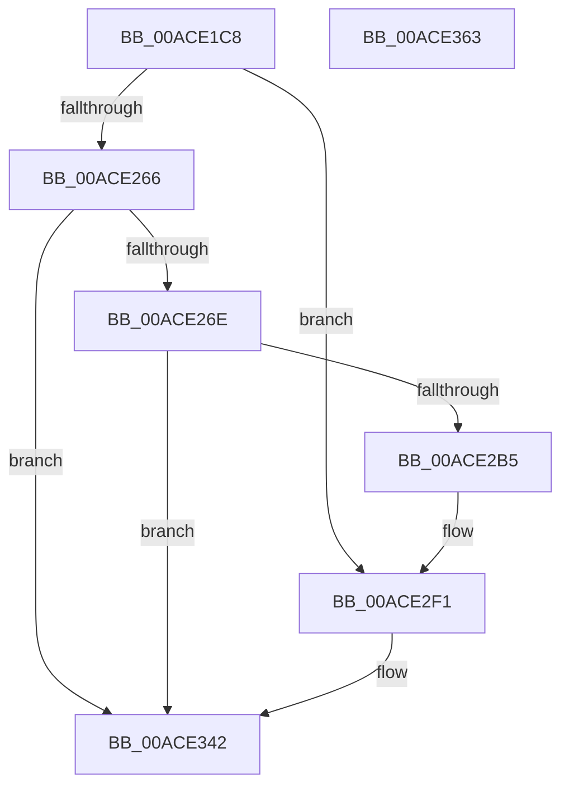

# BiGetPartitionInformation

- RVA: `0x00ACE1C8`–`0x00ACE364` (길이 `412` bytes)
- VA: `0x0000000140ACE1C8`
- 실행 섹션: `PAGE`
- PDB 이름 있음: `예`; PDB Function 태그: `아니요`
- unwind 정보 RVA: `0x000BE734`
- 디코드: `105`개 명령, `412/412` bytes 표시
- 미해석 바이트: `0` (있으면 어셈블리에 `.byte`로 보존)

> 이 문서는 커널 이미지의 기계어와 PDB 기호를 분석해 생성했습니다. 4번과 5번은 함수 원형과 자료형을 바이너리 사용 방식에서 추정한 C 해석이며 원본 소스 복구 결과는 아닙니다.

## 1. Dependencies

- 직접 호출 지점: **4**; 고유 호출 대상: **3**
- 직접 호출자로 확인된 함수: **1**
- RIP 상대 이미지 참조: **1**

### Outgoing calls
- `0x00ACE218` → [memset](../../text/6C/memset_function_006C6C40.md) (function, `0x006C6C40`)
- `0x00ACE257` → [ZwDeviceIoControlFile](../../text/6A/ZwDeviceIoControlFile_function_006AD1B0.md) (function, `0x006AD1B0`)
- `0x00ACE2A6` → [ZwDeviceIoControlFile](../../text/6A/ZwDeviceIoControlFile_function_006AD1B0.md) (function, `0x006AD1B0`)
- `0x00ACE34B` → [_security_check_cookie](../../text/6A/_security_check_cookie_function_006AC640.md) (function, `0x006AC640`)

### Direct callers
- [BiCreatePartitionDevice](../82/BiCreatePartitionDevice_function_00824D10.md) at `0x00824FD3`

### Static image references
- `0x00ACE1DC` → RVA `0x00E0A740` (`.data`; read)

## 2. Other-region calls and transfers

- 다른 실행 섹션으로 향하는 call: **4**
  - `0x00ACE218` → [memset](../../text/6C/memset_function_006C6C40.md) (`PAGE` → `.text`)
  - `0x00ACE257` → [ZwDeviceIoControlFile](../../text/6A/ZwDeviceIoControlFile_function_006AD1B0.md) (`PAGE` → `.text`)
  - `0x00ACE2A6` → [ZwDeviceIoControlFile](../../text/6A/ZwDeviceIoControlFile_function_006AD1B0.md) (`PAGE` → `.text`)
  - `0x00ACE34B` → [_security_check_cookie](../../text/6A/_security_check_cookie_function_006AC640.md) (`PAGE` → `.text`)
- 별도 외부 분기/꼬리 이동을 확인하지 못했습니다.

## 3. Assembly (complete function range)

```asm
00ACE1C8  48 89 5C 24 10                  mov qword ptr [rsp + 0x10], rbx
00ACE1CD  55                              push rbp
00ACE1CE  56                              push rsi
00ACE1CF  57                              push rdi
00ACE1D0  48 8D 6C 24 E0                  lea rbp, [rsp - 0x20]
00ACE1D5  48 81 EC 20 01 00 00            sub rsp, 0x120
00ACE1DC  48 8B 05 5D C5 33 00            mov rax, qword ptr [rip + 0x33c55d]
00ACE1E3  48 33 C4                        xor rax, rsp
00ACE1E6  48 89 45 10                     mov qword ptr [rbp + 0x10], rax
00ACE1EA  0F 57 C9                        xorps xmm1, xmm1
00ACE1ED  49 8B D8                        mov rbx, r8
00ACE1F0  8B FA                           mov edi, edx
00ACE1F2  48 8B F1                        mov rsi, rcx
00ACE1F5  0F 57 C0                        xorps xmm0, xmm0
00ACE1F8  48 8D 4C 24 60                  lea rcx, [rsp + 0x60]
00ACE1FD  33 C0                           xor eax, eax
00ACE1FF  33 D2                           xor edx, edx
00ACE201  41 B8 8C 00 00 00               mov r8d, 0x8c
00ACE207  89 44 24 64                     mov dword ptr [rsp + 0x64], eax
00ACE20B  0F 11 44 24 50                  movups xmmword ptr [rsp + 0x50], xmm0
00ACE210  0F 11 4D F0                     movups xmmword ptr [rbp - 0x10], xmm1
00ACE214  0F 11 4D 00                     movups xmmword ptr [rbp], xmm1
00ACE218  E8 23 8A BF FF                  call 0x1406c6c40
00ACE21D  C7 44 24 48 90 00 00 00         mov dword ptr [rsp + 0x48], 0x90
00ACE225  48 8D 44 24 60                  lea rax, [rsp + 0x60]
00ACE22A  48 89 44 24 40                  mov qword ptr [rsp + 0x40], rax
00ACE22F  45 33 C9                        xor r9d, r9d
00ACE232  83 64 24 38 00                  and dword ptr [rsp + 0x38], 0
00ACE237  48 8D 44 24 50                  lea rax, [rsp + 0x50]
00ACE23C  48 83 64 24 30 00               and qword ptr [rsp + 0x30], 0
00ACE242  45 33 C0                        xor r8d, r8d
00ACE245  C7 44 24 28 48 00 07 00         mov dword ptr [rsp + 0x28], 0x70048
00ACE24D  33 D2                           xor edx, edx
00ACE24F  48 8B CE                        mov rcx, rsi
00ACE252  48 89 44 24 20                  mov qword ptr [rsp + 0x20], rax
00ACE257  E8 54 EF BD FF                  call 0x1406ad1b0
00ACE25C  8B D0                           mov edx, eax
00ACE25E  85 C0                           test eax, eax
00ACE260  0F 89 8B 00 00 00               jns 0x140ace2f1
00ACE266  85 FF                           test edi, edi
00ACE268  0F 85 D4 00 00 00               jne 0x140ace342
00ACE26E  C7 44 24 48 20 00 00 00         mov dword ptr [rsp + 0x48], 0x20
00ACE276  48 8D 45 F0                     lea rax, [rbp - 0x10]
00ACE27A  48 89 44 24 40                  mov qword ptr [rsp + 0x40], rax
00ACE27F  45 33 C9                        xor r9d, r9d
00ACE282  21 7C 24 38                     and dword ptr [rsp + 0x38], edi
00ACE286  48 8D 44 24 50                  lea rax, [rsp + 0x50]
00ACE28B  48 83 64 24 30 00               and qword ptr [rsp + 0x30], 0
00ACE291  45 33 C0                        xor r8d, r8d
00ACE294  C7 44 24 28 04 40 07 00         mov dword ptr [rsp + 0x28], 0x74004
00ACE29C  33 D2                           xor edx, edx
00ACE29E  48 8B CE                        mov rcx, rsi
00ACE2A1  48 89 44 24 20                  mov qword ptr [rsp + 0x20], rax
00ACE2A6  E8 05 EF BD FF                  call 0x1406ad1b0
00ACE2AB  8B D0                           mov edx, eax
00ACE2AD  85 C0                           test eax, eax
00ACE2AF  0F 88 8D 00 00 00               js 0x140ace342
00ACE2B5  48 8B 45 F0                     mov rax, qword ptr [rbp - 0x10]
00ACE2B9  21 7C 24 60                     and dword ptr [rsp + 0x60], edi
00ACE2BD  48 89 44 24 68                  mov qword ptr [rsp + 0x68], rax
00ACE2C2  48 8B 45 F8                     mov rax, qword ptr [rbp - 8]
00ACE2C6  48 89 44 24 70                  mov qword ptr [rsp + 0x70], rax
00ACE2CB  8B 45 04                        mov eax, dword ptr [rbp + 4]
00ACE2CE  89 44 24 78                     mov dword ptr [rsp + 0x78], eax
00ACE2D2  8A 45 0B                        mov al, byte ptr [rbp + 0xb]
00ACE2D5  88 44 24 7C                     mov byte ptr [rsp + 0x7c], al
00ACE2D9  8A 45 08                        mov al, byte ptr [rbp + 8]
00ACE2DC  88 45 80                        mov byte ptr [rbp - 0x80], al
00ACE2DF  8A 45 09                        mov al, byte ptr [rbp + 9]
00ACE2E2  88 45 81                        mov byte ptr [rbp - 0x7f], al
00ACE2E5  8A 45 0A                        mov al, byte ptr [rbp + 0xa]
00ACE2E8  88 45 82                        mov byte ptr [rbp - 0x7e], al
00ACE2EB  8B 45 00                        mov eax, dword ptr [rbp]
00ACE2EE  89 45 84                        mov dword ptr [rbp - 0x7c], eax
00ACE2F1  48 8D 44 24 60                  lea rax, [rsp + 0x60]
00ACE2F6  B9 80 00 00 00                  mov ecx, 0x80
00ACE2FB  0F 10 00                        movups xmm0, xmmword ptr [rax]
00ACE2FE  0F 10 48 10                     movups xmm1, xmmword ptr [rax + 0x10]
00ACE302  0F 11 03                        movups xmmword ptr [rbx], xmm0
00ACE305  0F 10 40 20                     movups xmm0, xmmword ptr [rax + 0x20]
00ACE309  0F 11 4B 10                     movups xmmword ptr [rbx + 0x10], xmm1
00ACE30D  0F 10 48 30                     movups xmm1, xmmword ptr [rax + 0x30]
00ACE311  0F 11 43 20                     movups xmmword ptr [rbx + 0x20], xmm0
00ACE315  0F 10 40 40                     movups xmm0, xmmword ptr [rax + 0x40]
00ACE319  0F 11 4B 30                     movups xmmword ptr [rbx + 0x30], xmm1
00ACE31D  0F 10 48 50                     movups xmm1, xmmword ptr [rax + 0x50]
00ACE321  0F 11 43 40                     movups xmmword ptr [rbx + 0x40], xmm0
00ACE325  0F 10 40 60                     movups xmm0, xmmword ptr [rax + 0x60]
00ACE329  0F 11 4B 50                     movups xmmword ptr [rbx + 0x50], xmm1
00ACE32D  0F 10 0C 08                     movups xmm1, xmmword ptr [rax + rcx]
00ACE331  0F 11 43 60                     movups xmmword ptr [rbx + 0x60], xmm0
00ACE335  0F 10 40 70                     movups xmm0, xmmword ptr [rax + 0x70]
00ACE339  0F 11 44 0B F0                  movups xmmword ptr [rbx + rcx - 0x10], xmm0
00ACE33E  0F 11 0C 0B                     movups xmmword ptr [rbx + rcx], xmm1
00ACE342  8B C2                           mov eax, edx
00ACE344  48 8B 4D 10                     mov rcx, qword ptr [rbp + 0x10]
00ACE348  48 33 CC                        xor rcx, rsp
00ACE34B  E8 F0 E2 BD FF                  call 0x1406ac640
00ACE350  48 8B 9C 24 48 01 00 00         mov rbx, qword ptr [rsp + 0x148]
00ACE358  48 81 C4 20 01 00 00            add rsp, 0x120
00ACE35F  5F                              pop rdi
00ACE360  5E                              pop rsi
00ACE361  5D                              pop rbp
00ACE362  C3                              ret
00ACE363  CC                              int3
```

## 4. C-style interpretation (structured pseudocode)

```c
__int64 __fastcall BiGetPartitionInformation(__int64 a1, int a2, __int64 a3, int a4)
{
    __int64 result;
    __int64 v_rsp;
    unsigned int v_stack_m100;
    unsigned __int64 v_stack_m108;
    unsigned int v_stack_m110;
    unsigned __int64 v_stack_m118;
    unsigned __int64 v_stack_m28;
    unsigned __int8 v_stack_m2D;
    unsigned __int8 v_stack_m2E;
    unsigned __int8 v_stack_m2F;
    unsigned __int8 v_stack_m30;
    unsigned int v_stack_m34;
    unsigned __int64 v_stack_m38;
    unsigned __int64 v_stack_m40;
    unsigned __int64 v_stack_m48;
    unsigned int v_stack_mB4;
    unsigned __int8 v_stack_mB6;
    unsigned __int8 v_stack_mB7;
    unsigned __int8 v_stack_mB8;
    unsigned __int8 v_stack_mBC;
    unsigned int v_stack_mC0;
    unsigned __int64 v_stack_mC8;
    unsigned __int64 v_stack_mD0;
    unsigned int v_stack_mD4;
    unsigned __int64 v_stack_mD8;
    unsigned __int64 v_stack_mE8;
    unsigned int v_stack_mF0;
    unsigned __int64 v_stack_mF8;
    unsigned __int64 v_stack_p10;

    v_stack_p10 = v_rbx;
    v_rsp = (v_rsp) - (288);
    result = (*(unsigned __int64 *)(v_rip + 3392861)) ^ (v_rsp);
    v_stack_m28 = result;
    result = 0;
    a2 = 0;
    v_stack_mD4 = 0;
    v_stack_mE8 = v_xmm0;
    v_stack_m48 = v_xmm1;
    v_stack_m38 = v_xmm1;
    result = memset(v_stack_mD8, a2, 140, a4);
    v_stack_mF0 = 144;
    v_stack_mF8 = v_stack_mD8;
    a4 = 0;
    a3 = 0;
    v_stack_m110 = 0x70048ULL;
    a2 = 0;
    v_stack_m118 = v_stack_mE8;
    result = ZwDeviceIoControlFile(a1, a2, a3, a4);
    if (!sign_flag) goto loc_00ACE2F1;
    if ((unsigned int)((unsigned int)(a2)) != 0) goto loc_00ACE342;
    v_stack_mF0 = 32;
    v_stack_mF8 = v_stack_m48;
    a4 = 0;
    a3 = 0;
    v_stack_m110 = 0x74004ULL;
    a2 = 0;
    v_stack_m118 = v_stack_mE8;
    result = ZwDeviceIoControlFile(a1, a2, a3, a4);
    if (sign_flag) goto loc_00ACE342;
    v_stack_mD0 = v_stack_m48;
    v_stack_mC8 = v_stack_m40;
    v_stack_mC0 = (unsigned int)((unsigned int)(v_stack_m34));
    v_stack_mBC = (unsigned __int8)(v_stack_m2D);
    v_stack_mB8 = (unsigned __int8)(v_stack_m30);
    v_stack_mB7 = (unsigned __int8)(v_stack_m2F);
    v_stack_mB6 = (unsigned __int8)(v_stack_m2E);
    v_stack_mB4 = (unsigned int)((unsigned int)(v_stack_m38));
loc_00ACE2F1:
    *(unsigned __int64 *)(a3) = v_xmm0;
    *(unsigned __int64 *)(a3 + 16) = v_xmm1;
    *(unsigned __int64 *)(a3 + 32) = v_xmm0;
    *(unsigned __int64 *)(a3 + 48) = v_xmm1;
    *(unsigned __int64 *)(a3 + 64) = v_xmm0;
    *(unsigned __int64 *)(a3 + 80) = v_xmm1;
    *(unsigned __int64 *)(a3 + 96) = v_xmm0;
    *(unsigned __int64 *)(a3 + 128 * 1 - 16) = v_xmm0;
    *(unsigned __int64 *)(a3 + 128 * 1) = v_xmm1;
loc_00ACE342:
    a1 = (v_stack_m28) ^ (v_rsp);
    result = _security_check_cookie(a1, (unsigned int)((unsigned int)(result)), a3, a4);
    v_rsp = (v_rsp) + (288);
    return result;
}
```

## 5. (Beta) C Style

```c
int64_t BiGetPartitionInformation(int64_t Arg1, int32_t Arg2, void *Arg3, int32_t Arg4)
{
    uint8_t *arg3 = (uint8_t *)Arg3;

    int64_t result;
    int64_t local_rsp;
    uint32_t v_stack_m100;
    uint64_t v_stack_m108;
    uint32_t v_stack_m110;
    uint64_t v_stack_m118;
    uint64_t v_stack_m28;
    uint8_t v_stack_m2D;
    uint8_t v_stack_m2E;
    uint8_t v_stack_m2F;
    uint8_t v_stack_m30;
    uint32_t v_stack_m34;
    uint64_t v_stack_m38;
    uint64_t v_stack_m40;
    uint64_t v_stack_m48;
    uint32_t v_stack_mB4;
    uint8_t v_stack_mB6;
    uint8_t v_stack_mB7;
    uint8_t v_stack_mB8;
    uint8_t v_stack_mBC;
    uint32_t v_stack_mC0;
    uint64_t v_stack_mC8;
    uint64_t v_stack_mD0;
    uint32_t v_stack_mD4;
    uint64_t v_stack_mD8;
    uint64_t v_stack_mE8;
    uint32_t v_stack_mF0;
    uint64_t v_stack_mF8;
    uint64_t v_stack_p10;

    v_stack_p10 = local_rbx;
    local_rsp = (local_rsp) - (288);
    result = (*(uint64_t *)(v_rip + 0x33C55D)) ^ (local_rsp);
    v_stack_m28 = result;
    result = 0;
    Arg2 = 0;
    v_stack_mD4 = 0;
    v_stack_mE8 = v_xmm0;
    v_stack_m48 = v_xmm1;
    v_stack_m38 = v_xmm1;
    result = memset(v_stack_mD8, Arg2, 140, Arg4);
    v_stack_mF0 = 144;
    v_stack_mF8 = v_stack_mD8;
    Arg4 = 0;
    Arg3 = 0;
    v_stack_m110 = 0x70048ULL;
    Arg2 = 0;
    v_stack_m118 = v_stack_mE8;
    result = ZwDeviceIoControlFile(Arg1, Arg2, Arg3, Arg4);
    if (!sign_flag) goto loc_00ACE2F1;
    if ((uint32_t)((uint32_t)(Arg2)) != 0) goto loc_00ACE342;
    v_stack_mF0 = 32;
    v_stack_mF8 = v_stack_m48;
    Arg4 = 0;
    Arg3 = 0;
    v_stack_m110 = 0x74004ULL;
    Arg2 = 0;
    v_stack_m118 = v_stack_mE8;
    result = ZwDeviceIoControlFile(Arg1, Arg2, Arg3, Arg4);
    if (sign_flag) goto loc_00ACE342;
    v_stack_mD0 = v_stack_m48;
    v_stack_mC8 = v_stack_m40;
    v_stack_mC0 = (uint32_t)((uint32_t)(v_stack_m34));
    v_stack_mBC = (uint8_t)(v_stack_m2D);
    v_stack_mB8 = (uint8_t)(v_stack_m30);
    v_stack_mB7 = (uint8_t)(v_stack_m2F);
    v_stack_mB6 = (uint8_t)(v_stack_m2E);
    v_stack_mB4 = (uint32_t)((uint32_t)(v_stack_m38));
loc_00ACE2F1:
    *(uint64_t *)(arg3) = v_xmm0;
    *(uint64_t *)(arg3 + 0x10) = v_xmm1;
    *(uint64_t *)(arg3 + 0x20) = v_xmm0;
    *(uint64_t *)(arg3 + 0x30) = v_xmm1;
    *(uint64_t *)(arg3 + 0x40) = v_xmm0;
    *(uint64_t *)(arg3 + 0x50) = v_xmm1;
    *(uint64_t *)(arg3 + 0x60) = v_xmm0;
    *(uint64_t *)(arg3 + 0x80 * 1 - 0x10) = v_xmm0;
    *(uint64_t *)(arg3 + 0x80 * 1) = v_xmm1;
loc_00ACE342:
    Arg1 = (v_stack_m28) ^ (local_rsp);
    result = _security_check_cookie(Arg1, (uint32_t)((uint32_t)(result)), Arg3, Arg4);
    local_rsp = (local_rsp) + (288);
    return result;
}
```

### 관측된 메모리 오프셋

구조체 형식이 확인되지 않은 접근은 인자 기준의 오프셋으로만 기록했습니다.

| 기준 인자 | 오프셋 표현 | 폭 (bit) | 접근 |
|---|---:|---:|---|
| `Arg3` | `- 0x10 + rcx*1` | `128` | `R` |
| `Arg3` | `+ 0x0` | `128` | `R` |
| `Arg3` | `+ 0x0 + rcx*1` | `128` | `R` |
| `Arg3` | `+ 0x10` | `128` | `R` |
| `Arg3` | `+ 0x20` | `128` | `R` |
| `Arg3` | `+ 0x30` | `128` | `R` |
| `Arg3` | `+ 0x40` | `128` | `R` |
| `Arg3` | `+ 0x50` | `128` | `R` |
| `Arg3` | `+ 0x60` | `128` | `R` |

## 6. Execution-region graph

[열기: 2D/3D 그래프와 함수 탐색 컨트롤 패널](../../../control-panel.html?section=page&rva=0x00ACE1C8&view=graph)

- 2D 그래프는 위에서 아래로 흐르고, 3D 그래프는 빈 공간을 드래그해 회전합니다. Shift+드래그는 이동, 휠은 확대·축소, 함수 노드 선택은 대상 보고서 이동입니다.

### Static fallback


