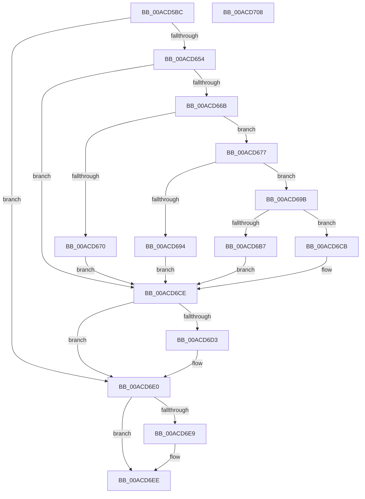

# BiGetPhysicalDriveName

- RVA: `0x00ACD5BC`–`0x00ACD709` (길이 `333` bytes)
- VA: `0x0000000140ACD5BC`
- 실행 섹션: `PAGE`
- PDB 이름 있음: `예`; PDB Function 태그: `아니요`
- unwind 정보 RVA: `0x000BE648`
- 디코드: `89`개 명령, `333/333` bytes 표시
- 미해석 바이트: `0` (있으면 어셈블리에 `.byte`로 보존)

> 이 문서는 커널 이미지의 기계어와 PDB 기호를 분석해 생성했습니다. 4번과 5번은 함수 원형과 자료형을 바이너리 사용 방식에서 추정한 C 해석이며 원본 소스 복구 결과는 아닙니다.

## 1. Dependencies

- 직접 호출 지점: **8**; 고유 호출 대상: **7**
- 직접 호출자로 확인된 함수: **2**
- RIP 상대 이미지 참조: **1**

### Outgoing calls
- `0x00ACD5F8` → [RtlInitUnicodeString](../../text/42/RtlInitUnicodeString_function_0042A780.md) (function, `0x0042A780`)
- `0x00ACD645` → [ZwOpenFile](../../text/6A/ZwOpenFile_function_006AD730.md) (function, `0x006AD730`)
- `0x00ACD65C` → [BiGetVolumeDiskExtentsInformation](../82/BiGetVolumeDiskExtentsInformation_function_008259FC.md) (function, `0x008259FC`)
- `0x00ACD687` → [ExAllocatePool2](../../poolcode/B8/ExAllocatePool2_function_00B820F0.md) (function, `0x00B820F0`)
- `0x00ACD6AE` → [swprintf_s](../../text/50/swprintf_s_function_00504B20.md) (function, `0x00504B20`)
- `0x00ACD6C4` → [ExFreePoolWithTag](../../poolcode/B8/ExFreePoolWithTag_function_00B82870.md) (function, `0x00B82870`)
- `0x00ACD6DB` → [ExFreePoolWithTag](../../poolcode/B8/ExFreePoolWithTag_function_00B82870.md) (function, `0x00B82870`)
- `0x00ACD6E9` → [ZwClose](../../text/6A/ZwClose_function_006AD2B0.md) (function, `0x006AD2B0`)

### Direct callers
- [BiCreatePartitionDevice](../82/BiCreatePartitionDevice_function_00824D10.md) at `0x00824DEB`
- [BiGetDriveLayoutBlock](../82/BiGetDriveLayoutBlock_function_0082538C.md) at `0x008253D7`

### Static image references
- `0x00ACD69F` → RVA `0x00B0BD70` (` ?? ::NNGAKEGL::`string'`; read)

## 2. Other-region calls and transfers

- 다른 실행 섹션으로 향하는 call: **7**
  - `0x00ACD5F8` → [RtlInitUnicodeString](../../text/42/RtlInitUnicodeString_function_0042A780.md) (`PAGE` → `.text`)
  - `0x00ACD645` → [ZwOpenFile](../../text/6A/ZwOpenFile_function_006AD730.md) (`PAGE` → `.text`)
  - `0x00ACD687` → [ExAllocatePool2](../../poolcode/B8/ExAllocatePool2_function_00B820F0.md) (`PAGE` → `POOLCODE`)
  - `0x00ACD6AE` → [swprintf_s](../../text/50/swprintf_s_function_00504B20.md) (`PAGE` → `.text`)
  - `0x00ACD6C4` → [ExFreePoolWithTag](../../poolcode/B8/ExFreePoolWithTag_function_00B82870.md) (`PAGE` → `POOLCODE`)
  - `0x00ACD6DB` → [ExFreePoolWithTag](../../poolcode/B8/ExFreePoolWithTag_function_00B82870.md) (`PAGE` → `POOLCODE`)
  - `0x00ACD6E9` → [ZwClose](../../text/6A/ZwClose_function_006AD2B0.md) (`PAGE` → `.text`)
- 별도 외부 분기/꼬리 이동을 확인하지 못했습니다.

## 3. Assembly (complete function range)

```asm
00ACD5BC  48 89 5C 24 08                  mov qword ptr [rsp + 8], rbx
00ACD5C1  48 89 74 24 10                  mov qword ptr [rsp + 0x10], rsi
00ACD5C6  55                              push rbp
00ACD5C7  57                              push rdi
00ACD5C8  41 56                           push r14
00ACD5CA  48 8B EC                        mov rbp, rsp
00ACD5CD  48 81 EC 80 00 00 00            sub rsp, 0x80
00ACD5D4  33 C0                           xor eax, eax
00ACD5D6  4C 8B F2                        mov r14, rdx
00ACD5D9  21 45 EC                        and dword ptr [rbp - 0x14], eax
00ACD5DC  48 8B D1                        mov rdx, rcx
00ACD5DF  48 21 45 30                     and qword ptr [rbp + 0x30], rax
00ACD5E3  48 8D 4D B0                     lea rcx, [rbp - 0x50]
00ACD5E7  48 21 45 38                     and qword ptr [rbp + 0x38], rax
00ACD5EB  0F 57 C0                        xorps xmm0, xmm0
00ACD5EE  89 45 D4                        mov dword ptr [rbp - 0x2c], eax
00ACD5F1  21 45 D4                        and dword ptr [rbp - 0x2c], eax
00ACD5F4  0F 11 45 B0                     movups xmmword ptr [rbp - 0x50], xmm0
00ACD5F8  E8 83 D1 95 FF                  call 0x14042a780
00ACD5FD  48 83 65 D8 00                  and qword ptr [rbp - 0x28], 0
00ACD602  48 8D 45 B0                     lea rax, [rbp - 0x50]
00ACD606  0F 57 C0                        xorps xmm0, xmm0
00ACD609  C7 44 24 28 20 00 00 00         mov dword ptr [rsp + 0x28], 0x20
00ACD611  4C 8D 4D C0                     lea r9, [rbp - 0x40]
00ACD615  48 89 45 E0                     mov qword ptr [rbp - 0x20], rax
00ACD619  4C 8D 45 D0                     lea r8, [rbp - 0x30]
00ACD61D  C7 45 D0 30 00 00 00            mov dword ptr [rbp - 0x30], 0x30
00ACD624  BA 00 00 10 80                  mov edx, 0x80100000
00ACD629  C7 45 E8 40 02 00 00            mov dword ptr [rbp - 0x18], 0x240
00ACD630  48 8D 4D 30                     lea rcx, [rbp + 0x30]
00ACD634  C7 44 24 20 03 00 00 00         mov dword ptr [rsp + 0x20], 3
00ACD63C  F3 0F 7F 45 F0                  movdqu xmmword ptr [rbp - 0x10], xmm0
00ACD641  0F 11 45 C0                     movups xmmword ptr [rbp - 0x40], xmm0
00ACD645  E8 E6 00 BE FF                  call 0x1406ad730
00ACD64A  8B D8                           mov ebx, eax
00ACD64C  85 C0                           test eax, eax
00ACD64E  0F 88 8C 00 00 00               js 0x140acd6e0
00ACD654  48 8B 4D 30                     mov rcx, qword ptr [rbp + 0x30]
00ACD658  48 8D 55 38                     lea rdx, [rbp + 0x38]
00ACD65C  E8 9B 83 D5 FF                  call 0x1408259fc
00ACD661  48 8B 7D 38                     mov rdi, qword ptr [rbp + 0x38]
00ACD665  8B D8                           mov ebx, eax
00ACD667  85 C0                           test eax, eax
00ACD669  78 63                           js 0x140acd6ce
00ACD66B  83 3F 01                        cmp dword ptr [rdi], 1
00ACD66E  74 07                           je 0x140acd677
00ACD670  BB BB 00 00 C0                  mov ebx, 0xc00000bb
00ACD675  EB 57                           jmp 0x140acd6ce
00ACD677  BA 3E 00 00 00                  mov edx, 0x3e
00ACD67C  B9 02 01 00 00                  mov ecx, 0x102
00ACD681  41 B8 42 43 44 4B               mov r8d, 0x4b444342
00ACD687  E8 64 4A 0B 00                  call 0x140b820f0
00ACD68C  48 8B F0                        mov rsi, rax
00ACD68F  48 85 C0                        test rax, rax
00ACD692  75 07                           jne 0x140acd69b
00ACD694  BB 9A 00 00 C0                  mov ebx, 0xc000009a
00ACD699  EB 33                           jmp 0x140acd6ce
00ACD69B  44 8B 4F 08                     mov r9d, dword ptr [rdi + 8]
00ACD69F  4C 8D 05 CA E6 03 00            lea r8, [rip + 0x3e6ca]
00ACD6A6  BA 1F 00 00 00                  mov edx, 0x1f
00ACD6AB  48 8B CE                        mov rcx, rsi
00ACD6AE  E8 6D 74 A3 FF                  call 0x140504b20
00ACD6B3  85 C0                           test eax, eax
00ACD6B5  7F 14                           jg 0x140acd6cb
00ACD6B7  BA 42 43 44 4B                  mov edx, 0x4b444342
00ACD6BC  48 8B CE                        mov rcx, rsi
00ACD6BF  BB 0D 00 00 C0                  mov ebx, 0xc000000d
00ACD6C4  E8 A7 51 0B 00                  call 0x140b82870
00ACD6C9  EB 03                           jmp 0x140acd6ce
00ACD6CB  49 89 36                        mov qword ptr [r14], rsi
00ACD6CE  48 85 FF                        test rdi, rdi
00ACD6D1  74 0D                           je 0x140acd6e0
00ACD6D3  BA 42 43 44 4B                  mov edx, 0x4b444342
00ACD6D8  48 8B CF                        mov rcx, rdi
00ACD6DB  E8 90 51 0B 00                  call 0x140b82870
00ACD6E0  48 8B 4D 30                     mov rcx, qword ptr [rbp + 0x30]
00ACD6E4  48 85 C9                        test rcx, rcx
00ACD6E7  74 05                           je 0x140acd6ee
00ACD6E9  E8 C2 FB BD FF                  call 0x1406ad2b0
00ACD6EE  4C 8D 9C 24 80 00 00 00         lea r11, [rsp + 0x80]
00ACD6F6  8B C3                           mov eax, ebx
00ACD6F8  49 8B 5B 20                     mov rbx, qword ptr [r11 + 0x20]
00ACD6FC  49 8B 73 28                     mov rsi, qword ptr [r11 + 0x28]
00ACD700  49 8B E3                        mov rsp, r11
00ACD703  41 5E                           pop r14
00ACD705  5F                              pop rdi
00ACD706  5D                              pop rbp
00ACD707  C3                              ret
00ACD708  CC                              int3
```

## 4. C-style interpretation (structured pseudocode)

```c
__int64 __fastcall BiGetPhysicalDriveName(__int64 a1, __int64 a2)
{
    __int64 result;
    __int64 v_rsp;
    unsigned __int64 v_stack_m18;
    unsigned __int64 v_stack_m28;
    unsigned int v_stack_m2C;
    unsigned int v_stack_m30;
    unsigned __int64 v_stack_m38;
    unsigned __int64 v_stack_m40;
    unsigned int v_stack_m44;
    unsigned __int64 v_stack_m48;
    unsigned __int64 v_stack_m58;
    unsigned __int64 v_stack_m68;
    unsigned int v_stack_m70;
    unsigned int v_stack_m78;
    unsigned __int64 v_stack_p10;
    unsigned __int64 v_stack_p18;
    unsigned __int64 v_stack_p20;
    unsigned __int64 v_stack_p8;

    v_stack_p8 = v_rbx;
    v_stack_p10 = v_rsi;
    v_rsp = (v_rsp) - (128);
    result = 0;
    v_stack_m44 = 0;
    v_stack_m68 = v_xmm0;
    result = RtlInitUnicodeString(v_stack_m68, a1, a3, a4);
    v_stack_m70 = 32;
    v_stack_m38 = v_stack_m68;
    v_stack_m48 = 48;
    v_stack_m30 = 576;
    v_stack_m78 = 3;
    v_stack_m28 = v_xmm0;
    v_stack_m58 = v_xmm0;
    result = ZwOpenFile(v_stack_p18, (unsigned int)(0x80100000ULL), v_stack_m48, v_stack_m58);
    if (sign_flag) goto loc_00ACD6E0;
    result = BiGetVolumeDiskExtentsInformation(v_stack_p18, v_stack_p20, v_stack_m48, v_stack_m58);
    if (sign_flag) goto loc_00ACD6CE;
    if ((*(unsigned int *)(v_stack_p20)) == 1) goto loc_00ACD677;
    goto loc_00ACD6CE;
loc_00ACD677:
    result = ExAllocatePool2(258, 62, (unsigned int)(0x4B444342ULL), v_stack_m58);
    if (result != 0) goto loc_00ACD69B;
    goto loc_00ACD6CE;
loc_00ACD69B:
    result = swprintf_s(result, 31, v_rip + 255690, (unsigned int)(*(unsigned int *)(v_stack_p20 + 8)));
    if (condition_is_greater) goto loc_00ACD6CB;
    result = ExFreePoolWithTag(result, (unsigned int)(0x4B444342ULL), v_rip + 255690, (unsigned int)(*(unsigned int *)(v_stack_p20 + 8)));
    goto loc_00ACD6CE;
loc_00ACD6CB:
    *(unsigned __int64 *)(a2) = result;
loc_00ACD6CE:
    if (v_stack_p20 != 0) {
        a2 = 0x4B444342ULL;
        a1 = v_stack_p20;
        result = ExFreePoolWithTag(a1, a2, v_rip + 255690, (unsigned int)(*(unsigned int *)(v_stack_p20 + 8)));
    }
    if (v_stack_p18 != 0) {
        result = ZwClose(v_stack_p18, a2, v_rip + 255690, (unsigned int)(*(unsigned int *)(v_stack_p20 + 8)));
    }
    return (unsigned int)((unsigned int)((unsigned int)(0xC000000DULL)));
}
```

## 5. (Beta) C Style

```c
int64_t BiGetPhysicalDriveName(int64_t Arg1, void *Arg2)
{
    uint8_t *arg2 = (uint8_t *)Arg2;

    int64_t result;
    int64_t local_rsp;
    uint64_t v_stack_m18;
    uint64_t v_stack_m28;
    uint32_t v_stack_m2C;
    uint32_t v_stack_m30;
    uint64_t v_stack_m38;
    uint64_t v_stack_m40;
    uint32_t v_stack_m44;
    uint64_t v_stack_m48;
    uint64_t v_stack_m58;
    uint64_t v_stack_m68;
    uint32_t v_stack_m70;
    uint32_t v_stack_m78;
    uint64_t v_stack_p10;
    uint64_t v_stack_p18;
    uint64_t v_stack_p20;
    uint64_t v_stack_p8;

    v_stack_p8 = local_rbx;
    v_stack_p10 = local_rsi;
    local_rsp = (local_rsp) - (128);
    result = 0;
    v_stack_m44 = 0;
    v_stack_m68 = v_xmm0;
    result = RtlInitUnicodeString(v_stack_m68, Arg1, a3, a4);
    v_stack_m70 = 32;
    v_stack_m38 = v_stack_m68;
    v_stack_m48 = 48;
    v_stack_m30 = 576;
    v_stack_m78 = 3;
    v_stack_m28 = v_xmm0;
    v_stack_m58 = v_xmm0;
    result = ZwOpenFile(v_stack_p18, (uint32_t)(0x80100000ULL), v_stack_m48, v_stack_m58);
    if (sign_flag) goto loc_00ACD6E0;
    result = BiGetVolumeDiskExtentsInformation(v_stack_p18, v_stack_p20, v_stack_m48, v_stack_m58);
    if (sign_flag) goto loc_00ACD6CE;
    if ((*(uint32_t *)(v_stack_p20)) == 1) goto loc_00ACD677;
    goto loc_00ACD6CE;
loc_00ACD677:
    result = ExAllocatePool2(258, 62, (uint32_t)(0x4B444342ULL), v_stack_m58);
    if (result != 0) goto loc_00ACD69B;
    goto loc_00ACD6CE;
loc_00ACD69B:
    result = swprintf_s(result, 31, v_rip + 255690, (uint32_t)(*(uint32_t *)(v_stack_p20 + 0x8)));
    if (condition_is_greater) goto loc_00ACD6CB;
    result = ExFreePoolWithTag(result, (uint32_t)(0x4B444342ULL), v_rip + 255690, (uint32_t)(*(uint32_t *)(v_stack_p20 + 0x8)));
    goto loc_00ACD6CE;
loc_00ACD6CB:
    *(uint64_t *)(arg2) = result;
loc_00ACD6CE:
    if (v_stack_p20 != 0) {
        Arg2 = 0x4B444342ULL;
        Arg1 = v_stack_p20;
        result = ExFreePoolWithTag(Arg1, Arg2, v_rip + 255690, (uint32_t)(*(uint32_t *)(v_stack_p20 + 0x8)));
    }
    if (v_stack_p18 != 0) {
        result = ZwClose(v_stack_p18, Arg2, v_rip + 255690, (uint32_t)(*(uint32_t *)(v_stack_p20 + 0x8)));
    }
    return (uint32_t)((uint32_t)((uint32_t)(0xC000000DULL)));
}
```

### 관측된 메모리 오프셋

구조체 형식이 확인되지 않은 접근은 인자 기준의 오프셋으로만 기록했습니다.

| 기준 인자 | 오프셋 표현 | 폭 (bit) | 접근 |
|---|---:|---:|---|
| `Arg2` | `+ 0x0` | `64` | `W` |

## 6. Execution-region graph

[열기: 2D/3D 그래프와 함수 탐색 컨트롤 패널](../../../control-panel.html?section=page&rva=0x00ACD5BC&view=graph)

- 2D 그래프는 위에서 아래로 흐르고, 3D 그래프는 빈 공간을 드래그해 회전합니다. Shift+드래그는 이동, 휠은 확대·축소, 함수 노드 선택은 대상 보고서 이동입니다.

### Static fallback


