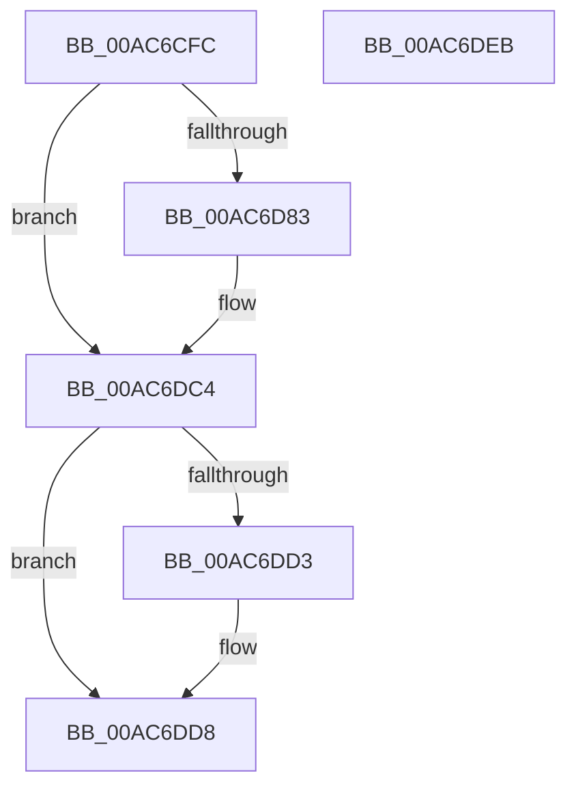

# BiIsVolumePartitionInformationRetained

- RVA: `0x00AC6CFC`–`0x00AC6DEC` (길이 `240` bytes)
- VA: `0x0000000140AC6CFC`
- 실행 섹션: `PAGE`
- PDB 이름 있음: `예`; PDB Function 태그: `아니요`
- unwind 정보 RVA: `0x00086CF8`
- 디코드: `59`개 명령, `240/240` bytes 표시
- 미해석 바이트: `0` (있으면 어셈블리에 `.byte`로 보존)

> 이 문서는 커널 이미지의 기계어와 PDB 기호를 분석해 생성했습니다. 4번과 5번은 함수 원형과 자료형을 바이너리 사용 방식에서 추정한 C 해석이며 원본 소스 복구 결과는 아닙니다.

## 1. Dependencies

- 직접 호출 지점: **4**; 고유 호출 대상: **4**
- 직접 호출자로 확인된 함수: **1**
- RIP 상대 이미지 참조: **0**

### Outgoing calls
- `0x00AC6D2B` → [RtlInitUnicodeString](../../text/42/RtlInitUnicodeString_function_0042A780.md) (function, `0x0042A780`)
- `0x00AC6D78` → [ZwOpenFile](../../text/6A/ZwOpenFile_function_006AD730.md) (function, `0x006AD730`)
- `0x00AC6DBD` → [ZwDeviceIoControlFile](../../text/6A/ZwDeviceIoControlFile_function_006AD1B0.md) (function, `0x006AD1B0`)
- `0x00AC6DD3` → [ZwClose](../../text/6A/ZwClose_function_006AD2B0.md) (function, `0x006AD2B0`)

### Direct callers
- [BiConvertNtDeviceToBootEnvironment](../A4/BiConvertNtDeviceToBootEnvironment_function_00A41760.md) at `0x00A4197E`

### Static image references
- 디코드된 RIP-relative 메모리 참조가 없습니다.

## 2. Other-region calls and transfers

- 다른 실행 섹션으로 향하는 call: **4**
  - `0x00AC6D2B` → [RtlInitUnicodeString](../../text/42/RtlInitUnicodeString_function_0042A780.md) (`PAGE` → `.text`)
  - `0x00AC6D78` → [ZwOpenFile](../../text/6A/ZwOpenFile_function_006AD730.md) (`PAGE` → `.text`)
  - `0x00AC6DBD` → [ZwDeviceIoControlFile](../../text/6A/ZwDeviceIoControlFile_function_006AD1B0.md) (`PAGE` → `.text`)
  - `0x00AC6DD3` → [ZwClose](../../text/6A/ZwClose_function_006AD2B0.md) (`PAGE` → `.text`)
- 별도 외부 분기/꼬리 이동을 확인하지 못했습니다.

## 3. Assembly (complete function range)

```asm
00AC6CFC  48 89 5C 24 08                  mov qword ptr [rsp + 8], rbx
00AC6D01  55                              push rbp
00AC6D02  48 8D 6C 24 A9                  lea rbp, [rsp - 0x57]
00AC6D07  48 81 EC A0 00 00 00            sub rsp, 0xa0
00AC6D0E  33 C0                           xor eax, eax
00AC6D10  0F 57 C0                        xorps xmm0, xmm0
00AC6D13  21 45 43                        and dword ptr [rbp + 0x43], eax
00AC6D16  48 8B D1                        mov rdx, rcx
00AC6D19  48 21 45 6F                     and qword ptr [rbp + 0x6f], rax
00AC6D1D  48 8D 4D 17                     lea rcx, [rbp + 0x17]
00AC6D21  89 45 2B                        mov dword ptr [rbp + 0x2b], eax
00AC6D24  21 45 2B                        and dword ptr [rbp + 0x2b], eax
00AC6D27  0F 11 45 17                     movups xmmword ptr [rbp + 0x17], xmm0
00AC6D2B  E8 50 3A 96 FF                  call 0x14042a780
00AC6D30  48 83 65 2F 00                  and qword ptr [rbp + 0x2f], 0
00AC6D35  48 8D 45 17                     lea rax, [rbp + 0x17]
00AC6D39  0F 57 C0                        xorps xmm0, xmm0
00AC6D3C  C7 44 24 28 20 00 00 00         mov dword ptr [rsp + 0x28], 0x20
00AC6D44  4C 8D 4D 07                     lea r9, [rbp + 7]
00AC6D48  48 89 45 37                     mov qword ptr [rbp + 0x37], rax
00AC6D4C  4C 8D 45 27                     lea r8, [rbp + 0x27]
00AC6D50  C7 45 27 30 00 00 00            mov dword ptr [rbp + 0x27], 0x30
00AC6D57  BA 00 00 10 80                  mov edx, 0x80100000
00AC6D5C  C7 45 3F 40 02 00 00            mov dword ptr [rbp + 0x3f], 0x240
00AC6D63  48 8D 4D 6F                     lea rcx, [rbp + 0x6f]
00AC6D67  C7 44 24 20 03 00 00 00         mov dword ptr [rsp + 0x20], 3
00AC6D6F  F3 0F 7F 45 47                  movdqu xmmword ptr [rbp + 0x47], xmm0
00AC6D74  0F 11 45 07                     movups xmmword ptr [rbp + 7], xmm0
00AC6D78  E8 B3 69 BE FF                  call 0x1406ad730
00AC6D7D  8B D8                           mov ebx, eax
00AC6D7F  85 C0                           test eax, eax
00AC6D81  78 41                           js 0x140ac6dc4
00AC6D83  83 64 24 48 00                  and dword ptr [rsp + 0x48], 0
00AC6D88  48 8D 45 07                     lea rax, [rbp + 7]
00AC6D8C  48 83 64 24 40 00               and qword ptr [rsp + 0x40], 0
00AC6D92  0F 57 C0                        xorps xmm0, xmm0
00AC6D95  83 64 24 38 00                  and dword ptr [rsp + 0x38], 0
00AC6D9A  45 33 C9                        xor r9d, r9d
00AC6D9D  48 83 64 24 30 00               and qword ptr [rsp + 0x30], 0
00AC6DA3  45 33 C0                        xor r8d, r8d
00AC6DA6  48 8B 4D 6F                     mov rcx, qword ptr [rbp + 0x6f]
00AC6DAA  33 D2                           xor edx, edx
00AC6DAC  C7 44 24 28 28 00 56 00         mov dword ptr [rsp + 0x28], 0x560028
00AC6DB4  48 89 44 24 20                  mov qword ptr [rsp + 0x20], rax
00AC6DB9  0F 11 45 07                     movups xmmword ptr [rbp + 7], xmm0
00AC6DBD  E8 EE 63 BE FF                  call 0x1406ad1b0
00AC6DC2  8B D8                           mov ebx, eax
00AC6DC4  48 8B 4D 6F                     mov rcx, qword ptr [rbp + 0x6f]
00AC6DC8  C1 EB 1F                        shr ebx, 0x1f
00AC6DCB  80 F3 01                        xor bl, 1
00AC6DCE  48 85 C9                        test rcx, rcx
00AC6DD1  74 05                           je 0x140ac6dd8
00AC6DD3  E8 D8 64 BE FF                  call 0x1406ad2b0
00AC6DD8  8A C3                           mov al, bl
00AC6DDA  48 8B 9C 24 B0 00 00 00         mov rbx, qword ptr [rsp + 0xb0]
00AC6DE2  48 81 C4 A0 00 00 00            add rsp, 0xa0
00AC6DE9  5D                              pop rbp
00AC6DEA  C3                              ret
00AC6DEB  CC                              int3
```

## 4. C-style interpretation (structured pseudocode)

```c
__int64 __fastcall BiIsVolumePartitionInformationRetained(__int64 a1)
{
    __int64 result;
    __int64 v_rbx;
    __int64 v_rsp;
    unsigned __int64 v_stack_m18;
    unsigned int v_stack_m1C;
    unsigned int v_stack_m20;
    unsigned __int64 v_stack_m28;
    unsigned __int64 v_stack_m30;
    unsigned int v_stack_m34;
    unsigned __int64 v_stack_m38;
    unsigned __int64 v_stack_m48;
    unsigned __int64 v_stack_m58;
    unsigned __int64 v_stack_m5F;
    unsigned int v_stack_m60;
    unsigned __int64 v_stack_m68;
    unsigned int v_stack_m70;
    unsigned __int64 v_stack_m78;
    unsigned int v_stack_m80;
    unsigned int v_stack_m88;
    unsigned __int64 v_stack_p10;
    unsigned __int64 v_stack_p8;

    v_stack_p8 = v_rbx;
    v_rsp = (v_rsp) - (160);
    result = 0;
    v_stack_m34 = 0;
    v_stack_m48 = v_xmm0;
    result = RtlInitUnicodeString(v_stack_m48, a1, a3, a4);
    v_stack_m80 = 32;
    v_stack_m28 = v_stack_m48;
    v_stack_m38 = 48;
    v_stack_m20 = 576;
    v_stack_m88 = 3;
    v_stack_m18 = v_xmm0;
    v_stack_m58 = v_xmm0;
    result = ZwOpenFile(v_stack_p10, (unsigned int)(0x80100000ULL), v_stack_m38, v_stack_m58);
    v_rbx = (unsigned int)((unsigned int)(result));
    if (!(sign_flag)) {
        result = v_stack_m58;
        a4 = 0;
        a3 = 0;
        a1 = v_stack_p10;
        a2 = 0;
        v_stack_m80 = 0x560028ULL;
        v_stack_m88 = result;
        v_stack_m58 = v_xmm0;
        result = ZwDeviceIoControlFile(a1, a2, a3, a4);
        v_rbx = (unsigned int)(result);
    }
    v_rbx = (unsigned int)((v_rbx) >> (31));
    v_rbx = (unsigned __int8)((v_rbx) ^ (1));
    if (v_stack_p10 != 0) {
        result = ZwClose(v_stack_p10, a2, a3, a4);
    }
    v_rsp = (v_rsp) + (160);
    return (unsigned __int8)(v_rbx);
}
```

## 5. (Beta) C Style

```c
int64_t BiIsVolumePartitionInformationRetained(int64_t Arg1)
{
    int64_t result;
    int64_t local_rbx;
    int64_t local_rsp;
    uint64_t v_stack_m18;
    uint32_t v_stack_m1C;
    uint32_t v_stack_m20;
    uint64_t v_stack_m28;
    uint64_t v_stack_m30;
    uint32_t v_stack_m34;
    uint64_t v_stack_m38;
    uint64_t v_stack_m48;
    uint64_t v_stack_m58;
    uint64_t v_stack_m5F;
    uint32_t v_stack_m60;
    uint64_t v_stack_m68;
    uint32_t v_stack_m70;
    uint64_t v_stack_m78;
    uint32_t v_stack_m80;
    uint32_t v_stack_m88;
    uint64_t v_stack_p10;
    uint64_t v_stack_p8;

    v_stack_p8 = local_rbx;
    local_rsp = (local_rsp) - (160);
    result = 0;
    v_stack_m34 = 0;
    v_stack_m48 = v_xmm0;
    result = RtlInitUnicodeString(v_stack_m48, Arg1, a3, a4);
    v_stack_m80 = 32;
    v_stack_m28 = v_stack_m48;
    v_stack_m38 = 48;
    v_stack_m20 = 576;
    v_stack_m88 = 3;
    v_stack_m18 = v_xmm0;
    v_stack_m58 = v_xmm0;
    result = ZwOpenFile(v_stack_p10, (uint32_t)(0x80100000ULL), v_stack_m38, v_stack_m58);
    local_rbx = (uint32_t)((uint32_t)(result));
    if (!(sign_flag)) {
        result = v_stack_m58;
        a4 = 0;
        a3 = 0;
        Arg1 = v_stack_p10;
        a2 = 0;
        v_stack_m80 = 0x560028ULL;
        v_stack_m88 = result;
        v_stack_m58 = v_xmm0;
        result = ZwDeviceIoControlFile(Arg1, a2, a3, a4);
        local_rbx = (uint32_t)(result);
    }
    local_rbx = (uint32_t)((local_rbx) >> (31));
    local_rbx = (uint8_t)((local_rbx) ^ (1));
    if (v_stack_p10 != 0) {
        result = ZwClose(v_stack_p10, a2, a3, a4);
    }
    local_rsp = (local_rsp) + (160);
    return (uint8_t)(local_rbx);
}
```

## 6. Execution-region graph

[열기: 2D/3D 그래프와 함수 탐색 컨트롤 패널](../../../control-panel.html?section=page&rva=0x00AC6CFC&view=graph)

- 2D 그래프는 위에서 아래로 흐르고, 3D 그래프는 빈 공간을 드래그해 회전합니다. Shift+드래그는 이동, 휠은 확대·축소, 함수 노드 선택은 대상 보고서 이동입니다.

### Static fallback


