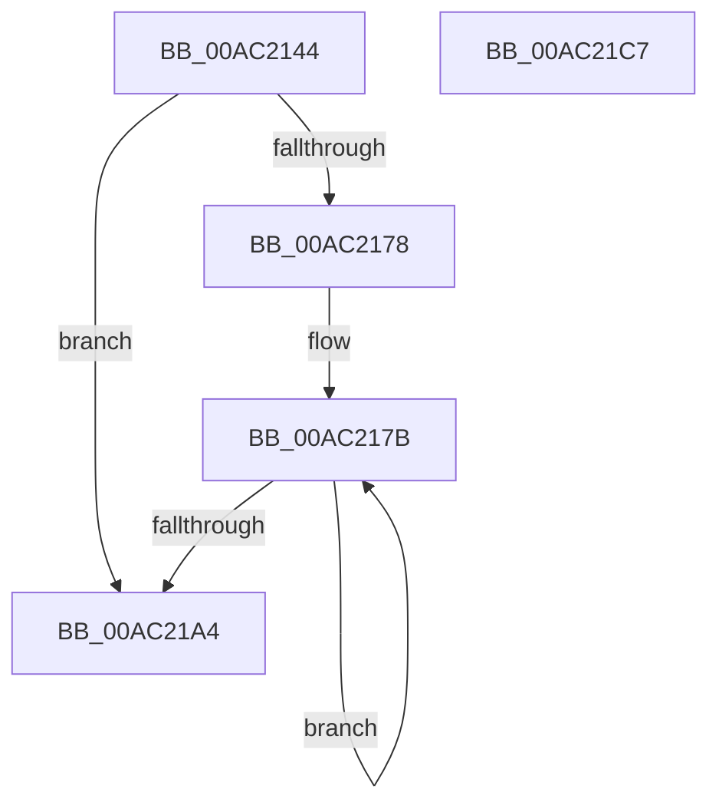

# BiTranslateDisplayOrder

- RVA: `0x00AC2144`–`0x00AC21C8` (길이 `132` bytes)
- VA: `0x0000000140AC2144`
- 실행 섹션: `PAGE`
- PDB 이름 있음: `예`; PDB Function 태그: `아니요`
- unwind 정보 RVA: `0x0005FEF8`
- 디코드: `43`개 명령, `132/132` bytes 표시
- 미해석 바이트: `0` (있으면 어셈블리에 `.byte`로 보존)

> 이 문서는 커널 이미지의 기계어와 PDB 기호를 분석해 생성했습니다. 4번과 5번은 함수 원형과 자료형을 바이너리 사용 방식에서 추정한 C 해석이며 원본 소스 복구 결과는 아닙니다.

## 1. Dependencies

- 직접 호출 지점: **1**; 고유 호출 대상: **1**
- 직접 호출자로 확인된 함수: **1**
- RIP 상대 이미지 참조: **0**

### Outgoing calls
- `0x00AC2185` → [BiTranslateObjectIdentifier](../82/BiTranslateObjectIdentifier_function_00827048.md) (function, `0x00827048`)

### Direct callers
- [BiExportEfiBootManager](BiExportEfiBootManager_function_00ACB13C.md) at `0x00ACB236`

### Static image references
- 디코드된 RIP-relative 메모리 참조가 없습니다.

## 2. Other-region calls and transfers

- 다른 실행 섹션으로 향하는 call: **0**
- 별도 외부 분기/꼬리 이동을 확인하지 못했습니다.

## 3. Assembly (complete function range)

```asm
00AC2144  48 8B C4                        mov rax, rsp
00AC2147  48 89 58 08                     mov qword ptr [rax + 8], rbx
00AC214B  48 89 68 10                     mov qword ptr [rax + 0x10], rbp
00AC214F  48 89 70 18                     mov qword ptr [rax + 0x18], rsi
00AC2153  48 89 78 20                     mov qword ptr [rax + 0x20], rdi
00AC2157  41 54                           push r12
00AC2159  41 56                           push r14
00AC215B  41 57                           push r15
00AC215D  48 83 EC 20                     sub rsp, 0x20
00AC2161  41 8B 01                        mov eax, dword ptr [r9]
00AC2164  33 DB                           xor ebx, ebx
00AC2166  33 FF                           xor edi, edi
00AC2168  49 8B F1                        mov rsi, r9
00AC216B  4D 8B F8                        mov r15, r8
00AC216E  48 8B EA                        mov rbp, rdx
00AC2171  4C 8B E1                        mov r12, rcx
00AC2174  85 C0                           test eax, eax
00AC2176  74 2C                           je 0x140ac21a4
00AC2178  44 8B F0                        mov r14d, eax
00AC217B  4D 8D 04 9F                     lea r8, [r15 + rbx*4]
00AC217F  48 8B D5                        mov rdx, rbp
00AC2182  49 8B CC                        mov rcx, r12
00AC2185  E8 BE 4E D6 FF                  call 0x140827048
00AC218A  85 C0                           test eax, eax
00AC218C  B9 0D 00 00 80                  mov ecx, 0x8000000d
00AC2191  0F 48 F9                        cmovs edi, ecx
00AC2194  8D 4B 01                        lea ecx, [rbx + 1]
00AC2197  0F 49 D9                        cmovns ebx, ecx
00AC219A  48 83 C5 10                     add rbp, 0x10
00AC219E  49 83 EE 01                     sub r14, 1
00AC21A2  75 D7                           jne 0x140ac217b
00AC21A4  48 8B 6C 24 48                  mov rbp, qword ptr [rsp + 0x48]
00AC21A9  8B C7                           mov eax, edi
00AC21AB  48 8B 7C 24 58                  mov rdi, qword ptr [rsp + 0x58]
00AC21B0  89 1E                           mov dword ptr [rsi], ebx
00AC21B2  48 8B 5C 24 40                  mov rbx, qword ptr [rsp + 0x40]
00AC21B7  48 8B 74 24 50                  mov rsi, qword ptr [rsp + 0x50]
00AC21BC  48 83 C4 20                     add rsp, 0x20
00AC21C0  41 5F                           pop r15
00AC21C2  41 5E                           pop r14
00AC21C4  41 5C                           pop r12
00AC21C6  C3                              ret
00AC21C7  CC                              int3
```

## 4. C-style interpretation (structured pseudocode)

```c
__int64 __fastcall BiTranslateDisplayOrder(__int64 a1, __int64 a2, __int64 a3, __int64 a4)
{
    __int64 result;
    __int64 v_r14;
    __int64 v_rbp;
    __int64 v_rbx;
    __int64 v_rdi;
    __int64 v_rsp;
    unsigned __int64 v_stack_p10;
    unsigned __int64 v_stack_p18;
    unsigned __int64 v_stack_p20;
    unsigned __int64 v_stack_p8;

    *(unsigned __int64 *)(v_rsp + 8) = v_rbx;
    *(unsigned __int64 *)(v_rsp + 16) = v_rbp;
    *(unsigned __int64 *)(v_rsp + 24) = v_rsi;
    *(unsigned __int64 *)(v_rsp + 32) = v_rdi;
    v_rsp = (v_rsp) - (32);
    v_rbx = 0;
    v_rdi = 0;
    if ((unsigned int)((unsigned int)(*(unsigned int *)(a4))) == 0) goto loc_00AC21A4;
loc_00AC217B:
    result = BiTranslateObjectIdentifier(a1, a2, a3 + v_rbx * 4, a4);
    if (sign_flag) { v_rdi = (unsigned int)((unsigned int)(0x8000000DULL)); }
    if (!sign_flag) { v_rbx = (unsigned int)(v_rbx + 1); }
    v_rbp = (a2) + (16);
    v_r14 = ((unsigned int)((unsigned int)((unsigned int)(*(unsigned int *)(a4))))) - (1);
    if (condition_is_not_equal) goto loc_00AC217B;
loc_00AC21A4:
    *(unsigned int *)(a4) = (unsigned int)(v_rbx);
    v_rsp = (v_rsp) + (32);
    return (unsigned int)((unsigned int)(v_rdi));
}
```

## 5. (Beta) C Style

```c
int64_t BiTranslateDisplayOrder(int64_t Arg1, int64_t Arg2, void *Arg3, void *Arg4)
{
    uint8_t *arg3 = (uint8_t *)Arg3;
    uint8_t *arg4 = (uint8_t *)Arg4;

    int64_t result;
    int64_t local_r14;
    int64_t local_rbp;
    int64_t local_rbx;
    int64_t local_rdi;
    int64_t local_rsp;
    uint64_t v_stack_p10;
    uint64_t v_stack_p18;
    uint64_t v_stack_p20;
    uint64_t v_stack_p8;

    *(uint64_t *)(local_rsp + 0x8) = local_rbx;
    *(uint64_t *)(local_rsp + 0x10) = local_rbp;
    *(uint64_t *)(local_rsp + 0x18) = local_rsi;
    *(uint64_t *)(local_rsp + 0x20) = local_rdi;
    local_rsp = (local_rsp) - (32);
    local_rbx = 0;
    local_rdi = 0;
    if ((uint32_t)((uint32_t)(*(uint32_t *)(arg4))) == 0) goto loc_00AC21A4;
loc_00AC217B:
    result = BiTranslateObjectIdentifier(Arg1, Arg2, Arg3 + local_rbx * 4, Arg4);
    if (sign_flag) { local_rdi = (uint32_t)((uint32_t)(0x8000000DULL)); }
    if (!sign_flag) { local_rbx = (uint32_t)(local_rbx + 1); }
    local_rbp = (Arg2) + (16);
    local_r14 = ((uint32_t)((uint32_t)((uint32_t)(*(uint32_t *)(arg4))))) - (1);
    if (condition_is_not_equal) goto loc_00AC217B;
loc_00AC21A4:
    *(uint32_t *)(arg4) = (uint32_t)(local_rbx);
    local_rsp = (local_rsp) + (32);
    return (uint32_t)((uint32_t)(local_rdi));
}
```

### 관측된 메모리 오프셋

구조체 형식이 확인되지 않은 접근은 인자 기준의 오프셋으로만 기록했습니다.

| 기준 인자 | 오프셋 표현 | 폭 (bit) | 접근 |
|---|---:|---:|---|
| `Arg3` | `+ 0x0 + rbx*4` | `64` | `R` |
| `Arg4` | `+ 0x0` | `32` | `R` |
| `Arg4` | `+ 0x0` | `32` | `W` |

## 6. Execution-region graph

[열기: 2D/3D 그래프와 함수 탐색 컨트롤 패널](../../../control-panel.html?section=page&rva=0x00AC2144&view=graph)

- 2D 그래프는 위에서 아래로 흐르고, 3D 그래프는 빈 공간을 드래그해 회전합니다. Shift+드래그는 이동, 휠은 확대·축소, 함수 노드 선택은 대상 보고서 이동입니다.

### Static fallback


