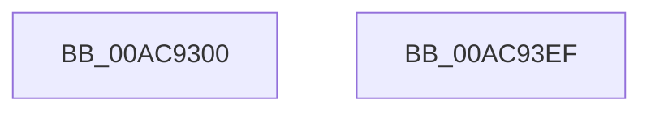

# CcAggregateCumulativeGlobalTelemetry

- RVA: `0x00AC9300`–`0x00AC93F0` (길이 `240` bytes)
- VA: `0x0000000140AC9300`
- 실행 섹션: `PAGE`
- PDB 이름 있음: `예`; PDB Function 태그: `아니요`
- unwind 정보 RVA: `0x000DB714`
- 디코드: `36`개 명령, `240/240` bytes 표시
- 미해석 바이트: `0` (있으면 어셈블리에 `.byte`로 보존)

> 이 문서는 커널 이미지의 기계어와 PDB 기호를 분석해 생성했습니다. 4번과 5번은 함수 원형과 자료형을 바이너리 사용 방식에서 추정한 C 해석이며 원본 소스 복구 결과는 아닙니다.

## 1. Dependencies

- 직접 호출 지점: **0**; 고유 호출 대상: **0**
- 직접 호출자로 확인된 함수: **1**
- RIP 상대 이미지 참조: **34**

### Outgoing calls
- 직접 디코드된 call 명령이 없습니다.

### Direct callers
- [CcPostVolumeTelemetry](../../text/42/CcPostVolumeTelemetry_function_00420FF8.md) at `0x004211D6`

### Static image references
- `0x00AC9300` → RVA `0x00F8F2B0` (`.data`; read)
- `0x00AC9307` → RVA `0x00F8F338` (`.data`; read/write)
- `0x00AC930E` → RVA `0x00F8F2B8` (`.data`; read)
- `0x00AC9315` → RVA `0x00F8F340` (`.data`; read/write)
- `0x00AC931C` → RVA `0x00F8F2C0` (`.data`; read)
- `0x00AC9323` → RVA `0x00F8F348` (`.data`; read/write)
- `0x00AC932A` → RVA `0x00F8F2C8` (`.data`; read)
- `0x00AC9331` → RVA `0x00F8F350` (`.data`; read/write)
- `0x00AC9338` → RVA `0x00F8F2D0` (`.data`; read)
- `0x00AC933F` → RVA `0x00F8F358` (`.data`; read/write)
- `0x00AC9346` → RVA `0x00F8F2D8` (`.data`; read)
- `0x00AC934D` → RVA `0x00F8F360` (`.data`; read/write)
- `0x00AC9354` → RVA `0x00F8F2E0` (`.data`; read)
- `0x00AC935B` → RVA `0x00F8F368` (`.data`; read/write)
- `0x00AC9362` → RVA `0x00F8F2E8` (`.data`; read)
- `0x00AC9369` → RVA `0x00F8F370` (`.data`; read/write)
- `0x00AC9370` → RVA `0x00F8F2F0` (`.data`; read)
- `0x00AC9377` → RVA `0x00F8F378` (`.data`; read/write)
- `0x00AC937E` → RVA `0x00F8F2F8` (`.data`; read)
- `0x00AC9385` → RVA `0x00F8F380` (`.data`; read/write)
- `0x00AC938C` → RVA `0x00F8F300` (`.data`; read)
- `0x00AC9393` → RVA `0x00F8F388` (`.data`; read/write)
- `0x00AC939A` → RVA `0x00F8F308` (`.data`; read)
- `0x00AC93A1` → RVA `0x00F8F390` (`.data`; read/write)
- `0x00AC93A8` → RVA `0x00F8F310` (`.data`; read)
- `0x00AC93AF` → RVA `0x00F8F398` (`.data`; read/write)
- `0x00AC93B6` → RVA `0x00F8F318` (`.data`; read)
- `0x00AC93BD` → RVA `0x00F8F3A0` (`.data`; read/write)
- `0x00AC93C4` → RVA `0x00F8F320` (`.data`; read)
- `0x00AC93CB` → RVA `0x00F8F3A8` (`.data`; read/write)
- `0x00AC93D2` → RVA `0x00F8F328` (`.data`; read)
- `0x00AC93D9` → RVA `0x00F8F3B0` (`.data`; read/write)
- `0x00AC93E0` → RVA `0x00F8F330` (`.data`; read)
- `0x00AC93E7` → RVA `0x00F8F3B8` (`.data`; read/write)

## 2. Other-region calls and transfers

- 다른 실행 섹션으로 향하는 call: **0**
- 별도 외부 분기/꼬리 이동을 확인하지 못했습니다.

## 3. Assembly (complete function range)

```asm
00AC9300  48 8B 05 A9 5F 4C 00            mov rax, qword ptr [rip + 0x4c5fa9]
00AC9307  48 01 05 2A 60 4C 00            add qword ptr [rip + 0x4c602a], rax
00AC930E  48 8B 05 A3 5F 4C 00            mov rax, qword ptr [rip + 0x4c5fa3]
00AC9315  48 01 05 24 60 4C 00            add qword ptr [rip + 0x4c6024], rax
00AC931C  48 8B 05 9D 5F 4C 00            mov rax, qword ptr [rip + 0x4c5f9d]
00AC9323  48 01 05 1E 60 4C 00            add qword ptr [rip + 0x4c601e], rax
00AC932A  48 8B 05 97 5F 4C 00            mov rax, qword ptr [rip + 0x4c5f97]
00AC9331  48 01 05 18 60 4C 00            add qword ptr [rip + 0x4c6018], rax
00AC9338  48 8B 05 91 5F 4C 00            mov rax, qword ptr [rip + 0x4c5f91]
00AC933F  48 01 05 12 60 4C 00            add qword ptr [rip + 0x4c6012], rax
00AC9346  48 8B 05 8B 5F 4C 00            mov rax, qword ptr [rip + 0x4c5f8b]
00AC934D  48 01 05 0C 60 4C 00            add qword ptr [rip + 0x4c600c], rax
00AC9354  48 8B 05 85 5F 4C 00            mov rax, qword ptr [rip + 0x4c5f85]
00AC935B  48 01 05 06 60 4C 00            add qword ptr [rip + 0x4c6006], rax
00AC9362  48 8B 05 7F 5F 4C 00            mov rax, qword ptr [rip + 0x4c5f7f]
00AC9369  48 01 05 00 60 4C 00            add qword ptr [rip + 0x4c6000], rax
00AC9370  48 8B 05 79 5F 4C 00            mov rax, qword ptr [rip + 0x4c5f79]
00AC9377  48 01 05 FA 5F 4C 00            add qword ptr [rip + 0x4c5ffa], rax
00AC937E  48 8B 05 73 5F 4C 00            mov rax, qword ptr [rip + 0x4c5f73]
00AC9385  48 01 05 F4 5F 4C 00            add qword ptr [rip + 0x4c5ff4], rax
00AC938C  48 8B 05 6D 5F 4C 00            mov rax, qword ptr [rip + 0x4c5f6d]
00AC9393  48 01 05 EE 5F 4C 00            add qword ptr [rip + 0x4c5fee], rax
00AC939A  48 8B 05 67 5F 4C 00            mov rax, qword ptr [rip + 0x4c5f67]
00AC93A1  48 01 05 E8 5F 4C 00            add qword ptr [rip + 0x4c5fe8], rax
00AC93A8  48 8B 05 61 5F 4C 00            mov rax, qword ptr [rip + 0x4c5f61]
00AC93AF  48 01 05 E2 5F 4C 00            add qword ptr [rip + 0x4c5fe2], rax
00AC93B6  48 8B 05 5B 5F 4C 00            mov rax, qword ptr [rip + 0x4c5f5b]
00AC93BD  48 01 05 DC 5F 4C 00            add qword ptr [rip + 0x4c5fdc], rax
00AC93C4  48 8B 05 55 5F 4C 00            mov rax, qword ptr [rip + 0x4c5f55]
00AC93CB  48 01 05 D6 5F 4C 00            add qword ptr [rip + 0x4c5fd6], rax
00AC93D2  48 8B 05 4F 5F 4C 00            mov rax, qword ptr [rip + 0x4c5f4f]
00AC93D9  48 01 05 D0 5F 4C 00            add qword ptr [rip + 0x4c5fd0], rax
00AC93E0  48 8B 05 49 5F 4C 00            mov rax, qword ptr [rip + 0x4c5f49]
00AC93E7  48 01 05 CA 5F 4C 00            add qword ptr [rip + 0x4c5fca], rax
00AC93EE  C3                              ret
00AC93EF  CC                              int3
```

## 4. C-style interpretation (structured pseudocode)

```c
__int64 __fastcall CcAggregateCumulativeGlobalTelemetry(void)
{
    return *(unsigned __int64 *)(v_rip + 5005129);
}
```

## 5. (Beta) C Style

```c
void CcAggregateCumulativeGlobalTelemetry(void)
{
    return *(uint64_t *)(v_rip + 0x4C5F49);
}
```

## 6. Execution-region graph

[열기: 2D/3D 그래프와 함수 탐색 컨트롤 패널](../../../control-panel.html?section=page&rva=0x00AC9300&view=graph)

- 2D 그래프는 위에서 아래로 흐르고, 3D 그래프는 빈 공간을 드래그해 회전합니다. Shift+드래그는 이동, 휠은 확대·축소, 함수 노드 선택은 대상 보고서 이동입니다.

### Static fallback


