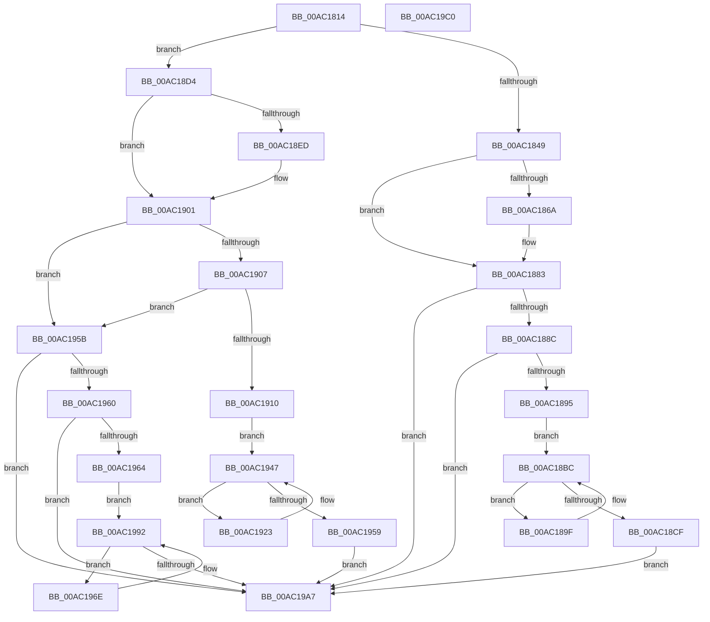

# CmFcManagerFlushFeatureUsage

- RVA: `0x00AC1814`–`0x00AC19C1` (길이 `429` bytes)
- VA: `0x0000000140AC1814`
- 실행 섹션: `PAGE`
- PDB 이름 있음: `예`; PDB Function 태그: `아니요`
- unwind 정보 RVA: `0x000BDA48`
- 디코드: `114`개 명령, `429/429` bytes 표시
- 미해석 바이트: `0` (있으면 어셈블리에 `.byte`로 보존)

> 이 문서는 커널 이미지의 기계어와 PDB 기호를 분석해 생성했습니다. 4번과 5번은 함수 원형과 자료형을 바이너리 사용 방식에서 추정한 C 해석이며 원본 소스 복구 결과는 아닙니다.

## 1. Dependencies

- 직접 호출 지점: **7**; 고유 호출 대상: **3**
- 직접 호출자로 확인된 함수: **2**
- RIP 상대 이미지 참조: **7**

### Outgoing calls
- `0x00AC185D` → [CmFcpManagerComputeMinimumFeatureUsageFlushTimestampIncrement](../70/CmFcpManagerComputeMinimumFeatureUsageFlushTimestampIncrement_function_007059D0.md) (function, `0x007059D0`)
- `0x00AC187E` → [CmpWorkItemQueueWork](../../text/37/CmpWorkItemQueueWork_function_00378D4C.md) (function, `0x00378D4C`)
- `0x00AC18B7` → [ExBlockOnAddressPushLock](../../text/2A/ExBlockOnAddressPushLock_function_002A43A0.md) (function, `0x002A43A0`)
- `0x00AC18E1` → [CmFcpManagerComputeMinimumFeatureUsageFlushTimestampIncrement](../70/CmFcpManagerComputeMinimumFeatureUsageFlushTimestampIncrement_function_007059D0.md) (function, `0x007059D0`)
- `0x00AC18FC` → [CmpWorkItemQueueWork](../../text/37/CmpWorkItemQueueWork_function_00378D4C.md) (function, `0x00378D4C`)
- `0x00AC1942` → [ExBlockOnAddressPushLock](../../text/2A/ExBlockOnAddressPushLock_function_002A43A0.md) (function, `0x002A43A0`)
- `0x00AC198D` → [ExBlockOnAddressPushLock](../../text/2A/ExBlockOnAddressPushLock_function_002A43A0.md) (function, `0x002A43A0`)

### Direct callers
- [RtlFlushFeatureUsage](../78/RtlFlushFeatureUsage_function_0078F4F0.md) at `0x0078F4F9`
- [CmFcManagerUnregisterFeatureUsageProvider](../7F/CmFcManagerUnregisterFeatureUsageProvider_function_007F4ABC.md) at `0x007F4C3B`

### Static image references
- `0x00AC182C` → RVA `0x00EF7A10` (`.data`; read)
- `0x00AC1835` → RVA `0x00EF7A14` (`.data`; read)
- `0x00AC186F` → RVA `0x00EF7A10` (`.data`; read/write)
- `0x00AC1877` → RVA `0x00EF7950` (`.data`; read)
- `0x00AC1907` → RVA `0x00EF7A38` (`.data`; read)
- `0x00AC193B` → RVA `0x00EF78B0` (`.data`; read)
- `0x00AC1986` → RVA `0x00EF78A8` (`.data`; read)

## 2. Other-region calls and transfers

- 다른 실행 섹션으로 향하는 call: **5**
  - `0x00AC187E` → [CmpWorkItemQueueWork](../../text/37/CmpWorkItemQueueWork_function_00378D4C.md) (`PAGE` → `.text`)
  - `0x00AC18B7` → [ExBlockOnAddressPushLock](../../text/2A/ExBlockOnAddressPushLock_function_002A43A0.md) (`PAGE` → `.text`)
  - `0x00AC18FC` → [CmpWorkItemQueueWork](../../text/37/CmpWorkItemQueueWork_function_00378D4C.md) (`PAGE` → `.text`)
  - `0x00AC1942` → [ExBlockOnAddressPushLock](../../text/2A/ExBlockOnAddressPushLock_function_002A43A0.md) (`PAGE` → `.text`)
  - `0x00AC198D` → [ExBlockOnAddressPushLock](../../text/2A/ExBlockOnAddressPushLock_function_002A43A0.md) (`PAGE` → `.text`)
- 별도 외부 분기/꼬리 이동을 확인하지 못했습니다.

## 3. Assembly (complete function range)

```asm
00AC1814  48 89 5C 24 08                  mov qword ptr [rsp + 8], rbx
00AC1819  48 89 6C 24 10                  mov qword ptr [rsp + 0x10], rbp
00AC181E  48 89 74 24 20                  mov qword ptr [rsp + 0x20], rsi
00AC1823  57                              push rdi
00AC1824  41 56                           push r14
00AC1826  41 57                           push r15
00AC1828  48 83 EC 30                     sub rsp, 0x30
00AC182C  8B 1D DE 61 43 00               mov ebx, dword ptr [rip + 0x4361de]
00AC1832  49 8B F0                        mov rsi, r8
00AC1835  8B 05 D9 61 43 00               mov eax, dword ptr [rip + 0x4361d9]
00AC183B  8B EA                           mov ebp, edx
00AC183D  40 B7 01                        mov dil, 1
00AC1840  4D 85 C0                        test r8, r8
00AC1843  0F 84 8B 00 00 00               je 0x140ac18d4
00AC1849  4D 8D 78 64                     lea r15, [r8 + 0x64]
00AC184D  41 8B 1F                        mov ebx, dword ptr [r15]
00AC1850  8B D3                           mov edx, ebx
00AC1852  C1 EA 03                        shr edx, 3
00AC1855  8A CB                           mov cl, bl
00AC1857  40 22 D7                        and dl, dil
00AC185A  40 22 CF                        and cl, dil
00AC185D  E8 6E 41 C4 FF                  call 0x1407059d0
00AC1862  44 8B F0                        mov r14d, eax
00AC1865  83 F8 02                        cmp eax, 2
00AC1868  72 19                           jb 0x140ac1883
00AC186A  F0 41 83 0F 02                  lock or dword ptr [r15], 2
00AC186F  F0 83 0D 99 61 43 00 08         lock or dword ptr [rip + 0x436199], 8
00AC1877  48 8D 0D D2 60 43 00            lea rcx, [rip + 0x4360d2]
00AC187E  E8 C9 74 8B FF                  call 0x140378d4c
00AC1883  40 84 EF                        test dil, bpl
00AC1886  0F 84 1B 01 00 00               je 0x140ac19a7
00AC188C  45 85 F6                        test r14d, r14d
00AC188F  0F 84 12 01 00 00               je 0x140ac19a7
00AC1895  C1 EB 03                        shr ebx, 3
00AC1898  BD FF FF FF 1F                  mov ebp, 0x1fffffff
00AC189D  EB 1D                           jmp 0x140ac18bc
00AC189F  48 83 64 24 20 00               and qword ptr [rsp + 0x20], 0
00AC18A5  4C 8D 44 24 60                  lea r8, [rsp + 0x60]
00AC18AA  41 B9 04 00 00 00               mov r9d, 4
00AC18B0  48 8D 4E 68                     lea rcx, [rsi + 0x68]
00AC18B4  49 8B D7                        mov rdx, r15
00AC18B7  E8 E4 2A 7E FF                  call 0x1402a43a0
00AC18BC  8B 46 64                        mov eax, dword ptr [rsi + 0x64]
00AC18BF  89 44 24 60                     mov dword ptr [rsp + 0x60], eax
00AC18C3  C1 E8 03                        shr eax, 3
00AC18C6  2B C3                           sub eax, ebx
00AC18C8  23 C5                           and eax, ebp
00AC18CA  41 3B C6                        cmp eax, r14d
00AC18CD  72 D0                           jb 0x140ac189f
00AC18CF  E9 D3 00 00 00                  jmp 0x140ac19a7
00AC18D4  8B D3                           mov edx, ebx
00AC18D6  8A CB                           mov cl, bl
00AC18D8  C1 EA 05                        shr edx, 5
00AC18DB  40 22 CF                        and cl, dil
00AC18DE  40 22 D7                        and dl, dil
00AC18E1  E8 EA 40 C4 FF                  call 0x1407059d0
00AC18E6  8B F0                           mov esi, eax
00AC18E8  83 F8 02                        cmp eax, 2
00AC18EB  72 14                           jb 0x140ac1901
00AC18ED  F0 83 0D 1B 61 43 00 10         lock or dword ptr [rip + 0x43611b], 0x10
00AC18F5  48 8D 0D 54 60 43 00            lea rcx, [rip + 0x436054]
00AC18FC  E8 4B 74 8B FF                  call 0x140378d4c
00AC1901  40 F6 C5 02                     test bpl, 2
00AC1905  74 54                           je 0x140ac195b
00AC1907  80 3D 2A 61 43 00 00            cmp byte ptr [rip + 0x43612a], 0
00AC190E  74 4B                           je 0x140ac195b
00AC1910  C1 EB 05                        shr ebx, 5
00AC1913  BF FF FF FF 07                  mov edi, 0x7ffffff
00AC1918  03 DE                           add ebx, esi
00AC191A  BE 00 00 00 04                  mov esi, 0x4000000
00AC191F  23 DF                           and ebx, edi
00AC1921  EB 24                           jmp 0x140ac1947
00AC1923  48 83 64 24 20 00               and qword ptr [rsp + 0x20], 0
00AC1929  4C 8D 44 24 60                  lea r8, [rsp + 0x60]
00AC192E  41 B9 04 00 00 00               mov r9d, 4
00AC1934  48 8D 15 D9 60 43 00            lea rdx, [rip + 0x4360d9]
00AC193B  48 8D 0D 6E 5F 43 00            lea rcx, [rip + 0x435f6e]
00AC1942  E8 59 2A 7E FF                  call 0x1402a43a0
00AC1947  8B 05 C7 60 43 00               mov eax, dword ptr [rip + 0x4360c7]
00AC194D  89 44 24 60                     mov dword ptr [rsp + 0x60], eax
00AC1951  2B C3                           sub eax, ebx
00AC1953  23 C7                           and eax, edi
00AC1955  3B C6                           cmp eax, esi
00AC1957  73 CA                           jae 0x140ac1923
00AC1959  EB 4C                           jmp 0x140ac19a7
00AC195B  40 84 EF                        test dil, bpl
00AC195E  74 47                           je 0x140ac19a7
00AC1960  85 F6                           test esi, esi
00AC1962  74 43                           je 0x140ac19a7
00AC1964  C1 EB 05                        shr ebx, 5
00AC1967  BF FF FF FF 07                  mov edi, 0x7ffffff
00AC196C  EB 24                           jmp 0x140ac1992
00AC196E  48 83 64 24 20 00               and qword ptr [rsp + 0x20], 0
00AC1974  4C 8D 44 24 60                  lea r8, [rsp + 0x60]
00AC1979  41 B9 04 00 00 00               mov r9d, 4
00AC197F  48 8D 15 8A 60 43 00            lea rdx, [rip + 0x43608a]
00AC1986  48 8D 0D 1B 5F 43 00            lea rcx, [rip + 0x435f1b]
00AC198D  E8 0E 2A 7E FF                  call 0x1402a43a0
00AC1992  8B 05 78 60 43 00               mov eax, dword ptr [rip + 0x436078]
00AC1998  89 44 24 60                     mov dword ptr [rsp + 0x60], eax
00AC199C  C1 E8 05                        shr eax, 5
00AC199F  2B C3                           sub eax, ebx
00AC19A1  23 C7                           and eax, edi
00AC19A3  3B C6                           cmp eax, esi
00AC19A5  72 C7                           jb 0x140ac196e
00AC19A7  48 8B 5C 24 50                  mov rbx, qword ptr [rsp + 0x50]
00AC19AC  48 8B 6C 24 58                  mov rbp, qword ptr [rsp + 0x58]
00AC19B1  48 8B 74 24 68                  mov rsi, qword ptr [rsp + 0x68]
00AC19B6  48 83 C4 30                     add rsp, 0x30
00AC19BA  41 5F                           pop r15
00AC19BC  41 5E                           pop r14
00AC19BE  5F                              pop rdi
00AC19BF  C3                              ret
00AC19C0  CC                              int3
```

## 4. C-style interpretation (structured pseudocode)

```c
__int64 __fastcall CmFcManagerFlushFeatureUsage(__int64 a1, int a2, __int64 a3)
{
    __int64 result;
    __int64 v_rbx;
    __int64 v_rsp;
    unsigned __int64 v_stack_m28;
    unsigned __int64 v_stack_p10;
    unsigned __int64 v_stack_p18;
    unsigned __int64 v_stack_p20;
    unsigned __int64 v_stack_p8;

    v_stack_p8 = v_rbx;
    v_stack_p10 = v_rbp;
    v_stack_p20 = v_rsi;
    v_rsp = (v_rsp) - (48);
    if (a3 == 0) goto loc_00AC18D4;
    a2 = (unsigned int)(((unsigned int)((unsigned int)((unsigned int)(*(unsigned int *)(a3 + 100))))) >> (3));
    a2 = (unsigned __int8)((a2) & (1));
    a1 = (unsigned __int8)(((unsigned __int8)((unsigned int)(*(unsigned int *)(a3 + 100)))) & (1));
    result = CmFcpManagerComputeMinimumFeatureUsageFlushTimestampIncrement(a1, a2, a3, a4);
    if (((unsigned int)(result)) >= 2) {
        a1 = v_rip + 4415698;
        result = CmpWorkItemQueueWork(a1, a2, a3, a4);
    }
    if (((1) & ((unsigned __int8)((unsigned int)(a2)))) == 0) goto loc_00AC19A7;
    if ((unsigned int)((unsigned int)((unsigned int)(result))) == 0) goto loc_00AC19A7;
    v_rbx = (unsigned int)(((unsigned int)(*(unsigned int *)(a3 + 100))) >> (3));
    goto loc_00AC18BC;
loc_00AC189F:
    result = ExBlockOnAddressPushLock(a3 + 104, a3 + 100, v_stack_p18, 4);
loc_00AC18BC:
    v_stack_p18 = (unsigned int)((unsigned int)(*(unsigned int *)(a3 + 100)));
    result = (unsigned int)(((unsigned int)(*(unsigned int *)(a3 + 100))) >> (3));
    result = (unsigned int)((result) - ((unsigned int)(v_rbx)));
    result = (unsigned int)((result) & ((unsigned int)((unsigned int)(0x1FFFFFFFULL))));
    if (((unsigned int)(result)) < ((unsigned int)((unsigned int)((unsigned int)(result))))) goto loc_00AC189F;
    goto loc_00AC19A7;
loc_00AC18D4:
    a2 = (unsigned int)(((unsigned int)((unsigned int)(v_rbx))) >> (5));
    a1 = (unsigned __int8)(((unsigned __int8)(v_rbx)) & (1));
    a2 = (unsigned __int8)((a2) & (1));
    result = CmFcpManagerComputeMinimumFeatureUsageFlushTimestampIncrement(a1, a2, v_stack_p18, 4);
    if (((unsigned int)(result)) >= 2) {
        a1 = v_rip + 4415572;
        result = CmpWorkItemQueueWork(a1, a2, v_stack_p18, 4);
    }
    if ((((unsigned __int8)((unsigned int)(0x1FFFFFFFULL))) & (2)) == 0) goto loc_00AC195B;
    if ((*(unsigned __int8 *)(v_rip + 4415786)) == 0) goto loc_00AC195B;
    v_rbx = (unsigned int)((v_rbx) >> (5));
    v_rbx = (unsigned int)((v_rbx) + ((unsigned int)((unsigned int)((unsigned int)(result)))));
    v_rbx = (unsigned int)((v_rbx) & ((unsigned int)((unsigned int)(0x7FFFFFFULL))));
    goto loc_00AC1947;
loc_00AC1923:
    result = ExBlockOnAddressPushLock(v_rip + 4415342, v_rip + 4415705, v_stack_p18, 4);
loc_00AC1947:
    v_stack_p18 = (unsigned int)((unsigned int)(*(unsigned int *)(v_rip + 4415687)));
    result = (unsigned int)(((unsigned int)(*(unsigned int *)(v_rip + 4415687))) - ((unsigned int)(v_rbx)));
    result = (unsigned int)((result) & ((unsigned int)((unsigned int)(0x7FFFFFFULL))));
    if (((unsigned int)(result)) >= ((unsigned int)((unsigned int)(0x4000000ULL)))) goto loc_00AC1923;
    goto loc_00AC19A7;
loc_00AC195B:
    if ((((unsigned __int8)((unsigned int)(0x7FFFFFFULL))) & ((unsigned __int8)((unsigned int)(0x1FFFFFFFULL)))) == 0) goto loc_00AC19A7;
    if ((unsigned int)((unsigned int)(0x4000000ULL)) == 0) goto loc_00AC19A7;
    v_rbx = (unsigned int)((v_rbx) >> (5));
    goto loc_00AC1992;
loc_00AC196E:
    result = ExBlockOnAddressPushLock(v_rip + 4415259, v_rip + 4415626, v_stack_p18, 4);
loc_00AC1992:
    v_stack_p18 = (unsigned int)((unsigned int)(*(unsigned int *)(v_rip + 4415608)));
    result = (unsigned int)(((unsigned int)(*(unsigned int *)(v_rip + 4415608))) >> (5));
    result = (unsigned int)((result) - ((unsigned int)(v_rbx)));
    result = (unsigned int)((result) & ((unsigned int)((unsigned int)(0x7FFFFFFULL))));
    if (((unsigned int)(result)) < ((unsigned int)((unsigned int)(0x4000000ULL)))) goto loc_00AC196E;
loc_00AC19A7:
    v_rsp = (v_rsp) + (48);
    return result;
}
```

## 5. (Beta) C Style

```c
int64_t CmFcManagerFlushFeatureUsage(int64_t Arg1, int32_t Arg2, void *Arg3)
{
    uint8_t *arg3 = (uint8_t *)Arg3;

    int64_t result;
    int64_t local_rbx;
    int64_t local_rsp;
    uint64_t v_stack_m28;
    uint64_t v_stack_p10;
    uint64_t v_stack_p18;
    uint64_t v_stack_p20;
    uint64_t v_stack_p8;

    v_stack_p8 = local_rbx;
    v_stack_p10 = local_rbp;
    v_stack_p20 = local_rsi;
    local_rsp = (local_rsp) - (48);
    if (Arg3 == NULL) goto loc_00AC18D4;
    Arg2 = (uint32_t)(((uint32_t)((uint32_t)((uint32_t)(*(uint32_t *)(arg3 + 0x64))))) >> (3));
    Arg2 = (uint8_t)((Arg2) & (1));
    Arg1 = (uint8_t)(((uint8_t)((uint32_t)(*(uint32_t *)(arg3 + 0x64)))) & (1));
    result = CmFcpManagerComputeMinimumFeatureUsageFlushTimestampIncrement(Arg1, Arg2, Arg3, a4);
    if (((uint32_t)(result)) >= 2) {
        Arg1 = v_rip + 4415698;
        result = CmpWorkItemQueueWork(Arg1, Arg2, Arg3, a4);
    }
    if (((1) & ((uint8_t)((uint32_t)(Arg2)))) == 0) goto loc_00AC19A7;
    if ((uint32_t)((uint32_t)((uint32_t)(result))) == 0) goto loc_00AC19A7;
    local_rbx = (uint32_t)(((uint32_t)(*(uint32_t *)(arg3 + 0x64))) >> (3));
    goto loc_00AC18BC;
loc_00AC189F:
    result = ExBlockOnAddressPushLock(Arg3 + 104, Arg3 + 100, v_stack_p18, 4);
loc_00AC18BC:
    v_stack_p18 = (uint32_t)((uint32_t)(*(uint32_t *)(arg3 + 0x64)));
    result = (uint32_t)(((uint32_t)(*(uint32_t *)(arg3 + 0x64))) >> (3));
    result = (uint32_t)((result) - ((uint32_t)(local_rbx)));
    result = (uint32_t)((result) & ((uint32_t)((uint32_t)(0x1FFFFFFFULL))));
    if (((uint32_t)(result)) < ((uint32_t)((uint32_t)((uint32_t)(result))))) goto loc_00AC189F;
    goto loc_00AC19A7;
loc_00AC18D4:
    Arg2 = (uint32_t)(((uint32_t)((uint32_t)(local_rbx))) >> (5));
    Arg1 = (uint8_t)(((uint8_t)(local_rbx)) & (1));
    Arg2 = (uint8_t)((Arg2) & (1));
    result = CmFcpManagerComputeMinimumFeatureUsageFlushTimestampIncrement(Arg1, Arg2, v_stack_p18, 4);
    if (((uint32_t)(result)) >= 2) {
        Arg1 = v_rip + 4415572;
        result = CmpWorkItemQueueWork(Arg1, Arg2, v_stack_p18, 4);
    }
    if ((((uint8_t)((uint32_t)(0x1FFFFFFFULL))) & (2)) == 0) goto loc_00AC195B;
    if ((*(uint8_t *)(v_rip + 0x43612A)) == 0) goto loc_00AC195B;
    local_rbx = (uint32_t)((local_rbx) >> (5));
    local_rbx = (uint32_t)((local_rbx) + ((uint32_t)((uint32_t)((uint32_t)(result)))));
    local_rbx = (uint32_t)((local_rbx) & ((uint32_t)((uint32_t)(0x7FFFFFFULL))));
    goto loc_00AC1947;
loc_00AC1923:
    result = ExBlockOnAddressPushLock(v_rip + 4415342, v_rip + 4415705, v_stack_p18, 4);
loc_00AC1947:
    v_stack_p18 = (uint32_t)((uint32_t)(*(uint32_t *)(v_rip + 0x4360C7)));
    result = (uint32_t)(((uint32_t)(*(uint32_t *)(v_rip + 0x4360C7))) - ((uint32_t)(local_rbx)));
    result = (uint32_t)((result) & ((uint32_t)((uint32_t)(0x7FFFFFFULL))));
    if (((uint32_t)(result)) >= ((uint32_t)((uint32_t)(0x4000000ULL)))) goto loc_00AC1923;
    goto loc_00AC19A7;
loc_00AC195B:
    if ((((uint8_t)((uint32_t)(0x7FFFFFFULL))) & ((uint8_t)((uint32_t)(0x1FFFFFFFULL)))) == 0) goto loc_00AC19A7;
    if ((uint32_t)((uint32_t)(0x4000000ULL)) == 0) goto loc_00AC19A7;
    local_rbx = (uint32_t)((local_rbx) >> (5));
    goto loc_00AC1992;
loc_00AC196E:
    result = ExBlockOnAddressPushLock(v_rip + 4415259, v_rip + 4415626, v_stack_p18, 4);
loc_00AC1992:
    v_stack_p18 = (uint32_t)((uint32_t)(*(uint32_t *)(v_rip + 0x436078)));
    result = (uint32_t)(((uint32_t)(*(uint32_t *)(v_rip + 0x436078))) >> (5));
    result = (uint32_t)((result) - ((uint32_t)(local_rbx)));
    result = (uint32_t)((result) & ((uint32_t)((uint32_t)(0x7FFFFFFULL))));
    if (((uint32_t)(result)) < ((uint32_t)((uint32_t)(0x4000000ULL)))) goto loc_00AC196E;
loc_00AC19A7:
    local_rsp = (local_rsp) + (48);
    return result;
}
```

### 관측된 메모리 오프셋

구조체 형식이 확인되지 않은 접근은 인자 기준의 오프셋으로만 기록했습니다.

| 기준 인자 | 오프셋 표현 | 폭 (bit) | 접근 |
|---|---:|---:|---|
| `Arg3` | `+ 0x64` | `32` | `R` |
| `Arg3` | `+ 0x68` | `64` | `R` |

## 6. Execution-region graph

[열기: 2D/3D 그래프와 함수 탐색 컨트롤 패널](../../../control-panel.html?section=page&rva=0x00AC1814&view=graph)

- 2D 그래프는 위에서 아래로 흐르고, 3D 그래프는 빈 공간을 드래그해 회전합니다. Shift+드래그는 이동, 휠은 확대·축소, 함수 노드 선택은 대상 보고서 이동입니다.

### Static fallback


