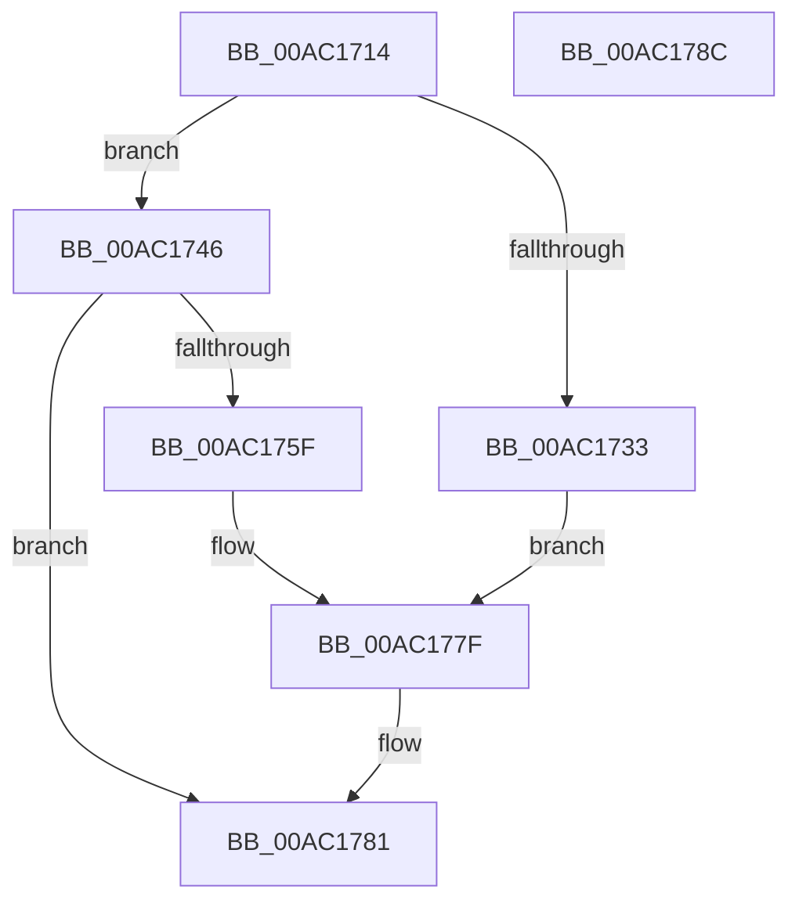

# CmFcpMapSection

- RVA: `0x00AC1714`–`0x00AC178D` (길이 `121` bytes)
- VA: `0x0000000140AC1714`
- 실행 섹션: `PAGE`
- PDB 이름 있음: `예`; PDB Function 태그: `아니요`
- unwind 정보 RVA: `0x00068D5C`
- 디코드: `35`개 명령, `121/121` bytes 표시
- 미해석 바이트: `0` (있으면 어셈블리에 `.byte`로 보존)

> 이 문서는 커널 이미지의 기계어와 PDB 기호를 분석해 생성했습니다. 4번과 5번은 함수 원형과 자료형을 바이너리 사용 방식에서 추정한 C 해석이며 원본 소스 복구 결과는 아닙니다.

## 1. Dependencies

- 직접 호출 지점: **1**; 고유 호출 대상: **1**
- 직접 호출자로 확인된 함수: **5**
- RIP 상대 이미지 참조: **0**

### Outgoing calls
- `0x00AC1756` → [MmMapViewInSessionSpace](../98/MmMapViewInSessionSpace_function_00982480.md) (function, `0x00982480`)

### Direct callers
- [CmFcManagerOverwriteFeatureConfigurationSection](../7F/CmFcManagerOverwriteFeatureConfigurationSection_function_007F4450.md) at `0x007F46DD`
- [CmFcManagerOverwriteFeatureConfigurationSection](../7F/CmFcManagerOverwriteFeatureConfigurationSection_function_007F4450.md) at `0x007F472E`
- [CmFcManagerUpdateFeatureConfigurations](../7F/CmFcManagerUpdateFeatureConfigurations_function_007F4CF4.md) at `0x007F4F08`
- [CmFcManagerUpdateFeatureConfigurations](../7F/CmFcManagerUpdateFeatureConfigurations_function_007F4CF4.md) at `0x007F501E`
- [CmFcpManagerCreateSectionFromBuffer](../7F/CmFcpManagerCreateSectionFromBuffer_function_007F5438.md) at `0x007F5493`
- [sub_00B3AEBA](../B3/Unknown_function_00B3AEBA.md) at `0x00B3AEF1`
- [CmFcManagerStartRuntimePhase](../../init/C5/CmFcManagerStartRuntimePhase_function_00C5DC70.md) at `0x00C5DE3A`

### Static image references
- 디코드된 RIP-relative 메모리 참조가 없습니다.

## 2. Other-region calls and transfers

- 다른 실행 섹션으로 향하는 call: **0**
- 별도 외부 분기/꼬리 이동을 확인하지 못했습니다.

## 3. Assembly (complete function range)

```asm
00AC1714  48 89 5C 24 10                  mov qword ptr [rsp + 0x10], rbx
00AC1719  57                              push rdi
00AC171A  48 83 EC 20                     sub rsp, 0x20
00AC171E  48 83 64 24 30 00               and qword ptr [rsp + 0x30], 0
00AC1724  48 8B F9                        mov rdi, rcx
00AC1727  48 8B 49 08                     mov rcx, qword ptr [rcx + 8]
00AC172B  48 8B DA                        mov rbx, rdx
00AC172E  48 85 C9                        test rcx, rcx
00AC1731  75 13                           jne 0x140ac1746
00AC1733  48 21 0A                        and qword ptr [rdx], rcx
00AC1736  48 21 4A 08                     and qword ptr [rdx + 8], rcx
00AC173A  48 21 4A 10                     and qword ptr [rdx + 0x10], rcx
00AC173E  48 8B 07                        mov rax, qword ptr [rdi]
00AC1741  48 89 02                        mov qword ptr [rdx], rax
00AC1744  EB 39                           jmp 0x140ac177f
00AC1746  48 83 64 24 40 00               and qword ptr [rsp + 0x40], 0
00AC174C  4C 8D 44 24 40                  lea r8, [rsp + 0x40]
00AC1751  48 8D 54 24 30                  lea rdx, [rsp + 0x30]
00AC1756  E8 25 0D EC FF                  call 0x140982480
00AC175B  85 C0                           test eax, eax
00AC175D  78 22                           js 0x140ac1781
00AC175F  48 83 23 00                     and qword ptr [rbx], 0
00AC1763  48 83 63 10 00                  and qword ptr [rbx + 0x10], 0
00AC1768  48 8B 44 24 30                  mov rax, qword ptr [rsp + 0x30]
00AC176D  48 89 43 08                     mov qword ptr [rbx + 8], rax
00AC1771  48 8B 47 10                     mov rax, qword ptr [rdi + 0x10]
00AC1775  48 89 43 10                     mov qword ptr [rbx + 0x10], rax
00AC1779  48 8B 07                        mov rax, qword ptr [rdi]
00AC177C  48 89 03                        mov qword ptr [rbx], rax
00AC177F  33 C0                           xor eax, eax
00AC1781  48 8B 5C 24 38                  mov rbx, qword ptr [rsp + 0x38]
00AC1786  48 83 C4 20                     add rsp, 0x20
00AC178A  5F                              pop rdi
00AC178B  C3                              ret
00AC178C  CC                              int3
```

## 4. C-style interpretation (structured pseudocode)

```c
__int64 __fastcall CmFcpMapSection(__int64 a1, __int64 a2)
{
    __int64 result;
    __int64 v_rsp;
    unsigned __int64 v_stack_p10;
    unsigned __int64 v_stack_p18;
    unsigned __int64 v_stack_p8;

    v_stack_p10 = v_rbx;
    v_rsp = (v_rsp) - (32);
    if (*(unsigned __int64 *)(a1 + 8) != 0) goto loc_00AC1746;
    *(unsigned __int64 *)(a2) = *(unsigned __int64 *)(a1);
    goto loc_00AC177F;
loc_00AC1746:
    result = MmMapViewInSessionSpace(*(unsigned __int64 *)(a1 + 8), v_stack_p8, v_stack_p18, a4);
    if (sign_flag) goto loc_00AC1781;
    *(unsigned __int64 *)(a2 + 8) = v_stack_p8;
    *(unsigned __int64 *)(a2 + 16) = *(unsigned __int64 *)(a1 + 16);
    *(unsigned __int64 *)(a2) = *(unsigned __int64 *)(a1);
loc_00AC177F:
    result = 0;
loc_00AC1781:
    v_rsp = (v_rsp) + (32);
    return result;
}
```

## 5. (Beta) C Style

```c
int64_t CmFcpMapSection(void *Arg1, void *Arg2)
{
    uint8_t *arg1 = (uint8_t *)Arg1;
    uint8_t *arg2 = (uint8_t *)Arg2;

    int64_t result;
    int64_t local_rsp;
    uint64_t v_stack_p10;
    uint64_t v_stack_p18;
    uint64_t v_stack_p8;

    v_stack_p10 = local_rbx;
    local_rsp = (local_rsp) - (32);
    if (*(uint64_t *)(arg1 + 0x8) != 0) goto loc_00AC1746;
    *(uint64_t *)(arg2) = *(uint64_t *)(arg1);
    goto loc_00AC177F;
loc_00AC1746:
    result = MmMapViewInSessionSpace(*(uint64_t *)(arg1 + 0x8), v_stack_p8, v_stack_p18, a4);
    if (sign_flag) goto loc_00AC1781;
    *(uint64_t *)(arg2 + 0x8) = v_stack_p8;
    *(uint64_t *)(arg2 + 0x10) = *(uint64_t *)(arg1 + 0x10);
    *(uint64_t *)(arg2) = *(uint64_t *)(arg1);
loc_00AC177F:
    result = 0;
loc_00AC1781:
    local_rsp = (local_rsp) + (32);
    return result;
}
```

### 관측된 메모리 오프셋

구조체 형식이 확인되지 않은 접근은 인자 기준의 오프셋으로만 기록했습니다.

| 기준 인자 | 오프셋 표현 | 폭 (bit) | 접근 |
|---|---:|---:|---|
| `Arg1` | `+ 0x0` | `64` | `R` |
| `Arg1` | `+ 0x8` | `64` | `R` |
| `Arg1` | `+ 0x10` | `64` | `R` |
| `Arg2` | `+ 0x0` | `64` | `R/W` |
| `Arg2` | `+ 0x0` | `64` | `W` |
| `Arg2` | `+ 0x8` | `64` | `R/W` |
| `Arg2` | `+ 0x8` | `64` | `W` |
| `Arg2` | `+ 0x10` | `64` | `R/W` |
| `Arg2` | `+ 0x10` | `64` | `W` |

## 6. Execution-region graph

[열기: 2D/3D 그래프와 함수 탐색 컨트롤 패널](../../../control-panel.html?section=page&rva=0x00AC1714&view=graph)

- 2D 그래프는 위에서 아래로 흐르고, 3D 그래프는 빈 공간을 드래그해 회전합니다. Shift+드래그는 이동, 휠은 확대·축소, 함수 노드 선택은 대상 보고서 이동입니다.

### Static fallback


